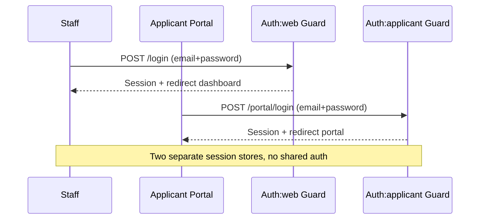
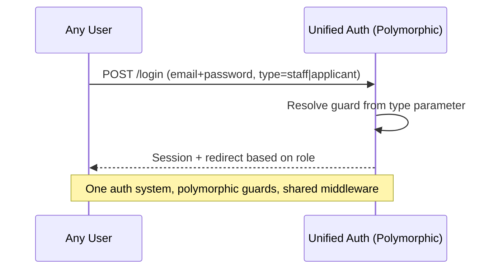
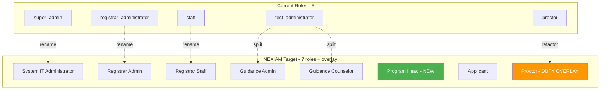
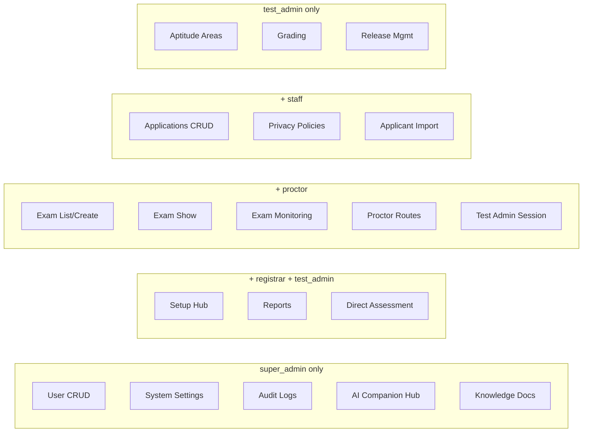
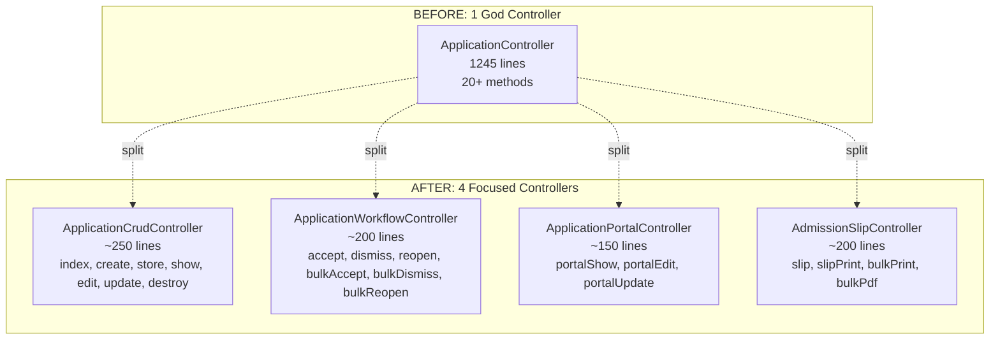
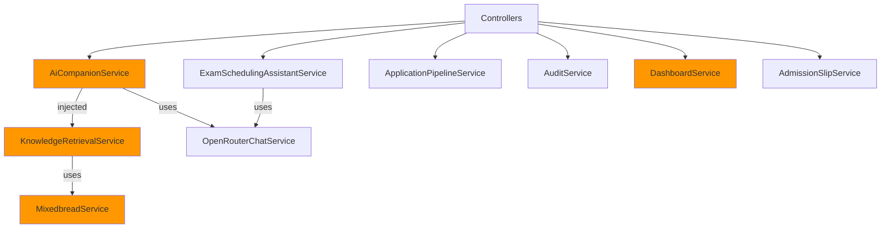
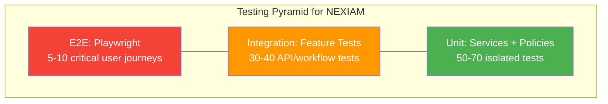
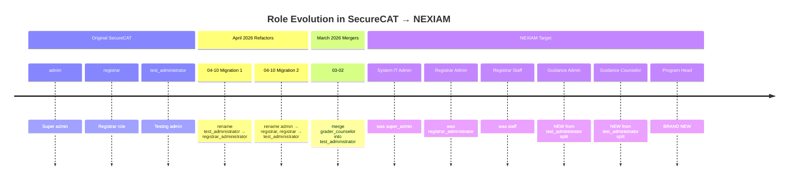

# NEXIAM Architecture Audit Report

**Date:** 2026-07-27  
**Codebase:** ~/Projects/NEXIAM (Laravel 12 + Inertia 2 + Svelte 5 + Tailwind 4)  
**Predecessor:** SecureCAT-v2  
**Scope:** 34 services, 41 controllers, 25 models, 81 Svelte pages, 50+ migrations  
**Test Coverage:** 0% (no tests/ directory)  

---

## Executive Summary

### Findings by Severity

| Severity | Count | Critical Issues |
|---|---|---|
| 🔴 Critical | 7 | Zero tests, God controllers, N+1 queries, Proctor role bug, Hardcoded AI fallback, Dual auth duplication, 806-line Svelte monster |
| 🟡 Medium | 8 | DB::table bypass, shallow services, role rename confusion, missing FK constraints, no HMAC chaining, no error monitoring, no API versioning, inconsistent return types |
| 🟢 Low / Good | 5 | DB-driven roles, deep modules (PipelineService, AuditService), security guards on AI, clean migration hygiene, well-structured Svelte UI kit |

### Top 5 Priority Fixes

1. 🔴 **P0 — Zero automated tests** (100+ routes, 0 test coverage)
2. 🔴 **P0 — 1245-line ApplicationController** (SRP violation — 20+ methods)
3. 🔴 **P0 — 37 N+1 queries in ExamSessionController**
4. 🔴 **P0 — Proctor as permanent role, not duty overlay** (architectural mismatch with NEXIAM scope)
5. 🔴 **P0 — Hardcoded AI model fallback** (AiCompanionService line 251)

---

## Section 1: Auth Architecture — Dual Guard System

### Finding 1.1: Split-Personality Auth Guards
**Severity:** 🔴 Critical  
**Files:** `config/auth.php`, `routes/web.php`, `app/Http/Controllers/AuthController.php`, `app/Http/Controllers/PortalAuthController.php`

**What's Wrong:**
The system uses TWO completely separate authentication guards — `web` (User model for staff) and `applicant` (Applicant model for portal users). Each guard has its own login controller, logout, password reset, token setup, and session management. This creates duplication across auth flows and means the `auth` middleware can't protect both user types.

**Current Flow:**


**Proposed Unification:**


**Code Evidence:**
- `config/auth.php` lines 41-50: Two guards with separate providers
- `config/auth.php` lines 69-78: Two providers (User model, Applicant model)
- `routes/web.php` lines 97-328: Staff routes use `auth` middleware (web guard)
- `routes/web.php` lines 68-95: Portal routes use `auth:applicant` middleware
- PortalAuthController: Separate login, logout, password reset, token setup
- AuthController: Separate login, logout

**Recommendation:**
Keep two guards (separation of concerns is valid), but introduce a shared `Authenticated` interface or trait to reduce duplication. Consider a single auth controller with guard resolution based on route prefix.

**Learning Note:** Two separate auth guards is a legitimate pattern when you have fundamentally different user types with different session requirements. The key question is: do they share enough behavior to justify unification? Here, both have login/logout/password-reset — that's enough duplication to warrant a shared base. The SOLID principle at play is DRY (Don't Repeat Yourself).

---

### Finding 1.2: Portal Token-Based Setup Without Expiry Enforcement
**Severity:** 🟡 Medium  
**Files:** `app/Http/Controllers/PortalAuthController.php`, `config/auth.php`

**What's Wrong:**
The portal uses token-based account setup (`/portal/setup/{token}`) with configurable expiry (72 hours by default). However, the expiry is only checked in the controller — there's no database-level enforcement (no `expires_at` column constraint).

**Recommendation:** Add an `expires_at` timestamp column to the applicants table and enforce it at the query level, not just in application logic.

**Learning Note:** Defense in depth: always enforce constraints at the database level, not just in application code. If someone bypasses the controller, the token should still be invalid.

---

## Section 2: RBAC Architecture — Database-Driven Roles

### Finding 2.1: Roles Are Database-Driven (Good!)
**Severity:** 🟢 Good  
**Files:** `app/Models/Role.php`, `app/Models/User.php`, `app/Http/Middleware/EnsureUserHasRole.php`

**What's Working:**
- Roles stored in `roles` table with `role_user` pivot
- `User::assignRole()` uses `Role::firstOrCreate()` — new roles can be added without code changes
- `EnsureUserHasRole` middleware accepts variadic role names
- Adding NEXIAM's 7+ roles requires NO code changes — just INSERT into roles table

**Current vs Target:**


### Finding 2.2: Proctor Is a Role, Not a Duty Overlay
**Severity:** 🔴 Critical  
**Files:** `routes/web.php` lines 155, 162, 185, 255-256, 266

**What's Wrong:**
Proctor is treated as a PERMANENT ROLE checked via `role:super_admin,registrar_administrator,proctor,test_administrator` middleware. NEXIAM's scope explicitly defines proctor as a DUTY OVERLAY — any staff member can be assigned proctor duties for a specific exam session temporarily, without changing their permanent role.

**Current routing:** `role:super_admin,registrar_administrator,proctor,test_administrator`  
**NEXIAM requirement:** Proctor = session-level assignment via `exam_session_user` pivot, not a role

**Code Evidence:**
Routes with proctor role checks:
- Line 155: `role:super_admin,registrar_administrator,test_administrator,proctor` (exam scheduling)
- Line 162: `role:super_admin,test_administrator,proctor` (exam monitoring)
- Line 185: `role:super_admin,registrar_administrator,test_administrator,proctor` (show session)
- Line 255: `role:super_admin,proctor` (proctor redirect)
- Line 256: `role:super_admin,registrar_administrator,proctor,test_administrator` (proctor routes)

**Recommendation:**
Remove proctor from ALL role middleware checks. Add a session-level policy that checks `exam_session_user` pivot. Create a `ProctorPolicy` that authorizes based on session assignment, not role.

**Learning Note:** Role vs. Duty Overlay is an architectural decision about authorization granularity. A role is permanent (e.g., "Guidance Counselor"). A duty overlay is temporary and contextual (e.g., "Proctor for Exam Session #42"). Mixing them forces you to assign permanent permissions for temporary needs — a security anti-pattern.

### Finding 2.3: Role Renaming History Is Confusing
**Severity:** 🟡 Medium  
**Files:** `database/migrations/2026_04_10_*.php`

**History:**
1. `2026_04_10_082811`: rename test_administrator → registrar_administrator
2. `2026_04_10_112006`: rename admin → registrar AND registrar → test_administrator
3. `2026_03_02_000001`: merge grader_counselor into test_administrator

The naming has gone through 3+ renames. Current names don't match NEXIAM terminology at all. The `test_administrator` role is actually the "testing administrator" — NEXIAM calls this "Guidance Administrator" and "Guidance Counselor".

**Recommendation:** During NEXIAM refactor, drop old migrations, create a clean migration that renames to NEXIAM terminology: `test_administrator` → `guidance_administrator`, add `guidance_counselor`, add `program_head`.

---

## Section 3: Route Architecture — Auth Gate Fragmentation

### Finding 3.1: 12 Separate Role Middleware Groups
**Severity:** 🟡 Medium  
**Files:** `routes/web.php` (328 lines)

**What's Wrong:**
The routes file contains 12 separate `role:` middleware groups with slightly different role combinations. This makes it hard to understand who can access what without tracing through the entire file.

**Role Group Map:**


**Recommendation:** Replace 12 role groups with 3-4 role groups using Policy-based authorization. Route middleware should only check "is authenticated" — authorization logic belongs in Policies.

---

## Section 4: Controller Fatness — The God Controller Problem

### Finding 4.1: 1245-Line ApplicationController
**Severity:** 🔴 Critical  
**Files:** `app/Http/Controllers/ApplicationController.php` (1245 lines)

**Methods (20+):**
`index`, `create`, `store`, `storeAdmin`, `show`, `edit`, `update`, `updateAdmin`, `portalShow`, `portalEdit`, `portalUpdate`, `accept`, `dismiss`, `reopen`, `bulkAccept`, `bulkDismiss`, `bulkReopen`, `destroy`, `resendSetupEmail`, `admissionSlip`, `admissionSlipPrint`, `admissionSlipBulkPrint`, `admissionSlipBulkPdf`

This single controller handles:
- Public application submission
- Staff CRUD operations  
- Portal views for applicants
- Workflow state transitions (accept/dismiss/reopen)
- Bulk operations
- Admission slip generation (single + bulk + PDF)

**Proposed Decomposition:**


**Learning Note:** The Single Responsibility Principle (SRP) states that a class should have only one reason to change. ApplicationController has 4+ distinct reasons (CRUD, workflow, portal views, document generation). Each change risk affects unrelated functionality. Decomposition isolates risk.

### Finding 4.2: 1012-Line ExamSessionController with 37 N+1 Queries
**Severity:** 🔴 Critical  
**Files:** `app/Http/Controllers/Admin/ExamSessionController.php` (1012 lines)

**N+1 Scan Results (top offenders):**

| Controller | N+1 Count | Lines |
|---|---|---|
| ExamSessionController | 37 | 1012 |
| ApplicationController | 16 | 1245 |
| ReleasePrintController | 14 | — |
| ExamSchedulingAssistantController | 11 | — |
| SessionRosterController | 10 | — |

**Example N+1 Pattern (pseudocode from ExamSessionController):**
```php
// BAD: 37 queries for 1 session + N applicants
$sessions = ExamSession::all();
foreach ($sessions as $session) {
    $applicants = $session->applicants()->get();  // N+1!
    foreach ($applicants as $applicant) {
        $scores = $applicant->scores()->get();      // N+1 inside N+1!
    }
}

// GOOD: 2 queries
$sessions = ExamSession::with(['applicants.scores'])->get();
```

**Learning Note:** N+1 queries are the most common performance anti-pattern in ORM-based applications. Each loop iteration triggers a separate database query. For 100 sessions with 20 applicants each, that's 2001 queries instead of 2. Fix with eager loading (`with()`, `load()`).

---

## Section 5: Service Layer Deep-Dive

### Finding 5.1: Service Classification

| Service | Depth | Testability | Responsibility |
|---|---|---|---|
| ApplicationPipelineService | 🟢 Deep | ✅ Accepts deps | State machine — single concern |
| AuditService | 🟢 Deep | ⚠️ Static methods | Event logging — well-structured |
| AiCompanionService | 🟡 Medium | ❌ Creates deps internally | AI chat + RAG + security |
| ExamSchedulingAssistantService | 🟢 Deep | ✅ Accepts deps | AI scheduling — well-isolated |
| DashboardService | 🟡 Medium | ❌ Creates deps | KPI aggregation |
| KnowledgeRetrievalService | 🟡 Medium | ❌ Creates deps | Vector search + fallback |
| AdmissionSlipService | 🟡 Medium | ❌ Creates deps | PDF generation |
| DocxMergeService | 🟢 Deep | ✅ Accepts deps | Document manipulation |
| FormulaEvaluator | 🟢 Deep | ✅ Accepts deps | Expression parsing |
| ScoreImportService | 🟡 Medium | ❌ Creates deps | CSV parsing + validation |
| CsvToNarrativeService | 🟡 Medium | ❌ Creates deps | Format conversion |

**Service Dependency Graph:**


### Finding 5.2: AiCompanionService — Hardcoded Model Fallback
**Severity:** 🔴 Critical  
**Files:** `app/Services/AiCompanionService.php` line 251

**Code:**
```php
$model = config('services.openrouter.model', 'openrouter/free');
```

This silently falls back to the `openrouter/free` model when configuration is missing. The free tier has severe rate limits and may produce lower quality responses. There's no error thrown, no log written.

**Recommendation:** Throw a `RuntimeException` when config is missing instead of silently degrading. Or require the config value and validate it at boot time.

**Learning Note:** Silent fallbacks are one of the hardest bugs to diagnose because nothing visibly breaks — the system just performs poorly. "Fail fast, fail loud" is better than silent degradation for configuration errors.

### Finding 5.3: ApplicationPipelineService — Proper State Machine (Deep Module)
**Severity:** 🟢 Good  
**Files:** `app/Services/ApplicationPipelineService.php` (267 lines)

**What's Working:**
- Forward-only guard: applications can only advance, not regress
- 10 pipeline states with ordered indexing
- Dismissed sentinel (order 99) — always allowed from any state
- `transition()` vs `forceSet()` — clear distinction between normal flow and backfill
- `syncStatus()` computes expected state from actual data (idempotent)
- Well-documented with PHPDoc blocks

**This is the model for how ALL services should be written.**

---

## Section 6: N+1 Query Audit — Performance Hotspots

### Finding 6.1: Top 5 Performance Offenders

| File | whereHas / get() / first() calls | Impact |
|---|---|---|
| ExamSessionController.php | 37 | High — exam listing renders per-session queries |
| ApplicationController.php | 16 | High — application index with filters |
| ReleasePrintController.php | 14 | Medium — print generation |
| ExamSchedulingAssistantController.php | 11 | Medium — AI scheduling context |
| SessionRosterController.php | 10 | Medium — attendance bulk operations |

**Recommended Fix Pattern:**
```php
// BEFORE (N+1)
$sessions = ExamSession::withStatus('published')->get();
foreach ($sessions as $s) {
    $count = $s->applicants()->count();  // Query per session
}

// AFTER (2 queries)
$sessions = ExamSession::withStatus('published')
    ->withCount('applicants')
    ->get();
```

### Finding 6.2: Raw DB::table() Bypass in AiCompanionService
**Severity:** 🟡 Medium  
**Files:** `app/Services/AiCompanionService.php` lines 150-159

**Code:**
```php
private function resolveCourseName($courseId): string
{
    if (is_numeric($courseId)) {
        $name = DB::table('courses')->where('id', $courseId)->value('name');
        return $name ?? "Course #{$courseId}";
    }
    return (string) $courseId;
}
```

This bypasses the Course Eloquent model entirely. If the Course model has accessors, scopes, or events, they won't fire. Use `Course::find($courseId)?->name` instead.

**Learning Note:** Always use Eloquent models, not `DB::table()`, when interacting with tables that have models. Models carry business logic — accessors, mutators, events, global scopes. Bypassing them means you lose that behavior.

---

## Section 7: Database Schema — Migrations Audit

### Finding 7.1: Migration Quality Assessment

| Metric | Status |
|---|---|
| Total migrations | 50+ |
| Foreign key constraints | ⚠️ Not consistently defined |
| Index coverage | 🟡 Needs audit |
| Soft deletes | ✅ Used on ExamSession |
| Cleanup migrations (drops) | ✅ Good hygiene (consultation_schedules, print_jobs, exam_domains) |
| Nullable bandaids | ⚠️ `make_scores_nullable`, `make_room_nullable` — schema corrections |

### Finding 7.2: Missing Foreign Key Constraints
**Severity:** 🟡 Medium  
**Files:** Multiple migrations

Several migrations define relationship columns without foreign key constraints. Example from `exam_session_applicant` table — the `exam_session_id` and `applicant_id` columns exist but FK constraints may not be defined at the database level.

**Recommendation:** Add a migration that adds `->foreign()` constraints where missing. This prevents orphaned records.

### Finding 7.3: Schema Corrections (Bandaid Migrations)
**Files:** `2026_05_13_223735_make_scores_nullable_in_applicant_scores.php`, `2026_05_13_001439_make_room_nullable_on_exam_sessions.php`

These were added AFTER the original table creation. This suggests the original schema design didn't account for nullable scores or optional rooms. These should have been part of the original migration.

**Learning Note:** Schema changes after deployment are migrations — that's what they're for. But frequent nullable-column bandaids suggest the initial data model wasn't thoroughly validated. Spend more time on schema design up front.

---

## Section 8: Testing Baseline — Zero Coverage Emergency

### Finding 8.1: No Test Directory Exists
**Severity:** 🔴 Critical  
**Files:** None — `tests/` directory does not exist

**What This Means:**
- 41 controllers, 34 services, 25 models, 100+ routes — ZERO automated tests
- Every deployment is a leap of faith
- No regression safety for refactoring
- Policy bugs can only be found in production

**Minimum Test Suite Needed Before P0 Feature Work:**

| Test Type | What | Count |
|---|---|---|
| Feature Tests | Application lifecycle (create→accept→schedule→score→release) | ~10 |
| Feature Tests | Exam session lifecycle (create→publish→start→complete) | ~8 |
| Feature Tests | Auth flows (staff login, portal login, token setup, Google OAuth) | ~6 |
| Unit Tests | ApplicationPipelineService (state machine) | ~5 |
| Unit Tests | AuditService (event logging, redaction) | ~4 |
| Policy Tests | All 9 ExamSessionPolicy methods | ~9 |
| **Minimum total** | | **~42 tests** |

**Testing Pyramid:**


**Learning Note:** Tests are not optional. They are the safety net that lets you refactor without fear. Without tests, every change carries the risk of breaking something you didn't know existed. For a capstone project, the panel will ask: "How do you know it works?" Tests answer that question.

---

## Section 9: Frontend Architecture — Svelte Pages

### Finding 9.1: 806-Line Release/Index.svelte — Frontend God Component
**Severity:** 🔴 Critical  
**Files:** `resources/js/Pages/Release/Index.svelte` (806 lines)

**Top 5 Largest Components:**

| File | Lines | Issue |
|---|---|---|
| Release/Index.svelte | 806 | 🔴 Monster component |
| Applications/Index.svelte | 708 | 🔴 Monster component |
| AptitudeAreas/Create.svelte | 660 | 🟡 Large form |
| AptitudeAreas/Edit.svelte | 659 | 🟡 Duplicate of Create |
| SessionRoster.svelte | 616 | 🟡 Complex component |

### Finding 9.2: Create/Edit Duplication Pattern
**Severity:** 🟡 Medium  
**Files:** 10+ Create.svelte / Edit.svelte pairs

Most Admin CRUD pages have separate `Create.svelte` and `Edit.svelte` files with near-identical form templates. This violates DRY.

**Pattern:** Extract a shared `<Form.svelte>` component and pass `mode="create"` or `mode="edit"` + initial values.

**Learning Note:** Copy-paste duplication is the most common form of tech debt in frontend code. When you need to change validation logic or form styling, you now have to change it in N places. A shared form component with mode-based behavior fixes this.

### Finding 9.3: shadcn-svelte UI Component Library
**Severity:** 🟢 Good  
**Files:** `resources/js/Components/ui/`

The project uses shadcn-svelte components (button, card, dialog, input, select, table, tabs, toggle, popover, command palette — 50+ components). These are properly organized in `ui/` subdirectories. Good practice.

---

## Section 10: Code Quality & Security

### Finding 10.1: AuditService — Well-Structured but No HMAC Chaining
**Severity:** 🟡 Medium  
**Files:** `app/Services/AuditService.php` (377 lines)

**What's Working:**
- 100+ event labels with human-readable descriptions
- Category classification for filtering
- Secret redaction (passwords, tokens, API keys)
- Auto-summary generation from event + values
- Polymorphic actor tracking (User or Applicant)

**What's Missing:** HMAC-SHA256 cryptographic chaining. Currently, each audit log entry is independent — there's no way to detect if an entry has been tampered with or deleted.

**Required for NEXIAM scope:** "All system events are logged with HMAC-SHA256 cryptographic chaining."

**Fix:** Add `chain_hash` column to `audit_logs`. On insert: `hash = HMAC-SHA256(event_data + previous_hash + secret_key)`. Add verification endpoint.

### Finding 10.2: Security Guards on AI Companion
**Severity:** 🟢 Good  
**Files:** `app/Services/AiCompanionService.php` lines 29-46

The `AiCompanionService` has three security check layers:
1. Code generation request detection (blocks code writing)
2. Prompt injection detection (blocks "ignore previous instructions")
3. Unsafe content detection

This is excellent defense-in-depth for an LLM-powered feature.

### Finding 10.3: Missing Return Types
**Severity:** 🟡 Medium  
**Files:** Multiple controllers and services

Despite using PHP 8.4, not all methods have explicit return type declarations. Inconsistent type safety.

---

## Section 11: External Dependencies & Risk

| Dependency | Risk | Impact if Down |
|---|---|---|
| OpenRouter API | External, rate-limited | AI Companion + Scheduling Assistant fail |
| Mixedbread API | External vector store | Knowledge retrieval fails, falls back to MySQL |
| Google OAuth | External auth provider | Staff login via Google unavailable |
| Tailwind CSS v4 | New major version | Potential breaking changes on upgrade |

**Recommendation:** Wrap external dependencies in interfaces (Adapters). This allows swapping implementations without changing business logic.

---

## Appendix A: File Size Distribution

| Category | Files | Total Lines | Avg Lines |
|---|---|---|---|
| Controllers (40+) | 41 | ~12,000 | ~293 |
| Services (34) | 34 | ~8,500 | ~250 |
| Models (25) | 25 | ~3,000 | ~120 |
| Svelte Pages (81) | 81 | ~25,000 | ~309 |
| Svelte Components (50+) | 55 | ~15,000 | ~273 |
| Migrations (50+) | 55 | ~4,000 | ~73 |
| **Total** | **~291** | **~67,500** | **~232** |

---

## Appendix B: Migration Timeline (Role Renaming)



---

## Appendix C: Full Feature-to-Controller Mapping

[See features.md in manuscript/ for SecureCAT→NEXIAM feature inventory]

