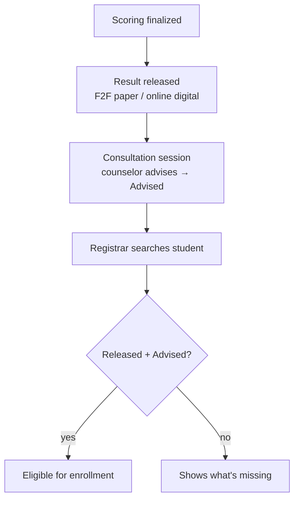

# Consultation Sessions — Client-Facing Design (final shape)

**Purpose:** present the consultation, release, program-choice, Program Head, universal-QR, and enrollment-completion shape to the client.
**Date:** 2026-08-13; admission-support extension reconciled 2026-08-15.

---

## 1. The three steps

Consultation in NEXIAM is **three independent, required steps** — no more tangled single-day release:

1. **Release** — the student's scores/result become visible.
   - *F2F:* shown early, on printed sheets at the consultation.
   - *Online:* shown digitally on the portal — no office printing.
2. **Consultation (advising)** — the Test Administrator/Counselor advises the student. Completing it flips the student's status to **Advised**.
3. **Enrollment eligibility** — when the student goes to the Registrar to enroll, staff **search the name** and the system answers: **eligible to enroll — or exactly what's still missing**.

## 2. Scheduling = exactly like exam sessions (staff already know this)

- One structure: **Consultation Session** — date + time the office sets, **room pick** for venue (create "Guidance Office" or "Covered Court" once, then just pick), capacity from the room.
- **Office picks per session from day one** — staff-only (office assigns) or self-booking (students reserve first-come-first-served) — and can **switch anytime** — the same toggle exam sessions already have.
- **Early-assessment advantage is automatic:** whoever's grading + printing finishes first becomes eligible first. No special feature needed.
- **Leftovers:** office creates a later session (venue "Covered Court") and assigns everyone left; a ready-pool list shows who's unscheduled.

## 3. What the student sees (portal)

| Stage | Student sees |
|---|---|
| Not result-ready | "Consultation unlocks after your result is ready" |
| Booking open | Session cards: date, time, room, remaining slots → Reserve |
| Assigned / reserved | "Your consultation schedule" — date, time, room (+ office-assigned vs you-reserved badge) |
| Advised | Status milestone: **Advised** |
| Eligible | "Eligible for enrollment" (after release + advised) |

## 4. What the Registrar sees

Search name / applicant no → eligibility card:

- Exam done ✓ · Result released ✓ (date) · **Consultation Advised ✓** (by, date)
- → **Eligible for enrollment** — or the missing requirement shown ("consultation pending", "result not yet released", "follow-up needed")
- Registrar sees status facts only — never counselor notes or suggestions. Every lookup is recorded.

## 5. Automatic rules (system-enforced)

1. No double-booking; one schedule per student per session
2. Scheduling blocked until the student's result is ready
3. Capacity from the room — no overbooking
4. Self-booking closes when full or when the office disables it
5. Cancellations keep history — nothing erased
6. Counselor's suggestions and the student's chosen program never merged
7. Every action records who did it and when
8. Eligible = accepted + exam done + result released + advised — computed, never hand-set; recomputes if anything changes

## 6. Less paper (online mode)

| | Today | Online mode |
|---|---|---|
| Result sheets | Office prints all | Scores on portal; office prints only if needed |
| Institution copy | Paper filing | Digital record kept by the system |
| Student copy | Handed paper | Student downloads/prints their own (☐ confirm) |

## 7. Open questions for the client

| # | Question | Options |
|---|---|---|
| 1 | May scores be **released before** the advising consultation, or must consultation come first? | Release first (recommended) / Consultation first |
| 2 | What counts as **Advised**? | Counselor confirms the decision (recommended) / Session attendance only |
| 3 | Registrar: search + eligibility card is enough? | Yes / They also want a printed list |
| 4 | Student prints their own copy for enrollment? | Yes / Institution prints a batch |
| 5 | Big general sessions: OK to **publicly declare names** in the roster? | Yes / Names to office only |
| 6 | Leftovers: office assigns via ready pool, or auto-slot? | Office assigns (recommended) / Auto-slot |
| 7 | Self-booking from day one, or admin-led first? | **Both from day one — office picks per session** (decided 2026-08-14) |

## 8. Why this is better than the traditional flow

- **No single-day crowd rush** — workload spreads as sessions finish grading.
- **Nothing falls through** — ready pool + missing-requirement display catch every student.
- **The Registrar no longer queues for answers** — the system says eligible or what's missing.
- **Less paper, same rigor** — consultation never skipped; the record is digital and audited.

## 9. Admission-support extension (planned after the active OMR cut)

- The existing consultation record becomes the one applicant-specific workspace: readiness overview, real released-score charts with a same-value accessible table, ordered preferences, structured consultation evidence, human decision, Guidance program pool/default, follow-up, and attributable history.
- No AI/ML recommendation engine ships in this phase. The verified YuKee artifact/K-Means plugin and a transparent deterministic/rule-based plugin remain two separate future changes; neither may write the counselor's decision, pool/default, applicant choice, quota, or enrollment state.
- Program Heads receive an assigned-program dashboard and tiered candidate access. Preference/pool-only visibility stays minimal; released scores and bounded program-relevant notes require an applicant-acknowledged current selection or targeted follow-up for that program.
- One universal applicant QR appears in the portal and approved print. It contains only an opaque signed applicant-attempt locator. After authentication, the same QR opens an actor-specific action hub for Registrar, Guidance/TA, or assigned Program Head based on ordinary capability, duty, scope, and current case state.
- Scanning never performs a business action and never grants authority. Staff still choose and confirm an allowed action normally; invalid, expired, copied-outside-window, cross-scope, and no-destination scans reveal no applicant data.
