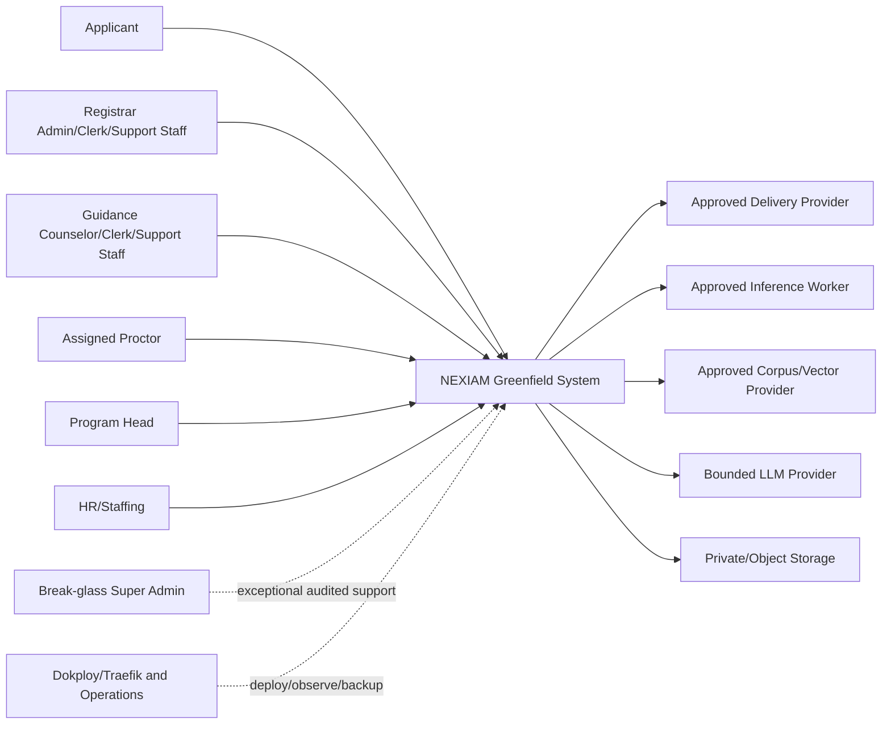

# System High-Level Design

**Artifact:** NEXIAM-GF-17  
**Status:** DRAFT — HLD CHECKPOINT 1 GO; REVIEW REQUIRED  
**Authority:** Downstream of GF-01–GF-16; not implementation authority until the HLD review gate passes.  
**Scope:** Greenfield NEXIAM modular monolith for the ISPSC Tagudin admission-testing workflow and bounded capstone capabilities.

## 1. Purpose and design posture

This HLD defines the system shape before detailed classes, migrations, routes, and UI components are designed.

The target is a modular monolith, not a collection of CRUD screens and not a microservice system. The core admission, examination, assessment, consultation, release, and audit mutations share one transactional database and one authorization model. External or failure-prone capabilities are reached through explicit adapters and asynchronous jobs.

The HLD preserves these non-negotiable principles:

- command-owned domain state;
- backend-enforced capability and resource scope;
- one authoritative state transition per workflow decision;
- durable history and non-destructive correction;
- manual core workflow independent of optional providers/workers;
- after-commit side effects with idempotency and retry;
- human authority over scoring review, consultation, and admission-support decisions;
- no direct model/provider authority over domain state;
- auditable protected views and mutations;
- clean greenfield boundaries rather than legacy code structure.

## 2. Scope boundary

### 2.1 Core system

The core system owns:

- staff and applicant identity/access;
- academic cycles and reference data;
- public/staff admission intake;
- acceptance, dismissal, correction, archive, and history;
- exam sessions, rooms, assignments, attendance, submission, and close;
- manual scoring, grading review, finalization, and correction versions;
- consultation records and mode-specific release prerequisites;
- result release/reversal and generated-document metadata;
- notifications and applicant own-data retrieval;
- audit events, verification, and protected-view evidence;
- scoped reporting read models.

### 2.2 Conditional or deferred system capabilities

The following are adapter-backed and gated separately. “Gated” means the contract is committed and evidence must pass before promotion; it does not mean the feature may silently disappear from the capstone promise.

- OMR observation and reviewed import;
- Yukee-compatible/deterministic aptitude and interest decision-support engines;
- policy, authorized own-data, and typed staff-task RAG chatbot;
- AI-assisted scheduling proposals;
- bounded Guidance inquiry handoff;
- offline proctoring with outbox/conflict resolution;
- BGE as a low-priority beta behind an explicit feature flag;
- broader analytics, generic engine registration, and multi-campus tenancy.

No conditional feature may weaken or bypass the core domain contract.

## 3. System context



### 3.1 Actor authority summary

| Actor | System responsibility | Explicit boundary |
|---|---|---|
| Applicant | Submit, establish approved access, view own status/approved release, use permitted policy/own-data assistance | No staff data, no pre-release result, no cross-applicant inference |
| Registrar Admin | Institutional/reference setup, delegated Registrar accounts, intake oversight, acceptance/dismissal, application-window configuration | No converted result/remark sheets or converted per-domain scores unless separately approved |
| Registrar Clerk | Daily intake, correction, acceptance/dismissal, and approved institutional/reference setup pages within Registrar scope | No cross-office authority; Support Staff permissions are not inherited automatically |
| Registrar Support Staff | Delegated intake/correction, acceptance/dismissal, and status visibility | No institutional/reference/setup pages or role-management authority |
| Guidance Counselor/Clerk/Support Staff with Test Administrator capability | Exam workflow, slot reservation/manual assignment, scoring, consultation, result preparation, release coordination, and approved evidence review | Capability is explicit and audited; no unrestricted HR/Registrar authority; no raw/confidential data beyond capability scope |
| Proctor | Assigned-session attendance/submission operations | No global proctor role, no unrelated session access, no scoring authority |
| Program Head | Read-only program-scoped projection and approved consultation-facing evidence | No admission/score/release writes, raw answer sheets, or confidential conversion tables |
| HR/Staffing | Permanent personnel and approved support-staff lifecycle | No applicant, exam, scoring, consultation, or release decisions; cannot grant Proctor/Test Administrator capability |
| Super Admin | Full audit-scope user view plus exceptional technical/support recovery | Full audit visibility is permitted because the legacy Super Admin could see all; every audit-view/use is reasoned, time-bound, alerted, audited, and does not grant routine business authority |

## 4. Container architecture

### 4.1 Browser clients

Applicant and staff browsers use HTTPS and receive Inertia page responses with typed page props. The browser may present or hide actions for usability, but it is never the authorization boundary.

Browser responsibilities:

- render page/view models;
- submit typed forms and idempotency keys;
- display loading, empty, denied, stale, validation, conflict, and retry states;
- never contain authoritative workflow logic or secrets;
- never treat an AI/model response as a permission or state transition.

The browser contract is split deliberately: GF-21 defines server-enforced authorization and protected-view boundaries; GF-22 defines the shells, route responsibilities, page props, breadcrumbs, forms, tables, charts/graphics, notifications/toasts, loading/empty/error/conflict/offline states, accessibility, responsive behavior, and evidence expected from the Inertia/Svelte presentation. HLD modules may expose page/query contracts, but they may not leave these behaviors to ad hoc component inference.

### 4.2 Laravel web application

The web application is the synchronous request boundary.

Responsibilities:

- authentication/session establishment;
- request shape validation;
- capability/resource authorization;
- command/query dispatch;
- transaction-owned domain mutation through application services;
- typed page/view-model responses;
- safe file upload initiation and download authorization;
- health/readiness endpoints appropriate to the environment.

The web layer must not:

- orchestrate multi-step business workflows inside controllers;
- write domain state from Inertia page code;
- call optional providers directly from a request when a durable job is required;
- bypass policies for “internal” routes;
- dispatch external side effects before commit.

### 4.3 Capability modules inside the modular monolith

The application is organized around capability boundaries rather than legacy controllers or table names. Each module has an application surface, domain model, persistence mapping, policies, read queries, events, and tests.

The proposed modules are:

1. Identity & Access
2. Reference Data & Academic Configuration
3. Admissions
4. Examination
5. Assessment & Grading
6. Consultation & Release
7. Documents & Reporting
8. Communications
9. Audit & Compliance
10. Knowledge & RAG
11. Decision Support
12. Platform/Operations adapters

Detailed ownership and dependency rules are deferred to GF-18, but the HLD rule is that a module may not mutate another module’s aggregate by reaching through its Eloquent relationships. It must use an approved command, domain event, or read contract.

### 4.4 Queue worker

The Laravel queue worker executes after-commit jobs such as:

- notification delivery;
- document generation/conversion;
- batch import processing;
- provider calls;
- corpus synchronization;
- audit checkpoint export;
- rebuild/reconciliation jobs.

Worker jobs must be:

- uniquely identifiable;
- retry-safe;
- idempotent at the domain boundary;
- bounded by timeout and retry policy;
- observable with attempt/failure/terminal state;
- unable to silently convert provider output into authoritative domain state.

### 4.5 Scheduler

The scheduler triggers bounded operational commands, such as:

- application-window transitions;
- slot-reservation open/close/finalize and publication readiness;
- session auto-close;
- notification retry/reconciliation;
- expired challenge cleanup;
- failed-job/reconciliation scans;
- audit checkpoint work;
- retention operations only under approved policy.

Scheduler commands call the same application command as manual operations where behavior is shared. They do not duplicate transition logic.

### 4.6 Relational database

The production authority is PostgreSQL for the greenfield system, with the supported major version pinned during E0 and recorded in the environment/ADR. `pgvector` may be enabled for the optional BGE/RAG embedding path only after extension/version, index, backup/restore, and privacy evidence is approved. SQLite is limited to tests where parity is proven; the current MySQL Compose setup is legacy/current-app evidence, not the greenfield authority.

The database protects:

- identity and reference uniqueness;
- aggregate foreign keys and delete behavior;
- one-active-version/cardinality rules;
- scope-bearing relationships;
- idempotency keys;
- durable job/import/notification state;
- audit sequence/checkpoint fields.
- vector/document metadata only through an approved PostgreSQL extension contract; embeddings never become an authorization source.

Application checks alone are insufficient for race-sensitive invariants.

### 4.7 Private file storage

Private storage holds controlled uploads and generated artifacts. Storage references are opaque and do not expose filesystem paths.

Every controlled artifact records:

- owner and subject;
- lifecycle class;
- content type and size metadata;
- template/input/version metadata;
- checksum;
- access policy reference;
- created/retained/expired state.

Object storage is an adapter choice for pilot durability; the application contract must not assume local disk permanence. Retention status for raw OMR images and derived provenance is explicit and operator-observable.

### 4.8 Inference worker

The optional Python worker is an internal, authenticated adapter boundary for OMR and approved decision-support engines, including the low-priority BGE beta when its feature flag and evidence gate are enabled.

It may:

- validate input envelope;
- process approved input versions;
- return observations/proposals with confidence and provenance;
- report health/capability/version;
- fail or abstain explicitly.

It may not:

- connect directly to the database;
- write scores, releases, admissions, or consultation decisions;
- select an applicant’s program autonomously;
- bypass human review or import commands.

### 4.9 External delivery, knowledge, and LLM providers

Each external provider is behind a typed adapter with timeout, retry, idempotency, provenance, redaction, health, and degraded-mode behavior. Mailpit is local/test only and must not be treated as production delivery evidence.

## 5. Primary data-flow patterns

### 5.1 Synchronous authoritative command

```text
HTTP request
 → authenticate actor
 → resolve capability/resource scope
 → validate request shape
 → invoke one application command
 → transaction:
      lock/reload required aggregates
      validate domain preconditions
      enforce DB-backed invariants
      mutate authoritative state
      append required audit event
      register idempotency result
 → commit
 → dispatch after-commit effects
 → return typed success or typed failure
```

### 5.2 Asynchronous side effect

```text
Committed domain event
 → after-commit job dispatch
 → claim idempotency key
 → execute adapter/storage operation
 → persist attempt/result/provenance
 → retry bounded transient failure
 → terminal failure visible for operator/manual recovery
```

### 5.3 Proposal/import flow

```text
Approved input/version
 → staged batch/operation record
 → worker/provider proposal
 → confidence/provenance/review state
 → authorized human review
 → explicit import command
 → authoritative score/result mutation
 → audit and reconciliation
```

## 6. High-level module ownership

| Module | Owns | Publishes/serves | Must not own |
|---|---|---|---|
| Identity & Access | Staff/applicant credentials, challenge lifecycle, grants, scope resolution | Authenticated actor and capability context | Admission decisions or result visibility by itself |
| Reference Data | Academic cycles, programs, rooms, aptitude areas, templates, mappings | Versioned reference snapshots | Applicant workflow state |
| Admissions | ApplicantIdentity, AdmissionAttempt, Applicant No/Reference, intake decisions | Admission status/read model, eligibility signals | Exam scoring or result release |
| Examination | ExamSession, ExamSlotPlan, ExamSlotReservation, assignment, proctor duty, attendance, submission, close | Session/slot/roster/attendance read models | Score interpretation or consultation |
| Assessment & Grading | Grading version, score records, OMR observation/reviewed import, Direct Assessment mode | Score/grading read models and completion facts | Applicant admission or release authority |
| Consultation & Release | Consultation evidence, availability/reservation, result preparation, release/reversal | Applicant/staff release views and release events | Authentication or raw model execution |
| Documents & Reporting | Typed projections, templates, generated artifacts, safe exports | Private documents and scoped reports | Core workflow state mutation |
| Communications | Notification intent/delivery/read state, conditional inquiry | Delivery/read projections | Acceptance, scoring, or release decisions |
| Audit & Compliance | Event catalog, append/checkpoint/verification, access evidence | Audit verification and compliance views | Business state decisions |
| Knowledge & RAG | Approved corpus, retrieval, citation/refusal envelope, AssistantActionRequest proposal/confirmation envelope | Bounded answer proposal and typed task request | Permission decisions, direct ORM/database access, placement advice, unapproved state mutation |
| Decision Support | Engine adapter registry/manifest, proposals, provenance | Human-review proposals | Authoritative scores or admissions |
| Platform/Operations | Queue/storage/provider/runtime adapters | Health, metrics, operational evidence | Domain policy |

## 7. Dependency direction

```text
HTTP/Inertia/UI adapters
        ↓
Application commands and queries
        ↓
Domain aggregates, policies, value objects
        ↓
Persistence and port interfaces
        ↓
Infrastructure adapters
```

Allowed cross-cutting dependencies:

- every protected command may use Identity & Access policy context;
- every authoritative mutation may use Audit & Compliance append service;
- modules may consume approved immutable reference-data snapshots;
- Communications/Documents/Decision Support/Knowledge consume committed events or read contracts;
- Platform adapters implement ports and cannot define domain outcomes.

Prohibited dependencies:

- domain code importing HTTP response/request classes;
- UI deciding authorization or state transitions;
- one module reaching through another module’s ORM relationship to mutate state;
- providers writing domain tables;
- reports mutating core aggregates;
- audit verification changing business state;
- model/RAG text being accepted as a command without human authorization;
- assistant action execution bypassing the same frontend/request gates used by the normal UI.
- assistant text being treated as a route, ORM query, or capability grant without a typed allowlisted application command.

## 8. Trust and security boundaries

1. **Untrusted browser boundary:** all user input, uploaded files, generated-document values, and model/provider output are untrusted until validated/encoded.
2. **Ingress boundary:** HTTPS, session/cookie protections, rate limits, request size limits, and security headers.
3. **Application authorization boundary:** authentication, capability, office/program/resource scope, state/time-window checks.
4. **Persistence boundary:** constraints, transaction isolation, idempotency, private storage references, audit append.
5. **Worker boundary:** authenticated internal contract, no direct DB write, bounded input/output, health and timeout.
6. **Provider boundary:** no secrets in client, explicit adapter, provider outage isolation, provenance and redaction.
7. **Break-glass boundary:** time-bound reasoned access with alerting and review.

## 9. Deployment topology

### 9.1 Controlled demonstration

```text
HTTPS ingress
  → Laravel web container
       → PostgreSQL (greenfield pinned major)
       → private storage volume
       → database queue
  → dedicated queue worker
  → scheduler process
  → optional authenticated Python worker
  → Mailpit local/test sink
```

### 9.2 Pilot/production direction

Pilot/production requires separate approval for:

- managed/off-machine database and backups;
- object storage or durable artifact storage;
- approved mail provider;
- inference worker deployment and model artifact custody;
- secrets/key management;
- monitoring/alerting;
- restore rehearsal and RPO/RTO;
- privacy/retention and institutional sign-off.

Dokploy/Traefik is an ingress/deployment boundary, not a substitute for application authorization or operational evidence.

## 10. Runtime modes

| Mode | Authoritative core | Optional capabilities | Allowed data |
|---|---|---|---|
| Development | Synthetic seeded workflow | Local adapters/Mailpit | Synthetic only |
| Test/CI | Deterministic fixtures and fake ports | Contract fixtures; no uncontrolled providers | Synthetic fixtures |
| Controlled demo | Manual core plus approved test providers | OMR/RAG/engines/offline only if their gates pass | Approved demo data |
| Degraded provider | Manual core continues | Provider-backed action queues/retries visibly fail | Existing authorized data |
| Pilot/production | Only after combined system-ready gate | Only approved and monitored capabilities | Institutionally approved real data |

## 11. Non-functional requirements carried into LLD

- correctness: race-safe constraints and serialized transitions;
- security: default deny, typed scopes, rate limits, no bearer identifiers;
- privacy: minimum necessary views, explicit retention, protected artifact access;
- availability: provider failures do not block manual core;
- recoverability: idempotent jobs, replay/reconciliation, backup/restore evidence;
- auditability: mandatory mutation/access events and bounded tamper-evidence claim;
- accessibility and UX correctness: keyboard, focus, readable loading/empty/error/conflict states, breadcrumbs, chart/table alternatives, toasts, responsive behavior, and protected feedback design in GF-21/GF-22 UI contracts;
- maintainability: module ownership, dependency tests, typed boundaries;
- reproducibility: pinned runtime and deterministic reset/seed;
- performance: measurable query/import/worker limits to be specified before pilot.

## 12. HLD decisions that must be promoted later

| Decision | Current direction | Promotion artifact |
|---|---|---|
| Modular monolith | One Laravel transactional core with explicit modules | ADR-002 / GF-18 |
| Queue boundary | After-commit jobs, database queue initially | ADR-008 / GF-20/GF-23 |
| Inference boundary | Authenticated worker, proposal-only, no direct DB writes | ADR-010 / GF-20 |
| Database boundary | PostgreSQL greenfield authority; pgvector only by extension/ADR/evidence gate; SQLite test-only | D-057 / GF-19/GF-20 |
| Storage boundary | Private filesystem adapter now, object-storage adapter later | ADR-009 / GF-19/GF-23 |
| Audit assurance | Tamper-evident under defined threat model, not tamper-proof | ADR-013 / GF-18/GF-23 |
| Applicant access | Post-submission one-time challenge; acceptance independent | ADR-004 / GF-18/GF-21 |
| Authorization and browser boundary | Capability/resource-scope enforcement is server-side; UI routes/page states/feedback follow GF-21/GF-22 | GF-21/GF-22 |
| Result release | Human decision and mode-specific prerequisites | ADR-006/ADR-009/GF-18 |

## 13. HLD review questions

These questions must be answered before LLD promotion:

1. **GO as working baseline:** the twelve proposed capability modules are accepted for continued solutioning; final HLD promotion remains gated by the remaining questions and consistency review.
2. Should Reference Data be a separate module or part of the relevant workflow modules?
3. Is Consultation & Release one module, or should consultation and document/release be separated?
4. Is Communications limited to notifications for the first slice, with inquiry threads deferred?
5. Is the Python worker required for the connected slice or optional until the OMR gate passes, with offline proctoring independently gated by EV-011?
6. Is database queue sufficient for the first system-ready target?
7. Is private local storage acceptable for the controlled demonstration with a documented migration path?
8. Which audit checkpoint destination and key-custody model are acceptable?
9. Which provider calls must be synchronous, and which must always be queued?
10. What PostgreSQL major version and pgvector extension/version are approved after clean-engine rehearsal, and what is the documented fallback if vector evidence is not ready?

## 14. HLD exit criteria

The HLD may be promoted to `APPROVED` or `CONDITIONAL` only when:

- actors and trust boundaries are accepted;
- containers and deployment responsibilities are accepted;
- module ownership has no unresolved overlapping write authority;
- synchronous/asynchronous boundaries are explicit;
- provider failures and manual fallback are explicit;
- core data and audit ownership are clear;
- browser shells, route/page responsibilities, authorization states, and UX feedback do not contradict the trust boundaries;
- the HLD review questions are answered or assigned to named gates;
- GF-18 can be written without inventing a module boundary.

Until then, this document remains a draft design for review, not permission to scaffold domain code.
