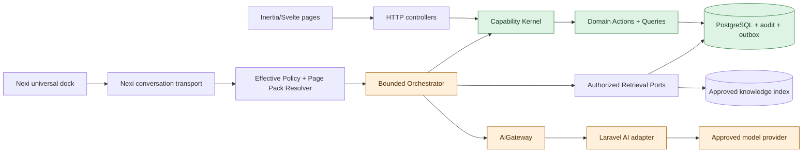
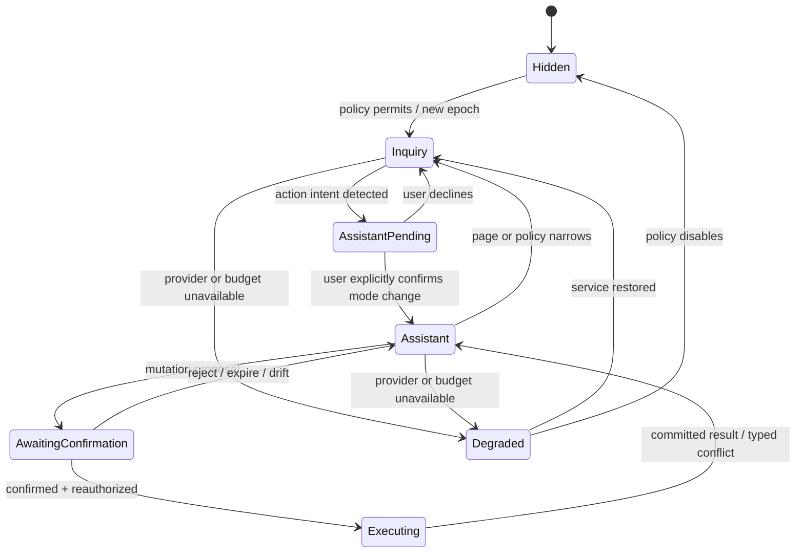

# Architecture Spine — NEXIAM AI Assistant Foundation

## Design Paradigm

Nexi is an inbound adapter to a hexagonal modular monolith. Browser controllers and Nexi both invoke one capability-based command/query kernel; AI-provider code is an outbound adapter. A model may choose among capabilities already granted by the application, but it cannot create authority, routes, commands, or data access.



Dependency direction is inward: provider/SDK, transport, UI, and route adapters depend on NEXIAM contracts; domain Actions and Queries never depend on Nexi, prompts, Laravel AI, or a provider.

## Invariants & Rules

### AD-1 — One shared application capability path [ADOPTED]

- **Binds:** all page actions, assistant tools, scheduled operations, and future channels
- **Prevents:** duplicated AI routes, authorization drift, and business rules split between controllers and assistant code
- **Rule:** HTTP controllers and Nexi submit untrusted invocation requests to one non-bypassable `CapabilityKernel`. The kernel creates the trusted principal/provenance context and runs: current-principal resolution → surface/mode/task-policy resolution → strict schema validation → capability authorization → target-scope and version resolution → idempotency reservation where required → handler invocation → channel projection → protected-view/invocation evidence → typed result. Handlers retain domain invariants and transactional audit/outbox ownership. No AI-specific domain Action, controller clone, direct route replay, or caller-supplied authority snapshot may exist.

### AD-2 — The Capability Registry is the only tool authority

- **Binds:** tool discovery, page actions exposed to Nexi, skills, confirmation, audit, and tests
- **Prevents:** model-invented commands, raw URL access, wildcard tools, and incompatible tool schemas
- **Rule:** every callable capability has one immutable code-owned definition containing `(key, version)`, independent `contract_version`, read/propose/command kind, strict input and authoritative-result schemas, registered channel projections, application capability, scope resolver, risk, confirmation, idempotency, handler, and safe description. Contracts use the NEXIAM-supported subset of JSON Schema Draft 2020-12, reject unknown fields and implicit coercion/defaults at dispatch, and expose stable error paths. Duplicate registrations fail the build/boot; compatibility and canonical serialization fixtures are mandatory. Only registry `read` and `propose` entries may become provider-facing tools.

### AD-3 — Page Capability Packs are relevance filters, not permission grants

- **Binds:** universal Nexi availability, route context, suggestions, projections, and UI intents
- **Prevents:** a global tool dump, duplicated route matrices, client-authored context, page-specific prompt sprawl, and **treating the current page as a cage** that hides Nexi or denies actor-authorized work
- **Rule:** a build-time registry maps each canonical Laravel route name to at most one owned, compiled `(pack_key, pack_version)` artifact; duplicates fail the build/boot. The resolver returns one immutable decision containing route/page identity, context binding, effective modes, registry versions, projections, navigation targets, disclosure, and privacy class. The pack is a **relevance lens** (suggestions, page identity, optional skill start) — it never grants a missing capability and never replaces Capability Kernel ∩ GF-21 authorization.
- **Founder clarification (2026-08-10):** mountable `SurfaceProfile` keeps Nexi available (`degraded` / later `inquiry_only`) even when `page_pack` is null (e.g. staff routes without a registered pack). `hidden` is reserved for feature-disabled, non-mountable surface, pack–surface mismatch, or suspension — **not** for “no pack on this route.” Fail-closed for unknown routes means **do not inherit the previous page’s pack/tools**, not “remove the dock.” Cross-page continuity of *tools* uses actor capabilities plus later TaskGrants (`nexi-run-and-usage-governance`); conversation history and confirm-to-Apply belong to later OpenSpecs, not the pack registry.

### AD-4 — Interaction modes form a privilege boundary

- **Binds:** Inquiry, Assistant, mode switching, navigation, prompt assembly, and tool exposure
- **Prevents:** a Q&A turn silently gaining mutation tools or a model treating countdown text as consent
- **Rule:** every new context epoch defaults to Inquiry and exposes no mutation tools. Inquiry-to-Assistant requires an application-owned consent record bound to actor, authenticated session, disclosure version, surface/task grant, and expiry; a broader or changed pack requires fresh consent. Assistant may visibly demote to Inquiry when policy or page context narrows. Mode is re-resolved server-side on every turn and tool call.

### AD-5 — Skills are bounded workflows over capabilities

- **Binds:** scheduling, conflict resolution, guided tasks, planning, and future domain assistants
- **Prevents:** monolithic prompts, arbitrary agent scripts, hidden privilege, and repeated route hopping
- **Rule:** a skill is an immutable code-owned finite state machine with version-pinned capability keys, typed input/output/proposal schemas, named legal transitions, persisted cursor/checkpoints, deterministic versus model-recommended transition markers, step retry/idempotency, fan-out, timeout/cancel, and terminal/fallback rules. The server workflow engine alone advances the cursor after validation; model output may recommend but never perform a transition. Skills compose reads and proposals; only the Capability Kernel executes commands.

### AD-6 — Orchestration is finite and reauthorized

- **Binds:** model loops, tool calls, retries, sub-plans, provider failover, and long-running work
- **Prevents:** runaway cost, stale authorization, recursive agents, and confused-deputy execution
- **Rule:** server configuration caps steps, time, tokens, cost, retries, fan-out, and tool-chain depth. Before every tool call, the executor resolves a fresh trusted principal tuple (`actor_type`, opaque actor ID, institution, authenticated session/service identity, surface, provenance, correlation ID) and intersects mode, capability, scope, target state, page/task grant, privacy destination, and budget. Protected reads additionally require a short-lived server-issued invocation grant binding purpose, query keys, target/filter, maximum cardinality/pages, field projection, destination, and expiry; protected-view/egress evidence must persist before payload release. A cumulative disclosure ledger bound to context epoch, TaskGrant, and run decrements unique targets, sensitive fields, rows/pages, and overlapping-query allowance across calls/runs so repeated small reads cannot enumerate a larger set. Client/provider identity, mode, pack, scope, or grant fields are stale hints only.

### AD-7 — Assistant mutations require a bound proposal and confirmation

- **Binds:** create, update, publish, bulk scheduling, cancellation, release, exports, and other consequential operations
- **Prevents:** ambiguous consent, replay, execution drift, and confirmation of an open-ended model plan
- **Rule:** provider-facing tools never contain executable command capabilities. Orchestration may read and propose, then persist an immutable proposal naming one registered command. Only the generic confirmation endpoint may dispatch it with `nexi_confirm` provenance after explicit human decision and fresh checks; SDK approval is a pause signal and never resumes a closure that commits domain state. Proposal bytes use RFC 8785 canonical JSON and a domain-separated SHA-256 digest over actor, institution, command/version, normalized arguments, target versions, impact, expiry, and idempotency identity. One atomic compare-and-swap lifecycle governs `pending → executing → executed|conflicted|failed` and terminal `rejected|expired|cancelled|invalidated`; retries return the recorded result.

- **Proposal integrity contract:** canonical proposal bytes also bind the ordered `RuleDependencySet` digest, preflight key/version, complete `ConstraintEvidence` digest, projection/privacy version used for impact, and evidence observation time. Confirmation verifies all bindings before the compare-and-swap transition; a queued worker repeats the same checks immediately before commit.

### AD-8 — Bulk work is a first-class application command

- **Binds:** multi-applicant scheduling, batch status changes, exports, and queued assistant work
- **Prevents:** N hidden POST requests, partial state without a contract, page bouncing, and irreconcilable retries
- **Rule:** bulk skills end in a purpose-built batch command or queued operation with declared atomic/partial semantics, per-item outcomes, operation identity, idempotency, conflict handling, and audit. The model never loops ordinary write routes to simulate a batch.

### AD-9 — The AI controls no DOM or component path

- **Binds:** Nexi navigation, page refresh, highlighting, panel opening, and result rendering
- **Prevents:** model-authored selectors, XSS, fragile page automation, and UI state diverging from server truth
- **Rule:** provider output may request but never construct a final UI intent. Trusted application code maps an approved request to a versioned discriminated `UiIntent` union with registered route/panel/region key, strict parameters, context/pack or task-grant binding, expiry, and deduplication ID. The Svelte shell revalidates for defense in depth, ignores stale/unknown intents, uses named application navigation/refresh behavior, and renders authoritative command/query results.

### AD-10 — Authorization and minimization precede prompt construction [ADOPTED]

- **Binds:** page context, own-data lookup, staff projections, RAG, provider payloads, logs, and citations
- **Prevents:** cross-applicant leakage, overbroad prompts, and an LLM deciding record access
- **Rule:** each capability returns one authoritative typed result; the kernel selects a separately registered, versioned channel projection after authorization. Provider-visible projections use a code-owned classification/destination matrix, fail closed on unclassified fields, and use pseudonymous references unless identity is required and approved. Every provider turn reconstructs minimized context from a server-owned context epoch bound to actor/session, institution, purpose, mode, page pack or task grant, and privacy class; persisted SDK/history content is never blindly replayed across an epoch. Scope, duty, break-glass, impersonation, institution, purpose, or privacy-class changes close or segment the epoch. Never send raw models, unrestricted Eloquent results, credentials, unreleased data, or database access to a model.

### AD-11 — Prompt/data firewall is defense in depth, not authorization

- **Binds:** user input, retrieved documents, tool results, provider output, Markdown/links, and audit metadata
- **Prevents:** prompt injection becoming executable authority, secret leakage, unsafe rendering, and misplaced trust in a sanitizer library
- **Rule:** treat all natural-language and provider content as untrusted data. Deterministic controls perform input limits/normalization, instruction-data separation, field classification/minimization, schema validation, secret/PII checks, output escaping, and link allowlisting. Raw provider deltas never reach the browser: an application-owned output assembler buffers and validates bounded chunks, and protected own/staff-data answers default to full buffered validation before release. Citation, refusal, link, and terminal events become durable/replayable only after schema, privacy, source-eligibility, and allowlist checks pass. Each provider call records a hash-linked `PrivacyDecision` containing projection/rule versions, classifications, transformations, destination profile, and pseudonym-map retention without storing prohibited raw payloads. Prompts and sanitizers never replace tool authorization or confirmation.

### AD-12 — Policy RAG and operational data use different retrieval paths

- **Binds:** Inquiry, citations, own-data questions, staff task context, embeddings, and corpus lifecycle
- **Prevents:** operational PII in vector indexes, policy text becoming commands, and citation-free answers
- **Rule:** embeddings/indexing apply only to owner-approved, versioned, attributable policy documents. Authorization, institution, audience, effective-version, and revocation predicates execute inside candidate retrieval before any chunk leaves the trusted index adapter or enters cache/reranking. Retrieval returns a typed snapshot with source/chunk/version IDs, exact cited spans, scores, filter evidence, and stable no-support reason; only sources active in that snapshot may be cited. Own-data and staff operational questions use deterministic authorized application Queries. Retrieved text cannot grant tools or alter instructions.

### AD-13 — Laravel AI is an adapter behind NEXIAM ports

- **Binds:** agents, streaming, structured output, tool calls, approvals, embeddings, failover, and tests
- **Prevents:** framework/provider APIs leaking into domain modules and a pre-1.0 SDK controlling NEXIAM policy
- **Rule:** application code targets NEXIAM-owned request/response/event DTOs on `AiGateway` (`generate`, `stream`, optional `requestCancel`, `health`) and `KnowledgeIndexPort`; no SDK type crosses the adapter. The gateway normalizes finish/refusal/error reasons, tool requests, usage precision, provider request ID, timeout/retry class, routing/privacy evidence, and cancellation support. Every adapter passes common golden conformance fixtures for stream fragmentation, malformed/duplicate tools, missing usage, safety refusal, timeout-after-output, cancellation, and unknown errors. A pinned `laravel/ai` adapter may implement the ports only after ADR/OpenSpec approval.

### AD-14 — Provider/model routing is centrally pinned and privacy-gated

- **Binds:** model selection, failover, configuration, evaluations, cost, and incident response
- **Prevents:** silent model drift, unexpected data transfer, inconsistent behavior, and cross-provider policy bypass
- **Rule:** approved routing profiles pin provider, model, purpose, data classes, timeouts, and budgets. Dynamic cheapest/smartest routing and cross-provider failover are disabled until each target has equivalent approved privacy, retention, region, cost, and evaluation evidence.

### AD-15 — Availability and usage have one effective-policy resolver

- **Binds:** global switch, per-page modes, actor access, per-user/admin controls, quotas, rate limits, and degraded UI
- **Prevents:** contradictory flags, client-side enforcement, concurrent budget overruns, and demo counters becoming authority
- **Rule:** effective availability is a deny-dominant intersection of emergency state, immutable published institutional policy version, actor capability/scope/purpose, per-user narrowing, page pack/task grant, privacy destination, provider health, durable budget, and burst rate state. No admin/user override can add a capability, widen scope, bypass lifecycle/purpose/step-up, or exceed its approved ceiling. Each run atomically reserves a multi-dimensional budget (asks, input/output tokens, tool steps, provider-cost micro-units/currency) by institution, user, routing profile, pricing version, policy timezone/reset, then settles/releases or enters an explicit unknown-usage reconciliation state. Current emergency, suspension, authorization, provider health, and budget are rechecked at each provider/tool/confirm boundary.

### AD-16 — Admin control is bounded configuration

- **Binds:** assistant administration, quotas, feature availability, corpus publication, model profiles, and emergency response
- **Prevents:** routine administrators injecting prompts/tools, registering executable classes/URLs, or bypassing deployment review
- **Rule:** admins use typed, authorized, audited commands to select approved policy values, quotas, users/surfaces, routing profiles, and corpus versions. Raw production prompts, registry code, tool schemas, and executable adapters are deployment-owned artifacts.

- **Knowledge governance:** source create, approve, publish, supersede, revoke, and delete are distinct typed Capability Kernel commands with separation-of-duty policy where required, immutable decision evidence, idempotency, and outbox events. An approver identifier in a row is not authority by itself.

### AD-17 — Conversations and runs are owned, retained, and auditable

- **Binds:** session history, streaming, tool calls, proposals, confirmations, citations, usage, errors, and clear-history behavior
- **Prevents:** cross-user conversation access, unbounded sensitive retention, unverifiable actions, and storage of hidden reasoning
- **Rule:** a Conversation owns ordered Turns; one submitted Turn creates at most one active Run; a Run owns tool calls and may create proposals. Canonical status enums, legal transitions, optimistic versions, one-active-run uniqueness, and terminal immutability are code-owned contracts; provider conversation IDs are untrusted metadata. The stream is a versioned discriminated union with monotonically increasing per-run sequence and at most one terminal event. Durable validated state/citation/proposal/terminal events are replayable by cursor; validated text chunks use a bounded short-lived replay buffer and reconnect otherwise recovers from an authoritative snapshot. Replay re-resolves actor/session/surface, conversation ownership, current source/citation eligibility, retention status, and protected-view purpose before returning content; denied/expired items become typed tombstones rather than leaks. Duplicates are ignored, gaps trigger snapshot recovery, and cancellation distinguishes requested, provider-stopped, and domain-command-already-committed. Never request/store raw chain-of-thought; retention, erasure, backup copies, protected audit access, and replay remain application-authorized and evidence-bearing.

### AD-18 — Manual operation and visible degradation remain complete [ADOPTED]

- **Binds:** provider outage, quota exhaustion, flag disablement, evaluation failure, scheduling, and all authoritative workflows
- **Prevents:** AI becoming a single point of failure or degraded state masquerading as success/empty data
- **Rule:** every AI-assisted workflow retains its ordinary page path. Nexi exposes only the canonical availability states `hidden`, `inquiry_only`, `assistant_available`, `assistant_active`, `degraded`, `quota_exhausted`, and `suspended`, each with a manual next action; AI failure never rolls back or blocks an otherwise valid domain workflow. The emergency stop is checked at every provider/tool/confirm boundary, blocks new work and uncommitted commands, revokes task grants, requests best-effort cancellation of in-flight generation, and never labels an already committed command as cancelled. Durable reconciliation jobs settle orphan usage reservations, stale runs, executing proposals, failed outbox work, corpus deletion/reindex, and retention erasure with idempotent operator-visible outcomes.

### AD-19 — Cross-page skills use revocable task grants

- **Binds:** skill start, navigation, mode changes, logout, policy publication, capability revocation, and pending proposals
- **Prevents:** a copied page pack becoming durable authority or navigation unpredictably cancelling/preserving privilege
- **Rule:** starting a skill from an eligible Assistant pack creates a persisted server-issued TaskGrant bound to actor/session, institution, surface, skill/version, allowed capability versions, scope/cardinality bounds, origin pack/version, context epoch, creation/expiry, and status. Later steps require the grant plus fresh kernel authorization and never inherit destination-page tools. Logout, session/scope change, mode demotion, suspension, emergency stop, capability revocation, or incompatible pack/skill publication revokes the grant and invalidates pending proposals; navigation alone may preserve it only within its original bounds.

### AD-20 — Domain rules are the canonical proposal authority

- **Binds:** domain invariants, eligibility, capacity/overlap checks, workflow state, proposal previews, prompts, skills, confirmation, and rule changes
- **Prevents:** prompt-only business rules, duplicated constraint logic, stale “valid” proposals, and a model certifying feasibility
- **Rule:** domain state, Actions/Queries, policies, and deterministic constraint/preflight evaluators own business truth. Every mutation-capable registry entry references a versioned `RuleDependencySet` of `RuleSetRef` entries and one canonical preflight that normalizes arguments, checks actor/scope/target versions and domain constraints, and returns typed `ConstraintEvidence`. Proposal persistence requires a pass or explicit confirmable result; confirmation reruns the same preflight and invalidates on rule/target drift. System prompts receive only a generated versioned rule digest and skill guidance; provider output is a candidate plan, never authority. A rule change updates the domain rule/action and tests first, rebuilds registry descriptors/page packs/skills/prompt digests, segments affected context epochs, and invalidates incompatible proposals/task grants. Capability/version changes are required only when the contract or semantics change.

- **Constraint evidence contract:** `RuleDependencySet` is an ordered canonical list of `(rule_key, rule_version, digest, compatibility_class)` entries plus one set digest. Versioned `ConstraintEvidence` contains preflight key/version, normalized-argument digest, target snapshot/version digest, the dependency set, ordered per-rule code/outcome/safe facts, assumptions, observed-at, actor/scope decision reference, overall outcome, expiry, and evidence digest. Outcomes are `pass`, `confirmable_warning`, `hard_fail`, or `indeterminate`; only registry-owned warning codes marked confirmable by domain policy may proceed, and neither prompts, users, nor ordinary admins can downgrade a hard fail or indeterminate result.
- **Shared evaluator and commit rule:** the proposal preflight and the authoritative Action invoke the same domain-owned evaluator path. At final execution, the command transaction/queue worker acquires domain-defined locks, resolves the active safety publication and current dependencies, reruns all commit-relevant rules, and commits only on a matching valid result. A post-confirm conflict is a typed non-commit outcome tied to the proposal; partial success is allowed only where AD-8 explicitly declares it.

### AD-21 — One knowledge-source registry governs every information path

- **Binds:** terms/conditions, institutional guidance, released own-data, operational records, document ingestion, retrieval, citations, and future knowledge features
- **Prevents:** ad hoc embeddings, alternate retrieval paths, uncited policy answers, and operational records silently becoming RAG corpus data
- **Rule:** every candidate source is classified in one NEXIAM-owned source registry with owner/approver, audience, institution, purpose, effective/revocation/supersession state, checksum, extraction/index status, and a declared retrieval route. Approved institutional policy documents (including published terms/conditions) route through `KnowledgeIndexPort` with auth-before-retrieve and citations; own-data and staff operational records route through authorized deterministic Queries/projections; unsupported source classes fail closed. Retrieved text is evidence only and cannot change capabilities, `RuleSetRef`s, prompts, or authorization.

- **Source contract and enforcement:** a versioned `KnowledgeSourceDefinition` has stable source-class key/version, owner/approver authority, institution/audience/purpose policy, data classification, lifecycle state, and exactly one retrieval-route reference (`KnowledgeIndexPort` collection/profile or Capability Registry read key/projection). Duplicate or missing definitions fail build/publication. All AI/provider-bound knowledge acquisition enters `KnowledgeRouter.resolve(request, trusted_context)`, which applies source/purpose checks, issues the protected-read grant, dispatches only the registered route, and returns a router decision/evidence ID required by the Prompt/Data Firewall. Ordinary human UI reads remain on the Capability Kernel path until they are projected into an AI run.
- **Lifecycle and revocation:** source versions follow the canonical AD-25 publication lifecycle; only approved, effective, fully indexed versions whose required citation fixtures pass become active. Revocation immediately denies the source predicate, invalidates affected retrieval caches, context epochs, in-flight/replayable citations and answer artifacts, and emits deletion/reindex work. Reconnect or later conversation continuation must revalidate source eligibility before provider calls or durable citation completion. Each source version has one immutable primary class/route; copied or dual-class material keeps provenance or fails closed.

### AD-22 — Safety publications and dependency invalidation are atomic

- **Binds:** rule releases, surface profiles, registry descriptors, page packs, skills, prompt digests, evaluators, frontend contract versions, runs, proposals, TaskGrants, caches, and queued workers
- **Prevents:** mixed rule artifacts, delayed invalidation preserving authority, and workers executing under a different rule set than the user confirmed
- **Rule:** an immutable `RulePublication` bundle references compatible surface-profile, registry, page-pack, skill, `PromptSpec`, evaluator, and frontend-contract artifact digests plus an indexed reverse-dependency set. A monotonic active pointer publishes the bundle atomically; mixed or unavailable bundles fail closed for proposal creation and confirmation. Runs record the publication version. Publication emits an idempotent outbox event; consumers invalidate affected proposals, TaskGrants, context epochs, cached descriptors, citations, and evaluations, while the kernel independently rejects stale dependencies if event processing is delayed. Reconciliation reports incomplete invalidation and repairs it before affected authority can be used.

### AD-23 — Surface profiles are explicit isolation boundaries

- **Binds:** staff, applicant, proctor/session, knowledge-administration, operations, and break-glass shells; context epochs; page packs; disclosures; conversations; skills; and provider destinations
- **Prevents:** applicant-to-staff capability leakage, accidental prompt/history reuse between actor surfaces, URL-derived authority, and a universal component becoming a universal trust boundary
- **Rule:** every Nexi page load, turn, retrieval, tool request, proposal, and confirmation resolves exactly one immutable code-owned `SurfaceProfile` from the authenticated server context before resolving the page pack. A profile pins allowed actor types, authentication class, base modes, context classes, capability/skill ceilings, disclosure, conversation partition, persistence/retention policy key, destination policy, and emergency/manual fallback. Compiled fixtures apply deny-on-ambiguity precedence using matched server route plus trusted context: active break-glass profile, operations route, knowledge-administration route, active proctor-session route/duty, authenticated applicant route/guard, then ordinary staff route. Role strings and client URLs do not resolve the profile. Staff, applicant, proctor/session, knowledge-administration, operations, and break-glass profiles may share presentation components and the Capability Kernel but never inherit another profile's packs, prompts, projections, history, consent, or TaskGrants. Unknown or conflicting surface resolution fails closed. Applicant Assistant actions, when later promoted, are limited to ordinary applicant-owned commands and cannot expose staff tools.

### AD-24 — The frontend consumes a typed session protocol, not AI authority

- **Binds:** universal dock mounting, navigation, context changes, streaming/reconnect, mode consent, usage display, citations, proposal cards, confirmation dialogs, cancellation, and degraded/manual recovery
- **Prevents:** client URL parsing or local storage granting tools, stale streams crossing page/scope changes, model-authored UI execution, duplicate confirmation, and a presentation-only usage meter claiming enforcement
- **Rule:** the server projects one versioned `NexiSessionView` containing surface/profile version, context epoch, page-pack/publication version, effective availability/modes, disclosure, conversation/run cursor, usage/budget state, proposal summaries, and safe manual fallback intents. The client renders only the registered versioned event and `UiIntent` unions, ignores unknown/stale/duplicate events, and requests an authoritative snapshot on sequence gaps or epoch changes. Local expansion/motion preferences may persist; local mode, URL-derived context, capability arrays, model text, and provider events are never authority. A model may request mode escalation, but only an application-owned consent dialog can activate Assistant. Confirmation sends only proposal identity, expected version, and a fresh idempotency key; it never submits model-authored command arguments.

### AD-25 — Knowledge publication is governed, testable, and reversible

- **Binds:** knowledge-source create/upload/edit, extraction, validation, approval, publish, supersede, revoke, index/reindex, citation tests, retention, purge, and operator recovery
- **Prevents:** generic file CRUD becoming corpus authority, unreviewed text entering retrieval, same-person silent publication, stale citations surviving revocation, and deletion being reported before indexes/backups reconcile
- **Rule:** knowledge administration uses typed audited commands over a legal version lifecycle: `draft → extracting → review_required → approved → indexing → active`, with terminal or corrective `rejected`, `superseded`, `revoked`, `index_failed`, `deletion_pending`, and `deleted` outcomes. New files enter private quarantine; content-type sniffing, size/page limits, malware/content checks, and a sandboxed no-network/no-credential parser worker must pass before an immutable extraction artifact exists. Source ownership, approver authority, audience/purpose/data classification, checksum, effective dates, extraction artifact, and retention policy are mandatory. Approval records an RFC 8785 canonical, domain-separated SHA-256 `KnowledgePublicationDigest` over source/version metadata, content checksum, extraction digest, classification, audience, purpose, effective fields, index profile, and required query/citation/refusal fixtures; any bound change invalidates approval. The active index admits only approved effective versions whose extraction and citation fixtures pass; publish, supersede, revoke, and purge require risk-appropriate confirmation and separation of duties where policy requires it. Revocation denies retrieval synchronously before asynchronous cache/index deletion. Every transition exposes status, failure, retry/reconcile, audit correlation, and a deterministic test-query/citation snapshot; ordinary operational records remain Queries and never enter this lifecycle merely because Nexi can discuss them.

### AD-26 — Initial transport, worker, storage, and recovery topology is pinned

- **Binds:** turn submission, provider execution, SSE streaming, reconnect, queue workers, scheduler reconciliation, Postgres state, private knowledge storage, index rebuild, backup/restore, and emergency enablement
- **Prevents:** provider calls being tied to browser connections, raw provider streams bypassing policy, Redis/Echo/WebSockets appearing by accident, derived indexes becoming sole authority, and restore re-enabling stale or revoked knowledge
- **Rule:** the initial modular-monolith deployment uses the existing Laravel app, PostgreSQL, database-backed queues/cache, private storage, queue worker, and scheduler. Turn submission persists one Run and enqueues an idempotent worker; the worker calls `AiGateway`, passes output through AD-11, and appends application-owned sequenced events. A generic SSE endpoint reauthorizes the subscriber and replays by cursor/`Last-Event-ID` from the run-event store with heartbeats, bounded connection/runtime limits, terminal closure, and snapshot fallback; no provider byte stream, database transaction, Echo, Redis, or WebSocket is required. Database jobs also own extraction, indexing, invalidation, usage settlement, retention erasure, and reconciliation, while scheduled jobs repair stale reservations/runs/proposals/outbox/deletion states. PostgreSQL plus private source/extraction storage are backed up and restored under one manifest; knowledge/vector indexes are derived and rebuilt only from active approved source versions. Revocation/tombstone/retention/audit metadata survives restore, and AI stays disabled until restore verification, required reindex, audit verification, and reconciliation pass.

## Consistency Conventions

| Concern | Convention |
| --- | --- |
| Capability keys | Domain-oriented dot keys such as `exams.sessions.list.v1` and `exams.assignments.batch_propose.v1`; Laravel route names are never tool keys. |
| Page-pack keys | Stable page identity plus version, such as `exams.sessions.show@1`; resolved server-side from the matched route/page contract. |
| Skill keys | Outcome-oriented names plus version, such as `schedule.accepted_applicants@1`; never named after prompts or providers. |
| Envelopes | Every turn/run/tool/proposal carries UUID, actor reference, mode, pack/skill version, correlation ID, timestamps, and typed status/failure. |
| Data formats | UTC ISO-8601 instants, opaque public IDs, explicit versions for mutable targets, JSON Schema-compatible inputs/outputs. |
| Contract schemas | Code-owned JSON Schema Draft 2020-12 subset; strict unknown-field rejection, no implicit coercion/defaults, stable error paths, canonical fixtures. |
| Rule authority | Domain policies/constraints/preflight evaluators are canonical; `RuleSetRef` and `ConstraintEvidence` are versioned projections used by proposals and prompts. |
| Proposal validity | Candidate output → canonical preflight/evidence → persisted exact proposal → fresh preflight at confirmation; rule/target drift invalidates. |
| Rule dependencies | Ordered `(rule_key, rule_version, digest, compatibility_class)` entries plus a canonical set digest; proposal/run/publication binds the exact set. |
| Rule publication | Immutable `RulePublication` bundle and monotonic active pointer; mixed artifact versions fail closed. |
| Knowledge sources | One source registry chooses policy index/RAG or deterministic Query; no feature may invent a separate retrieval path. |
| Knowledge routing | All provider-bound retrieval crosses `KnowledgeRouter` and carries a source decision/evidence ID before Prompt/Data Firewall release. |
| Surface profiles | One code-owned profile per authenticated shell/trust boundary; shared UI never implies shared packs, history, or authority. |
| Frontend session | `NexiSessionView` plus versioned stream and `UiIntent` unions; client storage and URL parsing are non-authoritative. |
| Knowledge publication | Typed source-version lifecycle with owner/approver, extraction/citation evidence, synchronous revocation denial, and asynchronous reconciliation. |
| Availability | Canonical enum only: `hidden`, `inquiry_only`, `assistant_available`, `assistant_active`, `degraded`, `quota_exhausted`, `suspended`. |
| Protected reads | Per-call invocation grant plus cumulative epoch/TaskGrant/run disclosure budget; overlapping reads cannot enumerate around limits. |
| Streaming | Queued Run worker → output firewall/assembler → sequenced application event store → reauthorized SSE replay/snapshot. |
| Recovery | PostgreSQL + private-storage backup manifest; derived index rebuild; AI remains disabled until restore/reindex/reconciliation verification. |
| Execution context | Server-resolved principal and provenance (`human_http`, `nexi_read`, `nexi_confirm`, `system_job`); caller snapshots are never trusted. |
| Mutations | Capability Kernel → Action handler → one authoritative transaction → audit/outbox → typed result. |
| Reads | Scope resolver → field-allowlisted Query/projection → freshness/classification metadata → typed result. |
| Provider calls | After policy, budget reservation, context projection, and privacy firewall; never inside an authoritative domain transaction. |
| Errors | Versioned envelope: stable machine code/category, safe message key, correlation ID, retriable flag, retry/reset instant, manual fallback intent, sanitized details; categories include denied, invalid, conflict, stale, approval_required, quota_exhausted, degraded, provider_failed, unsupported, refused, and cancellation states. |
| Logging | Correlation/operation metadata and redacted classifications; no credentials, raw sensitive payloads, hidden reasoning, or unrestricted prompt dumps. |
| Configuration | Environment emergency stop; database-backed approved policy/quotas; code-owned registry/page packs/skills/prompts. |

## Stack

| Name | Version |
| --- | --- |
| PHP | 8.4 |
| Laravel Framework | 13.23+ (repository constraint) |
| Inertia Laravel | 3.x |
| Svelte | 5.51+ (repository constraint) |
| Inertia Svelte | 3.6+ (repository constraint) |
| TypeScript | 5.9 |
| PostgreSQL | 16 |
| Laravel AI SDK candidate (not installed; ADR-gated) | 0.10.3 reviewed candidate; verify and lock at AI-002 |

## Structural Seed

```text
system/app/
  Application/Capabilities/       # registry definitions, dispatcher, schemas, typed results
  Ai/
    Contracts/                    # AiGateway, KnowledgeIndexPort, conversation/run contracts
    Policy/                       # effective availability, budget, privacy, mode decisions
    Context/                      # page packs and allowlisted context projections
    Surface/                      # code-owned staff/applicant/proctor/admin profiles and resolver
    Contracts/                    # canonical DTOs, schema subset, state/event/error unions
    Orchestration/                # bounded turn loop, proposal and confirmation lifecycle
    Skills/                       # versioned workflows composed from capability keys
    Knowledge/                    # source definitions, publication lifecycle and retrieval router
    Publication/                  # compatible safety bundle and dependency invalidation
    Adapters/LaravelAi/           # the only laravel/ai and provider-facing code
  <Domain>/Actions/               # authoritative write handlers, shared with page UI
  <Domain>/Queries/               # authorized read projections, shared with page UI
  <Domain>/Rules/                 # domain-owned policies, constraints, and preflight evaluators
  Ai/Knowledge/                   # knowledge-source registry and KnowledgeIndexPort adapter
  Ai/Publication/                 # immutable RulePublication and dependency invalidation
  Http/Controllers/Nexi/          # small generic conversation transport only

system/resources/js/
  Components/kit/Nexi/            # universal dock and typed event rendering
  stores/nexi/                    # conversation, page-context, stream and proposal state
  lib/nexi-intents/               # fixed client handlers for declarative UI intents
  types/nexi-session.ts            # generated/checked session, stream, proposal and usage unions
```



## Capability → Architecture Map

| Capability / Area | Lives in | Governed by |
| --- | --- | --- |
| Universal Nexi shell | Svelte Nexi component + store | AD-3, AD-4, AD-9, AD-18 |
| Staff/applicant/proctor/admin isolation | Surface profiles + server resolver | AD-4, AD-10, AD-23 |
| Frontend session/stream protocol | NexiSessionView + event/intent unions + snapshot recovery | AD-9, AD-17, AD-24 |
| Inquiry | Orchestrator + policy retrieval + own-data Queries | AD-4, AD-10–AD-12 |
| Page Assistant | Page packs + Capability Registry | AD-1–AD-4 |
| Multi-step skills | Skill definitions + bounded orchestrator | AD-5–AD-8 |
| Assistant mutations | Proposal/confirmation + Capability Kernel | AD-1, AD-7, AD-8 |
| Proposal validity | Domain rule sets/preflight + ConstraintEvidence | AD-20 |
| Rule publication/invalidation | Atomic RulePublication + reverse dependencies + outbox/reconciliation | AD-18, AD-20, AD-22 |
| Scheduling assistant | Examination Queries/Actions + scheduling skill | AD-5–AD-8, AD-18 |
| Provider/SDK | `AiGateway` + Laravel AI adapter | AD-13, AD-14 |
| Usage/admin | Effective policy + ledger/reservations + admin commands | AD-15, AD-16 |
| Conversation/audit | Conversation/run/event/proposal records | AD-7, AD-15, AD-17 |
| RAG/citations | KnowledgeIndexPort + approved corpus | AD-10–AD-12 |
| Knowledge source governance | Source registry + route selection + lifecycle metadata | AD-12, AD-21 |
| KnowledgeRouter | Provider-bound retrieval enforcement + source decision evidence | AD-10–AD-12, AD-21 |
| Knowledge administration | Typed source-version commands + extraction/index/citation evidence | AD-16, AD-21, AD-25 |
| Transport/worker/recovery | Database queue + run event store + SSE + scheduler + backup manifest | AD-11, AD-17, AD-18, AD-26 |

## Deferred

- **Provider and model:** decide through ADR after privacy, retention/ZDR, region, cost, latency, tool/structured-output, and evaluation evidence; revisit before live provider OpenSpec.
- **Knowledge index:** benchmark PostgreSQL full-text against locally operated pgvector hybrid; revisit in the Inquiry/RAG OpenSpec. Provider-hosted vector stores are not the default.
- **Publication storage/reconciliation:** choose the exact tables, active-pointer rollout, outbox consumer, cache invalidation, and operator repair mechanics in the foundation/RAG OpenSpecs; the atomic bundle and fail-closed contract are binding now.
- **Conversation retention/export:** privacy owner must approve duration, clear/export semantics, backup copies, and incident access before pilot.
- **Exact quotas and loop limits:** set from provider pricing, concurrency tests, and pilot usage; central limits are mandatory but values are operational policy.
- **Rule DSL/rules engine:** deferred. The initial source of truth remains code-owned domain policies/constraints and preflight evaluators; introduce a declarative rules product only when a concrete requirement justifies its own governance and conformance model.
- **Applicant live promotion:** the separate profile/pack/threat boundary is decided by AD-23; provider-backed policy/own-data Inquiry and any applicant Assistant commands remain separately gated implementation cuts.
- **Voice, file attachments, web search/fetch, external MCP, sub-agents, and arbitrary connectors:** excluded until separate need, threat model, and OpenSpec.
- **Cross-provider failover:** excluded until equivalent provider handling and deterministic regression evidence exist.
