# NEXIAM AI Assistant Foundation — Visual Guide

This is the readable picture of the architecture. It does not introduce a second design; it renders the decisions in [ARCHITECTURE-SPINE.md](./ARCHITECTURE-SPINE.md).

## The one-sentence model

**Nexi is another front door to the same application, not another application.** The page UI and Nexi both call one capability kernel, which calls the existing domain actions and queries. The model may suggest, read through bounded capabilities, and prepare a proposal; it is never the authority that writes to the database.

## 1. The whole system

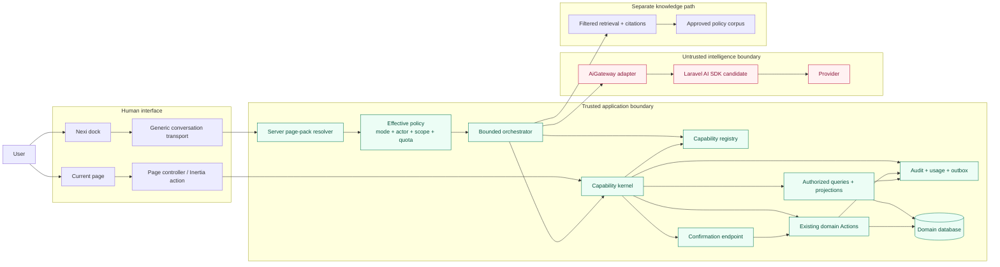

### What this prevents

| Tempting design | Actual design |
|---|---|
| Give the model raw HTTP or database access | Give it only registry entries with strict schemas |
| Add a second set of `ai/*` business routes | Use one generic Nexi transport and the same domain handlers |
| Let a provider execute a tool directly | Provider output becomes a validated read or a persisted proposal |
| Put page permissions in JavaScript context | Resolve actor, scope, role, mode, and lifecycle on the server |
| Let a prompt sanitizer decide security | Enforce projection, authorization, schema, policy, and audit at boundaries |

## 2. The shared-kernel rule

There are many normal page routes. There is one generic Nexi transport. Neither is allowed to invent business behavior.

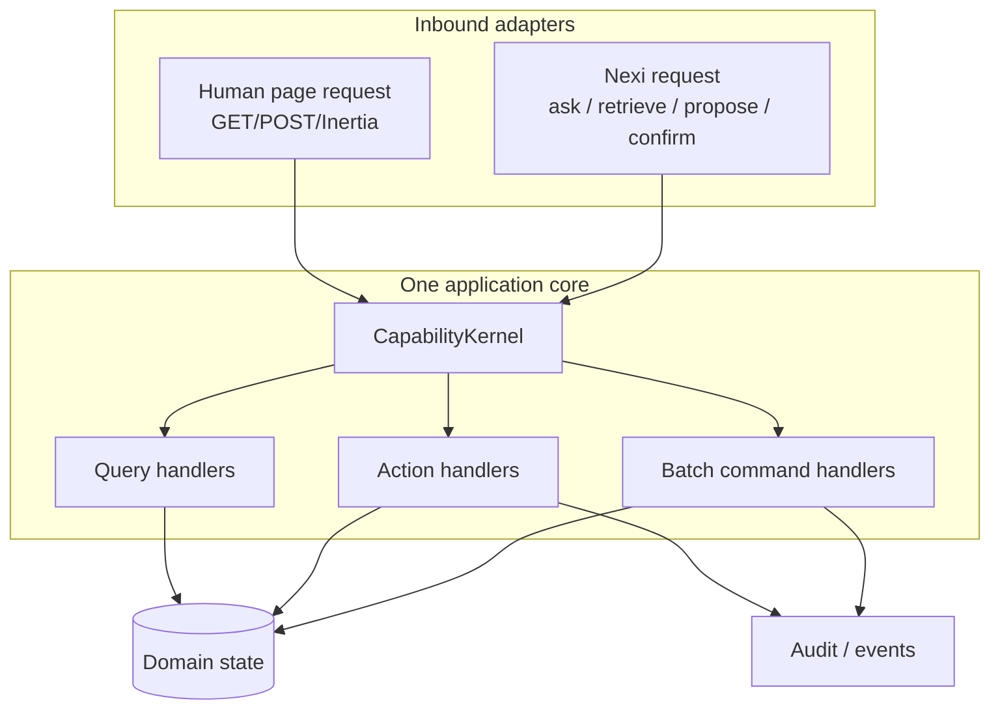

For example, the page button **Publish schedule** and Nexi's confirmed proposal both end in the same `PublishExamSessionSchedule` action. The transport that brought the request in does not change the authorization, transaction, audit, or idempotency rules.

## 3. The nouns that keep the system scalable

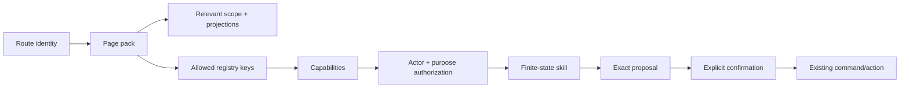

| Noun | Plain-language meaning | It is not |
|---|---|---|
| **Page pack** | Server-owned description of the current route: modes, projections, skills, capability keys, privacy class, and declarative UI intents | Permission by itself |
| **Capability** | One versioned operation with a strict input/output schema, scope resolver, risk, confirmation rule, and handler | A raw route or arbitrary code execution |
| **Projection** | The minimum, typed, privacy-reviewed view of records the model may see | A model-readable database dump |
| **Skill** | A bounded workflow state machine composed from capabilities | A free-running prompt or autonomous agent |
| **Proposal** | Persisted exact intended change, with canonical JSON and a hash | An instruction hidden in chat text |
| **Task grant** | Short-lived, revocable authority for a cross-page skill | A copy of the user's permanent permissions |
| **Provider** | An untrusted suggestion engine | A trusted actor or transaction manager |

## 4. What a page publishes

The browser can hint at the current route, but the server resolves the authoritative pack from the Laravel route name and current context epoch.

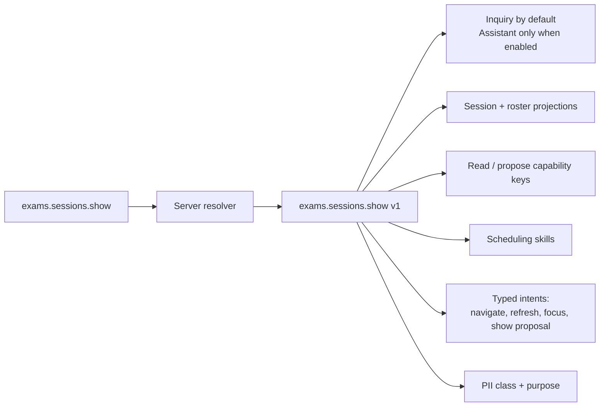

Example scheduling pack:

| Pack field | Example |
|---|---|
| Route identity | `exams.sessions.show` |
| Context epoch | `institution=7; duty=scheduler; session=42; pack=v1` |
| Default mode | `Inquiry` |
| Assistant gate | Explicit user consent + actor capability |
| Allowed projections | Session dates, capacity, assignment status, permitted display names |
| Read keys | `exam_session.get`, `exam_roster.summary` |
| Proposal keys | `exam_schedule.propose_assignments`, `exam_session.propose_open` |
| Command keys | Exposed only through the confirmation endpoint |
| UI intents | Refresh roster, focus unassigned list, show proposal |

The pack narrows relevance. The effective policy still performs the deny-dominant intersection of actor, role, scope, mode, lifecycle, purpose, feature flag, quota, provider health, and emergency controls.

## 5. How a capability is shaped

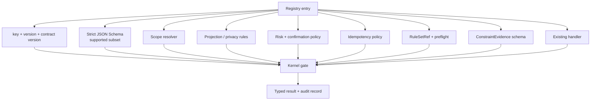

Only `read` and `propose` entries are offered to the provider. A mutation is not a provider tool call: it is a proposal saved by the server, then a separate confirmation request invokes the ordinary action.

## 5A. The single source of truth for proposal validity

The system prompt should teach the model the current constraints, but it must never be the place where the constraints live. The model receives a generated rule digest; the server proves validity with the domain preflight.

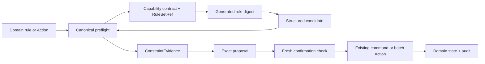

| Layer | Role |
|---|---|
| Domain rules, Actions, Queries | Canonical business truth |
| Preflight evaluator | Reusable deterministic feasibility and constraint check |
| Capability Registry | Versioned schema, scope, handler, `RuleSetRef`, and preflight reference |
| Prompt/rule digest | Concise guidance generated from the canonical rule set |
| LLM output | Candidate arguments/preferences, always untrusted |
| Proposal | Exact normalized snapshot plus rule/target evidence |
| Confirmation | Re-runs authorization, rule preflight, versions, and idempotency before the ordinary command |

### If a business rule changes

Update the domain rule and tests first. Then publish a new `RuleSetRef`, rebuild capability descriptors/page packs/skills/prompt digests, segment affected context epochs, and invalidate incompatible proposals or task grants. Keep the capability version when its contract and semantics remain compatible; bump it when they do not. No prompt edit alone can change what the application accepts.

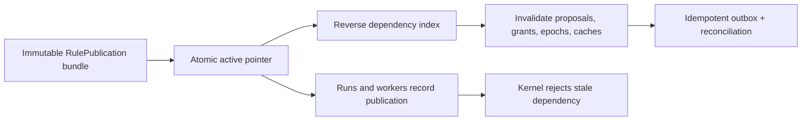

## 6. Scheduling: request to safe change

This is the concrete flow for “find feasible assignments and open the selected sessions.” Bulk work is one purpose-built batch command, not a sequence of hidden page hops.

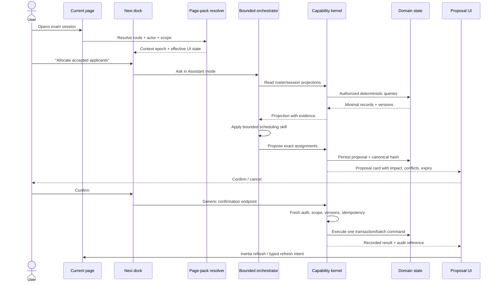

### The important stop points

1. **Inquiry cannot mutate.** It can answer from approved policy or authorized reads.
2. **Assistant requires explicit consent.** A countdown or automatic mode switch is not consent.
3. **The proposal is exact.** It contains target IDs, intended values, scope, expiry, versions, and a canonical hash.
4. **Confirmation is fresh.** The server rechecks authorization and optimistic-concurrency versions.
5. **The normal action runs.** Audit, idempotency, events, and transactions are unchanged.

## 7. Modes are a safety state machine

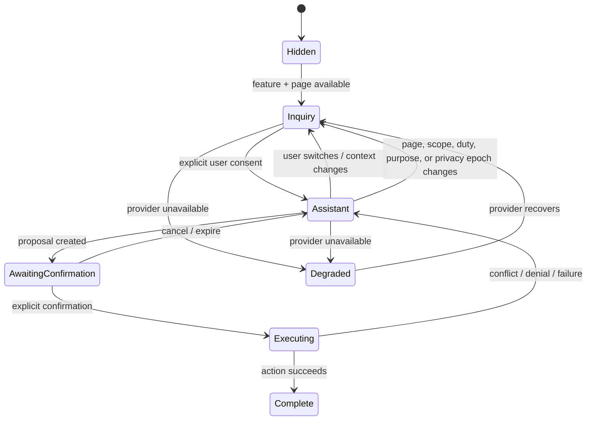

The context epoch is a hard boundary. When the page or authorized scope changes, the server segments or rebuilds provider context; it never blindly replays the old transcript under the new authority.

## 8. The Nexi UI at a glance

The dock is mounted in the authenticated shell, but the server continually supplies the effective state for the current page.

```text
┌──────────────────────────────────────────────────────────────┐
│ Current page: Exam session 42     Scope: Institution 7        │
│ ┌───────────────┐  ┌────────────────────────────────────────┐ │
│ │ Inquiry  ●    │  │ Nexi                                    │ │
│ │ Assistant ○   │  │ “I can answer policy questions here.    │ │
│ └───────────────┘  │ Assistant actions are available for     │ │
│                    │ this session after you enable them.”   │ │
│                    │                                          │ │
│                    │ [Citation card] [Read result]            │ │
│                    │                                          │ │
│                    │ [Proposal: 12 assignments]               │ │
│                    │ [Review details] [Confirm] [Cancel]       │ │
│                    │                                          │ │
│                    │ Usage today: 18 / 100     [Clear thread] │ │
│                    └────────────────────────────────────────┘ │
└──────────────────────────────────────────────────────────────┘
```

The dock may render only declarative, typed intents returned by the server: `navigate`, `refresh`, `focus`, `open_panel`, `show_proposal`, and `show_citations`. The provider cannot author DOM selectors, raw HTML, arbitrary URLs, or JavaScript.

| UI state | User experience |
|---|---|
| Hidden | No Nexi surface for this route or actor |
| Inquiry-only | Questions, policy citations, authorized read answers; no Apply controls |
| Assistant-ready | Explicit mode control and page-specific skills |
| Awaiting confirmation | Exact proposal, impact, conflicts, expiry, confirm/cancel |
| Degraded | Explain that live assistance is unavailable; retain safe fallback/manual UI |
| Quota suspended | Show limit and reset/admin contact; do not silently downgrade a denied capability |

## 9. Read, propose, command

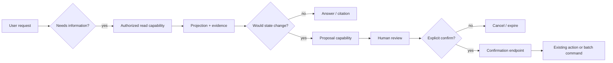

| Operation kind | Can it happen automatically? | Example |
|---|---:|---|
| Read | Yes, if authorized and bounded | List unassigned applicants |
| Propose | Yes, but it only persists an exact proposal | Suggest assignments that satisfy constraints |
| Command | No; requires explicit confirmation and fresh checks | Publish schedule, open reservations |

## 10. Data and privacy path

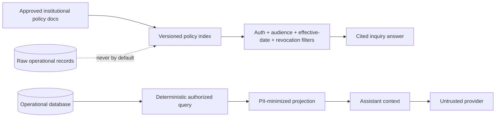

The system does not rely on one magical prompt-sanitization package. Safety is layered:

1. authorize before retrieval;
2. project and classify fields before prompt construction;
3. separate instructions, data, and retrieved documents;
4. use strict schemas and reject invalid output;
5. escape and allowlist links/UI intents;
6. record a hash-linked privacy decision and audit trail.

Operational own-data and staff-work data use deterministic, scoped queries. RAG is initially for the approved institutional policy corpus, with exact source citations and refusal when evidence is missing or stale.

### RAG status and one knowledge-source registry

RAG is designed but not active yet. The future registry is the only door into knowledge retrieval.

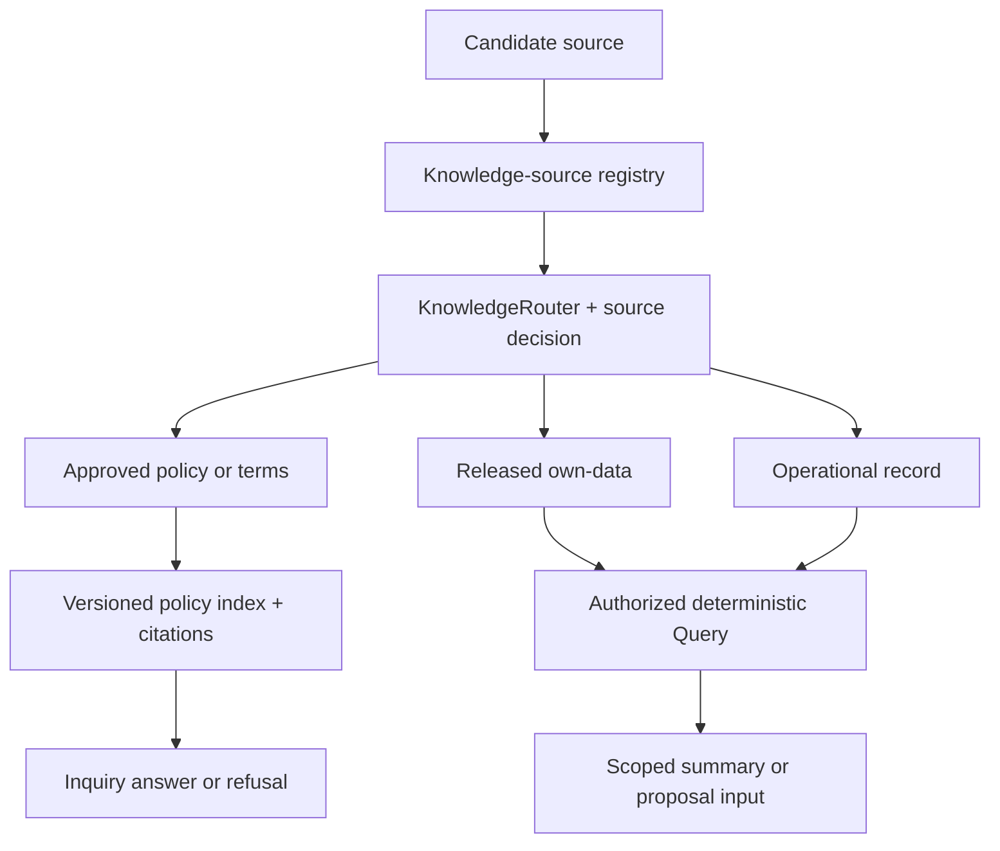

Institution-approved terms and conditions can be policy-corpus sources. Schedules, rosters, applicants, and other operational rows remain Query/projection data even when visible on a page; they are not embedded by convenience. Every source carries owner, audience, effective/revoked version, checksum, citation identity, and a declared retrieval route.

Revocation is immediate at the registry boundary: cached snapshots, context epochs, in-flight/replayable citations, and answer artifacts become unusable before asynchronous deletion or re-indexing completes. Reconnect and later conversation turns re-check source eligibility.

## 11. Skills are bounded workflows, not free autonomy

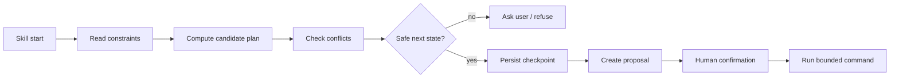

Every skill has a server-owned finite state machine, explicit legal transitions, maximum steps, token/time/cost budgets, bounded retries and fan-out, checkpointing, and a clear refusal/escalation path. The model can recommend the next transition; only the server advances the state.

For cross-page work, the skill receives a short-lived, revocable `TaskGrant` describing the additional purpose and scopes. The grant expires or is revoked when the task ends, the user cancels, or the context changes.

## 12. Usage limits and administration

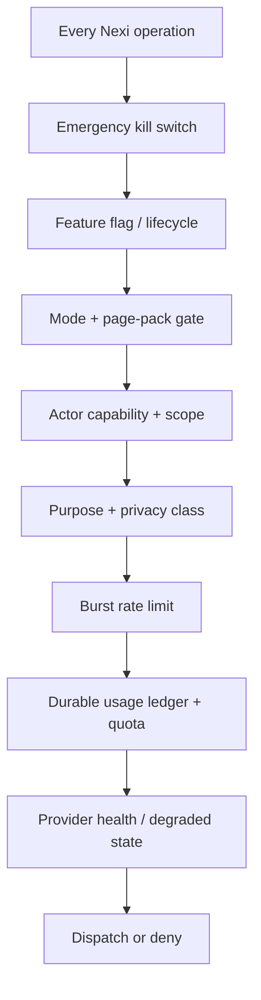

Administration can disable a route, mode, skill, provider, or capability and can set quotas or narrow an existing ceiling. An override may never grant a new capability or widen actor scope. Denial wins if any gate says no.

The durable ledger records asks, input/output tokens, tool steps, estimated cost in integer micro-units, actor, institution, routing profile, pricing version, and accounting timezone. A fast limiter handles bursts; the ledger handles durable quota and reporting.

## 13. Shared component, separate trust surfaces

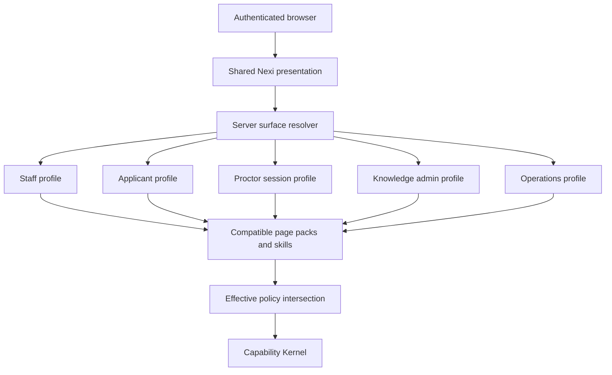

The dock can look the same across shells, but the resolved `SurfaceProfile` partitions prompts, disclosures, history, retention, page packs, context projections, skills, consent, and TaskGrants. Applicant context cannot fall through to staff behavior; unknown or conflicting surfaces fail closed.

## 14. Knowledge administration before RAG

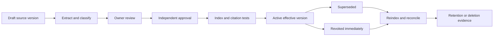

Knowledge CRUD is a publication workflow, not a file manager. Unreviewed drafts never enter retrieval. Revocation blocks retrieval synchronously, while cache/index deletion and retention reconciliation finish asynchronously with visible status.

Structured system records follow another path:

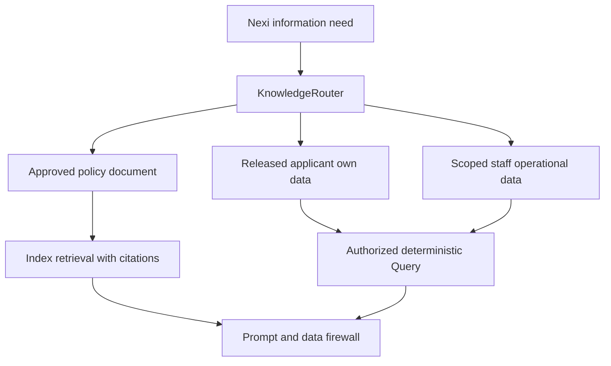

## 15. Frontend session and recovery loop

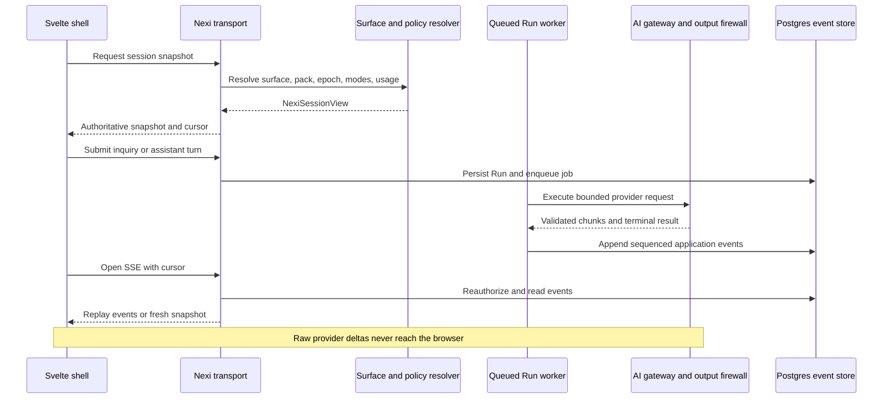

The model may emit a request to use Assistant, but the server returns an application-owned consent event. The user must choose; the client cannot turn a countdown, saved preference, or model message into consent.

## 16. Build order

```mermaid
flowchart LR
    P0["Reconcile planning authority"] --> P1["Shared degraded shells"]
    P1 --> P2["Surface profiles and page packs"]
    P2 --> P3["Conversation usage and recovery"]
    P3 --> P4["Knowledge governance without live RAG"]
    P4 --> P5["Provider spike on synthetic data"]
    P5 --> P6["Policy Inquiry with citations"]
    P6 --> P7["Applicant Inquiry"]
    P7 --> P8["Exam Assistant pilot"]
    P8 --> P9["Cross domain skills"]
```

### Gates before implementation

- Archive `exam-session-scheduling` and open `ai-assistant-foundation`.
- Reconcile promoted React references with the selected executable Inertia 3 + Svelte 5 stack.
- Approve the page × mode matrix and the first typed capability catalog.
- Decide the Laravel AI adapter/provider through an ADR; do not install it as a design shortcut.
- Prove fake-provider tests, context-epoch isolation, deny-dominant policy, idempotent confirmation, and degraded UI first.
- Build knowledge governance before claiming RAG, then promote policy Inquiry and applicant Inquiry separately.
- Start Assistant execution with one vertical slice: exam-session reads and two or three proposals.

## Related documents

- [Architecture spine](./ARCHITECTURE-SPINE.md) — normative invariants and contracts.
- [Readiness plan](./READINESS-PLAN.md) — research, ADR, OpenSpec, and rollout gates.
- [Junior implementation guide](./JUNIOR-IMPLEMENTATION-GUIDE.md) — complete surfaces, frontend contract, route matrix, capability/skill catalog, knowledge CRUD, applicant plan, and delivery slices.
- [Divergence review](./reviews/review-divergence-adversary.md) — integration/adversarial review.
- [Rubric/security review](./reviews/review-rubric-security.md) — security and acceptance review.
- [Technology review](./reviews/review-technology-reality.md) — Laravel AI candidate and verification notes.
- [Standards research](./STANDARDS-RESEARCH.md) — JSON Schema, RFC 8785, OWASP, NIST, Laravel AI, MCP, and remaining research gates.

No provider package was installed and no production route or domain code was changed by creating this visual guide.
