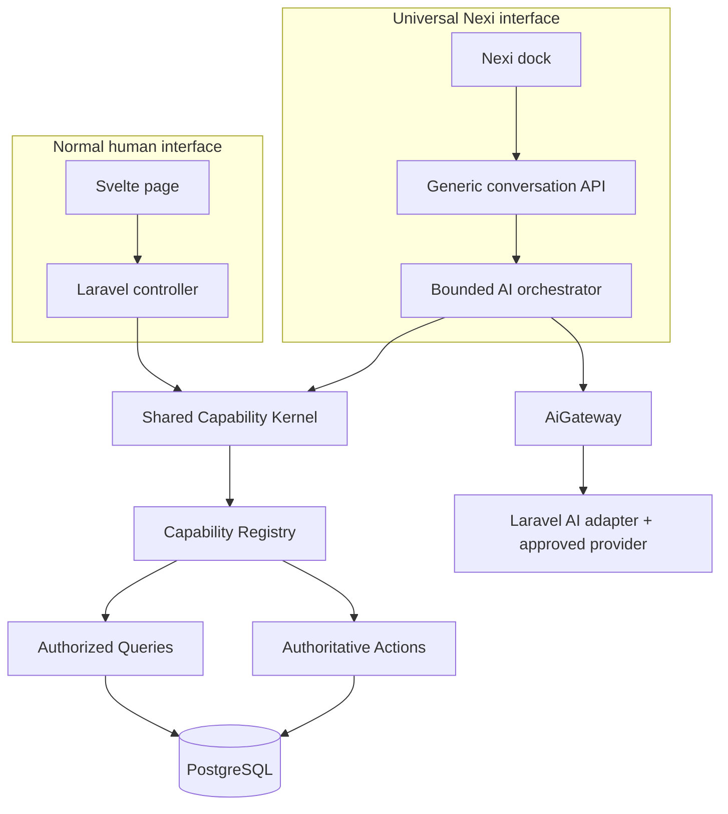
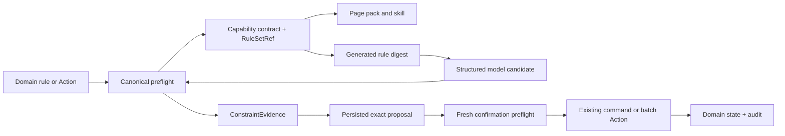
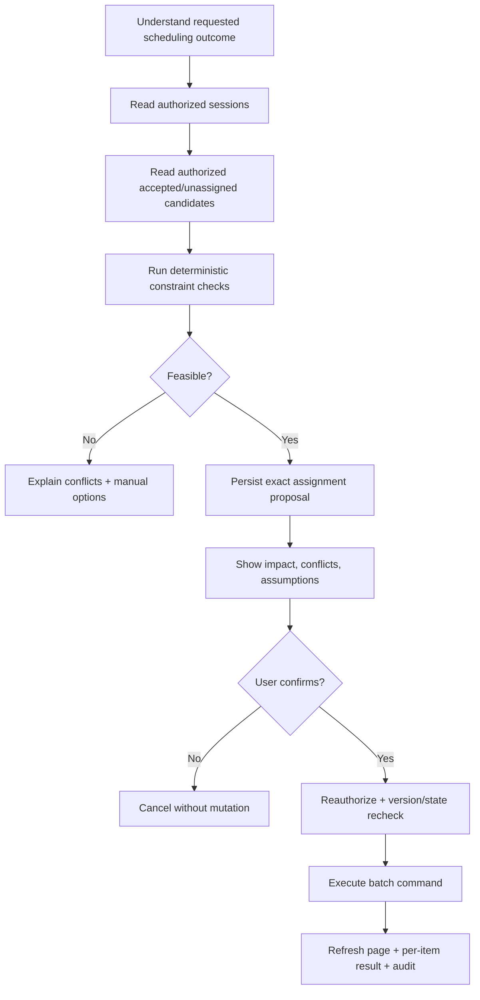
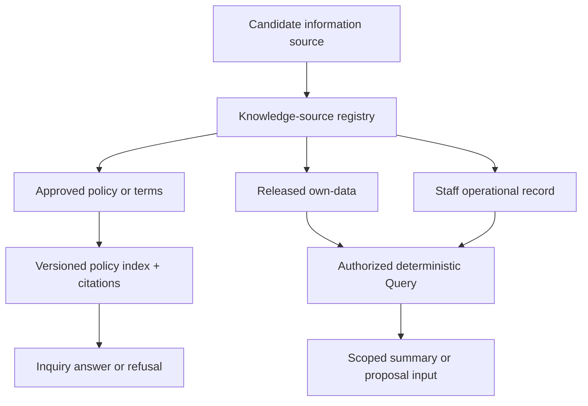

# NEXIAM AI Assistant Foundation — Architecture and Readiness Plan

**Date:** 2026-08-10  
**Status:** FINAL planning architecture; not implementation authority until the required ADRs and OpenSpec are approved  
**Purpose:** Turn the universal Nexi idea into a scalable implementation sequence without duplicate AI routes or hidden authority.  
**Binding companion:** [`ARCHITECTURE-SPINE.md`](ARCHITECTURE-SPINE.md)

**Standards companion:** [`STANDARDS-RESEARCH.md`](STANDARDS-RESEARCH.md)

## 1. Decision in one view

Build **one application capability system** used by both the normal UI and Nexi.



There are not two sets of business routes. There are:

1. ordinary application routes for people and Inertia pages;
2. a few generic Nexi conversation/approval endpoints;
3. one shared capability registry/dispatcher beneath both;
4. the existing domain Actions and Queries as the actual implementation.

The browser and AI are two callers of the same application behavior. Nexi never performs `GET /foo` or `POST /bar` as if it were a browser robot.

## 2. Why this avoids the route-maintenance problem

The current target already has good domain Actions such as `OpenExamSessionReservation`, `AssignApplicantToExamSession`, and `PublishExamSession`. The current risk is that page controllers call these Actions while Nexi's catalog is a separate JavaScript stub.

The foundation change should insert one shared application dispatcher:

```text
page controller ─┐
                 ├─> CapabilityKernel.dispatch(key, actor, input, context)
Nexi tool adapter┘                         │
                                           └─> existing Action/Query handler
```

For every operation exposed to Nexi, the page controller is migrated to that dispatcher too. This makes one definition own:

- input and output schema;
- capability and scope resolution;
- risk and confirmation rules;
- idempotency and target version requirements;
- audit event family;
- handler;
- safe model description;
- equivalent UI location.

Routes remain presentation adapters. Route names never become AI tool names.

## 3. The five architectural layers

| Layer | Owns | Must not own |
| --- | --- | --- |
| Nexi shell | Dock visibility, stream rendering, mode control, proposals, citations, UI intents | Authorization, domain truth, arbitrary DOM execution |
| Policy/context | Effective availability, page pack, actor/mode/budget/privacy decisions | Business state mutation |
| Orchestrator | Bounded conversation loop, tool selection, skill progression, proposal assembly | Record authorization or authoritative commits |
| Capability Kernel | Schema validation, authorization, scope, dispatch, idempotency, typed result | Provider prompts or UI rendering |
| Domain Actions/Queries | Business invariants, transactions, locks, projections, audit/outbox | AI/provider knowledge |

## 4. Page Capability Packs: scalable page awareness

A page pack is not a system prompt and not a list of raw routes. It is a server-owned capability view.

Minimum contract:

```yaml
key: exams.sessions.show@1
page_identity: exams.sessions.show
allowed_modes: [inquiry, assistant]
default_mode: inquiry
projections:
  - exams.session.summary.v1
  - exams.session.roster_status.v1
capabilities:
  - exams.reservations.open.v1
  - exams.reservations.close.v1
  - exams.assignments.propose.v1
  - exams.sessions.publish.v1
skills:
  - schedule.accepted_applicants@1
ui_intents:
  - navigate
  - refresh_page
  - open_assignment_panel
privacy_class: staff_operational_minimized
```

Rules:

- the server derives the pack from the canonical matched page identity;
- canonical page identity is the matched Laravel route name, registered at build time;
- the client URL is a hint, never authority;
- a pack can include cross-page navigation and skills, but only registered targets;
- a pack filters relevance; it never grants a missing capability;
- page navigation recomputes the pack and invalidates stale tool availability;
- pack/version is recorded on each run and proposal.
- duplicate route/pack registrations fail the build; unknown routes fail closed instead of inheriting the previous pack.

This scales better than one giant prompt because each domain team owns a small pack beside its application module while the registry remains global and unique.

## 5. Capability Registry: the internal MCP-inspired seam

The MCP inspiration is useful at the contract level: named tools, descriptions, schemas, and structured results. NEXIAM does not need to expose an MCP server or let the model discover arbitrary external servers.

Each definition contains:

| Field | Purpose |
| --- | --- |
| `key` + `version` | Stable model/application contract independent of route URI |
| `contract_version` | Compatibility version for the shared DTO/schema protocol |
| `kind` | `read`, `propose`, `command`, `navigate` |
| `input_schema` | Reject unstructured or invented arguments |
| `result_schema` | Keep tool results machine-checkable and minimizable |
| `channel_projections` | Separate registered UI, provider, audit, and stream views of one authoritative result |
| `application_capability` | GF-21 capability key |
| `scope_resolver` | Institution/cycle/office/program/session/own-data boundary |
| `rule_set_ref` | Code-owned domain rule-set key, version, and digest used by proposal preflight |
| `preflight` | Canonical deterministic feasibility/constraint evaluator reused at preview and confirmation |
| `handler` | Existing/new Action or Query class |
| `risk` | Read, reversible, consequential, destructive, data-export |
| `confirmation` | Always required for assistant mutations; exact confirmation copy policy |
| `idempotency` | Key source, replay behavior, reconciliation |
| `privacy_projection` | Fields/data class allowed into tool result/provider context |
| `equivalent_ui` | Human page path and control |
| `audit_events` | Proposed/confirmed/completed/refused evidence |
| `constraint_evidence` | Typed checks, rule IDs, target versions, and no-support/conflict reasons |

Example scheduling seed:

| Registry key | Kind | Handler | Confirmation | Equivalent UI |
| --- | --- | --- | --- | --- |
| `exams.sessions.list.v1` | read | scoped sessions Query | No | Sessions Index |
| `exams.assignments.unassigned_accepted.v1` | read | scoped eligible-attempt Query | No | Session assignment panel |
| `exams.schedule.propose.v1` | propose | deterministic feasibility/proposal service | No mutation | Schedule preview |
| `exams.assignments.batch_apply.v1` | command | purpose-built batch Action | Required | Confirm assignment plan |
| `exams.reservations.open.v1` | command | `OpenExamSessionReservation` | Required | Open reservation button |
| `exams.sessions.publish.v1` | command | `PublishExamSession` | Required | Publish button |

The first foundation OpenSpec should implement the registry/dispatcher with stubs and migrate only the pilot page operations. It should not catalog every route at once.

Registry contracts are immutable PHP artifacts compiled against a NEXIAM-supported subset of JSON Schema Draft 2020-12. Dispatch rejects unknown fields and implicit coercion/defaults, returns stable validation paths, and fails build/boot on duplicate `(key, version)` definitions. Canonical contract fixtures prove compatibility across the kernel, Svelte transport, skills, and provider adapter.

## 5A. Canonical rules, proposal validity, and change propagation

The proposal is only trustworthy when it reflects the same rules that the normal application command will enforce. The model may be given a concise rule summary so it proposes better candidates, but the prompt is never the source of truth.



### Single source of truth by layer

| Layer | Owns | Authority status |
|---|---|---|
| Domain state and Actions/Queries | Invariants, workflow state, locks, eligibility, capacity, overlap, transactions, projections | **Canonical** |
| Domain preflight / constraint evaluator | Pure or read-only feasibility checks for normalized command arguments | **Canonical validity check**, reused by preview and confirmation |
| Capability Registry | Input/result schemas, scope resolver, risk, handler, `RuleSetRef`, preflight reference | Versioned adapter contract; never a second rule implementation |
| Page pack / skill | Relevant capability keys, workflow sequence, UI intents, bounded hints | Relevance and workflow projection |
| Generated `PromptSpec` / rule digest | Role, mode, current rule summary, allowed capability descriptions, output format | Guidance only; not authorization or validity |
| Model output | Candidate arguments, preferences, explanations, referenced assumptions | Untrusted candidate |
| Proposal record | Exact normalized command, target snapshots, `RuleSetRef`, `ConstraintEvidence`, expiry, hash | Immutable decision snapshot; executable only after fresh confirmation |

### What changes when a business rule changes

1. Update the domain rule/action and its tests. Do not edit a system prompt to change behavior.
2. Publish a new `RuleSetRef` version/digest from the code-owned rule set.
3. Rebuild the affected registry descriptors, page packs, skills, and generated prompt digest.
4. Segment affected context epochs so new turns receive the new rule summary.
5. Invalidate pending proposals and `TaskGrant`s whose rule set no longer applies.
6. Keep the capability key/version stable when the input/output contract and semantics remain compatible; bump capability or `contract_version` when they do not.
7. Rerun domain, proposal, adversarial, and provider-contract evaluations before promotion.

The existing Examination Actions already contain authoritative checks such as status, capacity, overlap, and expected-version validation. The foundation should extract reusable preflight evaluators where preview needs the same checks; it must not create an AI-only copy of those rules.

### Evidence and publication contracts

Every proposal-capable capability uses an ordered `RuleDependencySet` of `(rule_key, rule_version, digest, compatibility_class)` entries and a canonical set digest. Its versioned `ConstraintEvidence` records the preflight identity, normalized-argument digest, target snapshot/version digest, ordered rule outcomes, safe facts/assumptions, actor/scope decision reference, observed-at time, expiry, overall outcome, and evidence digest. The outcome union is `pass`, `confirmable_warning`, `hard_fail`, or `indeterminate`; only domain-registered warning codes may be confirmable. A hard fail or indeterminate result cannot be downgraded by a prompt, model, user, or ordinary admin.

The final command transaction or queue worker acquires domain-defined locks, resolves the active `RulePublication`, and invokes the same evaluator path again immediately before mutation. Rule dependency/evidence/projection versions are part of the proposal digest. If the rule publication, target snapshot, or evidence differs, execution returns a typed non-commit conflict tied to the proposal.

`RulePublication` is an immutable bundle of evaluator, registry, page-pack, skill, and generated `PromptSpec` digests. A monotonic active pointer publishes it atomically. A reverse-dependency index plus idempotent outbox event invalidates affected proposals, grants, context epochs, caches, citations, and evaluation fixtures; the kernel independently rejects stale dependencies while reconciliation repairs delayed consumers.

## 6. Inquiry and Assistant modes

### Inquiry

- global Q&A where enabled;
- approved policy corpus with citations;
- deterministic authorized own-data query when supported;
- no mutation tools;
- no operational record enumeration;
- refusal/manual contact when unsupported or prohibited.

### Assistant

- everything Inquiry can explain;
- current page pack and minimized page projections;
- allowlisted navigation/read/proposal/command capabilities;
- versioned skills for multi-step tasks;
- explicit confirmation before every assistant-originated mutation.

### Switching

The model may recognize that an Inquiry request requires action and return:

```json
{
  "type": "mode_escalation_required",
  "target_mode": "assistant",
  "reason": "Opening reservations changes the session",
  "requested_capability": "exams.reservations.open.v1"
}
```

Nexi then renders an application-owned **Switch to Assistant** control. Only clicking it changes the mode. “Switching in 3…2…1” can be presentation copy only after the user has already confirmed; it cannot serve as consent.

Every new context epoch starts in Inquiry. Assistant activation produces a consent record bound to actor/session, disclosure version, eligible surface or task grant, and expiry. A broader or changed pack requires fresh activation.

On an Inquiry-only page, Assistant automatically demotes with a notice and its tools disappear. The conversation shell may remain, but a scope/duty/institution/purpose/privacy change closes or segments the context epoch; prior sensitive messages or tool results are never blindly replayed into the next provider request. Pending proposals are invalidated unless an active task grant still covers them and fresh checks pass.

## 7. Skills: guided multi-step work

A skill is a workflow recipe over capability keys, not a new authority layer.

Example `schedule.accepted_applicants@1`:



Important boundaries:

- deterministic code checks capacity, overlap, eligibility, session state, and target versions;
- the LLM may explain trade-offs or propose preferences, but it does not certify feasibility;
- the plan contains opaque attempt/session references and only necessary labels;
- one exact plan becomes one confirmation;
- a changed roster, capacity, or session version invalidates the plan;
- large work becomes a queued operation with progress and cancellation rules;
- every skill has a manual fallback and maximum step/time/cost limits;
- the server owns a finite state-machine cursor, legal transitions, checkpoints, retry/idempotency, cancellation, and terminal states; a model may recommend but never directly advance the cursor;
- starting a cross-page skill issues a short-lived TaskGrant bound to actor/session, institution, scope/cardinality, capability versions, origin pack, context epoch, and expiry;
- navigation alone may preserve that grant within its original bounds, but logout, mode demotion, suspension, emergency stop, capability/scope change, or incompatible publication revokes it and invalidates proposals.

Other useful skills can later include:

- `explain.schedule_conflicts@1` — read-only diagnosis;
- `prepare.reservation_opening@1` — identify eligible draft sessions and propose dates;
- `review.missing_scores@1` — scoped read and navigation only;
- `prepare.application_bulk_decision@1` — exact proposal, never autonomous acceptance.

## 8. Universal Nexi UI

Keep the existing wrap-island dock mounted at the authenticated shell level. Replace client-owned demo context/action stubs with server state.

### Effective visual states

| State | Dock behavior |
| --- | --- |
| `hidden` | No dock; actor/page is not eligible |
| `inquiry_only` | Inquiry pill fixed; policy/own-data help only |
| `assistant_available` | Mode chooser and consent affordance available; Inquiry remains active |
| `assistant_active` | Explicit consent is current; page/task suggestions and proposal UI are available |
| `degraded` | Existing static/page guidance; provider actions unavailable |
| `quota_exhausted` | History/manual help remain; new provider turns blocked with reset date |
| `suspended` | Admin/policy message with safe reason and support path |

### Conversation layout

- the dock survives Inertia navigation through the persistent layout;
- the page pack and context summary update on each navigation;
- the conversation is segmented into reauthorized context epochs; the provider receives only the current epoch or a newly authorized minimized summary;
- a visible “Using: Exam session / Cycle / Office” chip shows active scope;
- tool progress appears as safe statuses (`Checking sessions`, `Preparing proposal`) rather than hidden reasoning;
- citations open approved institutional pages/documents;
- proposals render structured cards, not model-authored Markdown tables alone;
- confirmation is an application component showing exact impact and expiry;
- command completion triggers normal Inertia prop refresh or named navigation;
- reduced-motion, keyboard, focus, live-region, cancel-stream, and reconnect behavior are acceptance requirements;
- “Cancel” first records cancellation requested; provider abort is a spike capability, and a committed domain command is always reported as committed rather than cancelled.

### Typed UI intents

Allow a small fixed catalog:

- `navigate(route_key, params)`;
- `refresh_page(only_props)`;
- `focus_region(region_key)`;
- `open_panel(panel_key)`;
- `show_proposal(proposal_id)`;
- `show_citations(citation_ids)`;
- `show_operation(operation_id)`.

Do not allow CSS selectors, JavaScript, component imports, arbitrary URLs, or raw HTML from the provider. Provider output may request an intent, but trusted application code alone constructs the final intent after checking the current pack or task grant; the client revalidates for defense in depth.

## 9. Nexi transport API

Use a small generic transport, not per-page AI endpoints. Exact URIs may follow project convention, but responsibilities are:

| Endpoint responsibility | Behavior |
| --- | --- |
| Start/list conversation | Authorize actor ownership and surface; return effective Nexi state |
| Submit turn / stream | Validate mode/page context, reserve budget, run bounded orchestrator, stream typed events |
| Resolve proposal | Approve/reject exact proposal; reauthorize and execute through Capability Kernel |
| Cancel run | Stop provider/queue work where possible; never pretend committed domain work was undone |
| Clear/history | Enforce ownership and retention policy |

Use one stream event envelope:

```json
{
  "event_id": "uuid",
  "run_id": "uuid",
  "sequence": 12,
  "type": "assistant_delta|status|citation|ui_intent|proposal|usage|completed|failed",
  "payload": {},
  "occurred_at": "2026-08-09T00:00:00Z"
}
```

SSE/fetch streaming is the recommended first transport. The Laravel AI SDK can stream directly and supports the Vercel AI SDK protocol, but NEXIAM should translate provider/SDK events into its own stable envelope so the Svelte UI is not bound to one SDK protocol.

The stream contract is a versioned discriminated union with a monotonic sequence per run and at most one terminal event. Durable status/citation/proposal/usage/terminal events replay by cursor; token deltas are transient. On reconnect, the client fetches an authoritative snapshot, ignores duplicates, detects gaps, and resumes from the next durable cursor. A Turn has at most one active Run, terminal states are immutable, and provider conversation IDs are adapter metadata rather than NEXIAM ownership keys.

## 10. Availability, usage limits, and admin control

### Effective policy intersection

```text
registry membership
  ∩ active Inquiry/Assistant mode
  ∩ page pack or task grant
  ∩ actor capability + data scope + lifecycle + purpose
  ∩ privacy destination policy
  ∩ institution/user narrowing
  ∩ provider/model health
  ∩ durable budget
  ∩ burst rate limit
```

The emergency switch denies everything first. All other layers form a deny-dominant intersection: no later admin/user override may restore a denied capability, widen scope, bypass lifecycle/purpose/step-up, or exceed an approved ceiling. The server records the immutable effective-policy version on every turn/run/reservation; the client never recomputes policy.

### Separate two controls

1. **Burst rate limit:** protects abuse and accidental rapid submission. Laravel's rate limiter is appropriate for per-user/per-IP short windows.
2. **Durable budget:** controls asks, input/output tokens, tool steps, and estimated/actual cost per user and institution over a day/month.

For concurrency-safe budget accounting:

1. estimate and reserve a maximum allowed amount under a lock;
2. start the provider request only after reservation succeeds;
3. settle actual SDK/provider usage on completion;
4. release unused reservation;
5. classify timeout/unknown-provider outcomes for reconciliation;
6. never rely on the UI meter as enforcement.

The durable ledger records asks, input/output tokens, tool steps, provider-cost micro-units and currency by institution, user, routing profile, pricing version, and policy timezone/reset. Reservations are uniquely tied to a run/attempt and have expiry, settlement, release, and unknown-usage reconciliation states. The policy specifies how rejected, retried, cached, cancelled, failed, and provider-unknown calls affect each dimension.

### Admin surface

Typed admin commands should support:

- global Nexi enabled/disabled/degraded;
- Inquiry and Assistant availability by approved surface/actor policy;
- per-user suspension or approved override with reason/expiry;
- daily/monthly ask/token/cost budgets and burst limits;
- approved routing profile selection;
- corpus version publication/revocation;
- usage/latency/error dashboard and sanitized audit review;
- emergency provider disablement.

Routine admins must not edit raw system prompts, add tools/routes/URLs/classes, enable web browsing, or change provider secrets.

An override may narrow access or adjust quota within a pre-approved ceiling; it can never grant application capability or resource scope. Publishing policy creates a new version, invalidates caches, and preserves ledger history.

## 11. Privacy and prompt-injection design

Do not search for a single “PII prompt sanitizer” and treat it as the security boundary. OWASP explicitly recommends least-privilege tools, server-side validation, structured prompts, monitoring, and human approval as defense in depth; guardrail models and sanitizers remain bypassable layers.

Build a NEXIAM Prompt/Data Firewall with these stages:

```text
authorized projection
  → data classification + field allowlist
  → pseudonymous reference mapping
  → secret/credential and prohibited-data check
  → structured instruction/data envelope
  → provider adapter
  → structured-output schema validation
  → citation/support/refusal validation
  → Markdown/HTML/link sanitization
  → typed Nexi event
```

Required rules:

- authorize and retrieve before prompt construction;
- issue a short-lived read invocation grant binding user-confirmed purpose, query keys, target/filter, maximum rows/pages, field projection, destination class, and expiry;
- persist mandatory protected-view/egress evidence before any protected result reaches the orchestrator/provider; fail closed if that evidence cannot be written;
- no raw Eloquent model serialization;
- no credentials, access keys, birthdates, raw scores, counseling notes, or unreleased data;
- names/contact data only when the approved task truly needs them and provider sharing is approved;
- prefer server-side entity matching and opaque references;
- policy documents are marked untrusted evidence, never instructions;
- provider output cannot choose capability keys outside the supplied set;
- tool arguments must validate against registry schema and original user intent;
- output links use approved citation/route IDs, never arbitrary model URLs;
- raw HTML is not rendered;
- system prompts contain no secrets or authorization matrices;
- logs store classifications, hashes, IDs, counts, and sanitized failures rather than full sensitive payloads;
- no raw chain-of-thought storage;
- prompt/tool/corpus/model changes rerun the adversarial suite.

Reference baselines: [OWASP Prompt Injection Prevention](https://cheatsheetseries.owasp.org/cheatsheets/LLM_Prompt_Injection_Prevention_Cheat_Sheet.html), [OWASP AI Agent Security](https://cheatsheetseries.owasp.org/cheatsheets/AI_Agent_Security_Cheat_Sheet.html), and [OWASP MCP Tool Poisoning](https://owasp.org/www-community/attacks/MCP_Tool_Poisoning).

## 12. Laravel AI SDK decision

### Recommendation

Adopt the first-party `laravel/ai` SDK behind NEXIAM ports after an ADR and spike. The package is **not installed**. As of 2026-08-09, the current reviewed release is **v0.10.3**; verify it again in AI-002, lock the accepted release, and isolate the pre-1.0 dependency.

Useful SDK capabilities verified in the official Laravel 13 documentation:

- agent classes with instructions, conversation context, tools, and structured output;
- JSON-schema tool inputs and structured results;
- streaming/SSE and Vercel AI stream protocol support;
- queue/broadcast options;
- human tool approval pauses and continuation;
- max steps/tokens/timeouts and pinned provider/model attributes;
- provider failover;
- embeddings, similarity search, provider vector stores, and reranking;
- agent fakes, fake pending-approval responses, prompt/approval assertions, and provider-facility fakes;
- events containing usage and tool lifecycle data.

Official references: [Laravel AI SDK documentation](https://laravel.com/docs/13.x/ai-sdk), [installation](https://laravel.com/docs/13.x/ai-sdk#installation), [tools](https://laravel.com/docs/13.x/ai-sdk#tools), [human tool approval](https://laravel.com/docs/13.x/ai-sdk#human-tool-approval), [testing](https://laravel.com/docs/13.x/ai-sdk#testing), and [official repository/tags](https://github.com/laravel/ai/tags).

### What the SDK does not decide for NEXIAM

- actor/conversation ownership—the official docs warn that continuing a conversation does not itself verify participant ownership;
- GF-21 capability and resource scope;
- page-pack relevance;
- business proposal hashing, target versions, expiry, idempotency, or audit;
- what PII may go to a provider;
- corpus approval, citation support threshold, or refusal policy;
- fair usage budgets and admin policy;
- manual fallback and recovery semantics.

### Specific adoption constraints

- depend on `laravel/ai` only inside `App\Ai\Adapters\LaravelAi`;
- pin the reviewed minor/patch in `composer.lock` and run contract tests on upgrades;
- pin provider and model IDs; do not use dynamic cheapest/smartest attributes for authoritative behavior;
- translate SDK events into NEXIAM event envelopes;
- use SDK tool approval as the pause mechanism, but persist a NEXIAM proposal/confirmation record and reauthorize before execution;
- do not enable FileStorage write tools, WebSearch/WebFetch, arbitrary MCP tools, sub-agents, or provider-hosted file stores in the first cuts;
- do not enable cross-provider failover until data handling is approved for every provider in the chain;
- treat provider-request cancellation as an AI-002 spike result: the SDK documents streaming but not an end-to-end abort guarantee, so NEXIAM must distinguish client disconnect, cooperative cancellation, provider work/billing continuation, and committed command outcomes.

## 13. RAG architecture

### Keep three contexts separate

| Context | Source | Retrieval | Model authority |
| --- | --- | --- | --- |
| Policy | Approved/versioned institutional documents | Knowledge index with audience/effective-version filters | Explain with citations or refuse |
| Own data | Released data belonging to authenticated applicant | Authorized deterministic Queries | Summarize only returned projection |
| Staff task | Capability/scope-limited operational projections | Authorized deterministic Queries/tools | Explain/propose; never commit directly |

Do not embed applicant operational records as a convenience. Embeddings belong to approved institutional documents; application Queries handle personal/operational data.

### Knowledge index recommendation

Use a `KnowledgeIndexPort` owned by NEXIAM. For the later RAG OpenSpec, benchmark:

1. PostgreSQL full-text retrieval;
2. locally operated pgvector semantic retrieval;
3. hybrid retrieval + reranking.

Prefer the smallest local option that passes GF-10's curated relevance/citation/refusal tests. Provider-hosted vector stores are not the default because NEXIAM must own authorization filters, source revocation, backup/restore, deletion, and retention. If pgvector is selected, pin the extension/image, embedding model/dimension, index type, backup/restore, re-embedding, and zero-downtime migration rules in its ADR.

The trusted index adapter must apply institution, audience, effective-version, and revocation predicates inside candidate retrieval—before chunks reach caches, reranking, or the orchestrator. Its typed result records the index snapshot, source/chunk/version IDs, exact cited spans, relevance scores, filter evidence, and stable no-support reason. Revocation makes a source immediately ineligible and queues the defined deletion/reindex workflow.

Every source/chunk needs:

- owner and approver;
- version/effective dates and audience;
- source/citation ID and canonical link;
- checksum/extraction/index status;
- supersedes/revoked relation;
- embedding model/version where applicable;
- publication and deletion evidence.

### Is RAG already active?

No. The current Nexi context/action seam and this architecture define the boundary only; no live embedding index or provider RAG path is installed. The later RAG OpenSpec must implement the source registry and `KnowledgeIndexPort` before any document retrieval is exposed.

### One knowledge-source registry, three retrieval routes



“Terms and conditions” belong to the policy route only when they are institution-approved, versioned, audience-scoped documents. A schedule row, applicant record, or roster is operational data even if it is displayed on a page; it stays behind authorized Queries/projections and is not embedded for convenience. Every future knowledge feature must declare its source class and route in the registry, otherwise it fails closed.

The registry is a versioned `KnowledgeSourceDefinition`, not an untyped database catalog. It contains a stable source-class key/version, owner/approver authority, institution/audience/purpose policy, data classification, lifecycle state, and exactly one route reference: a `KnowledgeIndexPort` collection/profile or a Capability Registry read key/projection. Source versions follow `draft → approved → indexing → active`, with `superseded`, `revoked`, and `deletion_pending` states; only approved/effective/fully indexed versions can become active.

All provider-bound knowledge acquisition enters `KnowledgeRouter.resolve(request, trusted_context)`. The router resolves the definition, applies purpose/audience/institution checks, issues the protected-read invocation grant, dispatches only the registered route, and returns a source decision/evidence ID required by the Prompt/Data Firewall. Ordinary page reads remain on the Capability Kernel path until they are projected into an AI run.

Revocation synchronously denies new retrieval, invalidates affected caches, context epochs, in-flight/replayable citations and answer artifacts, and emits deletion/reindex work. Reconnect and later conversation continuation revalidate source eligibility before provider calls or durable citation completion. The index snapshot, source-definition versions, cited source/chunk versions, and source decision are bound to the run and answer.

## 14. Persistence model to prepare

These are conceptual records; exact migrations belong to the OpenSpec/LLD.

| Record | Purpose |
| --- | --- |
| `assistant_policies` | Approved availability, mode, quota, routing-profile selection by institution/surface |
| `assistant_user_overrides` | Bounded suspension/override with reason, owner, expiry |
| `assistant_conversations` | Actor-owned surface/mode/retention envelope |
| `assistant_context_epochs` | Reauthorized actor/session/purpose/mode/pack-or-task/privacy segment |
| `assistant_turns/messages` | Ordered minimized user/assistant content and classifications |
| `assistant_runs` | Page pack, skill, `RulePublication`, source-registry snapshot, provider/model, status, timings, correlation |
| `assistant_task_grants` | Revocable cross-page skill authority and scope/cardinality bounds |
| `assistant_tool_calls` | Capability key/version, sanitized arguments/result metadata, decision |
| `assistant_action_proposals` | Exact normalized plan, target versions, `RuleDependencySet`, `ConstraintEvidence`, `RulePublication`, projection/privacy versions, impact, hash, expiry |
| `assistant_confirmations` | Actor decision and immutable proposal binding |
| `assistant_usage_reservations` | Atomic estimated budget hold |
| `assistant_usage_ledger` | Actual asks/tokens/cost/steps and reconciliation status |
| `rule_publications/dependencies` | Immutable evaluator/registry/pack/skill/prompt bundle and reverse-dependency index |
| `knowledge_sources/definitions/chunks` | Versioned source definitions, legal lifecycle, approved corpus lifecycle, and citations |
| `knowledge_decisions/snapshots` | `KnowledgeRouter` decision, protected-read evidence, index snapshot, cited source/chunk versions, and revocation state |

Reuse the existing operation/audit/outbox patterns where their contracts fit rather than creating an unrelated AI job system.

## 15. Evaluation and security evidence

Before a live provider or mutation capability is promoted, automate:

### Capability/authorization

- missing capability, wrong office/cycle/program/session, expired duty;
- direct tool-call attempt outside the page pack;
- broad enumeration beyond the read invocation grant or its cardinality/pages;
- model invents a capability key or extra argument;
- authorization revoked between proposal and confirmation;
- conversation ID belongs to another actor;
- prior sensitive context attempts to cross a new context epoch;
- Inquiry tries to call a mutation tool.

### Proposal/idempotency

- duplicate confirmation/retry;
- expired or already resolved proposal;
- target version changes after preview;
- rule dependency/publication changes after preview;
- proposal evidence or preflight digest mismatch at transactional/queued commit;
- batch conflict/partial semantics;
- provider times out after a tool result and run reconciles without duplicate mutation.
- concurrent confirmations prove one compare-and-swap winner and stable recorded replay result;
- reconnect proves stream duplicate/gap/snapshot behavior and at-most-one terminal event.

### Privacy/injection

- user and corpus prompt injection;
- tool-result instruction injection;
- system-prompt extraction attempts;
- cross-applicant and pre-release queries;
- secret/credential/PII leakage in prompt, output, logs, citations, and stream events;
- unsafe Markdown/HTML/link payloads.

### RAG quality

- direct, multi-source, stale/superseded, unsupported, and prohibited questions;
- source revocation during retrieval/generation, stream reconnect, cache replay, and later conversation continuation;
- retrieval relevance/recall;
- citation presence and source support;
- unsupported-claim rate and refusal precision/recall;
- provider outage/degraded fallback.

### Operations/UX

- stream cancel/reconnect and duplicate events;
- provider/rate/quota failure states;
- budget races from concurrent tabs;
- reduced motion, keyboard/focus/live region, mobile dock;
- manual workflow remains complete with Nexi disabled.

Use Laravel AI fakes for deterministic application tests, recorded provider-contract fixtures for adapter tests, and a small opt-in live evaluation suite for provider/model promotion. Never make live provider calls part of ordinary CI.

## 16. Required ADRs

| ADR | Decision | Blocks |
| --- | --- | --- |
| AI-001 Capability Kernel | Registry/dispatcher contract and migration of page callers | Foundation code |
| AI-001A Contract Kernel | DTO/schema subset, trusted principal/provenance, channel projections, state/event/error unions, conformance fixtures | All cross-module implementation |
| AI-002 Laravel AI SDK | Adopt/wrap/reject, pin and upgrade policy | SDK install |
| AI-003 Provider/model | Provider, model, DPA/retention/ZDR/region/cost, secrets, routing/failover | Live provider |
| AI-004 Conversation/privacy | Stored content, retention, clear/export, incident access, logs | Persistent chat/pilot |
| AI-005 Usage governance | Budget units, limits, reset, reservation/settlement, admin overrides | Real meter/enforcement |
| AI-006 Tool/confirmation | Risk taxonomy, proposal hash/expiry, grouped confirmation, idempotency | Assistant mutations |
| AI-007 RAG/index | Corpus lifecycle, full-text/pgvector, embedding pin, citations, revocation | RAG |
| AI-008 Evaluation | Query/tool/injection suites and pass thresholds | Any AI claim/promotion |
| AI-009 Rule/knowledge authority | `RuleDependencySet`, canonical preflight/evidence, atomic `RulePublication`, `KnowledgeSourceDefinition`, `KnowledgeRouter`, revocation/invalidation | Foundation + mutations + RAG |

## 17. OpenSpec sequence

Do not put the entire system in one change.

### OpenSpec 1 — `ai-assistant-foundation`

Scope:

- reconcile the selected Inertia 3 + Svelte 5 authority in every promoted planning artifact;
- shared staff/applicant disabled/degraded shell adapter and generated/checked `NexiSessionView` fixtures;
- code-owned staff/applicant/proctor/knowledge-admin/operations `SurfaceProfile` catalog and precedence tests;
- route → Page Pack compiler for the first non-sensitive pages, Inquiry default, canonical availability enum, and effective-policy view;
- replace client-authoritative `nexi-context.js` / `nexi-actions.js` decisions with server-owned fixtures while retaining the locked visual chrome;
- no persistence, provider, RAG, embeddings, tools, or mutations.
- **Pack vs cage (amended 2026-08-10):** PageCapabilityPack is a relevance lens. Missing/unregistered pack ⇒ `degraded` with `page_pack: null` on mountable surfaces — not automatic `hidden`. `hidden` remains for disabled feature, non-mountable surface, pack–surface mismatch, or suspended actor.

Reference proof: staff home/setup-readiness and applicant portal render distinct surface/page-pack/degraded states from the server. Do not install a provider or expand this change into the kernel/run/knowledge slices.

### OpenSpec 2 — `ai-capability-kernel`

**Entry criteria:** OpenSpec 1 archived PASS (SurfaceProfile + PageCapabilityPack + `NexiSessionView` + shared dock; client stubs demoted).

**Answers after this cut:** first real tool (`setup.readiness.read@1`) via registry/dispatch — still no chat history, no confirm modals, no provider.

Scope:

- canonical Contract Kernel and Capability Registry/dispatch pipeline;
- schema/principal/provenance/channel-projection golden fixtures;
- `setup.readiness.read@1` as the first low-risk reference capability over `ComputeSetupReadinessQuery`;
- migrate the staff home/setup-readiness controller path to the same kernel and prove HTTP/Nexi result parity;
- `RuleSetRef`/preflight/`ConstraintEvidence` seam and `RulePublication` compatibility checks;
- no live provider, conversation persistence, knowledge index, or command confirmation.

### OpenSpec 3 — `nexi-run-and-usage-governance`

**Entry criteria:** OpenSpec 2 PASS (Capability Kernel + first Query parity).

**Answers after this cut:** durable conversation/run history, SSE stream, proposals shell, usage budgets, TaskGrants for cross-page work — still fake gateway / no live provider / no Apply mutations.

Scope:

- context epochs, consent, TaskGrants, conversation/turn/run/event/proposal/usage persistence;
- queued Run worker, output assembler/firewall, application event store, reauthorized SSE cursor/snapshot transport;
- idempotency, cumulative disclosure budgets, budget reservation/settlement, cancellation, emergency stop, retention tombstones, and reconciliation;
- fake gateway and no domain command execution.

### OpenSpec 4 — `nexi-knowledge-governance`

Scope:

- knowledge source/version CRUD lifecycle and administration UI;
- private quarantine, safe parser worker, extraction review, canonical publication digest, independent approval, citation/refusal fixtures;
- fake `KnowledgeIndexPort`, publish/supersede/revoke, immediate retrieval denial, deletion/reindex/reconciliation;
- backup/restore manifest and derived-index rebuild evidence;
- no semantic-RAG quality claim and no live provider.

### OpenSpec 5 — `ai-provider-live-spike`

**Entry criteria:** OpenSpec 3–4 PASS enough that gateway/run/usage seams exist; still synthetic-only traffic.

**Answers after this cut:** real LLM behind AiGateway (not local mock) — still no mutation tools.

Scope:

- `laravel/ai` adapter behind `AiGateway`;
- one approved provider/model with synthetic data only;
- structured output, stream, cancellation-semantics spike, usage settlement, timeouts, fakes;
- provider-down degradation and cost/latency evidence;
- no mutation tools.

### OpenSpec 6 — `nexi-policy-inquiry-rag`

Scope:

- approved policy corpus lifecycle;
- selected local index/embedding contract;
- citation/refusal UI;
- GF-10 query/injection/auth/outage suite;
- no own-data embedding and no staff mutation tools.

### OpenSpec 7 — `nexi-applicant-inquiry`

Scope:

- live applicant Inquiry under its separate profile;
- approved policy plus lifecycle-authorized own-data Queries, with result/score fields release-gated;
- conversation isolation/clear, mobile/low-bandwidth UX, cross-applicant denial, and static/provider-down fallback;
- no staff tools and no applicant Assistant mutation.

### OpenSpec 8 — `nexi-exam-session-assistant`

**Entry criteria:** OpenSpec 2–3 (and preferably 5) PASS so proposals/SSE/tools exist.

**Answers after this cut:** exam-session packs + confirm modals for Apply + 2–3 ordinary exam commands — this is when chat confirmation UI becomes real.

Scope:

- exam-session page packs;
- scoped roster/session Queries;
- conflict-analysis and scheduling proposal skill;
- exact proposal/confirmation lifecycle;
- 2–3 ordinary exam commands through the shared kernel;
- manual fallback and full authorization/idempotency/Playwright evidence.

### Later independent cuts

- applicant slot/correction Assistant actions;
- additional staff page packs and skills one domain at a time;
- proctor/session guidance;
- high-risk grading/release/personnel proposals only after separate promotion;
- advanced admin/usage analytics;
- optional provider failover or additional models.

## 18. Readiness gates

### Before foundation coding

- architecture spine approved;
- scheduling OpenSpec archived through the normal process;
- AI-001 and AI-006 accepted or embedded as explicit OpenSpec decisions;
- AI-009 accepted, including shared evaluator path, evidence outcomes, atomic `RulePublication`, reverse invalidation, `KnowledgeSourceDefinition`, and `KnowledgeRouter`;
- AI-001A contract appendix accepted, including dispatcher order, schema subset, principal/context, proposal/conversation/run/stream state machines, and golden fixtures;
- bounded Nexi persona/product contract approved: name/disclosure, tone/vocabulary, uncertainty/refusal/escalation, allowed actors/contexts, accessibility/localization, reduced motion/static fallback, and no authority conveyed by animation;
- pilot page × mode matrix and capability rows approved;
- foundation OpenSpec proposal/design/spec/tasks approved.

### Before SDK/provider install

- AI-002/AI-003 accepted;
- external data classes and provider handling approved;
- synthetic-data spike plan and budget owner named;
- emergency disable/degraded path specified.

### Before Assistant mutations

- shared page/AI capability path proven;
- proposal/confirmation/idempotency/audit tests pass;
- canonical preflight and `ConstraintEvidence` agree with the ordinary domain Action;
- final transactional/queued execution reuses the same evaluator under domain locks and rejects stale `RulePublication`/dependency/evidence digests;
- revocation and stale-target tests pass;
- manual UI path remains complete;
- adversarial tool suite passes.

### Before RAG claim

- corpus owner/approver/version/revocation complete;
- every source has a declared registry class and retrieval route;
- `KnowledgeRouter` enforces every provider-bound retrieval and revocation invalidates caches, epochs, in-flight/replayable artifacts;
- selected index passes curated set;
- citation/refusal/auth isolation metrics meet approved thresholds;
- zero cross-applicant disclosure in the suite;
- outage/static fallback works.

### Before pilot/live data

- institutional privacy/provider approval;
- conversation retention/export decision;
- cost budget and alert owner;
- incident/kill-switch/restore runbook;
- security/evaluation gate rerun on pinned provider/model/prompt/tool/corpus versions.

## 19. Product-wide surface, mode, and skill readiness

The full implementation matrix, frontend contract, capability seeds, reusable skill catalog, knowledge-administration lifecycle, applicant surface, usage/admin model, junior slices, story template, and stop rules are now binding planning inputs in [`JUNIOR-IMPLEMENTATION-GUIDE.md`](JUNIOR-IMPLEMENTATION-GUIDE.md).

### Surface summary

| Surface | Inquiry | Assistant ceiling | First disposition |
| --- | --- | --- | --- |
| Staff | Approved policy + scoped operational Queries | Page/task reads and proposals after consent | Degraded shell, then exam pilot |
| Applicant | Approved policy + lifecycle-authorized own-data Queries; result fields remain release-gated | Later applicant-owned proposals only | Degraded/static shell, then Inquiry |
| Proctor/session | One assigned session guidance | Read/guide first | Separate duty-bound pack |
| Knowledge administration | Source lifecycle guidance and metadata | Draft/validation assistance; publish/revoke remain typed confirmed commands | Governance UI before live RAG |
| Operations | Static/runbook and reconciliation metadata | No general-purpose Assistant | Provider-independent |
| Break-glass | Hidden by default | Explicit allowlist only | Never inherits ordinary conversation |

### Required implementation artifacts

1. `SurfaceProfile` catalog and resolver fixtures;
2. complete route → page-pack matrix for every existing and planned route family;
3. capability registry rows with schema, scope, projection, rules, risk, idempotency, and owner;
4. skill catalog with finite states, limits, TaskGrant rules, fallbacks, and tests;
5. generated/checked `NexiSessionView`, stream-event, proposal, usage, citation, and `UiIntent` unions;
6. knowledge-source state machine and administration page catalog;
7. provider-independent fake fixtures for staff, applicant, proctor, and admin surfaces;
8. developer-ready seeds, identities, URLs, and recovery fixtures.

### Immediate frontend stitching boundary

The current staff `NexiAssistPanel` may be retained while authority moves from `nexi-context.js`, `nexi-actions.js`, URL parsing, browser capability arrays, and local mode state into server-owned props. The applicant shell may mount the same presentation component only through the applicant `SurfaceProfile`; it begins disabled/degraded or static Inquiry and receives no staff packs/history/tools. No provider is needed for these slices.

### Knowledge administration boundary

Knowledge work starts with governance, not embeddings: source/version CRUD, upload/content, extraction preview, classification/audience, owner/approver, validation, citation fixtures, approve/publish/supersede/revoke, index status, immediate revocation denial, and asynchronous reconciliation. Operational schedules, terms already represented as structured configuration, applicant status, and other live system data remain deterministic Queries unless the source registry explicitly classifies an approved document version for indexed retrieval.

### Applicant boundary

Applicant Inquiry answers approved policy and only the own-data projection the ordinary portal authorizes for the current lifecycle; result/score content remains release-gated. A future applicant Assistant may propose ordinary applicant actions such as slot reservation or correction resubmission, but only under a separate pack, explicit consent, immutable proposal, fresh own-record authorization, confirmation, idempotency, audit, and manual page parity. It never shares staff prompts, history, TaskGrants, or capabilities.

## 20. Final recommendation

Proceed with **shared foundation → knowledge governance → provider spike → policy Inquiry → applicant Inquiry → exam-session Assistant pilot → cross-domain expansion**. Do not start RAG, install an SDK, or expose a global route/tool dump before its gate.

The first build should prove four things:

1. staff, applicant, proctor, and admin shells share UI without sharing authority;
2. the normal page and Nexi genuinely share one capability definition and handler;
3. server surface profiles/page packs/modes prevent irrelevant or unauthorized tools;
4. knowledge sources can be governed, tested, revoked, and reconciled before semantic retrieval is claimed;
5. one multi-step scheduling skill can read, propose, confirm, and execute a purpose-built command without page hopping;
6. disabling the provider leaves every manual journey fully usable.

The stale React-versus-Svelte contradiction was reconciled on 2026-08-10: the active PRD, master roadmap, GF-14, GF-22, and GF-24 now match the executable Inertia 3 + Svelte 5 target. Historical readiness/reviewer evidence remains unchanged. The sequence above preserves the full Nexi vision while keeping every cut reviewable, safe, and maintainable.
