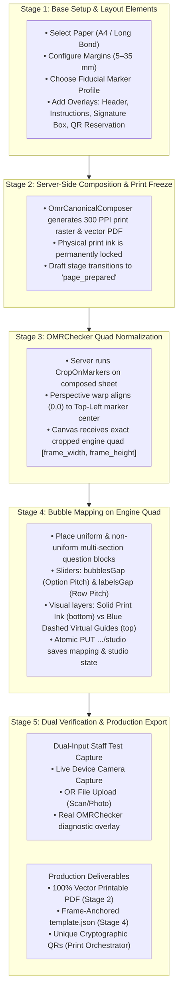

# OMR Template Studio & Capture Engine — Master Engineering Blueprint
> Status: Fully Approved Architecture & Consolidated Specification
> Date: 2026-08-21

---

## 1. Executive Summary & Core Philosophy

The NEXIAM OMR Template Studio provides an accurate, zero-license-cost template creation and optical mark recognition pipeline built directly on top of the open-source **OMRChecker** engine. 

### Key Architectural Invariants
1. **Normalization-First Quad Authority**: Print design (margins, markers, overlays) is composed and frozen first. OMRChecker's `CropOnMarkers` detector normalizes the sheet into a true quad where $(0,0)$ is identically the Top-Left marker center. Bubble coordinates are placed directly on this normalized quad, eliminating coordinate drift.
2. **Dual-Input Test Capture (Camera & Upload)**: Staff can verify their physical printed sheets directly within the builder using either **Live Camera Photo Capture** (utilizing device camera stream) or **File Upload** (scanned JPG/PNG/PDF), rendering OMRChecker's real `draw_template_layout` diagnostic overlay with bubble $Q$-values and tilt/blur gates.
3. **Flexible & Non-Uniform Question Mapping**: Supports arbitrary multi-section layouts, irregular question placements (e.g. Q1-Q15 in Col 1, Q16-Q20 callout, Q21-Q50 in Col 2), independent starting numbers, and continuous pitch tuning (`bubblesGap`, `labelsGap`).
4. **Unconstrained Printable Overlays**: Custom text boxes, exam instructions, candidate signature frames, and metadata boxes are treated as printable visual decorations with full font and dimension adjustability.
5. **Single Atomic Save & Outage Safety**: Single database transaction endpoint `PUT .../studio` storing native `fieldBlocks`, overlays, and studio state (`authoring_json.studio`) with lock concurrency and zero cross-invalidation.

---

## 2. End-to-End 5-Stage Studio Workflow



---

## 3. Detailed Component Specifications

### 3.1 Stage 1: Base Setup & Custom Overlays
* **Paper Dimension Standard**:
  * A4: $210 \times 297\text{ mm}$ ($2480 \times 3508\text{ px}$ at 300 PPI).
  * Long Bond: $216 \times 330\text{ mm}$ ($2551 \times 3898\text{ px}$ at 300 PPI).
* **Overlay Elements**:
  * `header_title`: Main exam title and subtitle.
  * `instructions_box`: Candidate instructions (e.g. "Use 2B pencil only. Shade completely.").
  * `signature_box`: Examinee signature frame with dashed baseline.
  * `metadata_box` / `custom_text`: Freeform text notes and institution branding.
  * `instance_qr`: Reserved $28\text{ mm}$ bounding area for blank instance HMAC-SHA256 tracking barcode.

### 3.2 Stage 2 & 3: Print Sheet Composition & Engine Normalization
* **Composition Engine (`OmrCanonicalComposer`)**:
  * Renders PDF using FPDI (`setasign/fpdi`) and FPDF with physical millimetre vector precision.
  * Draws 4 corner fiducial markers at exact insets: $[TL, TR, BR, BL]$.
  * Renders static overlay texts and signature boxes directly onto the print raster.
* **Engine Normalization (`CropOnMarkers`)**:
  * Finds 4 fiducials and applies perspective transform.
  * Returns normalized quad image to frontend Studio.

### 3.3 Stage 4: Flexible Bubble Mapping & Non-Uniform Sections
* **Multi-Section Irregular Geometry**:
  * Staff can click `+ Add Section` or `+ Single Q` to create independent blocks.
  * Each block defines its own `startQ`, `questionsCount`, $(X, Y)$, `cols`, and option type (`MCQ 4-opt`, `MCQ 5-opt`, `True/False`, `Likert 1-5`, `Custom`).
  * Continuous physical sliders:
    * `bubblePitchMm` (`bubblesGap`): $6.0\text{ mm} \to 25.0\text{ mm}$
    * `rowPitchMm` (`labelsGap`): $5.0\text{ mm} \to 20.0\text{ mm}$
    * `bubbleRadiusMm`: $3.5\text{ mm} \to 7.0\text{ mm}$
* **Visual Layer Distinction**:
  * Base print ink rendered solid black/slate.
  * Virtual bubble calibration overlay rendered in semi-transparent blue (`border-blue-500`) with `[👁 Show Guides]` toggle.

### 3.4 Stage 5: Dual-Input Staff Test Capture & Dual Export
* **Dual-Input Capture UI**:
  * **Option A (Live Camera)**: Uses HTML5 `navigator.mediaDevices.getUserMedia` with video stream viewfinder, alignment crosshair guide, and snapshot shutter button.
  * **Option B (File Upload)**: Drag-and-drop file input accepting JPG, PNG, and PDF.
* **OMRChecker Diagnostic Visualization**:
  * Worker runs `ImageInstanceOps.draw_template_layout(aligned, shifted=True, draw_qvals=True)`.
  * Visualizes shifted bubble boxes, green/red fill indicators, and $Q$-value confidence readouts.
* **Dual Production Deliverables**:
  * **Deliverable 1 (Print PDF)**: 100% actual-size vector PDF with exact margin guides and 4 fiducials.
  * **Deliverable 2 (`template.json`)**: Frame-anchored native OMRChecker JSON for downstream scanning.

---

## 4. Backend Contracts & Database Schema

### 4.1 Single Atomic Studio Endpoint
* **Route**: `PUT /setup/omr/templates/canonical/drafts/{draft}/studio`
* **Request Payload**:
  ```json
  {
    "mapping": {
      "page_width": 2480,
      "page_height": 3508,
      "page_count": 1,
      "blocks": [
        {
          "name": "Section_A",
          "page_no": 1,
          "field_type": "QTYPE_MCQ4",
          "label_prefix": "q",
          "labels": ["q1", "q2", "q3", "..."],
          "rows": 25,
          "options": 4,
          "origin_x": 295,
          "origin_y": 1004,
          "width": 886,
          "height": 2067,
          "option_pitch_px": 142,
          "row_pitch_px": 83,
          "bubble_width_px": 53,
          "bubble_height_px": 53
        }
      ]
    },
    "overlay": {
      "boxes": [
        {
          "tag": "header_title",
          "scope": "template",
          "x": 295,
          "y": 236,
          "width": 1772,
          "height": 177,
          "content": "EXAMINATION ANSWER SHEET",
          "font_size": 14.0
        },
        {
          "tag": "signature_box",
          "scope": "template",
          "x": 1417,
          "y": 2894,
          "width": 768,
          "height": 295,
          "content": "CANDIDATE SIGNATURE"
        },
        {
          "tag": "blank_instance_qr",
          "scope": "blank_instance",
          "x": 1713,
          "y": 413,
          "width": 413,
          "height": 413
        }
      ]
    },
    "studio": {
      "sections": [
        {
          "id": "Section_A",
          "name": "Section A",
          "type": "mcq",
          "posX": 25,
          "posY": 85,
          "w_mm": 75,
          "h_mm": 175,
          "questionsCount": 25,
          "startQ": 1,
          "bubblePitchMm": 12.0,
          "rowPitchMm": 7.0
        }
      ],
      "marginMm": 15,
      "markerPattern": "square",
      "bubbleRadiusMm": 4.5
    },
    "lock_version": 1,
    "idempotency_key": "uuid"
  }
  ```
* **Database State**: Persisted in `omr_template_authoring_drafts.authoring_json` with fields `mapping`, `overlay`, and `studio`.

---

## 5. Testing & Quality Assurance Contract

All automated QA tests will be executed following full component implementation:
1. `OmrStudioAtomicSaveTest`: Validates single-call atomic persistence, lock increment, and non-destructive overlay updates.
2. `OmrOverlayContentTest`: Asserts custom text, instructions, and signature boxes are preserved with sanitization.
3. `OmrParametricComposeTest`: Verifies parametric blank canvas composition without file ingest.
4. `OmrBlankPrintQrPlacementTest`: Verifies QR positioning adheres to overlay reservations with safe fallback.
5. `OmrTestCaptureTest`: Verifies camera snapshot and file upload test capture through OMRChecker diagnostics.
6. Full 22 canonical test suites ($100\%$ green baseline).
