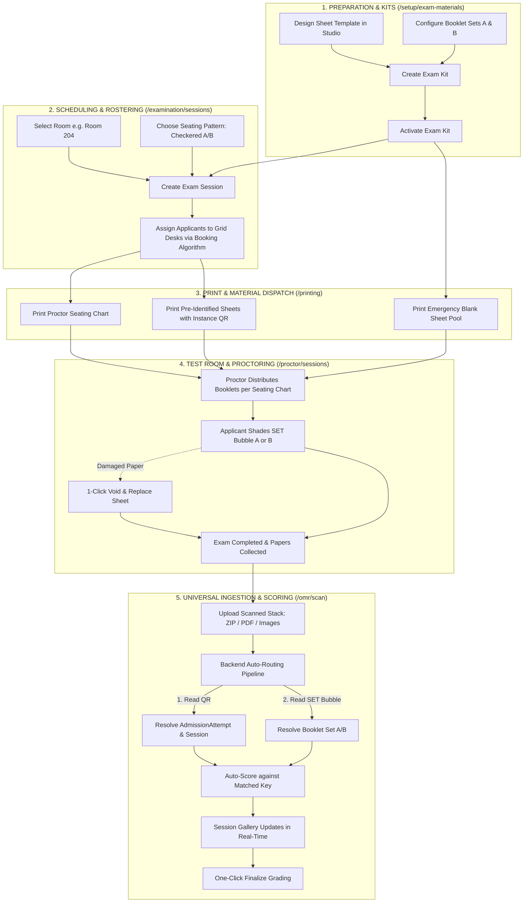

# OMR Unified Lifecycle & Ingestion Master Plan

## 1. Executive Summary & Core Philosophy

This document defines the authoritative, end-to-end architecture for the OMR Examination, Ingestion, and Assessment lifecycle in NEXIAM. It unifies answer sheet canvas authoring, question booklet and answer key authoring, automated anti-leak seating scheduling, offline-capable proctor monitoring, and universal OMR scan ingestion into a coherent, fail-safe system.

### Key Architectural Invariants
1. **Root Aggregate Integrity:** `AdmissionAttempt` is the immutable root anchor connecting the applicant identity, examination assignment, seating desk, answer sheet instance, and final scorable results.
2. **Sheet Uniformity & Resilience:** All physical answer sheets share the identical OMR blank instance format with a unique deterministic tracking QR code. Spares and regular sheets are physically interchangeable; paper damage is handled via a 1-click "Void & Replace" state transition.
3. **Decoupled Universal Ingest:** The scanner station is not trapped inside a specific grading session. Scanned stacks (via ZIP archives, multi-page PDFs, or batch images) are fed into a central station where the backend auto-routes each page to its corresponding Exam Session, Grading Session, and Answer Key using the sheet's decoded QR token and shaded `SET` bubble.
4. **Domain Separation in Setup:** High-level human/academic artifacts (Answer Sheet Templates, Question Booklets, Answer Keys, and Exam Kits) are cleanly separated from low-level machine-vision knobs (Fiducial Marker Profiles, Darkness Thresholds, and Calibration Benchmarks).
5. **No Forking of Core OMR Logic:** The Universal Ingestion Station reuses the existing `OmrCaptureBatch`, `ProcessOmrCaptureSheet`, and `NativeManifestDeriver` pipeline without code duplication.

---

## 2. End-to-End Situational & Activity Workflow



---

## 3. Data Models & Entity Relationships

```
[ Applicant Identity ]
          │
          ▼
 [ AdmissionAttempt ] ── (Root Aggregate: Ref Code, Academic Cycle, Preferences)
    │           │
    │           ├──► [ ExamAssignment ] ────► [ ExamSession ] ────► [ Room ]
    │           │           │                 (Grid Rows × Cols,    (Name, Cap,
    │           │           │                  Seating Pattern)      Facility)
    │           │           ├──► [ ExamAttendanceRecord ] (Present / Absent)
    │           │           └──► [ ExamSubmissionRecord ] (Paper Submitted)
    │           │
    │           └──► [ OmrCaptureSheet ] ──► [ ScoreRecords ] (Encrypted Scores)
    │                                              │
    ▼                                              ▼
[ Consultation / Program Head ] ◄──────── [ GradingSession ] (Finalized)
```

### 3.1 Dual-Mode Booklet Persistence
The booklet model (`OmrQuestionBookletVersion` and `OmrQuestionBookletQuestion`) supports two authoring modes:
1. **Blind / Key-Only Mode (Default & Confidential):**
   * Fields: `(question_position, aptitude_area_id, correct_option_code, weight)`.
   * Stems and distractors are omitted from the database to eliminate digital leak vectors.
2. **Full-Stem Item Bank Mode (Optional):**
   * Additional fields: `question_text`, `options_json`, `explanation`.
   * Enables item analysis, distractor difficulty curves, and future computer-based testing.
   * *Invariant:* The OMR Scoring Engine uses the exact same `(question_position, aptitude_area_id, correct_option_code)` tuple in both modes.

### 3.2 Decoupled Room vs Exam Session Geometry
* `Room` (`id`, `code`, `name`, `capacity`, `is_active`) remains a shared physical facility entity unpolluted by exam grids, making it usable by Consultation (e.g. Covered Courts) and other modules.
* `ExamSession` holds the specific seating geometry (`grid_rows`, `grid_cols`, `seating_pattern`, `desk_count`).

---

## 4. Setup Information Architecture (IA) Reorganization

The previous catch-all `/setup/omr` route is restructured into two dedicated setup categories:

```
                              SYSTEM SETUP (/setup)
                                       │
     ┌─────────────────────────────────┼─────────────────────────────────┐
     ▼                                 ▼                                 ▼
[ 📚 EXAM MATERIALS & KITS ]    [ ⚙️ OMR VISION & CALIBRATION ]    [ 🏛️ INSTITUTIONAL CATALOG ]
(`/setup/exam-materials`)       (`/setup/omr-engine`)              (`/setup/rooms`, `/cycles`)
 • Answer Sheet Templates        • Fiducial Marker Profiles         • Rooms & Capacities
 • Question Booklets (A/B/C/D)   • Skew & Rotation Thresholds       • Academic Years & Windows
 • Answer Keys & Aptitude Areas  • Bubble Darkness Sensitivity      • Programs & Quotas
 • Active Exam Kits (Pairs)      • Hardware Benchmark / Test Stand  • Grading Scales
```

### 4.1 The "Exam Kit" Visual Pair
Rather than disjointed sub-screens, the setup interface presents paired **Exam Kits**:

```
┌──────────────────────────────────────────────────────────────────────────────────────────────────┐
│ ACTIVE EXAM KIT: 2026 University General Aptitude Test (UGAT)              ● ACTIVE / PUBLISHED │
├───────────────────────────────────────────────────┬──────────────────────────────────────────────┤
│ 📄 ANSWER SHEET CANVAS                            │ 📖 QUESTION BOOKLETS & ANSWER KEYS           │
│                                                   │                                              │
│ Template: Long Bond Standard (3-Column Layout)    │ Total Items: 100 Questions (4 Areas)         │
│ Geometry: 216mm × 330mm (300 DPI)                 │ Scoring Mode: Blind Key-Only (Encrypted)     │
│ Grid: 100 MCQ Items (Options A–D)                 │ Available Sets:                              │
│ Anchors: Top-Right Attempt QR (28mm)              │   • Booklet Set A (v2.1) — 100 Keys [Active] │
│ Booklet Selector: 'SET' Bubble (A/B/C/D)          │   • Booklet Set B (v2.1) — 100 Keys [Active] │
│                                                   │                                              │
│ [ ✏️ Open Template Studio ]   [ 👁️ View PDF ]       │ [ 🔑 Edit Answer Keys ]   [ 🔄 Add Set C/D ] │
├───────────────────────────────────────────────────┴──────────────────────────────────────────────┤
│ PRIMARY OPERATIONS:                                                                              │
│ [ 🖨️ Batch Print Answer Sheets ]    [ 🧪 Run Diagnostic Test Scan ]    [ 📦 Export Native Bundle ]│
└──────────────────────────────────────────────────────────────────────────────────────────────────┘
```

---

## 5. Automated Seating & Anti-Leak Patterns

### 5.1 Automated Allocation Protocol
1. **Zero Manual Selection:** Applicants select an Exam Session date/time during self-service booking. Seat allocation and booklet set assignment happen automatically in the background.
2. **Standard Room Sizing:** Standard classrooms are assumed at $8\text{m} \times 10\text{m}$ (capacity 30–40 desks).

### 5.2 Seating Permutation Algorithms
* **Single Set (Uniform):**
  $$\text{Set}(\text{seat}) = \text{A} \quad (\forall \text{ seats})$$
* **Checkered Diagonal (2 Sets A/B for $R \times C$ Grid):**
  $$\text{Set}(r, c) = \begin{cases} \text{A} & \text{if } (r + c) \text{ is even} \\ \text{B} & \text{if } (r + c) \text{ is odd} \end{cases}$$
* **Column-Wise (2 Sets A/B):**
  $$\text{Set}(r, c) = \begin{cases} \text{A} & \text{if } c \text{ is odd} \\ \text{B} & \text{if } c \text{ is even} \end{cases}$$
* **Latin Square (4 Sets A/B/C/D):**
  $$\text{Set}(r, c) = \text{Sets}[(r + c) \pmod 4]$$
* **Linear Alternating (Open Halls / Gymnasiums):**
  $$\text{Set}(s) = \begin{cases} \text{A} & \text{if } s \text{ is odd} \\ \text{B} & \text{if } s \text{ is even} \end{cases}$$

---

## 6. Proctor Monitoring Desk (`/proctor/sessions/{id}`)

### 6.1 Features & Invariants
* **Offline-Capable:** The roster and seating chart cache locally in the browser; check-ins sync automatically upon reconnection.
* **Sequential Single-Action Buttons:** Prevents conflicting attendance/submission states.
  * State 0: `[ 👤 Mark Present ]`
  * State 1: `[ 📥 Submit Paper ]`
  * State 2: `✓ Handed In [HH:MM]`
* **1-Click Void & Replace:** If a sheet is torn or smudged, the proctor clicks "Sheet Replaced", logs the spare sheet token, and marks the damaged sheet void without manual student re-registration.

```
┌─ LIVE SEATING GRID (STANDARD 5 × 8 CLASSROOM MATRIX) ────────────────────────────────────────────┐
│  ┌──────────────────────┐ ┌──────────────────────┐ ┌──────────────────────┐ ┌──────────────────┐ │
│  │ SEAT 01 · SET A      │ │ SEAT 02 · SET B      │ │ SEAT 03 · SET A      │ │ SEAT 04 · SET B  │ │
│  │ REF-2026-0089        │ │ REF-2026-0090        │ │ REF-2026-0091        │ │ REF-2026-0092    │ │
│  │ Juan Dela Cruz       │ │ Maria Santos         │ │ Aris Thorne          │ │ Chloe Vance      │ │
│  │                      │ │                      │ │                      │ │                  │ │
│  │ [ ✓ Handed In 09:42] │ │ [ 📥 Submit Paper ]  │ │ [ 👤 Mark Present ]  │ │ [ ✗ Mark Absent ]│ │
│  └──────────────────────┘ └──────────────────────┘ └──────────────────────┘ └──────────────────┘ │
└──────────────────────────────────────────────────────────────────────────────────────────────────┘
```

---

## 7. Universal OMR Scan & Ingestion Station (`/omr/scan`)

### 7.1 Input Ingest Channels
1. **ZIP Archive Upload:** Accepts bulk scanned batches (e.g. `room204_batch.zip` containing 40–100 image files).
2. **Multi-Page PDF:** Extracts pages sequentially and feeds each page into the recognition queue.
3. **Multi-Image Drag & Drop:** Accepts direct drop of high-res JPG/PNG files.
4. **Auto-Camera Mode:** Direct webcam/tethered camera capture reusing the shared worker preflight.

### 7.2 The 4-Step Auto-Routing Pipeline
```
[ Input Page (PDF / Image / ZIP item) ]
                 │
                 ▼
     [ 1. QR Code Decode ] ──────────► Resolves: Admission Attempt ID & Template ID
                 │                                      │
                 │                                      ▼
                 │                          [ ExamAssignment Query ]
                 │                                      │
                 │                          ┌───────────┴───────────┐
                 │                          ▼                       ▼
                 │                  [ Exam Session ]        [ Grading Session ]
                 │
                 ▼
     [ 2. Read SET Bubble ] ─────────► Resolves: Booklet Version ('A' vs 'B')
                 │
                 ▼
     [ 3. Auto-Score ] ──────────────► Evaluates area scores against matched Key
                 │
                 ▼
     [ 4. Commit ScoreRecord ] ──────► Stores encrypted score & updates session card
```

### 7.3 Real-Time Session Gallery & Exception Tray
* **Session Accordions:** Scanned cards group automatically under their respective Exam Session. Progress bars update live (e.g. `CS-101: 38/38 Scored · 100%`).
* **1-Click Finalize:** Once all submitted sheets in a session are scored, the "Finalize Grading" action unlocks directly on the session card.
* **1-Click Exception Triage:** Sheets with unshaded booklet bubbles or damaged fiducials appear in a dedicated top-level exception tray with a side-by-side visual crop and 1-click key assignment.

---

## 8. OMR Checker Native Manifest Specification

### Sample `template.json`
```json
{
  "page_dimensions": { "width": 216.0, "height": 330.0, "unit": "mm" },
  "qr_overlays": [
    {
      "key": "instance_qr",
      "x": 178.0,
      "y": 12.0,
      "w": 28.0,
      "h": 28.0,
      "purpose": "attempt_identity_and_template_token"
    }
  ],
  "field_blocks": {
    "BOOKLET_SET": {
      "fieldType": "SET",
      "bubbleValues": ["A", "B", "C", "D"],
      "direction": "horizontal",
      "origin": { "x": 120.0, "y": 25.0 }
    },
    "ITEMS_1_100": {
      "fieldType": "QTYPE_MCQ4",
      "bubbleValues": ["A", "B", "C", "D"],
      "fieldLabels": ["Q1", "Q2", "...", "Q100"]
    }
  }
}
```

---

## 9. Phased Delivery Roadmap

1. **Phase 1: Setup IA Reorganization (`/setup`)**
   * Move Answer Sheets, Booklets, and Pairs into `/setup/exam-materials`.
   * Separate machine calibration into `/setup/omr-engine`.
   * Implement the unified **Exam Kit** visual pairing cards.
2. **Phase 2: Automated Seating Engine**
   * Add `seating_pattern`, `grid_rows`, and `grid_cols` to `ExamSession`.
   * Implement automated background desk and booklet (A/B) assignment during booking.
3. **Phase 3: Proctor Monitoring Desk**
   * Build the offline-capable interactive seating matrix at `/proctor/sessions/{id}`.
   * Implement the single-button `[Mark Present]` $\to$ `[Submit Paper]` flow and 1-click "Void & Replace".
4. **Phase 4: Universal OMR Ingest Station**
   * Deploy the top-level `/omr/scan` interface.
   * Implement ZIP/PDF/Image ingestion and the backend auto-routing pipeline.
   * Connect real-time session progress and 1-click exception resolution.
