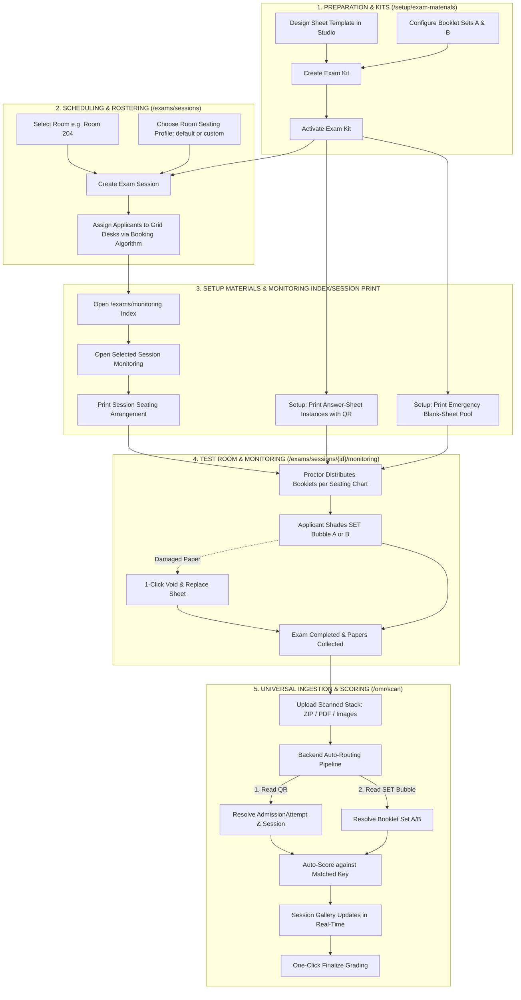

# OMR Unified Lifecycle & Ingestion Master Plan

## 1. Executive Summary & Core Philosophy

This document defines the authoritative, end-to-end architecture for the OMR Examination, Ingestion, and Assessment lifecycle in NEXIAM. It unifies answer sheet canvas authoring, question booklet and answer key authoring, automated anti-leak seating scheduling, online-first proctor monitoring with graceful offline fallback, and universal OMR scan ingestion into a coherent, fail-safe system.

### Key Architectural Invariants
1. **Root Aggregate Integrity:** `AdmissionAttempt` is the immutable root anchor connecting the applicant identity, examination assignment, seating desk, answer sheet instance, and final scorable results.
2. **Sheet Uniformity & Resilience:** All physical answer sheets share the identical OMR blank instance format with a unique deterministic tracking QR code. Spares and regular sheets are physically interchangeable; paper damage is handled via a 1-click "Void & Replace" state transition.
3. **Decoupled Universal Ingest:** The scanner station is not trapped inside a specific grading session. Scanned stacks (via ZIP archives, multi-page PDFs, or batch images) are fed into a central station where the backend auto-routes each page to its corresponding Exam Session, Grading Session, and Answer Key using the sheet's decoded QR token, its sealed assignment binding, and shaded `SET` bubble.
4. **Domain Separation in Setup:** High-level human/academic artifacts (Answer Sheet Templates, Question Booklets, Answer Keys, and Exam Kits) are cleanly separated from low-level machine-vision knobs (Fiducial Marker Profiles, Darkness Thresholds, and Calibration Benchmarks).
5. **No Forking of Core OMR Logic:** The Universal Ingestion Station reuses the existing `OmrCaptureBatch`, `ProcessOmrCaptureSheet`, and `NativeManifestDeriver` pipeline without code duplication.
6. **Online-First Fallback:** Canonical mutations execute through the online application actions. A fallback client caches a sealed manifest and queues the same idempotent command envelope; it does not create a second business-rule implementation. For monitoring, the first durable server commit wins; later distinct writes are retained as discarded sync records rather than merged.
7. **Operational Closure:** Local monitoring end is not authoritative session closure. `ExamSession` becomes completed and `GradingSession` opens only after monitoring commands synchronize, or an explicitly audited administrator override is applied.

---

## 2. End-to-End Situational & Activity Workflow



---

## 3. Data Models & Entity Relationships

```
[ Applicant Identity ]
          │
          ▼
 [ AdmissionAttempt ] ── (Root Aggregate: Ref Code, Academic Cycle, Preferences)
    │           │
    │           ├──► [ ExamAssignment ] ────► [ ExamSession ] ────► [ Room ]
    │           │           │                 (Grid Rows × Cols,    (Name, Cap,
    │           │           │                  Seating Pattern)      Facility)
    │           │           ├──► [ ExamAttendanceRecord ] (Present / Absent)
    │           │           └──► [ ExamSubmissionRecord ] (Paper Submitted)
    │           │
    │           └──► [ OmrCaptureSheet ] ──► [ ScoreRecords ] (Encrypted Scores)
    │                                              │
    ▼                                              ▼
[ Consultation / Program Head ] ◄──────── [ GradingSession ] (Finalized)
```

### 3.1 Dual-Mode Booklet Persistence
The booklet model (`OmrQuestionBookletVersion` and `OmrQuestionBookletQuestion`) supports two authoring modes:
1. **Blind / Key-Only Mode (Default & Confidential):**
   * Fields: `(question_position, aptitude_area_id, correct_option_code, weight)`.
   * Stems and distractors are omitted from the database to eliminate digital leak vectors.
2. **Full-Stem Item Bank Mode (Optional):**
   * Additional fields: `question_text`, `options_json`, `explanation`.
   * Enables item analysis, distractor difficulty curves, and future computer-based testing.
   * *Invariant:* The OMR Scoring Engine uses the exact same `(question_position, aptitude_area_id, correct_option_code)` tuple in both modes.

### 3.2 Room seating profiles versus session snapshots
* `Room` (`id`, `code`, `name`, `capacity`, `is_active`) remains a shared physical facility entity and owns reusable `RoomSeatingProfile` records.
* A room profile contains a name, rows, columns, seating pattern, desk count, active state, and one optional room default.
* `ExamSession` selects a room profile (default preselected) and snapshots its effective geometry/pattern at publish/seal; later room-profile edits cannot mutate historical sessions.

---

## 4. Setup Information Architecture (IA) Reorganization

The previous catch-all `/setup/omr` route is restructured into two dedicated setup categories:

```
                              SYSTEM SETUP (/setup)
                                       │
     ┌─────────────────────────────────┼─────────────────────────────────┐
     ▼                                 ▼                                 ▼
[ 📚 EXAM MATERIALS & KITS ]    [ ⚙️ OMR VISION & CALIBRATION ]    [ 🏛️ INSTITUTIONAL CATALOG ]
(`/setup/exam-materials`)       (`/setup/omr-engine`)              (`/setup/rooms`, `/cycles`)
 • Answer Sheet Templates        • Fiducial Marker Profiles         • Rooms, Capacities & Seating Profiles
 • Question Booklets (A/B/C/D)   • Skew & Rotation Thresholds       • Academic Years & Windows
 • Answer Keys & Aptitude Areas  • Bubble Darkness Sensitivity      • Programs & Quotas
 • Active Exam Kits (Pairs)      • Hardware Benchmark / Test Stand  • Grading Scales
```

### 4.1 The "Exam Kit" Visual Pair
Rather than disjointed sub-screens, the setup interface presents paired **Exam Kits**:

```
┌──────────────────────────────────────────────────────────────────────────────────────────────────┐
│ ACTIVE EXAM KIT: 2026 University General Aptitude Test (UGAT)              ● ACTIVE / PUBLISHED │
├───────────────────────────────────────────────────┬──────────────────────────────────────────────┤
│ 📄 ANSWER SHEET CANVAS                            │ 📖 QUESTION BOOKLETS & ANSWER KEYS           │
│                                                   │                                              │
│ Template: Long Bond Standard (3-Column Layout)    │ Total Items: 100 Questions (4 Areas)         │
│ Geometry: 216mm × 330mm (300 DPI)                 │ Scoring Mode: Blind Key-Only (Encrypted)     │
│ Grid: 100 MCQ Items (Options A–D)                 │ Available Sets:                              │
│ Anchors: Top-Right Attempt QR (28mm)              │   • Booklet Set A (v2.1) — 100 Keys [Active] │
│ Booklet Selector: 'SET' Bubble (A/B/C/D)          │   • Booklet Set B (v2.1) — 100 Keys [Active] │
│                                                   │                                              │
│ [ ✏️ Open Template Studio ]   [ 👁️ View PDF ]       │ [ 🔑 Edit Answer Keys ]   [ 🔄 Add Set C/D ] │
├───────────────────────────────────────────────────┴──────────────────────────────────────────────┤
│ PRIMARY OPERATIONS:                                                                              │
│ [ 🖨️ Batch Print Answer Sheets ]    [ 🧪 Run Diagnostic Test Scan ]    [ 📦 Export Native Bundle ]│
└──────────────────────────────────────────────────────────────────────────────────────────────────┘
```

---

## 5. Automated Seating & Anti-Leak Patterns

### 5.1 Room seating profiles

Room setup is where staff create and maintain reusable layouts for a room:

```text
Room 204
├── Standard 5 × 8 · Checkered A/B · default
├── Compact 4 × 6 · Uniform A
└── Hall 10 × 10 · Latin A/B/C/D
```

The exam-session form selects one active profile after selecting the room. The selected profile is copied into the session snapshot when the session is published or monitoring is started.

### 5.2 Automated Allocation Protocol
1. **Zero Manual Selection:** Applicants select an Exam Session date/time during self-service booking. Seat allocation and booklet set assignment happen automatically in the background.
2. **Standard Room Sizing:** Standard classrooms are assumed at $8\text{m} \times 10\text{m}$ (capacity 30–40 desks).

### 5.3 Seating Permutation Algorithms
* **Single Set (Uniform):**
  $$\text{Set}(\text{seat}) = \text{A} \quad (\forall \text{ seats})$$
* **Checkered Diagonal (2 Sets A/B for $R \times C$ Grid):**
  $$\text{Set}(r, c) = \begin{cases} \text{A} & \text{if } (r + c) \text{ is even} \\ \text{B} & \text{if } (r + c) \text{ is odd} \end{cases}$$
* **Column-Wise (2 Sets A/B):**
  $$\text{Set}(r, c) = \begin{cases} \text{A} & \text{if } c \text{ is odd} \\ \text{B} & \text{if } c \text{ is even} \end{cases}$$
* **Latin Square (4 Sets A/B/C/D):**
  $$\text{Set}(r, c) = \text{Sets}[(r + c) \pmod 4]$$
* **Linear Alternating (Open Halls / Gymnasiums):**
  $$\text{Set}(s) = \begin{cases} \text{A} & \text{if } s \text{ is odd} \\ \text{B} & \text{if } s \text{ is even} \end{cases}$$

---

## 6. Exam Monitoring (index and session detail)

### 6.1 Monitoring index and session detail

The sidebar item is `/exams/monitoring`. This is the main monitoring page, shaped like the legacy monitoring index:

```text
/exams/monitoring
├── Active / in-progress sessions
├── Upcoming published sessions
├── Room, date/time, capacity, roster progress
└── Select a session
        ↓
    /exams/sessions/{id}/monitoring
```

Test Administrators see all relevant sessions. Proctor-duty holders see only sessions where they have active duty. The index is informational and does not seal or lock a session.


### 6.2 Online-first monitoring run

Monitoring is normally online. When an authorized Test Administrator or active-duty proctor starts monitoring while connected, the server creates one sealed `ExamMonitoringRun` and publishes an immutable manifest:

```text
ExamMonitoringRun
├── exam_session_id
├── sealed roster and assignments
├── room/seating snapshot
├── proctor/duty identity
├── starts_at / effective_end_at
├── OMR template/booklet references
├── manifest_hash
└── connection state: online | offline | syncing | attention
```

Opening the page does not seal a session. Starting monitoring does. Once sealed, roster, room, timing, proctor assignment, and material references cannot change through ordinary scheduling actions. An emergency override invalidates the manifest and requires the monitoring client to refresh.

The monitoring run has its own operational lifecycle:

```text
ready → active → ended → syncing → synced → closed
                                  └→ synced_with_discarded
```

The `ExamSession` lifecycle remains `published` / `in_progress` / `completed`; connectivity is not encoded as an exam status.


### 6.3 Session detail and fixed seating print

Selecting a session opens the monitoring detail page directly. There is no separate lobby route or intermediate screen:

```text
/exams/sessions/{id}/monitoring
├── Session header
│   ├── room, time, seating profile
│   ├── Print seating arrangement
│   └── Start monitoring
└── Live monitoring desk
    ├── seating grid
    ├── attendance
    └── submission
```

The session detail page reserves a **Print Seating Arrangement** action, but its template and rendering body are intentionally pending for the later built-in print feature. This phase selects no HTML/PDF layout, customization model, or renderer contract.

When that built-in print feature is ready, it may connect the session-scoped artifact to the existing `PrintJob` queued/rendering/ready/failed management pattern. Until then, the print slot remains empty rather than inventing a parallel template system.

Answer-sheet instance printing and emergency blank-sheet printing remain exclusively under `/setup/exam-materials` inside the Exam Kit. Monitoring consumes the resulting stock and assignment bindings; it does not print answer sheets.


### 6.4 Graceful offline fallback

When connectivity fails, the client automatically changes to fallback mode. Staff do not choose a second workflow:

```text
Online command → server action → durable acknowledgement
Offline command → local queue → same server action after reconnect
```

The fallback may only operate on the sealed roster:

* `[ Mark Present ]`
* `[ Mark Absent ]`
* `[ Submit Paper ]`
* `[ End Monitoring Locally ]`
* `[ Void & Replace ]` against an existing assignment and sheet binding

“Accept applicant” means checking in an already assigned applicant. Creating a new assignment or moving an applicant remains online-only.

The client uses the manifest's server-issued time anchor plus local monotonic elapsed time. The browser wall clock is advisory; the server remains the authority when commands synchronize.

### 6.5 First-write-wins synchronization

Monitoring uses simple first-write-wins resolution for operational records:

* “First” means the first durable server commit, not the earliest client timestamp.
* The same idempotency key is replayed as a no-op.
* A later distinct write targeting an already-resolved attendance/submission state is discarded.
* Discarded commands remain in the sync ledger and audit trail; they are not retried or merged.
* The default UI has no blocking conflict-resolution screen. It shows a non-blocking sync summary such as `3 accepted · 1 already resolved`.

This is safe because monitoring transitions are intentionally monotonic:

```text
unmarked → present / absent
present  → submitted
```

First-write-wins applies to monitoring commands only. OMR processing continues to use pinned snapshots, processing-run claims, stale-result detection, and score-commit rules.

### 6.6 Reconnection and closure

On reconnect, the client synchronizes queued commands automatically, retries only transport failures, and displays accepted/replayed/discarded counts. It never silently presents a discarded local write as server truth.

`End Monitoring Locally` stops new local commands but does not call `CloseExamSession`. The existing close action remains the authoritative transition: it requires attendance coverage, marks the exam completed, and opens the grading session. An unsynchronized run blocks ordinary close; an administrator may force close only with an audited reason.

### 6.7 Features and invariants

* The roster and seating chart cache locally for the active run; local cache is cleared after successful synchronization.
* One primary offline writer is supported per monitoring run in the first cut; other devices are read-only while disconnected.
* Sequential single-action controls prevent contradictory local states.
* Every queued command carries `monitoring_run_id`, `client_command_id`, sequence, assignment id, manifest hash, client time, and idempotency key.
* Void & Replace records the replacement sheet against the existing assignment; it never re-registers the applicant.

```text
┌─ LIVE SEATING GRID ──────────────────────────────────────────────────────────┐
│ SEAT 01 · SET A     REF-2026-0089     [ Mark Present ]                        │
│ SEAT 02 · SET B     REF-2026-0090     [ Submit Paper ]                        │
│ SEAT 03 · SET A     REF-2026-0091     ✓ Handed In 09:42                       │
│                                                                              │
│ Online · 0 pending                                                           │
└──────────────────────────────────────────────────────────────────────────────┘
```

---

## 7. Universal OMR Scan & Ingestion Station (`/omr/scan`)

### 7.1 Input Ingest Channels
1. **ZIP Archive Upload:** Accepts bulk scanned batches (e.g. `room204_batch.zip` containing 40–100 image files).
2. **Multi-Page PDF:** Extracts pages sequentially and feeds each page into the recognition queue.
3. **Multi-Image Drag & Drop:** Accepts direct drop of high-res JPG/PNG files.
4. **Auto-Camera Mode:** Direct webcam/tethered camera capture reusing the shared worker preflight.

### 7.2 The 4-Step Auto-Routing Pipeline
```
[ Input Page (PDF / Image / ZIP item) ]
                 │
                 ▼
     [ 1. QR Code Decode ] ──────────► Resolves: Admission Attempt ID & Template ID
                 │                                      │
                 │                                      ▼
                 │                          [ ExamAssignment Query ]
                 │                                      │
                 │                          ┌───────────┴───────────┐
                 │                          ▼                       ▼
                 │                  [ Exam Session ]        [ Grading Session ]
                 │
                 ▼
     [ 2. Read SET Bubble ] ─────────► Resolves: Booklet Version ('A' vs 'B')
                 │
                 ▼
     [ 3. Auto-Score ] ──────────────► Evaluates area scores against matched Key
                 │
                 ▼
     [ 4. Commit ScoreRecord ] ──────► Stores encrypted score & updates session card
```

### 7.3 Real-Time Session Gallery & Exception Tray
* **Session Accordions:** Scanned cards group automatically under their respective Exam Session. Progress bars update live (e.g. `CS-101: 38/38 Scored · 100%`).
* **1-Click Finalize:** Once all submitted sheets in a session are scored, the "Finalize Grading" action unlocks directly on the session card.
* **1-Click Exception Triage:** Sheets with unshaded booklet bubbles or damaged fiducials appear in a dedicated top-level exception tray with a side-by-side visual crop and 1-click key assignment.

### 7.4 Shared fallback transport

The monitoring fallback and later OMR checking fallback share the manifest/cache/queue/sync envelope, connection states, idempotency handling, and sync-status presentation. Domain adapters remain separate:

```text
Shared fallback kernel
├── manifest cache
├── local command/blob queue
├── reconnect and retry
├── idempotency reconciliation
└── sync ledger

Exam Monitoring adapter ── attendance, submission, local end
OMR Checker adapter ────── image upload, processing, review, commit
```

Large OMR images use a content-hashed asset queue with resumable upload behavior; monitoring commands remain small metadata commands. The fallback kernel must not duplicate OMR detection, review, or score-commit rules.

---

## 8. OMR Checker Native Manifest Specification

### Sample `template.json`
```json
{
  "page_dimensions": { "width": 216.0, "height": 330.0, "unit": "mm" },
  "qr_overlays": [
    {
      "key": "instance_qr",
      "x": 178.0,
      "y": 12.0,
      "w": 28.0,
      "h": 28.0,
      "purpose": "attempt_identity_and_template_token"
    }
  ],
  "field_blocks": {
    "BOOKLET_SET": {
      "fieldType": "SET",
      "bubbleValues": ["A", "B", "C", "D"],
      "direction": "horizontal",
      "origin": { "x": 120.0, "y": 25.0 }
    },
    "ITEMS_1_100": {
      "fieldType": "QTYPE_MCQ4",
      "bubbleValues": ["A", "B", "C", "D"],
      "fieldLabels": ["Q1", "Q2", "...", "Q100"]
    }
  }
}
```

---

## 9. Phased Delivery Roadmap

1. **Phase 1: Setup IA Reorganization (`/setup`)**
   * Move Answer Sheets, Booklets, and Pairs into `/setup/exam-materials`.
   * Separate machine calibration into `/setup/omr-engine`.
   * Implement the unified **Exam Kit** visual pairing cards.
2. **Phase 2: Room Profiles and Automated Seating**
   * Add reusable room seating profiles under `/setup/rooms`.
   * Let each profile define rows, columns, desk count, default state, and A/B/C/D pattern.
   * Let an exam session choose a profile, defaulting to the room's active default.
   * Snapshot the selected profile at publish/seal; allocate each active applicant to one unique desk and booklet set.
   * Bind printed blank instances to the sealed exam assignment.
3. **Phase 3: Online-First Exam Monitoring**
   * Keep `/exams/monitoring` as the sidebar landing page for active, in-progress, and upcoming sessions.
   * Open `/exams/sessions/{id}/monitoring` for the selected session; keep the seating print action and **Start Monitoring** action on that detail page, with no intermediate lobby route.
   * Reserve the seating arrangement print action on the selected-session detail page; leave its template and rendering body pending for the later built-in print feature.
   * Create and seal one `ExamMonitoringRun` when monitoring starts online.
   * Add clock-window presentation and server-authoritative attendance/submission commands.
   * Lock structural scheduling changes after the run is sealed.
4. **Phase 4: Graceful Offline Fallback**
   * Cache the sealed monitoring manifest and minimal roster locally.
   * Queue the same idempotent attendance/submission/end commands used online.
   * Reconnect automatically and apply first-write-wins; expose only a non-blocking sync summary.
   * Keep local end pending until synchronization allows the existing `CloseExamSession` action.
5. **Phase 5: Universal OMR Ingest and Checking**
   * Deploy the top-level `/omr/scan` interface.
   * Implement ZIP/PDF/Image ingestion and QR → assignment → session routing.
   * Reuse the existing capture/review/score pipeline and pinned-run invariants.
   * Add the shared fallback transport for large OMR assets without applying monitoring's first-write-wins rule to detection or scoring results.

## 10. Implementation Gates and Reconciled Decisions

Before implementation, the following contracts must be explicit:

* `ExamKit` set membership: one template plus its compatible A/B/C/D booklet versions.
* Room seating profiles: named reusable layouts, one optional default per room, and immutable session snapshots.
* Session geometry and allocation invariants: no duplicate active desk, no capacity overflow, and immutable allocation after sealing.
* Answer-sheet printing ownership: Setup/Exam Materials prints QR-tagged instances and emergency stock; monitoring prints only the session seating arrangement.
* Seating arrangement print template and renderer: explicitly deferred; leave the session-scoped print slot empty until the built-in print feature is ready.
* Blank-instance binding: setup-printed sheet stock → assignment → session, with replacement history.
* `ExamMonitoringRun` manifest, seal, command envelope, and first-write-wins ledger.
* Clock-window behavior when offline and server verification on reconnect.
* Close gating: no grading session opens until monitoring synchronization is complete or explicitly overridden.
* Capability boundaries: Test Administrator and active-duty proctor behavior during preparation, fallback, synchronization, and override.
* Universal ingest must adapt to the existing OMR pipeline rather than create a second capture or scoring implementation.

The route, seating, blank-binding, monitoring-seal, and fallback contracts are prerequisites for code. Template-builder and OMR-engine work remains reusable infrastructure, not a reason to place monitoring logic inside the Setup/OMR controllers.
