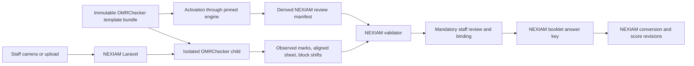
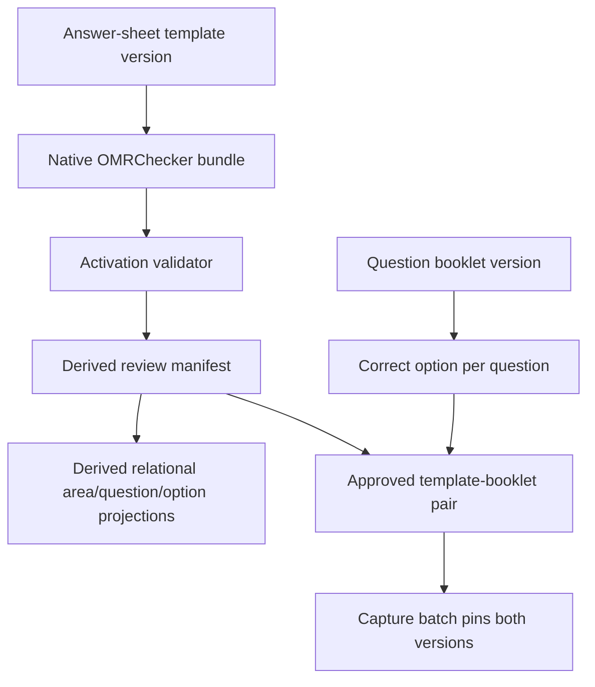
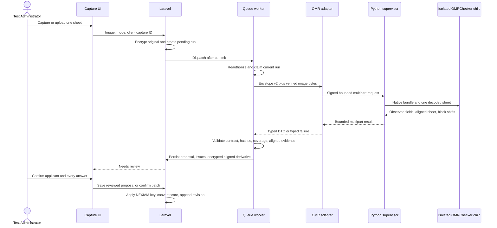
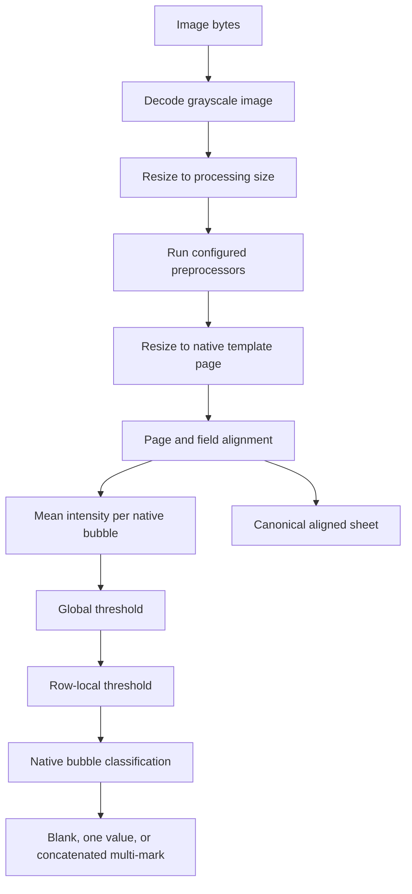

# OMRChecker in NEXIAM: Architecture Exploration

**Status:** implementation guide for Phase B planning; not a production-activation approval  
**Pinned upstream:** `Udayraj123/OMRChecker@de3f6982822895491be760325fd43e65e90fa293`  
**Authority:** [`../openspec/changes/omr-scoring-capture/`](../openspec/changes/omr-scoring-capture/) remains normative

## 1. The shortest useful mental model

OMRChecker is the pinned **pixels-to-observed-bubbles engine**. NEXIAM remains the **template-approval, applicant-binding, grading, authorization, review, and audit system**.



The worker may answer, “native field `q17` contains C.” It must not decide:

- which applicant owns the sheet;
- whether C is correct;
- the raw or converted score;
- whether a batch may close or grading may finalize;
- who is authorized;
- whether a proposal becomes authoritative.

## 2. What already exists

The first cut is browser-proven with `FakeOmrDetection`. The real adapter enters through this shell rather than adding a parallel workflow.

| Concern | Existing NEXIAM owner |
|---|---|
| Staff interface | `system/resources/js/Pages/Assessment/Omr/Capture.svelte` |
| HTTP commands/projection | `system/app/Http/Controllers/Assessment/GradingController.php` |
| Detection seam | `system/app/Assessment/Omr/OmrDetectionPort.php` |
| Request/result contract | `OmrDetectionRequest`, `OmrDetectionResult`, typed DTOs, validator |
| Queue boundary | `system/app/Jobs/Assessment/AnalyzeOmrCaptureSheetJob.php` |
| Workflow Actions | Create/upload/analyze/review/confirm/reject Actions |
| Private evidence | `SensitiveAssetStore`; authenticated session-scoped image route |
| Runtime evidence | capture batch, sheet, processing run, issues, audit events |
| Authoritative grades | `score_records`, immutable revisions, `ScoreConverter`, finalization |

The production provider remains deliberately unavailable until every qualification gate passes.

## 3. Locked decisions

| Decision | Locked rule | Why |
|---|---|---|
| Geometry authority | The immutable OMRChecker-native bundle is canonical. NEXIAM derives its review manifest from the expanded native bubbles. | Avoids translating into or modifying OMRChecker's difficult `FieldBlock` geometry. |
| Reverse compiler | None. Derived NEXIAM coordinates are never compiled back into OMRChecker input. | Two coordinate authorities drift and create wrong-row evidence. |
| Answer key | NEXIAM only; never sent to or accepted from the worker. | Keeps one grading authority and lets NEXIAM detect malicious/broken provider output. |
| Upstream code | Keep native template expansion, preprocessing, alignment, thresholds, and classification unchanged. | These parts are highly coupled and are the value of OMRChecker. |
| Initial patches | Headless import safety and stale/unbound overlay-coordinate defect only. | Smallest reviewed patch set; neither changes detection math. |
| Review image | Use an encrypted canonical aligned-sheet derivative for operational crops; retain the original photo as immutable forensic evidence. | Avoids fragile reverse composition through discarded perspective/affine matrices. |
| Confidence | `null` and `calibration_status=unqualified` for real-engine Phase B. | Upstream thresholds are not calibrated probabilities. |
| Runtime | One isolated detector child per sheet; child exits after one result. | Contains mutable globals/templates, `SystemExit`, timeouts, and temp files. |
| Identity | Bubbled applicant-number digits only; staff confirms roster binding. | OMRChecker is a bubble reader, not approved free-form OCR. |
| Confirmation | Human review remains mandatory; no automatic score acceptance. | High per-item accuracy does not make sheet-level identity/score errors safe. |

## 4. Configuration data and activation

### 4.1 Keep template and booklet separate



- The **native bundle** describes where marks are and how OMRChecker reads them.
- The **derived manifest** lets NEXIAM validate fields and crop the aligned review image.
- The **booklet** describes what observed marks mean for grading.
- The **compatibility pair** approves one visual template with one answer key.

Never collapse these into one provider-owned scoring configuration.

### 4.2 Native bundle contents

One immutable version contains:

```text
template.json
config.json
required marker/reference assets
page dimensions
exact OMRChecker commit and patch identity
SHA-256 for every file and the canonical bundle
```

`evaluation.json` is excluded online. It may be generated only for offline fixture/regression comparison; its calculated score is never imported as a NEXIAM grade.

### 4.3 Activation-derived manifest

Activation runs the exact pinned engine in isolation, loads the native `Template`, and expands every `FieldBlock`/`Bubble`. It derives:

```text
stable native field label
area code and question position
option code
native pixel rectangle
normalized aligned-page rectangle
question/area/identity crop
page dimensions
reference/alignment requirements
bundle, engine, patch, config, and manifest hashes
```

Activation rejects:

- unknown, missing, duplicate, or non-contiguous stable labels;
- missing or duplicate options;
- non-finite, out-of-bounds, overlapping, or zero-area bubbles;
- undeclared identity labels;
- nondeterministic derivation from the same bundle/engine/patch.

Relational `omr_template_areas`, questions, and options are immutable projections of this manifest. They are never manually maintained or used to regenerate `template.json`.

### 4.4 Why the current seed is replaced, not repaired

The current `OmrDemoSeeder` hand-calculates a second geometry, omits area offsets in question Y positions, and reuses one option Y coordinate. Correcting those formulas would preserve the wrong architecture. Replace them with one synthetic native bundle and derive all NEXIAM rows from it.

## 5. End-to-end use case



Manual and Auto use the same durable run:

- Manual waits/polls and normally opens review.
- Auto restores capture immediately and exposes status in the gallery.
- A browser disconnect does not cancel the job.
- A stale result cannot persist after retry, removal, review, close, or authority revocation.

## 6. Detection envelope v2

### 6.1 Request

```text
envelope version
run ID and correlation ID
deadline
image bytes, MIME, dimensions, SHA-256
native bundle/template/config hashes or exact preloaded bundle identity
derived review-manifest hash and ordered expected stable labels/options
declared bubbled applicant-number fields
expected engine name, commit, patch, and contract
```

The request contains no:

- correct option or answer key;
- correctness, raw score, converted score, or area total;
- applicant/roster record;
- database ID as detection truth;
- storage path or encryption key;
- second hand-authored geometry table.

### 6.2 Response

A successful bounded multipart response contains `result` JSON and `aligned_image` bytes:

```text
echoed contract/run/input/bundle/config/manifest/patch identity
exact engine name, version, and pinned commit
one observed state per expected stable item
selected option or null
confidence: null
calibration_status: unqualified
bubbled applicant-number observations
field-block shifts
aligned-image MIME, dimensions, and SHA-256
normalized issue candidates and stage timings
```

NEXIAM rejects missing/extra/duplicate/reordered items, unknown options, answer-key/correctness/score fields, non-null real-engine confidence, invalid identity values, unsafe shifts, malformed aligned evidence, hash/engine mismatches, non-finite values, or oversized diagnostics.

After validation, NEXIAM joins selected options to the pinned booklet, computes raw area totals, invokes `ScoreConverter`, enforces roster/duplicate-score rules, and records immutable revisions.

## 7. What remains native to OMRChecker

An upstream `FieldBlock` is a regular grid defined by origin, bubble dimensions, field labels, bubble values, bubble/label gaps, direction, and empty value. `FieldBlock.generate_bubble_grid` expands that structure into exact pixel bubbles. NEXIAM consumes this expansion; it does not reproduce it.

At the pinned commit, one-image detection performs:



Do not rewrite or wrap with alternate math:

- native template parsing and bubble-grid expansion;
- preprocessor order;
- page/marker/feature alignment;
- global/local threshold calculations;
- native marked/blank/multi field construction.

## 8. Aligned review evidence instead of reverse transforms

`CropPage`, `CropOnMarkers`, and feature alignment warp pixels but currently discard complete transform matrices. OMRChecker also mutates per-field horizontal shifts. Attempting to map every bubble back onto the original camera photo would require instrumenting and composing every transform correctly.

The safer first cut:

1. Store the original encrypted photo unchanged.
2. Return the canonical aligned sheet after native preprocessing/alignment.
3. Store that derivative encrypted with its own hash/HMAC/provenance.
4. Crop it using the activation-derived manifest plus bounded returned field-block shifts.
5. Let staff open the original separately for forensic comparison.
6. Reject missing, hash-mismatched, malformed, dimension-mismatched, out-of-bounds, or cross-row evidence.

## 9. Runtime shape and minimal patch set

Laravel must not call upstream `main.py`, `entry_point`, directory recursion, CSV output, online `evaluation.json`, or `check_and_move`. Use the narrow seam:

```text
owned bounded image decode
→ ImageInstanceOps.apply_preprocessors(...)
→ read_omr_response(..., save_dir=None)
→ inspect native field results and field-block shifts
→ return canonical aligned image
```

The Python API supervisor launches one child per sheet. The child handles one request and exits. This contains:

- class/module-level mutable state;
- mutable template field shifts;
- mutable marker thresholds/processor registry;
- `SystemExit` and mixed upstream exceptions;
- stuck OpenCV work;
- temporary plaintext cleanup.

The initial owned patches are limited to:

1. Remove import-time `get_monitors()[0]` and GUI dependence in provider mode; set headless OpenCV and `MPLBACKEND=Agg`.
2. Fix or disable the stale/unbound `x, y` marked-overlay branch. NEXIAM generates operational review overlays itself.

Every patch needs a focused test, checksum, rationale, and exact upstream references. Do not change geometry expansion, thresholds, or classification.

Upstream dependencies are not deployable as-is: open lower bounds and omitted OpenCV require a complete hash-locked dependency set and pinned base-image digest.

Suggested source layout:

```text
system/inference/omr_worker/
  server.py             # auth, bounds, health/readiness
  child.py              # one-sheet isolated execution
  adapter.py            # native fields -> NEXIAM result
  activation.py         # native bundle -> derived review manifest
  schemas.py            # strict request/result validation
  patches/              # two initial reviewed patches
system/app/Assessment/Omr/
  OmrCheckerDetection.php
```

Per-bubble telemetry and calibration are not part of the initial patch set. Add them later only through a separate reviewed change and qualification.

## 10. Confidence and human review

Upstream threshold output is not a probability. Therefore:

- every real-engine confidence value is `null`;
- the UI shows no percentage;
- every sheet requires staff review;
- every applicant-number proposal requires explicit staff binding;
- a clean-looking mark never triggers automatic score acceptance.

A later confidence feature requires all of the following:

1. Reviewed instrumentation exposing stable per-bubble measurements without changing classification.
2. Representative labeled corpus, not only generated clean sheets.
3. Versioned calibration mapping and held-out validation.
4. Explicit UI semantics and abstention policy.
5. Qualification record and invalidation when inputs, patch, model, or corpus changes.

## 11. Failures, qualification, and junior execution order

| Condition | Safe result | NEXIAM behavior |
|---|---|---|
| Native bundle/manifest invalid or mismatched | configuration failure | No provider call; activation/readiness closed |
| Invalid MIME, dimensions, decode, input hash | `invalid_input` | No retry; recapture/manual path |
| Worker unavailable, timeout, child crash | `retryable_failure` | Durable bounded retry, then manual fallback |
| Wrong contract/commit/patch/hash, malformed multipart/JSON | terminal failure | No proposal; operator diagnosis |
| Blank/multi/unclear observed field | proposal plus required review state | Reviewer resolves; no automatic score |
| Identity missing/unknown/conflicting | unbound proposal | Staff roster search and explicit bind |
| Aligned image/shift invalid | validator rejection | No wrong-row crop; retry/recapture/manual |
| Duplicate or stale run result | claim/version rejection | Current state remains authoritative |
| OMRChecker degraded | no fake fallback | Ordinary manual scoring remains available |

Implementation order is fixed in `tasks.md`:

1. Establish the immutable native synthetic bundle and remove duplicate seed geometry.
2. Pin OMRChecker/dependencies and add the two minimal headless/overlay patches.
3. Derive and persist the NEXIAM review manifest through the pinned engine.
4. Clean-cut envelope v2, answer-key ownership, aligned evidence, and durable current-run claims.
5. Generate the deterministic fixture pack.
6. Build the isolated worker and PHP adapter.
7. Integrate aligned review, identity binding, and truthful degraded states.
8. Benchmark, issue development qualification, and complete recovery proof.

A synthetic benchmark proves wiring and bounded behavior, not production accuracy. Production remains fail-closed until the approved client sheet/key, representative de-identified labeled corpus, exact artifact qualification, named approvers, retention/legal-hold policy, backup/keying procedures, and operational drills exist.

## 12. Upstream source map

Pinned primary-source links:

- [`Template` and `FieldBlock`](https://github.com/Udayraj123/OMRChecker/blob/de3f6982822895491be760325fd43e65e90fa293/src/template.py#L20-L327)
- [one-image orchestration](https://github.com/Udayraj123/OMRChecker/blob/de3f6982822895491be760325fd43e65e90fa293/src/entry.py#L224-L349)
- [bubble sampling and response construction](https://github.com/Udayraj123/OMRChecker/blob/de3f6982822895491be760325fd43e65e90fa293/src/core.py#L48-L435)
- [threshold algorithms](https://github.com/Udayraj123/OMRChecker/blob/de3f6982822895491be760325fd43e65e90fa293/src/core.py#L499-L701)
- [field types](https://github.com/Udayraj123/OMRChecker/blob/de3f6982822895491be760325fd43e65e90fa293/src/constants/common.py#L26-L51)
- [headless-sensitive interaction module](https://github.com/Udayraj123/OMRChecker/blob/de3f6982822895491be760325fd43e65e90fa293/src/utils/interaction.py#L1-L107)
- [page crop](https://github.com/Udayraj123/OMRChecker/blob/de3f6982822895491be760325fd43e65e90fa293/src/processors/CropPage.py#L58-L143)
- [marker crop](https://github.com/Udayraj123/OMRChecker/blob/de3f6982822895491be760325fd43e65e90fa293/src/processors/CropOnMarkers.py#L25-L272)
- [feature-based alignment](https://github.com/Udayraj123/OMRChecker/blob/de3f6982822895491be760325fd43e65e90fa293/src/processors/FeatureBasedAlignment.py#L17-L98)
- [MIT license](https://github.com/Udayraj123/OMRChecker/blob/de3f6982822895491be760325fd43e65e90fa293/LICENSE)

NEXIAM planning companions:

- [`proposal.md`](../openspec/changes/omr-scoring-capture/proposal.md)
- [`design.md`](../openspec/changes/omr-scoring-capture/design.md)
- [`spec.md`](../openspec/changes/omr-scoring-capture/specs/nexi-omr/spec.md)
- [`tasks.md`](../openspec/changes/omr-scoring-capture/tasks.md)
- [`omrchecker-strategic-research.md`](../openspec/changes/omr-scoring-capture/omrchecker-strategic-research.md)
