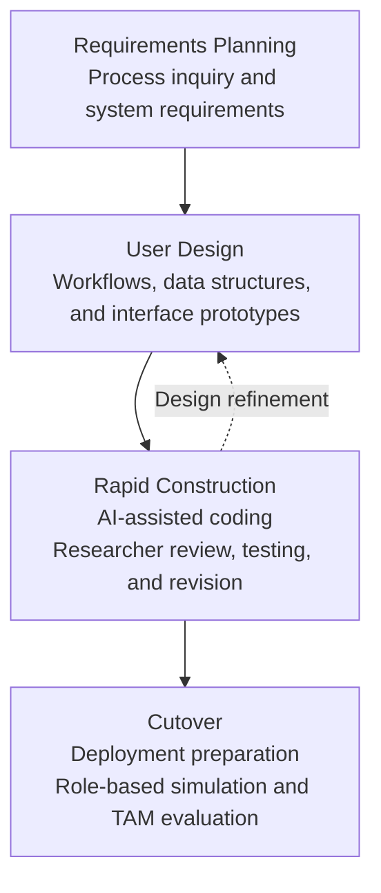

# Chapter 2: Methodology

> **Review draft, prepared 2026-10-06T01:05:29.531Z.** This reading copy is generated from the canonical section files. Bracketed FIGURE, PLATE, TABLE, and EVIDENCE instructions reserve insertion locations; pending values and images are not research results. Edit the source sections, then regenerate this copy before final integration.

## 2.1 Research Design

This study uses a descriptive-developmental research design (Frey, 2022). The descriptive component examines the existing admission-testing process through questionnaires, interviews, field observations, and applicant journey surveys. The findings provide the basis for determining the system requirements.

The developmental component covers the design, development, and refinement of NEXIAM based on these requirements. User acceptance is evaluated after participants complete simulated role-specific tasks, using the Technology Acceptance Model (TAM) questionnaire.

---

## 2.2 Software Development Model

NEXIAM development follows the Rapid Application Development (RAD) model (Martin, 1991; Pressman & Maxim, 2020). Its four phases are Requirements Planning, User Design, Rapid Construction, and Cutover. The project also draws on related Philippine system-development studies (Olipas, 2020; Melendres & Aranda, 2024).

Figure 2.1 presents the RAD phases applied to NEXIAM, with AI assistance within Rapid Construction.

[FIGURE 2.1: RAD with AI-assisted construction. Insert the approved figure using the four-phase draft above.]
> **Slot metadata (working note):**
> - **Brief:** Show the four RAD phases. Within Rapid Construction, show AI-assisted coding followed by researcher review, testing, and revision; retain feedback to User Design.
> - **Source:** Martin (1991) and Pressman and Maxim (2020) for RAD; Osmani et al. (2026) for AI-supported development and verification.
> - **Confirm:** Match the depicted activities to the team's development records. Do not add an AI phase or present literature as proof of project outcomes.

**Figure 2.1.** RAD model with AI-assisted construction.

**Requirements Planning.** This phase uses the process inquiry to identify admission-testing needs and define the initial system requirements.

**User Design.** The requirements are translated into workflows, data structures, and interface prototypes for review and refinement.

**Rapid Construction.** The team develops NEXIAM in increments from the documented requirements. AI-assisted coding is followed by researcher review, testing, and revision before integration, consistent with the verification-focused approach described by Osmani et al. (2026).

**Cutover.** The system is prepared for deployment and role-based evaluation. Participants complete simulated tasks covering their part of the admission workflow and then answer the TAM questionnaire.

---

## 2.3 Project Plan and Assignments

The project spans June to October 2026 and follows the four RAD phases. Requirements Planning and User Design establish the system requirements and designs, followed by incremental development and testing during Rapid Construction. Cutover covers deployment, role-based simulation, and user-acceptance evaluation. Figure 2.2 presents the project schedule.

[FIGURE 2.2: Project schedule. Insert the approved June–October 2026 chart with 6 October as the deployment milestone and evaluation activities shown separately.]
> **Slot metadata (working note):**
> - **Brief:** Show the four RAD phases across June–October. Mark deployment on 6 October 2026; show simulation and evaluation as separate activities.
> - **Source:** Researcher-confirmed project period and deployment date; approved project records for the remaining phase/activity dates.
> - **Confirm:** Use actual or approved scheduled dates for phase spans and evaluation activities. Deployment alone does not establish completed evaluation.

**Figure 2.2.** Project schedule for NEXIAM.

**Project Assignments.** Project responsibilities are distributed among the three researchers, as shown in Table 2.1. Technical Writer and Documenter is one shared role performed by all three researchers.

**Table 2.1**  
*Project Roles and Responsibilities*

| Project Role | Researchers | Responsibilities |
|---|---|---|
| Project Manager | David Datu N. Sarmiento | Coordinates the project schedule, stakeholder communication, and research activities. |
| System Analyst and Designer | David Datu N. Sarmiento; Jaypee G. Pagaduan | Analyzes process needs and designs the system workflows, interfaces, and data structures. |
| Lead Developer and Programmer | Jaypee G. Pagaduan | Develops the backend, frontend, and system integrations. |
| Quality Assurance Tester | Christine M. Lopez | Prepares test cases, supports evaluation sessions, and records system defects. |
| Technical Writer and Documenter | David Datu N. Sarmiento; Jaypee G. Pagaduan; Christine M. Lopez | Jointly prepares, reviews, and aligns the manuscript, evaluation report, and system documentation. |

---

## 2.4 Population and Locale of the Study

### Locale of the Study

The study is situated at Ilocos Sur Polytechnic State College (ISPSC) Tagudin Campus in Tagudin, Ilocos Sur, Philippines. The campus serves students from southern Ilocos Sur and nearby northern La Union. The applicant catchment described in the study includes Tagudin, Sta. Cruz, Sta. Lucia, Alilem, Sugpon, and Suyo in Ilocos Sur, and Bangar, Sudipen, and Luna in La Union. The study examines the campus admission-testing process; these catchment municipalities do not by themselves define the eligible student population or establish that findings generalize across them.

### Population and Sampling Distribution

The planned evaluation has four respondent groups: Registrar personnel, Guidance personnel, academic leaders, and first-year students. Participants are to complete tasks associated with their roles before responding to the role-adapted TAM questionnaire. Data collection and evaluation are planned, not completed.

The planned total is 263, including the current first-year-student target of 255:

1. *Registrar and Guidance personnel (census; n = 5):* The planned census comprises three Registrar personnel and two Guidance personnel.
2. *Academic leaders (purposive selection; n = 3):* One Program Head or Dean is to be selected from each of CAS, CBME, and CTE.
3. *First-year students (current target; n = 255):* First-year students are proposed because they recently experienced campus admission processes. The current sample-size calculation uses an estimated annual applicant baseline of 700 and Slovin’s formula with a 0.05 margin of error:

$$n = \frac{N}{1 + N(e)^2} = \frac{700}{1 + 700(0.05)^2} = \frac{700}{1 + 1.75} \approx 254.55 \rightarrow 255$$

The calculation yields a target of 255 only if the chosen population basis is appropriate. The value 700 is an applicant estimate, not the verified count of eligible first-year students. Confirm the student list, eligibility count, and selection procedure before describing the method as stratified random sampling. This includes the program allocation and selection steps within each program.

Table 2.2 shows planned numbers and selection bases, not completed participation.

**Table 2.2**  
*Planned Distribution of Evaluation Respondents*

| Respondent Group | Planned Sample (n) | Selection Basis |
|---|---:|---|
| Registrar Office Personnel | 3 | Census of eligible personnel |
| Guidance Office Personnel | 2 | Census of eligible personnel |
| Academic Program Heads or Deans | 3 | Purposive; one representative from each of CAS, CBME, and CTE |
| First-Year College Students | 255 | Current target; eligible population and selection procedure unverified |
| **Total** | **263** | **Planned total using current student target** |

### Scenario-Based Evaluation

The planned evaluation uses simulated tasks because data collection is outside the active admission cycle. Task-based scenarios provide participants with activities representative of their intended system roles before they report their perceptions. This approach is consistent with simulated-work-task and scenario-based evaluation methods (Borlund, 2000, 2003; Carroll, 2000; Dumas & Redish, 1999; Rubin & Chisnell, 2008; Kushniruk & Patel, 2004). TAM work provides a basis for measuring perceptions after interaction with a system (Davis, 1989; Venkatesh & Davis, 1996), but does not make a simulated task equivalent to live admission use.

First-year students are intended to contribute recent applicant experience and perform applicant-facing tasks using prepared records. Their responses would describe PU and PEOU under simulated conditions, not acceptance during a live admission cycle or change from the manual process. Registrar and Guidance personnel are included through the planned office census; academic leaders are selected purposively for relevant departmental responsibilities (Babbie, 2020; Creswell & Creswell, 2018). The small office and academic-leader groups limit broad generalization, and a census plan does not eliminate response or measurement error.

External IT experts are not part of the approved evaluation sample. Technical behavior is to be reported through relevant implementation records and test evidence, separately from respondents’ perception scores. No overall correctness, security, or privacy-compliance conclusion is inferred from the planned sample or questionnaire.

[EVIDENCE: Confirm the first-year-student sampling frame and eligible count, source/year for the 700 applicant estimate, program-level allocation if used, and the exact selection procedure. Update the sample calculation and selection description if the verified frame differs.]

---

## 2.5 Research Instruments

The study uses a role-adapted Technology Acceptance Model (TAM) questionnaire to measure Perceived Usefulness (PU) and Perceived Ease of Use (PEOU) after assigned NEXIAM tasks (Davis, 1989). The four respondent groups are Registrar personnel, Guidance personnel, first-year students, and Academic Program Heads or Deans. Task-specific wording is informed by related TAM applications (Lippert & Forman, 2005; Holden & Karsh, 2010).

Researchers prepare the reference data and materials needed for the assigned scenarios. The adapted questionnaire will undergo content review and pilot testing before administration. The task procedures and item alignments are provided in Appendix N.

Responses use a five-point agreement scale: 1 = Strongly Disagree, 2 = Disagree, 3 = Neutral, 4 = Agree, and 5 = Strongly Agree. Table 2.3 summarizes the role-specific item counts. The full questionnaires appear in Appendix J, Tables J.1 to J.4.

**Table 2.3**  
*Role-Adapted TAM Instrument Summary*

| Respondent group | PU items | PEOU items | Total items |
|---|---:|---:|---:|
| Registrar personnel | 4 | 4 | 8 |
| Guidance personnel | 7 | 6 | 13 |
| First-year students | 5 | 4 | 9 |
| Academic Program Heads or Deans | 4 | 4 | 8 |

---

## 2.6 Data Analysis

The analysis follows the three Specific Objectives. Process-inquiry records, technical evidence, and TAM responses are handled separately.

### Specific Objective 1: Process Mapping and Workflow Analysis

For SO1, questionnaire responses, interviews, and field observations are organized into descriptions of the admission-testing steps, office handoffs, and reported concerns. The two applicant journey surveys contain 22 respondents in total; staff and interview records are separate sources. Process mapping and workflow analysis identify the points linked to delays, unclear information, and coordination problems. Each finding is attributed to its source, with percentages reported for the relevant survey cohort.

[EVIDENCE: Reconcile each process-map step and reported concern with the original questionnaire, interview, survey, or observation record before finalizing the Chapter 3 findings.]

### Specific Objective 2: Requirements, Revisions, and Technical Evidence

Differences between the system design and the identified office needs are recorded as revision items. Each revision is linked to the relevant process finding or institutional requirement. The functional requirements and system features guide development and testing tasks.

Technical test results are documented separately, with the tested behavior, observed result, and remaining limits. Chapter 3 presents these records alongside the corresponding system requirements and features.

[EVIDENCE: Provide the revision log linking findings to requirements and changes, plus the specific test cases, execution records, observed results, and limitations supporting each technical claim.] 

### Specific Objective 3: Descriptive TAM Statistics

The role-adapted questionnaire uses a five-point agreement scale: 1 = Strongly Disagree, 2 = Disagree, 3 = Neutral, 4 = Agree, and 5 = Strongly Agree. PU and PEOU are analyzed separately. For each respondent, calculate a construct mean only when all items assigned to that construct have been answered. A blank response is missing, not Neutral; incomplete constructs are excluded from construct-mean calculations and counted by group and reason.

$$\bar{x}_{\text{person, construct}} = \frac{\sum_{i=1}^{k} x_i}{k}$$

where $x_i$ is the response to item $i$, and $k$ is the number of items assigned to that construct for the respondent’s role. The role-specific instrument has 8 items for Registrar personnel (4 PU, 4 PEOU), 13 for Guidance personnel (7 PU, 6 PEOU), 9 for students (5 PU, 4 PEOU), and 8 for academic leaders (4 PU, 4 PEOU), for 38 catalog items in total.

Primary results are separate group summaries for Registrar personnel, Guidance personnel, academic leaders, and students. For each group and construct, report the actual valid respondent count ($n$), mean, and standard deviation. If fewer than two valid responses are available, the standard deviation is not calculable. Because questions are adapted to role-specific tasks, group means are descriptive and do not support ranking offices against one another.

A secondary pooled summary is calculated from valid per-person construct scores across the four groups, giving each respondent equal weight. PU and PEOU remain separate. Because students form the largest group, the pooled results are presented alongside, not in place of, the four group results. The actual valid respondent count is reported for each summary.

Task completion, errors, interruptions, and assistance are summarized by role and task, separately from TAM scores. Participants may rate a function they attempted even when the task failed. Unanswered items are not assigned a neutral score. The results report valid counts and incomplete constructs with their recorded reasons. Findings from the small staff groups describe the participating personnel at ISPSC Tagudin Campus. Means are presented with the five-point response scale, not an unsupported acceptance label.

[EVIDENCE: After collection, insert group-level and pooled results using actual valid response counts, means, standard deviations, and missing-construct counts/reasons. Confirm participant flow and task logs before describing evaluation completion.]
