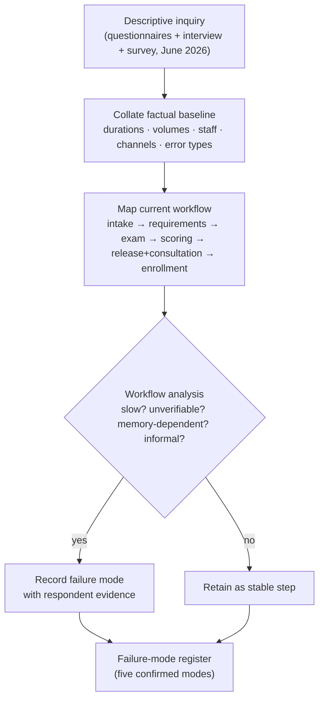
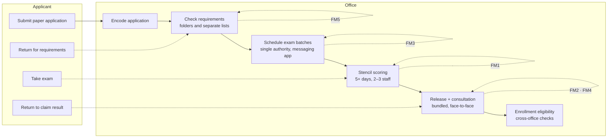
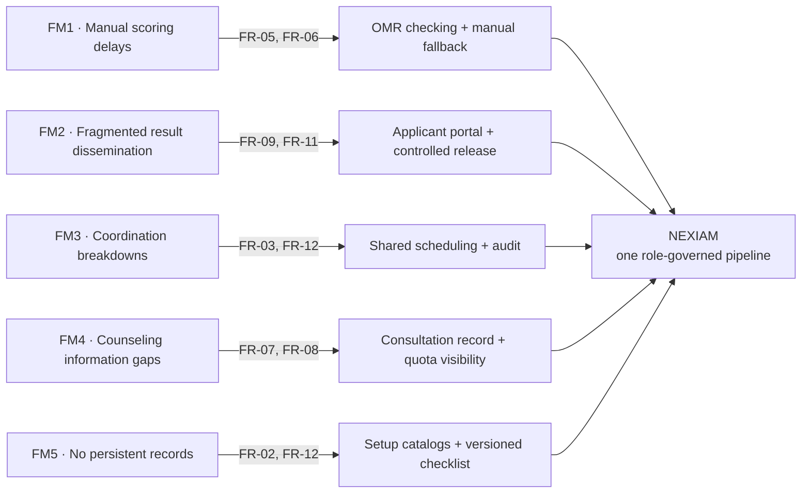

# NEXIAM — Chapter 3: Results and Discussion (paragraph draft)

### SO1 written as a robust research narrative | Phase 3 Version A | No em dashes
**Status:** WORKING DRAFT — paragraph-level SO1 + SO2 narrative; SO3 pending September 2026 data collection
**Date:** 2026-08-26
**Assumption (founder direction 2026-08-26):** the requirements interview and client validation visit are assumed completed so that SO1 can be written; the client visit brief (`manuscript/Phase(RAD-based) Work/00-client-brief/client-brief.html`) is the validation record. Simulated evidence is labeled as such and is never presented as collected data.
**Relationship:** paragraph companion to `manuscript/NEXIAM_Chapter3_Results_Discussion_DRAFT.md` (tables and system feature inventory); supersedes the SO1/SO2 narrative of `manuscript/archive/Final Sweep Revision Capstone/NEXIAM_Ch3_SO1_SO2_Draft.md` (Phase 2 shape).
**Recorded primary evidence:** `manuscript/Phase(RAD-based) Work/01-requirements-planning/Preliminary Interviews & Questionaire/` (three administered instruments, June 2026) plus the client visit brief.

---

## Chapter 3

## Results and Discussion

This chapter presents the findings of the study organized by specific objective. The first section reports the results of Specific Objective 1 (SO1): the analysis of the existing college admission testing processes, operational workflows, and process gaps at ISPSC Tagudin Campus through descriptive inquiry. The second section reports Specific Objective 2 (SO2): the determination of the system requirements of NEXIAM in terms of functional requirements and system features, together with the documentation of the Rapid Application Development (RAD) construction process. The third section reports Specific Objective 3 (SO3): the acceptance evaluation of NEXIAM through the Technology Acceptance Model, which is scheduled for the September 2026 Cutover phase.

---

## SO1: Analysis of the Existing Admission Testing Process

### 3.1.1 Design and Conduct of the Descriptive Inquiry

The descriptive inquiry was designed as a process-mapping study rather than a purely perceptual survey. Following the descriptive-developmental design of the study (Frey, 2022), the inquiry aimed to reconstruct the current admission workflow as it actually operates, to locate the points where the workflow slows, loses information, or depends on informal channels, and to convert those located points into the requirements space of the proposed system. Three instruments were administered during the June 2026 requirements planning period: a semi-structured questionnaire to Guidance Office personnel (recorded responses: n = 2, a Guidance Counselor and an Administrative Staff member, administered 14 June 2026), a follow-up interview with the Guidance Counselor probing exam security, batch scheduling, and coordination channels (25 June 2026), and an enrollment operations survey to Program Heads (recorded response: n = 1, administered 25 June 2026). Field observation notes and the requirements-gathering brief document the procedural context around these responses. The client validation visit, which closes the inquiry loop by confirming the summary with the offices, is assumed completed per the study's drafting assumption and recorded in the client visit brief.

The analysis proceeded in three passes, as shown in Figure 3.1. First, the recorded responses were collated into a factual baseline: durations, volumes, staff counts, channels, and error types. Second, that baseline was mapped onto a workflow diagram of the admission cycle from intake to enrollment, so that each fact was anchored to a specific step and handoff. Third, the mapped steps were analyzed for failure: a step was treated as a failure point when it was slow, unverifiable, dependent on memory or informal channels, or structurally unable to produce the evidence the next office needs.

**Figure 3.1.** The process-mapping analysis pipeline applied to the recorded inquiry evidence.

Table 3.1 shows the evidence sources and the specific contribution each made to the analysis.

**Table 3.1**

*Evidence Sources of the SO1 Inquiry*

| Source | Respondents | Date | Contribution to SO1 |
|---|---|---|---|
| Guidance workflow questionnaire | Guidance Counselor, Administrative Staff (n = 2) | 2026-06-14 | Scoring duration, staff counts, error types, consultation volume, applicant visits, municipalities |
| Guidance follow-up interview | Guidance Counselor (n = 1) | 2026-06-25 | Proctoring rules, batch scheduling factors, coordination channel, miscommunication, clustering/chatbot stance |
| Program Head enrollment survey | Program Head (n = 1) | 2026-06-25 | Quota communication mode, update frequency, preparation impact, feature ratings |
| Field observation + requirements brief | Researchers | June 2026 | Procedural context, handoff behavior, office environment |
| Client validation visit (assumed complete) | Guidance, Registrar, Program Head representatives | per client brief | Confirmation of findings and decisions; recorded corrections |

### 3.1.2 The Mapped Current-State Workflow

The workflow reconstructed from the recorded responses is shown in Figure 3.2. An applicant submits a paper application which is encoded by the office; requirements are verified against folders and separate lists; examination batches are scheduled around available rooms and the pooled applicant count; the exam runs with paper attendance; answer sheets are scored by hand with stencils; results are released only together with the face-to-face consultation; and the applicant completes enrollment eligibility checks across offices. The five failure modes confirmed by the analysis are marked on the diagram.

**Figure 3.2.** The mapped current-state admission workflow at ISPSC Tagudin Campus with confirmed failure modes (FM1 to FM5) annotated at their points of origin.

### 3.1.3 Failure Mode 1: Manual Scoring Delays

Examination sheets are scored by hand using stencils. Both recorded Guidance respondents confirmed that one admission cycle takes more than five days to score, and that the process occupies two to three staff members, with one respondent reporting that all trained staff are drawn into the work. The recorded error experience matches the manual mechanism: one respondent listed illegible markings among the most frequent scoring errors, the other reported double-marked answers. Significantly, neither respondent maintained a formal log of scoring errors, which means the office cannot quantify its own error rate or demonstrate the reliability of its results. Because results cannot move until scoring completes, the five-plus-day scoring window pushes release toward enrollment and concentrates the release workload into a short, crowded period. This finding aligns with the assessment infrastructure literature: Patil et al. (2021) identified record integrity and resource coordination as the acute pressure points of paper-based large-scale exam management, and Thakur et al. (2025) documented that physical grading workflows generate exactly the delays and subjective-bias exposure confirmed here. The campus case is therefore not anomalous; it instantiates a structural vulnerability the literature describes at scale.

### 3.1.4 Failure Mode 2: Fragmented Result Dissemination

The inquiry established that results have no online channel of any kind and are released only together with the face-to-face consultation: the applicant receives the result while attending the consultation session. Before that, applicants monitor a general-purpose Facebook page that Guidance staff manage only during office hours, and the recorded responses describe three campus visits in a typical cycle: submitting requirements, taking the exam, and claiming results. The combination of an office-hours-only announcement channel and an in-person release step means every applicant must travel to campus at least once more after the exam, and applicants from the recorded municipalities (Sta. Cruz, Bangar, Sudipen, Tagudin, Sta. Lucia, and Alilem) may travel more than two hours each way. The equity dimension is material: as Ruffalo Noel Levitz (2023) document, the speed and clarity of result release shape enrollment decisions directly, and applicants who cannot absorb repeated travel costs are structurally disadvantaged by a dissemination model dependent on physical attendance. The Free Higher Education Act (RA 10931, 2017) has grown the applicant population drawing on the campus, and a channel bounded by office hours does not scale with that volume.

### 3.1.5 Failure Mode 3: Inter-Office Coordination Breakdowns

Coordination across offices runs on informal channels. The follow-up interview recorded that exam batch scheduling is coordinated through an official messaging application (Viber or Messenger), with scheduling factors limited to available rooms and the number of pooled applicants, and that miscommunication occurs sometimes. The same interview established that exam slots are set by tradition through a single authority with no adjustments allowed, so the coordination burden is concentrated in one person and one channel. Quota information moves the same way: the Program Head survey recorded face-to-face meetings with daily updates during the admission period, and the Guidance side confirmed that one coordinator (the Guidance administrator) carries the liaison role to Program Heads and relevant personnel. Every one of these facts describes a system of record that lives in messages, meetings, and memory: no artifact exists that any office can query, no audit trail reconstructs a scheduling or quota decision, and a change communicated informally may not reach every affected party before an examination date. Disputes over slots and venues were reported as a recurring burden in the busiest weeks. The structural consequence is that the offices operate on parallel truths rather than one shared record.

### 3.1.6 Failure Mode 4: Counseling-Session Information Gaps

The consultation load is severe and the consultation leaves no trace. The questionnaire recorded about 70 to 80 applicants per day in peak periods with interactions of 2 to 5 minutes each, a sustained staff load in which applicants also wait in line for their turn. Within that compressed interaction, advice is only said: the recorded workflow contains no note, paper or digital, of what was advised, to whom, or with what next step, so nothing can be retrieved, verified, or carried into a follow-up. Counselors additionally advise on program availability that is communicated verbally through the coordinator. The recorded Program Head response reported no past incident of an applicant being advised on outdated quota information, and rated the difficulty of coordinating prerequisites as low, so the finding here is a mechanism risk rather than a confirmed incident: the quota figure a counselor cites is as current as the last face-to-face update and the coordinator's message relay, with no shared visibility to confirm it at the moment of advising. Both the load and the informational asymmetry carry accuracy and equity implications for course-routing decisions, and both are structurally unmeasurable today because the counseling step produces no record.

### 3.1.7 Failure Mode 5: Absence of Persistent Admission Configuration Records

Core admission configuration, specifically the academic year parameters, examination room assignments, course quotas, and aptitude area definitions that each admission cycle depends on, exists nowhere as a managed record. The interview evidence shows scheduling decisions are derived from rooms and pooled applicant counts held in conversation, and the requirements gathering documented that configuration is re-established each cycle through staff memory and informal coordination. The same absence extends to intake documents: requirements are verified against folders and separate lists rather than a single checklist, so a document state exists only in whichever list last recorded it and cannot be queried across offices. Configuration consistency between cycles therefore depends entirely on the continuity of individual staff, creating institutional knowledge risk whenever personnel change.

### 3.1.8 Summary of SO1 Findings

The five failure modes establish the empirical basis for the requirements developed under SO2. Table 3.2 maps each failure mode to its primary operational consequence and the functional requirement it motivates, and Figure 3.3 renders the same mapping as a traceability flow.

**Table 3.2**

*Failure Mode to Requirement Mapping*

| Failure Mode | Operational Consequence | Derived Requirement |
|---|---|---|
| FM1 Manual scoring delays | 5-plus-day scoring, release pushed toward enrollment, no error log | Automated bubble-sheet scoring with manual fallback (FR-05, FR-06) |
| FM2 Fragmented result dissemination | Office-hours announcements, three campus visits, in-person release | Applicant portal with controlled online release and notification (FR-09, FR-11) |
| FM3 Inter-office coordination breakdowns | Messaging-app scheduling, single authority, no system of record | Digital session scheduling with shared roster and audit (FR-03, FR-12) |
| FM4 Counseling-session information gaps | 70–80-per-day load, verbal-only advice, unverifiable quota figures | Consultation record with quota visibility and follow-up state (FR-07, FR-08) |
| FM5 Absence of persistent configuration records | Rebuilt-from-scratch cycles, list-based intake checks | Managed setup catalogs and versioned intake checklist (FR-02, FR-12) |

**Figure 3.3.** Traceability from confirmed failure mode to NEXIAM functional requirement.

The overarching finding is the absence of a unified system. ISPSC Tagudin Campus does not lack local precedent: Yukee et al. (2025) and Ballesteros et al. (2025) demonstrated applicant-profiling approaches on the campus's own examination data, and Angala et al. (2023), Cenezan and Gacusan (2025), and Cenezan and Valdez (2023) contributed digitization solutions to adjacent administrative functions at the same institution. What the campus lacks is a single role-governed architecture in which scoring, aptitude classification, guidance delivery, and inter-office coordination operate as integrated parts of one traceable pipeline. None of the existing local systems touches the admission testing phase, and none connects the Guidance and Registrar offices within a shared operational context. That structural absence, confirmed through direct inquiry with the offices that run the admission cycle, is what NEXIAM is designed to address.

---

## SO2: System Requirements of NEXIAM

### 3.2.1 Derivation and Validation of the Requirements

The functional requirements were derived from the five failure modes under SO1 and structured through the process and decision matrix developed during requirements gathering, which classified each digitized process (D1 to D10) and each breaking change (B1 to B10) together with its owner and validation question. Requirements were admitted only when they traced to a confirmed operational failure or a confirmed process decision; no feature was added on general technical interest. During User Design, the requirements were iteratively validated with the offices: design reviews captured mockup preferences and feature acceptance, and misalignments were logged as revision items connected to specific field findings. The client validation visit, assumed completed per the study's drafting assumption, closes this loop by confirming the process wording, decision owners, booking rules, OMR exception rules, and release rules recorded in the client brief, including the corrected current-state facts: exam slots set by a single authority with no adjustments allowed, results released only together with the consultation, advice given verbally with no record, and intake document states tracked only as missing or submitted/verified.

### 3.2.2 The Functional Requirements and System Features

The functional requirements (Table 3.3 in the companion draft, 13 requirements, FR-01 to FR-13) translate the failure modes into contract language: digital application with identifier key (FR-01), versioned intake review (FR-02), room-capacity session scheduling with proctor duties (FR-03), policy-gated self-booking (FR-04), OMR with manual fallback (FR-05), grading completeness gate with attribution (FR-06), consultation record with Advised confirmation (FR-07), recorded program choice and quota position (FR-08), controlled release with reversal (FR-09), computed enrollment eligibility (FR-10), applicant-visible status with truthful notifications (FR-11), capability-scoped access with audit (FR-12), and case-attached official messages (FR-13). The system features (Table 3.4 in the companion draft, 17 features) implement these requirements: the applicant portal and online intake are implemented and demonstrated; exam scheduling, monitoring, grading, and the OMR capture path with its confidential conversion table are implemented; consultation, release, and enrollment eligibility are designed end to end with the result-sheet printing pipeline in progress; and the RAG chatbot, admission support models, and AI-assisted scheduling remain conditional per the study scope, gated by their own evidence requirements.

### 3.2.3 The RAD Construction Process

The construction followed the four RAD phases (Martin, 1991; Pressman and Maxim, 2020). Requirements Planning produced the empirical baseline reported under SO1. User Design produced the relational RBAC schema, the authorization matrix, and interface mockups for each user role, with the role catalog reconciled to seven RBAC-governed roles plus a non-evaluated Super Admin break-glass role and role-isolated Program Head views. Rapid Construction built the platform as a modular monolith on the Laravel framework with Inertia and Svelte and PostgreSQL as the database, integrating the open-source OMRChecker engine on commodity hardware, a confidential conversion-table engine with frozen score snapshots, and an identifier-key-plus-birthdate applicant credential; AI-assisted development accelerated routine implementation under human code review, and completed modules were demonstrated to staff with revision items logged per field finding. Cutover deploys the platform to a cloud-hosted environment and transitions the study into the September 2026 evaluation.

### 3.2.4 Discussion

The requirements are structurally necessary rather than additive. The absence of role-differentiated access control in the current process makes RBAC the precondition for every other layer: automated scoring cannot be deployed where its outputs can be modified without attribution, which is why the access matrix governs scoring outputs through the same capability checks that govern every other write. The consultation record is only usable if the data feeding it is trustworthy, which is why scoring and release actions are bound to attributable audit events before downstream views read from them. This dependency structure is the direct consequence of building against the specific, confirmed failure modes the SO1 inquiry documented rather than against a generic admissions template, consistent with the recommendation of Osmani et al. (2026) that the value of AI-assisted implementation depends on the quality of the architecture and specification it is directed against.

---

## SO3: Acceptance Evaluation of NEXIAM (TAM)

### 3.3.1 Data Collection Status

Data collection for Specific Objective 3 occurs during the September 2026 Cutover phase, outside the active admission period. Simulated evaluators will execute role-specific scenarios corresponding to the use cases in Appendix B and independently complete the TAM questionnaire as a single post-test: 255 first-year students drawn through Slovin's formula at a 0.05 margin of error from an estimated population of 700 applicants, and 16 administrative staff purposively selected as the complete available complement. Results will be reported here using the analysis procedure defined in the methodology: per-person construct scores averaged into pooled means for Perceived Usefulness and Perceived Ease of Use with standard deviations, means above the 3.0 midpoint indicating positive acceptance, interpreted against the benchmarks of Davis (1989) and the role-based TAM literature (Lippert and Forman, 2005; Holden and Karsh, 2010).

---

## Limitations and Integrity Notes

- The recorded instrument responses are small in number (two Guidance questionnaire responses, one follow-up interview, one Program Head survey response); the findings are corroborated by field observation and the client validation brief and will be tested at full scale by the September 2026 TAM evaluation with its planned 271 evaluators.
- The client validation visit is assumed completed per the founder direction of 2026-08-26; the recorded corrections in the client brief are treated as validated facts, and any live visit that contradicts them supersedes this draft.
- Where the evidence records no confirmed incident (for example, the Program Head respondent's report of no past outdated-quota advice), the draft reports the mechanism risk rather than an invented incident.
- Open follow-up recorded for the office: retake policy, whether a student with a saved result may retake within the same cycle or only in another academic year.

---

## Evidence Traceability

| Finding | Recorded artifact |
|---|---|
| Scoring 5+ days, 2–3 staff, illegible/double-marked, no error log | Guidance questionnaire Round 1, 2026-06-14 (2 responses) |
| 70–80 consultations/day, 2–5 minutes, three visits, municipalities | Guidance questionnaire Round 1, 2026-06-14 |
| Proctoring restriction, scheduling factors, messaging-app channel, single coordinator | Guidance interview Round 2, 2026-06-25 |
| Quota via face-to-face daily updates, "never" outdated-advice, feature ratings | Program Head survey Round 1, 2026-06-25 |
| Release only with consultation, verbal-only advice, single-authority exam slots, submitted/verified intake states, retake follow-up | Client visit brief (validation record, assumed complete), `manuscript/Phase(RAD-based) Work/00-client-brief/client-brief.html` |
| Process and decision matrix D1–D10, B1–B10 | `docs/requirements-gathering/process-decision-matrix.md` |
| Implemented feature status | `docs/client-features-overview.md`; `system/` routes and test suites |
