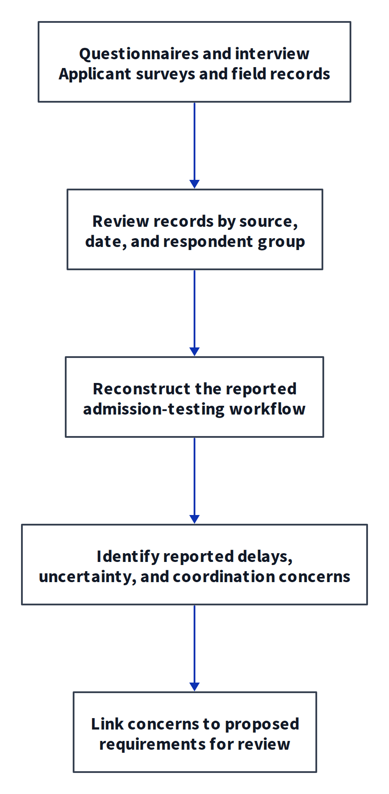
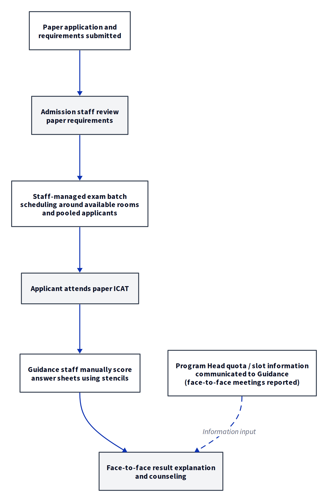

# Chapter 3: Results and Discussion

> **Review draft, prepared 2026-10-06T01:05:29.531Z.** This reading copy is generated from the canonical section files. Bracketed FIGURE, PLATE, TABLE, and EVIDENCE instructions reserve insertion locations; pending values and images are not research results. Edit the source sections, then regenerate this copy before final integration.

## 3.1 Specific Objective 1: Analysis of the Existing Admission Testing Process

This chapter presents the findings by Specific Objective: the existing admission-testing process (SO1), system requirements and RAD development (SO2), and user acceptance (SO3).

**Evidence Sources.**

The process analysis follows the descriptive-developmental research design (Frey, 2022) and draws on staff questionnaires, a follow-up interview, a Program Head survey, field records, and two applicant journey surveys. Table 3.1 identifies the sources and their recorded dates.

**Table 3.1**  
*Evidence Sources of the SO1 Descriptive Inquiry*

| Source | Respondents / scope | Date | Contribution to the process analysis |
|---|---|---|---|
| Guidance workflow questionnaire (Appendix H) | Guidance Counselor and administrative staff (n = 2) | 14 June 2026 | Scoring duration and staffing, reported marking challenges, consultation volume and duration |
| Guidance follow-up interview (Appendix H) | Guidance Counselor / Test Administrator (n = 1) | 25 June 2026 | Scheduling channels, room constraints, coordination, quota visibility and prior clustering-tool use |
| Program Head enrollment operations survey (Appendix I) | Academic Program Head (n = 1) | 25 June 2026 | Quota communication and reconciliation practices; requested coordination capability |
| Field observation and requirements validation brief | Institutional stakeholders; see source brief for scope | June–July 2026 | Operational context and recorded policy decisions; see the brief for the underlying evidence and decision register |
| Applicant journey survey, Round 1 (Appendix G) | Multi-year examinees, n = 12 | 28 August 2026 | Retrospective accounts across several programs and admission cycles |
| Applicant journey survey, Round 2 (Appendix G) | Enrolled first-year CBME students, n = 10 | 29 September 2026 | Current-cycle accounts from this cohort, including travel, document-status, schedule and consultation experiences |

Figure 3.1 shows how these records are organized for process mapping.

**Figure 3.1.** Evidence-to-process-mapping sequence for the SO1 descriptive inquiry.

Records are reviewed by source and respondent group before the current workflow is reconstructed. Reported concerns are then linked to proposed requirements for review.

**Reported Current Workflow.**

Figure 3.2 summarizes the admission-testing steps described in the staff and applicant records, from paper requirements to result explanation and counseling (Appendices G to I).

**Figure 3.2.** Source-based summary of the reported admission-testing workflow at ISPSC Tagudin Campus.

Staff schedule examination batches around available rooms and pooled applicants. Paper answer sheets are checked manually, and results are explained during face-to-face consultation. The dashed arrow represents Program Head quota information supplied through face-to-face meetings; it is an information input, not another applicant stage.

**Scoring and Result Consultation.**

Both Guidance respondents reported five or more days for scoring one full examination cycle. One reported two to three staff, while the other referred to all trained staff. Reported checking challenges included illegible and double-marked answers. No historical error log was supplied for calculating a manual-scoring error rate (Appendix H, §§2.1–2.2).

The Guidance questionnaire records peak consultation volumes of 70 to 80 applicants per day and approximately 2 to 5 minutes per consultation. Results are explained in face-to-face consultations. In the first-year CBME survey cohort (n = 10), six respondents (60%) reported waiting at least 30 minutes: four reported 30 minutes to one hour, one reported one to three hours, and one reported half a day (over three hours) (Appendix G, Table G.6).

**Applicant Experiences.**

In the first-year CBME cohort only (n = 10), six respondents (60%) lived outside Tagudin: five in Santa Cruz and one in Alilem. Seven (70%) reported relying on Facebook Messenger or classmates to confirm whether submitted requirements had been accepted; two (20%) reported immediate staff confirmation, and one (10%) selected other/uncertain. These values are not estimates for all applicants or for the separate n = 12 cross-sectional group (Appendix G, Tables G.1 and G.3).

For schedule announcements, seven of the ten first-year respondents (70%) named the official campus Facebook page, one named classmates/group chat, and two named word of mouth/personal inquiry. Three of ten (30%) reported scheduling friction: two reported short notice and one a schedule conflict. The other seven reported no scheduling difficulty (Appendix G, Tables G.4–G.5). The reported announcement channel is not proof that every respondent depended exclusively on Facebook.

Eight of ten respondents (80%) reported enrolling in their initial first-choice program; two (20%) reported changing program because the preferred program's quota was closed (Appendix G, Table G.7). The Guidance interview describes coordination to obtain quota information, while the Program Head respondent reported face-to-face communication and daily updates (Appendices H and I). These records identify an information-sharing need; they do not establish that quota visibility alone would prevent program changes.

**Office Coordination.**

The Guidance interview describes room-constrained batch scheduling coordinated through online messaging, with occasional miscommunication and short notice. The Program Head survey reports face-to-face communication of quota and slot information, with daily updates during the admission period (Appendices H and I).

The applicant survey records uncertainty about requirement status and schedule information. Together with the staff reports, these findings inform requirements for shared process information and recorded office handoffs.

**Applicant Suggestions.**

Three open-ended survey responses requested clearer process information. The quotations are attributed by study group rather than by name.

- A first-year CBME respondent requested: *"Provide a clear online system where students can check their exam schedule, results, available program slots, and enrollment requirements in one place."*
- A first-year CBME respondent wrote: *"Yes, some instructions were unclear, especially about the requirements and exam procedures... provide clearer instructions and a simple step-by-step guide for the admission process."*
- A first-year CBME respondent recommended: *"Giving clearer instructions and updates during the admission process so students know what to do and when to do it."*

These comments illustrate suggestions from the first-year CBME respondents.

**Requirements Traceability.**

The draft groups the process concerns into five traceability codes: FM1, scoring workload; FM2, applicant-facing information; FM3, session coordination; FM4, consultation and quota information; and FM5, persistence of operational records. Table 3.2 links these concerns to requirements for review. The final links will be reconciled with the full use-case documentation.

**Table 3.2**  
*Proposed Mapping of SO1 Observations to Requirements for Review*

| Code | Observed issue in the cited source | Proposed requirements to review | Mapping status |
|---|---|---|---|
| FM1 | Manual scoring takes 5+ days and occupies 2 to 3 staff; marking challenges are not quantified in a formal error log (Appendix H) | FR-05, FR-06 | Confirm scoring and review scope |
| FM2 | First-year CBME respondents report requirement-status uncertainty and travel outside Tagudin (Appendix G, n = 10) | FR-01, FR-02, FR-11 | Confirm applicant information and delivery scope |
| FM3 | Scheduling is coordinated through messaging and is room-constrained; applicants report schedule friction (Appendices G and H) | FR-03, FR-04, FR-11, FR-13 | Retain staff-managed scheduling as the evaluated default |
| FM4 | Consultations are brief during peak volume; quota information is communicated informally (Appendices H and I) | FR-07, FR-08, FR-13 | Confirm record, quota, and communication boundaries |
| FM5 | Requirements and operational details rely on paper, informal channels, or manual reconciliation in the reported processes (Appendices G to I) | FR-01, FR-02, FR-12 | Confirm configuration and access-control scope |

```mermaid
flowchart LR
    A[Scoring burden] -->|proposed: FR-05, FR-06| R[Requirements for review]
    B[Applicant status uncertainty] -->|proposed: FR-01, FR-02, FR-11| R
    C[Scheduling coordination] -->|proposed: FR-03, FR-04, FR-11, FR-13| R
    D[Consultation and quota information] -->|proposed: FR-07, FR-08, FR-13| R
    E[Persistence and access questions] -->|proposed: FR-01, FR-02, FR-12| R
```

[FIGURE 3.3: Process-to-requirements traceability. Insert the reconciled figure after the FR and use-case links are approved.]
> **Slot metadata (working note):**
> - **Brief:** Link the five source-grounded SO1 concern codes to provisional FRs from Table 3.2; retain the links as pending, not approved mappings.
> - **Source:** This section, Table 3.2 and its Mermaid draft; Appendix O at `manuscript/sections/04_appendices/04_appendix_o_use_case_activity_validation.md`.
> - **Confirm:** Full FR/use-case mapping is not reconciled; retain pending links until approved mapping is supplied.

**Figure 3.3.** Draft traceability from source-grounded SO1 observations to requirements for review. The links are provisional pending approved use-case mapping.

The literature review places the findings alongside campus studies of historical score analysis and related digital systems. Yukee et al. (2025) examined ICAT-score clustering; the Guidance interview reports that the prior clustering system was not used because it was not integrated into the operational workflow (Appendix H, Round 2, Item 3). This contextualizes the integration question without claiming that the present system or its decision-support functions have been institutionally adopted or validated.

---

## 3.2 Specific Objective 2: System Requirements and the Rapid Application Development Process

This section presents the requirements and development account for Specific Objective 2. It follows the RAD phases of Requirements Planning, User Design, Rapid Construction, and Cutover (Martin, 1991; Pressman & Maxim, 2020). The section reserves locations for the full use-case mapping, design figures, feature evidence, and system plates.

**Functional Requirements.**

Table 3.3 retains thirteen functional requirement identifiers for the draft mapping. It connects the process concerns in SO1 with the intended system functions. The approved use-case documentation will provide the final actor responsibilities, actions, and conditions.

**Table 3.3**  
*Proposed Functional Requirements of NEXIAM: Mapping and Verification Pending*

| ID | Proposed functional requirement for review | Proposed trace | Status |
|---|---|---|---|
| FR-01 | Support applicant intake with validated data, applicable privacy notice/consent handling, and a reference identifier. | FM5; decision mapping to confirm | Proposed; use-case and evidence review pending |
| FR-02 | Support attributable Registrar review of submitted requirements and record-status actions. | FM5; decision mapping to confirm | Proposed; state/action mapping pending |
| FR-03 | Support staff-managed examination session setup with room and roster information. | FM3; decision mapping to confirm | Proposed; actor and capacity rules pending |
| FR-04 | Support applicant self-booking only where enabled by an authorized policy decision; staff-managed assignment remains the documented operational default. | FM3; decision mapping to confirm | Optional/policy-gated capability; not an evaluated task |
| FR-05 | Support answer-sheet scoring, including any automated recognition and human review paths established by approved design and evidence. | FM1; decision mapping to confirm | Proposed; exact runtime behavior and limits pending |
| FR-06 | Support recording and review of examination scores and batch state under approved completion and correction rules. | FM1; decision mapping to confirm | Proposed; gate and audit evidence pending |
| FR-07 | Support recording of post-examination consultation and its outcome according to approved workflow. | FM4; decision mapping to confirm | Proposed; role/state mapping pending |
| FR-08 | Support recording program preferences and relevant departmental capacity information for authorized use. | FM4; decision mapping to confirm | Proposed; data and decision boundary pending |
| FR-09 | Support result preparation and delivery modes permitted by approved policy, with attributable state changes. | FM2; decision mapping to confirm | Proposed; physical delivery is the evaluation scenario; other modes not evaluated |
| FR-10 | Support Registrar review of enrollment eligibility information using approved criteria. | FM2; decision mapping to confirm | Proposed; criteria and authority pending |
| FR-11 | Support an applicant-facing view of authorized admission milestones and schedule/result information when available. | FM2; decision mapping to confirm | Proposed; exact visibility and delivery states pending |
| FR-12 | Apply approved capability- and resource-scoped access rules and record relevant actions as specified by the approved security design. | FM3, FM5; decision mapping to confirm | Proposed; security and audit behavior verification pending |
| FR-13 | Support applicant inquiries and cross-office responses within approved scope and privacy boundaries. | FM3; decision mapping to confirm | Proposed; actor/thread scope pending |

The requirement identifiers remain stable during review. Update the requirement wording and trace links when the approved use-case and decision documentation is integrated.

The full system use-case, data-flow, and entity-relationship diagram material is located in Appendices C to F. The main discussion focuses on the requirements and features linked to the SO1 findings.

**System Features.**

Table 3.4 organizes the feature areas across the admission-testing lifecycle. It distinguishes preparation activities, user tasks included in the evaluation, and optional functions. Implementation records and the approved use-case mapping will complete the feature descriptions and evidence status.

**Table 3.4**  
*System Feature Areas and Evidence Status for Review*

| Lifecycle area | Feature area retained for review | Related FR identifiers | Scope/status distinction |
|---|---|---|---|
| Configuration and setup | Administrative setup and template/catalog configuration | FR-05, FR-06, FR-08, FR-09, FR-12 | Researcher preparation/configuration is not a TAM participant task; verify the live setup scope |
| Configuration and setup | Staff views and role-scoped access | FR-12 | Verify actor/resource boundaries against approved use cases and technical evidence |
| Application intake | Online intake and document review | FR-01, FR-02 | Not a substitute for evidence of each validation, consent, or review behavior |
| Application intake | Applicant status and self-service portal | FR-01, FR-04, FR-11 | Assigned student tasks are listed in Appendix N; booking remains optional/policy-gated |
| Application intake | Inquiry and administrative response | FR-11, FR-13 | Student inquiry/reply and Guidance-to-academic-leader thread exchange are in the planned scenarios; verify exact scope |
| Examination scheduling | Session management and booking options | FR-03, FR-04 | Staff-managed scheduling is evaluated; applicant self-booking is optional and not evaluated |
| Examination day | Roster and attendance recording | FR-03 | Specific task behavior to be recorded; no claim of offline resilience without evidence |
| Result preparation | OMR scoring and review | FR-05 | Ordinary prepared-sheet scoring is in a Guidance scenario; uncertain-mark adjudication is not evaluated |
| Result preparation | Score recording and batch state | FR-06 | Prepared mappings/keys and configuration are setup; completeness behavior requires separate evidence |
| Consultation and triage | TabPFN or other configured program-match review | FR-07, FR-08 | Match-review task planned; no model-performance or admission-probability claim; readiness evidence required below |
| Consultation and triage | Consultation workbench and capacity information | FR-07, FR-08 | Face-to-face consultation and physical result delivery are in the planned staff/student scenarios; verify exact functions |
| Result handoff | Result preparation, printing, portal release, and reversal paths | FR-09 | Physical result-sheet delivery is in the planned scenario; separate digital release is not evaluated |
| Post-admission | Eligibility information and reports | FR-08, FR-10 | Registrar tasks cover specified lookups/review; establish criteria and evidence before claiming automated eligibility |
| Cross-cutting | Audit/event records | FR-12 | Verify actual event coverage, integrity behavior, and security claims before reporting |

The evaluated task scope is defined in Section 3.3 and Appendix N. Broader or optional capabilities remain separate from the selected tasks and require their own policy and evidence records.

**RAD Development.**

**Requirements Planning.**

Requirements Planning used the process inquiry and stakeholder material in Appendices G to I. Table 3.2 links the recorded concerns to proposed requirements. The two applicant survey cohorts are kept separate when reporting their experiences.

**User Design.**

User Design covers the system boundary, actor responsibilities, data flows, data model, and interface prototypes. The full design-diagram material is located in Appendices C to F and is reconciled with the requirements and current design records.

**Rapid Construction.**

The development account covers a Laravel application with Inertia and Svelte interfaces, PostgreSQL storage, OMR scoring, program-match decision support, and audit records. The final account will identify the evaluated build and attach the technical evidence for each reported behavior.

TabPFN provides the research basis for the tabular program-match component (Hollmann et al., 2025). Its intended use is to support Guidance review of applicant information against institutional benchmark exemplars. The model and benchmark records will identify the engine used in the evaluated build. The program-match output remains advisory.

[EVIDENCE: Record the evaluated build/runtime identity; selected admission-engine provider and actual model/driver/version; whether inference completed in that environment; benchmark-set identity/version and readiness state; and a traceable invocation/output/timing record. Revise model wording to match that evidence. Do not infer calibrated probabilities, predictive accuracy, admissions suitability, or autonomous admission from the existence of a TabPFN citation, adapter, synthetic fixture, or UI card.]

**Cutover.**

Cutover covers preparation for the role-specific tasks and TAM questionnaire. Section 3.3 provides the planned sample and the result-table locations. Deployment and task records will complete the development account, while questionnaire responses will supply the acceptance results.

[EVIDENCE: For every technical behavior reported as tested, record the exact actor/task or trigger, environment/build, input and preconditions, observed behavior/result, failures/help or manual intervention, and limits. Replace only the corresponding provisional wording; do not generalize beyond the observed behavior.]

**System Plates.**

Plates 1 to 15 reserve the main system interfaces and result artifact. Following the presentation pattern in Yukee et al. (2025), each plate has an image location and an explanatory paragraph. Insert verified captures using synthetic or redacted data, then revise each paragraph to match the visible interface. Record the role, build, and displayed state with the capture; technical behavior is supported by separate records.

#### Plate 1: Public Applicant Intake

[PLATE 1: Public intake. Insert a verified screenshot; show only relevant visible fields and use synthetic/redacted data.]
> **Slot metadata (working note):**
> - **Brief:** Capture the real public intake screen, showing only its visible form fields and submission controls with synthetic/redacted records.
> - **Source:** This section, Table 3.4 and Plate 1; public intake is broader system documentation, not a student TAM task.
> - **Confirm:** Capture environment, build, and visible state; verify each described field/control against the image.

**Plate 1.** Public Applicant Intake.

The intake plate covers the form used by a prospective applicant. The final description will identify the fields, requirements information, and submission controls visible in the approved capture.

#### Plate 2: Applicant Milestone and Schedule View

[PLATE 2: Applicant milestone view. Insert a verified screenshot with synthetic/redacted data.]
> **Slot metadata (working note):**
> - **Brief:** Capture the real applicant milestone and assigned-schedule view with synthetic/redacted data; show only what is visible.
> - **Source:** This section, Plate 2; student status and schedule tasks in Appendix N.
> - **Confirm:** Verify displayed state and available navigation from the captured screen; do not imply self-booking.

**Plate 2.** Applicant Milestone and Schedule View.

This plate covers the applicant's milestone and assigned-schedule view. Its description will identify the displayed admission state, examination information, and available navigation.

#### Plate 3: Registrar Intake Review

[PLATE 3: Registrar intake review. Insert a verified screenshot with synthetic/redacted data.]
> **Slot metadata (working note):**
> - **Brief:** Capture the actual Registrar intake-review screen with synthetic/redacted data, including only visible applicant, requirement-status, and review controls.
> - **Source:** This section, Plate 3; Registrar tasks in Appendix N.
> - **Confirm:** Verify the reviewer role, displayed fields, and controls against the capture.

**Plate 3.** Registrar Intake Review.

The Registrar intake plate covers application review. Its description will identify the applicant information, requirement status, and review controls visible in the selected state.

#### Plate 4: Examination Session Management

[PLATE 4: Examination session management. Insert a verified screenshot with synthetic/redacted data.]
> **Slot metadata (working note):**
> - **Brief:** Capture the real staff-managed session screen with synthetic/redacted data; show only visible scheduling, room, and staff controls.
> - **Source:** This section, Plate 4; scheduling task in Appendix N.
> - **Confirm:** Verify visible details; do not imply applicant self-booking.

**Plate 4.** Examination Session Management.

The examination-session plate covers staff-managed scheduling. Its description will identify the session details, assigned room, capacity information, and staff controls used in the selected workflow.

#### Plate 5: Examination Roster and Attendance

[PLATE 5: Examination roster and attendance. Insert a verified screenshot with synthetic/redacted data.]
> **Slot metadata (working note):**
> - **Brief:** Capture the real examination roster and attendance state with synthetic/redacted data; include only visible recording controls.
> - **Source:** This section, Plate 5; Guidance attendance task in Appendix N.
> - **Confirm:** Distinguish examination attendance from consultation attendance.

**Plate 5.** Examination Roster and Attendance.

The roster plate covers examination attendance. Its description will identify the examinee list, attendance state, and recording controls visible to the assigned staff user.

#### Plate 6: Scoring Interface

[PLATE 6: Scoring interface. Insert a verified screenshot with synthetic/redacted data.]
> **Slot metadata (working note):**
> - **Brief:** Capture the actual prepared-sheet scoring workflow with synthetic/redacted data, showing only its real input, processing state, and displayed result.
> - **Source:** This section, Plate 6; prepared scoring task in Appendix N.
> - **Confirm:** Verify displayed behavior; accuracy and processing time require separate technical records.

**Plate 6.** Scoring Interface.

The scoring plate covers use of the prepared scoring function. Its description will identify the submitted sheet, displayed processing state, and resulting scores in the selected capture. Processing time and recognition accuracy require separate technical records.

#### Plate 7: Mark Review Interface

[PLATE 7: Mark review interface. Insert a verified screenshot only if this function is available in the captured environment; use synthetic/redacted data.]
> **Slot metadata (working note):**
> - **Brief:** Capture a real mark-review screen only if available in the evaluated environment; use synthetic/redacted data and show visible controls.
> - **Source:** This section, Plate 7; system-feature scope in Table 3.4.
> - **Confirm:** Capability and capture availability are unverified; this is not a TAM task.

**Plate 7.** Mark Review Interface.

The mark-review plate is reserved for separately documented review capability. It is outside the TAM task set. Its description will identify the mark and review controls only after the capability and capture are confirmed.

#### Plate 8: Score Completion or Batch State

[PLATE 8: Score completion or batch state. Insert a verified screenshot with synthetic/redacted data.]
> **Slot metadata (working note):**
> - **Brief:** Capture the actual score-completion or batch-state screen with synthetic/redacted data; show only displayed scores, status, and actions.
> - **Source:** This section, Plate 8; score-state scope in Table 3.4.
> - **Confirm:** Verify visible state; completion rules need approved use-case and technical evidence.

**Plate 8.** Score Completion or Batch State.

The score-state plate covers score completion or batch status. Its description will identify the scores, displayed status, and available actions in the selected state. The completion rules will be described from the confirmed use-case and technical evidence.

#### Plate 9: Program-Match Review

[PLATE 9: Program-match review. Insert a verified screenshot with synthetic/redacted data and identify the model/provider only if runtime evidence confirms it.]
> **Slot metadata (working note):**
> - **Brief:** Capture Guidance's real program-match review with synthetic/redacted data; include matches only if displayed.
> - **Source:** This section, Plate 9; Guidance review task in Appendix N.
> - **Confirm:** Verify runtime engine/provider separately; a screenshot does not establish model performance.

**Plate 9.** Program-Match Review.

The program-match plate covers the information reviewed by Guidance during consultation. The description will identify the displayed program matches and any benchmark comparison. The TabPFN research basis is retained (Hollmann et al., 2025); the actual engine and benchmark version will be supplied from the model evidence.

#### Plate 10: Guidance Consultation

[PLATE 10: Guidance consultation. Insert a verified screenshot with synthetic/redacted data.]
> **Slot metadata (working note):**
> - **Brief:** Capture the real face-to-face consultation workflow with synthetic/redacted data, showing only visible applicant information, controls, and outcome.
> - **Source:** This section, Plate 10; Guidance consultation task in Appendix N.
> - **Confirm:** Verify the selected state; do not present it as online consultation.

**Plate 10.** Guidance Consultation.

The consultation plate covers the face-to-face workflow and its recorded outcome. Its description will identify the applicant information, consultation controls, and outcome shown in the selected state.

#### Plate 11: Result Preparation and Delivery

[PLATE 11: Result preparation/delivery. Insert a verified screenshot or physical result-sheet image using synthetic/redacted data; label the delivery mode shown.]
> **Slot metadata (working note):**
> - **Brief:** Capture the real prepared result artifact or physical result sheet with synthetic/redacted data; name only the delivery mode shown.
> - **Source:** This section, Plate 11; face-to-face delivery scenario in Appendix N.
> - **Confirm:** Verify printed content and delivery evidence separately; do not imply online release.

**Plate 11.** Result Preparation and Delivery.

The result plate covers preparation and physical delivery of the system-generated result sheet. Its description will identify the information printed on the sheet and the delivery state used in the face-to-face scenario.

#### Plate 12: Academic Leader View

[PLATE 12: Academic leader view. Insert a verified screenshot with synthetic/redacted data.]
> **Slot metadata (working note):**
> - **Brief:** Capture a real Program Head or Dean view with synthetic/redacted data; show only visible authorized capacity, applicant, or referral content.
> - **Source:** This section, Plate 12; academic-leader tasks in Appendix N.
> - **Confirm:** Verify role and program scope; this is not the complete system actor map.

**Plate 12.** Academic Leader View.

The academic-leader plate covers the view used by a Program Head or Dean. Its description will identify the assigned program scope, capacity information, applicant list, and referral controls present in the approved capture.

#### Plate 13: Registrar Handoff or Eligibility View

[PLATE 13: Registrar handoff/eligibility view. Insert a verified screenshot with synthetic/redacted data.]
> **Slot metadata (working note):**
> - **Brief:** Capture the actual Registrar handoff/eligibility view with synthetic/redacted data, showing visible status and supporting information only.
> - **Source:** This section, Plate 13; Registrar eligibility task in Appendix N.
> - **Confirm:** Verify visible state and authorized information; the image does not establish criteria.

**Plate 13.** Registrar Handoff or Eligibility View.

The Registrar handoff plate covers enrollment-eligibility information. Its description will identify the displayed status and supporting information used by Registrar personnel.

#### Plate 14: Audit or Event Record View

[PLATE 14: Audit/event record view. Insert a verified screenshot with synthetic/redacted data, only if present in the evaluated environment.]
> **Slot metadata (working note):**
> - **Brief:** Capture an authorized event-record screen with synthetic/redacted data only if it exists in the evaluated environment.
> - **Source:** This section, Plate 14; event-record scope in Table 3.4.
> - **Confirm:** Capture availability is unverified; integrity needs separate technical evidence.

**Plate 14.** Audit or Event Record View.

The event-record plate covers the recorded actions available to an authorized user. Its description will identify the visible event, actor, and date fields. Claims about record integrity require the related technical evidence.

#### Plate 15: Office Coordination Thread

[PLATE 15: Office Coordination. Insert a verified screenshot showing the explicit Guidance ↔ academic department thread, with synthetic/redacted data.]
> **Slot metadata (working note):**
> - **Brief:** Capture the actual paired Guidance–academic department thread exchange with synthetic/redacted data, showing only case context and visible messages.
> - **Source:** This section, Plate 15; paired communication tasks in Appendix N.
> - **Confirm:** Verify both sides and displayed scope; do not expose real applicant data.

**Plate 15.** Office Coordination Thread.

The office-coordination plate covers the applicant-thread exchange between Guidance and an academic department. Its description will identify the case context, message, and reply visible in the paired task, using synthetic or redacted records.

**Discussion.**

The system account links the SO1 process findings to requirements, design outputs, and the interfaces reserved in the plate sequence. The full use-case documentation will complete the actor and feature mapping. Technical records will supply the observed behavior for the evaluated build.

The selected user tasks use staff-managed sessions, prepared scoring, face-to-face consultation, physical result-sheet delivery, and recorded office communication. Preparation activities and optional modes remain separate from this task set.

[EVIDENCE: Complete the SO2 discussion after integrating the approved use-case mapping, design figures, verified plates, and technical records. Relate the observed functions and remaining limits to the source process concerns.]

---

## 3.3 Specific Objective 3: Acceptance Evaluation of NEXIAM Using the Technology Acceptance Model

This section defines the planned evaluation and reporting procedure for Specific Objective 3. Applicant journey findings in §3.1 describe the separate baseline survey; they are not TAM responses. TAM data collection remains pending, so all result tables below are blank reporting forms rather than findings.

**Evaluation Framework.**

The evaluation uses the Technology Acceptance Model (TAM; Davis, 1989), with Perceived Usefulness (PU) and Perceived Ease of Use (PEOU). Each participant answers the questionnaire after assigned role-specific tasks. The five-point scale is 1 = Strongly Disagree, 2 = Disagree, 3 = Neutral, 4 = Agree, and 5 = Strongly Agree. Wording is adapted to the assigned tasks (Lippert & Forman, 2005; Holden & Karsh, 2010).

Researchers prepare the answer-sheet design, item mappings, answer keys, score-conversion configuration, and benchmark material before evaluation. These setup activities are not participant tasks. Staff scenarios cover staff-managed exam scheduling, ordinary scoring with a prepared sheet, TabPFN program-match review, and face-to-face consultation with physical result-sheet delivery. The tasks do not evaluate setup validation, uncertain-mark adjudication, applicant self-booking, online consultation, or separate online result release. Reviewing a program-match output does not test the model's performance or readiness.

**Respondents and Task Administration.**

Data collection is pending. The planned evaluation cohort is 263: Registrar personnel (3, census), Guidance personnel (2, census), academic leaders (3, purposive, one Program Head or Dean from each of CAS, CBME, and CTE), and first-year students (255, conditional on confirmation of eligible population and selection basis). The student eligible population and sampling procedure remain unverified. The planned number is not a count of completed responses; replace it with actual participation and valid-response counts after collection.

Participants are to complete tasks suited to their role before answering the post-test instrument:

- **Registrar personnel:** Review intake information, manage applicant records, check enrollment eligibility, coordinate with another office, navigate intake, look up eligibility, request a record correction, and review authorized handoff information. Handoff review is limited to authorized information and does not grant access to a restricted applicant thread.
- **Guidance personnel:** Create a staff-managed examination session, use the prepared scoring function, review program-match results and admission/testing status, exchange an applicant-thread message with an academic leader, record examination attendance, and complete a face-to-face consultation with physical result-sheet delivery. Examination attendance is recorded in the examination roster, not as consultation attendance.
- **Academic leaders:** Review capacity, locate an applicant, review a referral, and reply in the applicant communication thread with Guidance. This scenario explicitly includes the Guidance-to-academic-leader thread exchange and the academic leader's response.
- **Students:** Log in with the assigned access key and birthdate, inspect application status and assigned schedule, ask an admission question and read its reply, and view a simulated portal notice. During a simulated face-to-face consultation, the student reads the physical result sheet delivered by Guidance; this is not result-portal viewing. Record the tested device before making any mobile-usability statement.

Record task observations separately from questionnaire responses, including task completion, errors, requests for help, and relevant manual intervention. Small staff-group counts limit generalization. TAM results describe participant perceptions of assigned tasks; they are not technical correctness, effectiveness, or model-performance measures.

**Role-Adapted Measurement.**

Table 2.3 summarizes the role-specific PU and PEOU item counts. Appendix J contains the full instruments in Tables J.1 to J.4. The output-coverage and role/task/item maps are in Appendix N, Tables N.1 and N.2.

**Results and Reporting.**

TAM data collection is pending. No acceptance score, completed response count, or conclusion is reported in this draft. After collection, calculate a person-level mean separately for PU and PEOU only when all items for that construct are answered. Do not impute a neutral response. Report excluded incomplete constructs and their reasons by group and construct.

Report the four respondent groups as the primary summaries. For each group and construct, provide actual valid *n*, mean, and standard deviation. If fewer than two valid responses contribute, report the standard deviation as not calculable. Present values on the five-point scale without acceptance bands; a mean above 3.00 is not an automatic acceptance decision.

A secondary pooled summary may combine person-level construct means across the four groups, giving each respondent equal weight. Label it pooled and secondary, state actual valid *n*, and report PU and PEOU separately. Do not weight groups equally, apply a special Guidance weight, sum raw item scores, or combine PU and PEOU into one score.

**Table 3.5**  
*Perceived Usefulness by Respondent Group*

| Respondent group | Actual valid n | Mean (PU) | Standard deviation | Excluded incomplete constructs (count and reason) |
|---|---:|---:|---:|---|
| Registrar personnel | [Insert actual n] | [Insert] | [Insert / not calculable] | [Insert count and reason] |
| Guidance personnel | [Insert actual n] | [Insert] | [Insert / not calculable] | [Insert count and reason] |
| Academic leaders | [Insert actual n] | [Insert] | [Insert / not calculable] | [Insert count and reason] |
| Students | [Insert actual n] | [Insert] | [Insert / not calculable] | [Insert count and reason] |
| Pooled across respondents (secondary) | [Insert actual n] | [Insert] | [Insert / not calculable] | [Insert count and reason] |
> **Slot metadata (working note):**
> - **Brief:** Report group-specific PU person-level means and SDs with actual valid *n*, incomplete-construct exclusions/reasons, and a separately labeled secondary pooled summary.
> - **Source:** This section's respondent and reporting paragraphs; Appendix J instrument and Appendix N task protocol.
> - **Confirm:** TAM responses are pending; use actual valid *n*, missingness, task logs, and named dataset/version, never example scores.

[EVIDENCE: Replace every bracketed Table 3.5 entry with the collected PU data; state the response dataset/version, scoring procedure, actual valid n, exclusions and reasons. Do not enter planned cohort counts as observed results.]

[EVIDENCE: Insert the PU results paragraph here. Describe the four groups' actual scores and valid counts, relate them to the assigned tasks, and identify the pooled summary as secondary.]

**Table 3.6**  
*Perceived Ease of Use by Respondent Group*

| Respondent group | Actual valid n | Mean (PEOU) | Standard deviation | Excluded incomplete constructs (count and reason) |
|---|---:|---:|---:|---|
| Registrar personnel | [Insert actual n] | [Insert] | [Insert / not calculable] | [Insert count and reason] |
| Guidance personnel | [Insert actual n] | [Insert] | [Insert / not calculable] | [Insert count and reason] |
| Academic leaders | [Insert actual n] | [Insert] | [Insert / not calculable] | [Insert count and reason] |
| Students | [Insert actual n] | [Insert] | [Insert / not calculable] | [Insert count and reason] |
| Pooled across respondents (secondary) | [Insert actual n] | [Insert] | [Insert / not calculable] | [Insert count and reason] |
> **Slot metadata (working note):**
> - **Brief:** Report group-specific PEOU person-level means and SDs with actual valid *n*, incomplete-construct exclusions/reasons, and a separately labeled secondary pooled summary.
> - **Source:** This section's respondent and reporting paragraphs; Appendix J instrument and Appendix N task protocol.
> - **Confirm:** TAM responses are pending; use actual valid *n*, missingness, task logs, and named dataset/version, never example scores.

[EVIDENCE: Replace every bracketed Table 3.6 entry with the collected PEOU data; state the response dataset/version, scoring procedure, actual valid n, exclusions and reasons. Do not enter planned cohort counts as observed results.]

[EVIDENCE: Insert the PEOU results paragraph here. Describe ease-of-use responses by group and relate notable difficulties to the recorded task observations.]

**Table 3.7**  
*Construct Response Completeness by Respondent Group*

| Respondent group | Planned cohort | PU valid n | PU excluded n and reasons | PEOU valid n | PEOU excluded n and reasons |
|---|---:|---:|---|---:|---|
| Registrar personnel | 3 | [Insert] | [Insert] | [Insert] | [Insert] |
| Guidance personnel | 2 | [Insert] | [Insert] | [Insert] | [Insert] |
| Academic leaders | 3 | [Insert] | [Insert] | [Insert] | [Insert] |
| Students | 255, conditional | [Insert] | [Insert] | [Insert] | [Insert] |
> **Slot metadata (working note):**
> - **Brief:** Report actual participation and PU/PEOU valid and excluded counts by the four planned respondent groups, with reasons and confirmed eligible-student basis.
> - **Source:** This section's respondent and reporting paragraphs; Appendix N task protocol and observation sheet.
> - **Confirm:** Actual participation, construct missingness, student eligibility, and selection basis are pending; planned counts are not response counts.

[EVIDENCE: Confirm actual eligible student population and selection basis; then replace planned-cohort qualifications as appropriate and report actual questionnaire participation, construct-valid counts, and exclusion reasons.]

**Table 3.8**  
*Observed Task Completion and Assistance by Respondent Role*

| Respondent role | Assigned task | Completed (actual count/denominator) | Errors or incomplete steps observed | Help/manual intervention | Notes on observed behavior and limits |
|---|---|---|---|---|---|
| Registrar personnel | [Insert assigned task] | [Insert] | [Insert] | [Insert] | [Insert] |
| Guidance personnel | [Insert assigned task] | [Insert] | [Insert] | [Insert] | [Insert] |
| Academic leaders | [Insert assigned task] | [Insert] | [Insert] | [Insert] | [Insert] |
| Students | [Insert assigned task] | [Insert] | [Insert] | [Insert] | [Insert] |
> **Slot metadata (working note):**
> - **Brief:** Summarize observed completion by assigned role/task with actual participant denominators, errors/incomplete steps, and help or manual intervention.
> - **Source:** This section's task-observation paragraph and Appendix N task/observation records.
> - **Confirm:** Contemporaneous task logs are pending; do not substitute TAM responses or planned cohort counts.

[EVIDENCE: Complete Table 3.8 from contemporaneous task-observation records. Identify task wording, actual participants/denominators, recorded failures and help; do not infer broad technical correctness or effectiveness from completion alone. If no task observation records are collected, remove Table 3.8 and do not make task-performance claims.]

[EVIDENCE: Insert the task-observation discussion here. Summarize actual completion, errors, and assistance by task; explain any departures from the planned session without converting observations into TAM scores.]

**Interpretation.**

Interpret PU and PEOU as separate perceptions of role-assigned tasks, with primary group summaries and the pooled summary clearly secondary. Report task observations separately. State the actual participating groups, valid response counts, missingness, and any departures from the planned procedure before discussing outcomes. The planned profile includes small staff groups and an unverified student sampling basis; avoid generalizing beyond the respondents and tasks actually observed. Do not infer that NEXIAM is accepted, technically correct, effective, or ready for institutional adoption until the relevant evidence has been collected and interpreted.

[EVIDENCE: Complete the integrated SO3 discussion here after Tables 3.5 to 3.8 are populated. Relate PU, PEOU, response completeness, and task observations to the evaluated workflow, with cohort-specific limits.]

---

The conclusions follow the three Specific Objectives. Recorded process findings are summarized below. The remaining conclusion and recommendation text will be completed from the integrated system evidence and evaluation results.

## 3.4 Conclusions

### Specific Objective 1: Existing Admission Testing Process

The Guidance Office inquiry records five or more working days for one cycle of manual stencil scoring, with two to three staff assigned, and peak consultation volumes of 70–80 applicants per day. In the separate first-year CBME applicant cohort (n = 10), six respondents (60%) reported living outside Tagudin, seven (70%) reported relying on Facebook Messenger or classmates to confirm requirement status, three (30%) reported scheduling friction, six (60%) reported consultation waits of at least 30 minutes, and two (20%) reported changing from their first-choice program because its quota was closed. These observations identify workload, information, scheduling, and coordination concerns in the cited sources; they do not establish prevalence among all applicants or all admission cycles.

### Specific Objective 2: Requirements and RAD Development

The inquiry identifies requirements for scoring, applicant information, staff-managed scheduling, consultation records, quota visibility, and office coordination. The requirement catalog and RAD account provide the structure for documenting how NEXIAM addresses these areas.

[EVIDENCE: Complete the SO2 conclusion from the approved actor/use-case mapping, reconciled FR-01 to FR-13, design figures, system plates, and technical records. State which functions are supported by the evidence and any remaining limits.]

### Specific Objective 3: TAM Evaluation

The user-acceptance conclusion will summarize PU and PEOU separately for Registrar personnel, Guidance personnel, Academic Program Heads or Deans, and students. It will relate the group scores to the assigned tasks and recorded difficulties.

[EVIDENCE: Before replacing this conclusion, insert the completed Tables 3.5–3.7 and any Table 3.8 observations, identify the response/observation dataset and actual counts, and revise the SO3 conclusion to match the descriptive results and their limits. Do not create an acceptance band or infer technical correctness from TAM scores.]

## 3.5 Recommendations

The following are draft recommendation themes. Their final wording will be linked to the completed findings and institutional review.

1. **Operational use and support.** Consider a staged institutional pilot of the staff-managed admission-testing workflow after the required technical checks and evaluation. Prepare staff orientation, support arrangements, and responsibility for maintaining the reference data.

2. **Program-match research.** Future studies may examine the relationship between admission profiles and later academic outcomes. Any new benchmark data should have a documented source and institutional approval. TabPFN remains a relevant research basis (Hollmann et al., 2025), while conclusions about program suitability require evidence appropriate to the intended use.

3. **Additional advising information.** The Guidance Office may consider a validated vocational-interest instrument where it fits institutional counseling practice. Its use would require a defined purpose, appropriate consent and access controls, and separate evaluation.

4. **Scoring equipment and conditions.** Select capture equipment and operating conditions from recorded scoring tests. Document lighting, sheet quality, operator procedures, and the manual fallback required for the chosen setup.

5. **Extension beyond the study setting.** Consider other campuses or optional operating modes only after the local workflow is evaluated. Confirm their policies, users, data responsibilities, and technical requirements separately.

[EVIDENCE: Revise the recommendation themes after the SO2 evidence and SO3 results are integrated. Link each retained recommendation to a finding or clearly identify it as a future-research proposal.]
