# Chapter 1: Introduction

## 1.2 Conceptual Framework of the Study

The IPO framework shows how applicant and institutional information, testing materials, and development resources support the NEXIAM project. It also shows the main system outputs related to the admission-testing objectives.

```mermaid
flowchart LR
    subgraph INPUT["Input"]
        direction TB
        subgraph SD["Stakeholder Data & Preferences"]
            I1["• Applicant Profiles<br/>• Program Preferences<br/>• Admission Inquiries<br/>• Current Process Records"]
        end
        subgraph IP["Institutional Parameters"]
            I2["• Admission Policies & Requirements<br/>• Academic Calendar<br/>• Program Benchmarks & Quotas<br/>• Testing Venues"]
        end
        subgraph DF["Development Foundations"]
            I3["• Answer Sheets, Conversion Tables<br/>• OMR Library<br/>• Admission Support Models<br/>• AI Framework"]
        end
    end

    subgraph PROCESS["Process"]
        P1["NEXIAM: A Role-Based College Admission Testing System<br/>for the Guidance and Registrar Offices at ISPSC<br/>Tagudin Campus"]
    end

    subgraph OUTPUT["Output"]
        direction TB
        subgraph COMM["Communication"]
            O1["• Inquiry Replies<br/>• Status Notifications<br/>• Office Coordination"]
        end
        subgraph RBI["Role-Based Interfaces"]
            O2["• Applicant Portal<br/>• Staff Interfaces"]
        end
        subgraph OA["Operational Artifacts"]
            O3["• Exam Schedules & Proctoring<br/>• Scoring Results<br/>• Released Result Sheets<br/>• Enrollment Eligibility"]
        end
        subgraph AR["Analytics and Reports"]
            O4["• Process Analysis Findings<br/>• Program Match Results"]
        end
    end

    INPUT ==> PROCESS ==> OUTPUT
```

**Figure 1. IPO Diagram**

### The Input Phase
The Input phase includes three groups. Stakeholder Data & Preferences includes applicant profiles, program preferences, admission inquiries, and current process records. Institutional Parameters includes admission policies and requirements, the academic calendar, program benchmarks and quotas, and testing venues. Development Foundations includes answer sheets and conversion tables from the Guidance Office, the OMR library, admission support models, and the AI framework.

### The Process Phase
The project examines current admission-testing processes, develops NEXIAM using the Rapid Application Development (RAD) model, and evaluates user acceptance using the Technology Acceptance Model (TAM), as stated in the study objectives.

### The Output Phase
The outputs include inquiry replies, status notifications, and office coordination; applicant and staff interfaces; exam schedules and proctoring, scoring results, released result sheets, and enrollment eligibility; and process analysis findings and program match results. Office coordination includes recorded communication between Guidance and academic department representatives. Program-match results support staff review. They do not make admission or placement decisions.
