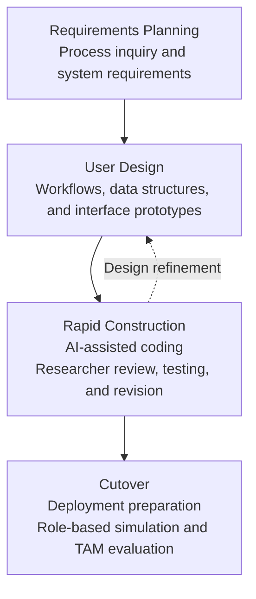

# Chapter 2: Methodology

## 2.2 Software Development Model

NEXIAM development follows the Rapid Application Development (RAD) model (Martin, 1991; Pressman & Maxim, 2020). Its four phases are Requirements Planning, User Design, Rapid Construction, and Cutover. The project also draws on related Philippine system-development studies (Olipas, 2020; Melendres & Aranda, 2024).

Figure 2.1 presents the RAD phases applied to NEXIAM, with AI assistance within Rapid Construction.

[FIGURE 2.1: RAD with AI-assisted construction. Insert the approved figure using the four-phase draft above.]
> **Slot metadata (working note):**
> - **Brief:** Show the four RAD phases. Within Rapid Construction, show AI-assisted coding followed by researcher review, testing, and revision; retain feedback to User Design.
> - **Source:** Martin (1991) and Pressman and Maxim (2020) for RAD; Osmani et al. (2026) for AI-supported development and verification.
> - **Confirm:** Match the depicted activities to the team's development records. Do not add an AI phase or present literature as proof of project outcomes.

**Figure 2.1.** RAD model with AI-assisted construction.

**Requirements Planning.** This phase uses the process inquiry to identify admission-testing needs and define the initial system requirements.

**User Design.** The requirements are translated into workflows, data structures, and interface prototypes for review and refinement.

**Rapid Construction.** The team develops NEXIAM in increments from the documented requirements. AI-assisted coding is followed by researcher review, testing, and revision before integration, consistent with the verification-focused approach described by Osmani et al. (2026).

**Cutover.** The system is prepared for deployment and role-based evaluation. Participants complete simulated tasks covering their part of the admission workflow and then answer the TAM questionnaire.