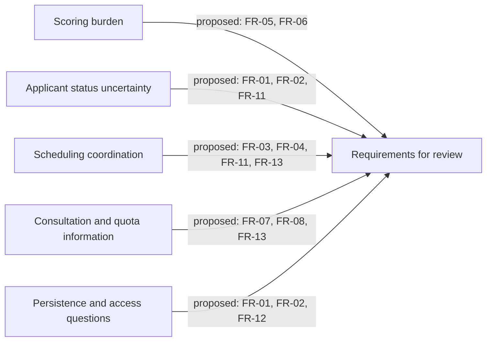

# Specific Objective 1: Analysis of the Existing Admission Testing Process

This chapter presents the findings by Specific Objective: the existing admission-testing process (SO1), system requirements and RAD development (SO2), and user acceptance (SO3).

**Evidence Sources.**

The process analysis follows the descriptive-developmental research design (Frey, 2022) and draws on staff questionnaires, a follow-up interview, a Program Head survey, field records, and two applicant journey surveys. Table 3.1 identifies the sources and their recorded dates.

**Table 3.1**  
*Evidence Sources of the SO1 Descriptive Inquiry*

| Source | Respondents / scope | Date | Contribution to the process analysis |
|---|---|---|---|
| Guidance workflow questionnaire (Appendix H) | Guidance Counselor and administrative staff (n = 2) | 14 June 2026 | Scoring duration and staffing, reported marking challenges, consultation volume and duration |
| Guidance follow-up interview (Appendix H) | Guidance Counselor / Test Administrator (n = 1) | 25 June 2026 | Scheduling channels, room constraints, coordination, quota visibility and prior clustering-tool use |
| Program Head enrollment operations survey (Appendix I) | Academic Program Head (n = 1) | 25 June 2026 | Quota communication and reconciliation practices; requested coordination capability |
| Field observation and requirements validation brief | Institutional stakeholders; see source brief for scope | June–July 2026 | Operational context and recorded policy decisions; see the brief for the underlying evidence and decision register |
| Applicant journey survey, Round 1 (Appendix G) | Multi-year examinees, n = 12 | 28 August 2026 | Retrospective accounts across several programs and admission cycles |
| Applicant journey survey, Round 2 (Appendix G) | Enrolled first-year CBME students, n = 10 | 29 September 2026 | Current-cycle accounts from this cohort, including travel, document-status, schedule and consultation experiences |

Figure 3.1 shows how these records are organized for process mapping.

**Figure 3.1.** Evidence-to-process-mapping sequence for the SO1 descriptive inquiry.

Records are reviewed by source and respondent group before the current workflow is reconstructed. Reported concerns are then linked to proposed requirements for review.

**Reported Current Workflow.**

Figure 3.2 summarizes the admission-testing steps described in the staff and applicant records, from paper requirements to result explanation and counseling (Appendices G to I).

**Figure 3.2.** Source-based summary of the reported admission-testing workflow at ISPSC Tagudin Campus.

Staff schedule examination batches around available rooms and pooled applicants. Paper answer sheets are checked manually, and results are explained during face-to-face consultation. The dashed arrow represents Program Head quota information supplied through face-to-face meetings; it is an information input, not another applicant stage.

**Scoring and Result Consultation.**

Both Guidance respondents reported five or more days for scoring one full examination cycle. One reported two to three staff, while the other referred to all trained staff. Reported checking challenges included illegible and double-marked answers. No historical error log was supplied for calculating a manual-scoring error rate (Appendix H, §§2.1–2.2).

The Guidance questionnaire records peak consultation volumes of 70 to 80 applicants per day and approximately 2 to 5 minutes per consultation. Results are explained in face-to-face consultations. In the first-year CBME survey cohort (n = 10), six respondents (60%) reported waiting at least 30 minutes: four reported 30 minutes to one hour, one reported one to three hours, and one reported half a day (over three hours) (Appendix G, Table G.6).

**Applicant Experiences.**

In the first-year CBME cohort only (n = 10), six respondents (60%) lived outside Tagudin: five in Santa Cruz and one in Alilem. Seven (70%) reported relying on Facebook Messenger or classmates to confirm whether submitted requirements had been accepted; two (20%) reported immediate staff confirmation, and one (10%) selected other/uncertain. These values are not estimates for all applicants or for the separate n = 12 cross-sectional group (Appendix G, Tables G.1 and G.3).

For schedule announcements, seven of the ten first-year respondents (70%) named the official campus Facebook page, one named classmates/group chat, and two named word of mouth/personal inquiry. Three of ten (30%) reported scheduling friction: two reported short notice and one a schedule conflict. The other seven reported no scheduling difficulty (Appendix G, Tables G.4–G.5). The reported announcement channel is not proof that every respondent depended exclusively on Facebook.

Eight of ten respondents (80%) reported enrolling in their initial first-choice program; two (20%) reported changing program because the preferred program's quota was closed (Appendix G, Table G.7). The Guidance interview describes coordination to obtain quota information, while the Program Head respondent reported face-to-face communication and daily updates (Appendices H and I). These records identify an information-sharing need; they do not establish that quota visibility alone would prevent program changes.

**Office Coordination.**

The Guidance interview describes room-constrained batch scheduling coordinated through online messaging, with occasional miscommunication and short notice. The Program Head survey reports face-to-face communication of quota and slot information, with daily updates during the admission period (Appendices H and I).

The applicant survey records uncertainty about requirement status and schedule information. Together with the staff reports, these findings inform requirements for shared process information and recorded office handoffs.

**Applicant Suggestions.**

Three open-ended survey responses requested clearer process information. The quotations are attributed by study group rather than by name.

- A first-year CBME respondent requested: *"Provide a clear online system where students can check their exam schedule, results, available program slots, and enrollment requirements in one place."*
- A first-year CBME respondent wrote: *"Yes, some instructions were unclear, especially about the requirements and exam procedures... provide clearer instructions and a simple step-by-step guide for the admission process."*
- A first-year CBME respondent recommended: *"Giving clearer instructions and updates during the admission process so students know what to do and when to do it."*

These comments illustrate suggestions from the first-year CBME respondents.

**Requirements Traceability.**

The draft groups the process concerns into five traceability codes: FM1, scoring workload; FM2, applicant-facing information; FM3, session coordination; FM4, consultation and quota information; and FM5, persistence of operational records. Table 3.2 links these concerns to requirements for review. The final links will be reconciled with the full use-case documentation.

**Table 3.2**  
*Proposed Mapping of SO1 Observations to Requirements for Review*

| Code | Observed issue in the cited source | Proposed requirements to review | Mapping status |
|---|---|---|---|
| FM1 | Manual scoring takes 5+ days and occupies 2 to 3 staff; marking challenges are not quantified in a formal error log (Appendix H) | FR-05, FR-06 | Confirm scoring and review scope |
| FM2 | First-year CBME respondents report requirement-status uncertainty and travel outside Tagudin (Appendix G, n = 10) | FR-01, FR-02, FR-11 | Confirm applicant information and delivery scope |
| FM3 | Scheduling is coordinated through messaging and is room-constrained; applicants report schedule friction (Appendices G and H) | FR-03, FR-04, FR-11, FR-13 | Retain staff-managed scheduling as the evaluated default |
| FM4 | Consultations are brief during peak volume; quota information is communicated informally (Appendices H and I) | FR-07, FR-08, FR-13 | Confirm record, quota, and communication boundaries |
| FM5 | Requirements and operational details rely on paper, informal channels, or manual reconciliation in the reported processes (Appendices G to I) | FR-01, FR-02, FR-12 | Confirm configuration and access-control scope |

[FIGURE 3.3: Process-to-requirements traceability. Insert the reconciled figure after the FR and use-case links are approved.]
> **Slot metadata (working note):**
> - **Brief:** Link the five source-grounded SO1 concern codes to provisional FRs from Table 3.2; retain the links as pending, not approved mappings.
> - **Source:** This section, Table 3.2 and its Mermaid draft; Appendix O at `manuscript/sections/04_appendices/04_appendix_o_use_case_activity_validation.md`.
> - **Confirm:** Full FR/use-case mapping is not reconciled; retain pending links until approved mapping is supplied.

**Figure 3.3.** Draft traceability from source-grounded SO1 observations to requirements for review. The links are provisional pending approved use-case mapping.

The literature review places the findings alongside campus studies of historical score analysis and related digital systems. Yukee et al. (2025) examined ICAT-score clustering; the Guidance interview reports that the prior clustering system was not used because it was not integrated into the operational workflow (Appendix H, Round 2, Item 3). This contextualizes the integration question without claiming that the present system or its decision-support functions have been institutionally adopted or validated.
