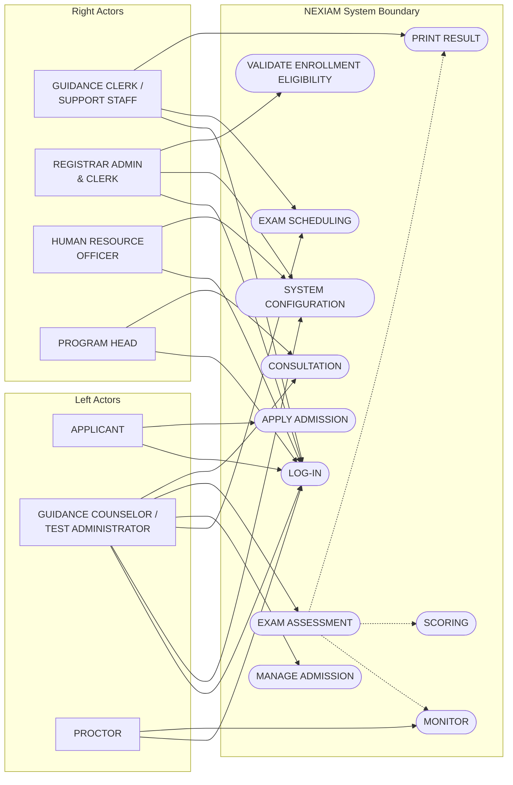
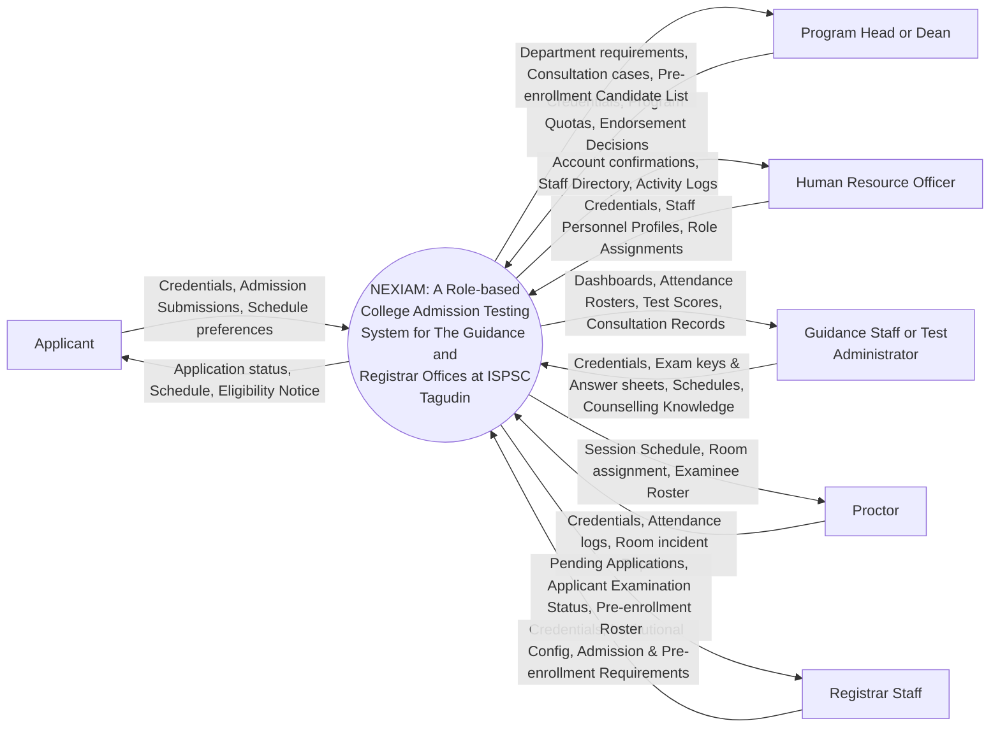

# Persisted Architectural Diagrams and Visual Models Reference

**Purpose:** Preserve the textual and Mermaid transcription of four saved diagram images from the project Google Drive (`16aEcQ4KDoC5rF22JJ8HZAtIjNa2xx6W8`, saved locally in `manuscript/V2_RESOURCES/latest_diagrams/`). These are reference snapshots, not a verified current actor/feature map. The Chapter 2 and Chapter 3 review drafts reserve insertion locations while the full use-case documentation is reconciled. Historical references to “authoritative” diagrams below describe the earlier record and do not override that pending review.
**Adviser:** Dr. Zeus Vincent Mendoza  
**Researchers:** David D. Sarmiento, Jaypee G. Pagaduan, C. M. Lopez

**Local Saved Paths:**
1. `manuscript/V2_RESOURCES/latest_diagrams/new-usecase-diagram.jpg`
2. `manuscript/V2_RESOURCES/latest_diagrams/new-DfD-level-0.png`
3. `manuscript/V2_RESOURCES/latest_diagrams/new-DfD-Level1.drawio.png`
4. `manuscript/V2_RESOURCES/latest_diagrams/nexiam-erd-compact.png`

---

## 1. Authoritative Use Case Diagram (`new-usecase-diagram.jpg`)

### 1.1 Actor Catalog on Diagram (7 Actor Groups: 10 Underlying Roles)

* **Left-Side Actors (Top to Bottom):**
  1. **`APPLICANT`** (Single stick figure, light blue lines)
  2. **`GUIDANCE COUNSELOR / TEST ADMINISTRATOR`** (Double stick figure, green lines)
  3. **`PROCTOR`** (Single stick figure, olive/gold lines; contextual session duty overlay)
* **Right-Side Actors (Top to Bottom):**
  4. **`GUIDANCE CLERK / SUPPORT STAFF`** (Double stick figure, brown lines)
  5. **`REGISTRAR ADMIN & CLERK`** (Double stick figure, dark red/maroon lines; encompasses Registrar Support Staff)
  6. **`HUMAN RESOURCE OFFICER`** (Single stick figure, teal lines; manages staff personnel profiles and role assignments)
  7. **`PROGRAM HEAD`** (Single stick figure, purple lines; Academic Department Head or Dean)

*(Note: `System IT Administrator` is completely removed. `Super Admin` remains a non-routine break-glass system capability outside standard operational diagrams.)*

### 1.2 Use Cases Inside the `NEXIAM` System Boundary (Top to Bottom)

| # | Use Case Box in `new-usecase-diagram.jpg` | Sub-Boxes (Dashed `<<include>>` / Decomposition) | Connected Actors in Diagram | Architectural & Manuscript Notes |
|---|---|---|---|---|
| 1 | **`LOG-IN`** | None | **All 7 Actor Groups:** `APPLICANT`, `GUIDANCE COUNSELOR / TEST ADMINISTRATOR`, `PROCTOR`, `GUIDANCE CLERK / SUPPORT STAFF`, `REGISTRAR ADMIN & CLERK`, `HUMAN RESOURCE OFFICER`, `PROGRAM HEAD` | Staff authenticate via institutional credentials; Applicants authenticate via Access/Reference Key and birthdate. |
| 2 | **`SYSTEM CONFIGURATION`** | None | `GUIDANCE COUNSELOR / TEST ADMINISTRATOR`, `REGISTRAR ADMIN & CLERK`, `HUMAN RESOURCE OFFICER` | Registrar Admin configures institutional info/cycles; HR Officer configures personnel accounts; Guidance/Test Admin configures testing kits, OMR templates, and result-sheet templates. |
| 3 | **`EXAM SCHEDULING`** | None | `GUIDANCE COUNSELOR / TEST ADMINISTRATOR`, `GUIDANCE CLERK / SUPPORT STAFF` *(plus policy-gated Applicant slot adjustment in DFD Level 1)* | Guidance sets schedules manually or automatically; applicant self-booking is a policy-gated toggle (disabled by default per current institutional policy). |
| 4 | **`APPLY ADMISSION`** | None | `APPLICANT` | Public online application intake with RA 10173 consent and immediate access key issuance. |
| 5 | **`MANAGE ADMISSION`** | None | `GUIDANCE COUNSELOR / TEST ADMINISTRATOR` *(and `Registrar Staff` in DFD Level 1 Process 4)* | Reviewing pending applications, validating submission requirements, and updating admission status. |
| 6 | **`EXAM ASSESSMENT`** | **`MONITOR`**, **`SCORING`**, **`PRINT RESULT`** | • `GUIDANCE COUNSELOR / TEST ADMINISTRATOR` $\rightarrow$ `EXAM ASSESSMENT` (all 3) • `PROCTOR` $\rightarrow$ `MONITOR` • `GUIDANCE CLERK / SUPPORT STAFF` $\rightarrow$ `PRINT RESULT` | Encompasses live session monitoring (`MONITOR`), computer-vision OMR and manual grading (`SCORING`), and active HTML/Word/ODT template rendering (`PRINT RESULT`). |
| 7 | **`CONSULTATION`** | None | `PROGRAM HEAD` (drawn purple arrow) **AND `GUIDANCE COUNSELOR / TEST ADMINISTRATOR`** *(Confirmed Diagram Quirk)* | **Crucial Quirk Recorded:** In `new-usecase-diagram.jpg`, the green line from `GUIDANCE COUNSELOR / TEST ADMINISTRATOR` to `CONSULTATION` was omitted in the image export, but as confirmed by the founder and shown in `new-DfD-Level1.drawio.png` (Processes 9 & 10), `GUIDANCE COUNSELOR / TEST ADMINISTRATOR` is the primary actor conducting consultations and marking applicant status alongside `PROGRAM HEAD` follow-up resolution. |
| 8 | **`VALIDATE ENROLLMENT ELIGIBILITY`** | None | `REGISTRAR ADMIN & CLERK` | Validates 4-point enrollment eligibility and generates the pre-enrollment list of candidates. |

---

## 2. Authoritative DFD Level 0: Context Diagram (`new-DfD-level-0.png`)

* **Central Process Circle:**  
  `NEXIAM: A Role-based College Admission Testing System for The Guidance and Registrar Offices at ISPSC Tagudin`
* **6 External Entities (3 Left, 3 Right) & Exact Bidirectional Data Flows:**

| Entity Position & Name | Inbound Flow (`Entity -> NEXIAM`) | Outbound Flow (`NEXIAM -> Entity`) |
|---|---|---|
| **Top-Left:** `Applicant` | `Credentials, Admission Submissions, Schedule preferences` | `Application status, Schedule, Eligibility Notice` |
| **Middle-Left:** `Program Head or Dean` | `Credentials, Program Quotas, Endorsement Decisions` | `Department requirements, Consultation cases, Pre-enrollment Candidate List` |
| **Bottom-Left:** `Human Resource Officer` | `Credentials, Staff Personnel Profiles, Role Assignments` | `Account confirmations, Staff Directory, Activity Logs` |
| **Top-Right:** `Guidance Staff or Test Administrator` | `Credentials, Exam keys & Answer sheets, Schedules, Counselling Knowledge` | `Dashboards, Attendance Rosters, Test Scores, Consultation Records` |
| **Middle-Right:** `Proctor` | `Credentials, Attendance logs, Room incident Reports` | `Session Schedule, Room assignment, Examinee Roster` |
| **Bottom-Right:** `Registrar Staff` | `Credentials, Institutional Config, Admission & Pre-enrollment Requirements` | `Pending Applications, Applicant Examination Status, Pre-enrollment Roster` |

---

## 3. Authoritative DFD Level 1: Decomposition Diagram (`new-DfD-Level1.drawio.png`)

This vertical waterfall diagram decomposes NEXIAM into **11 Processes (Circles in Center)**, **8 Data Stores (Cylinders on Left)**, and **External Stakeholders (Rectangles on Right)**, mapping directly to the **7-Stage Operational Pipeline**:

| Stage in 7-Stage Pipeline | DFD Level 1 Process Circle | Left Data Store Cylinder(s) & Flows | Right Stakeholder Entity(ies) & Flows |
|---|---|---|---|
| **0. Authentication** | **`Login & Authentication`** | **`Users`** • `Verify` ($\rightarrow$ Process) • `Update Session status` ($\leftarrow$ Process) | **`All Stakeholders`** • `Enter Credentials` ($\rightarrow$ Process) • `Session Headers & Web pages` ($\leftarrow$ Process) |
| **Stage 1: Configuration & Setup** | **`System Configuration`** | **`System Configuration`** • `Read Configuration` ($\rightarrow$ Process) • `Save Configuration` ($\leftarrow$ Process) | **`Registrar Admin`** • `Configure Institutional Information` ($\rightarrow$) • `Setup Status and Checks` ($\leftarrow$) **`HR Officer`** • `Configure Personnel accounts` ($\rightarrow$) • `Staff Accounts Credentials` ($\leftarrow$) **`Guidance Counselor or Test Administrator`** • `Testing Kit & Requirements` ($\rightarrow$) • `Printouts samples` ($\leftarrow$) |
| **Stage 2a: Admission / Application** | **`Apply Admissions`** | **`Admissions`** • `Retrieve Admission Form` ($\rightarrow$ Process) • `Save Application` ($\leftarrow$ Process) | **`Applicants`** • `Fill in Admission Form` ($\rightarrow$ Process) • `Generate Access key & Redirect applicant to portal` ($\leftarrow$ Process) |
| **Stage 2b: Admission Verification** | **`Manage Admissions`** | **`Admissions`** • `Read pending applications` ($\rightarrow$ Process) • `Update validation status & Requirements checklist` ($\leftarrow$ Process) | **`Registrar Staff`** • `Accept and validate submission requirements` ($\rightarrow$ Process) • `Admission Lists` ($\leftarrow$ Process) **`Applicants`** • `Update Admission status` ($\leftarrow$ Process) |
| **Stage 3: Exam Scheduling** | **`Exam Scheduling`** | **`Exam Schedules`** • `Read Room & Schedule Availability` ($\rightarrow$ Process) • `Update schedules` ($\leftarrow$ Process) | **`Guidance Counselor or Test Administrator`** • `Set schedule manually or automatically` ($\rightarrow$) • `List of schedules` ($\leftarrow$) **`Applicants`** • `Time/date adjustment` ($\rightarrow$, *policy-gated toggle*) • `View own published schedule` ($\leftarrow$) |
| **Stage 4: Examination / Testing Day** | **`Exam monitoring`** | **`Exam Schedules`** $\rightarrow$ `Read Schedule and Assignments` **`Exam Assessments`** $\leftarrow$ `Update attendance` | **`Proctor`** • `Mark attendance` ($\rightarrow$ Process) • `Notify Assignment` ($\leftarrow$ Process) **`Guidance Counselor or Test Administrator`** • `Oversee Examination` ($\rightarrow$ Process) • `List of Attendees` ($\leftarrow$ Process) |
| **Stage 5a: Result Preparation (Scoring)** | **`Exam scoring`** | **`Exam Assessments`** • `read submission status` ($\rightarrow$ Process) • `convert & create scores` ($\leftarrow$ Process) | **`Guidance Counselor or Test Administrator`** • `Scan & Mark Answers` ($\rightarrow$ Process) • `Score status` ($\leftarrow$ Process) |
| **Stage 5b: Result Preparation (Printing)** | **`Exam print result`** | **`Exam Assessments`** $\rightarrow$ `Read scores` **`Consultation Schedules`** $\leftarrow$ `Save ready for consultation` | **`Guidance Counselor or Test Administrator`** • `Finalize Template` ($\rightarrow$ Process) • `Printed sheets` ($\leftarrow$ Process) |
| **Stage 6a: Consultation Scheduling** | **`Release & Consultation Scheduling`** | **`Consultation Schedules`** • `Read schedule availability` ($\rightarrow$ Process) • `Save schedules` ($\leftarrow$ Process) | **`Guidance Counselor or Test Administrator`** • `Set schedule manually or automatically` ($\rightarrow$) • `List of schedules` ($\leftarrow$) **`Applicants`** • `Time/date adjustment` ($\rightarrow$, *policy-gated*) • `View own published schedule` ($\leftarrow$) |
| **Stage 6b: Consultation & Triage** | **`Release & Consultation`** | **`Consultation`** • `Read consultation aid and notes` ($\rightarrow$ Process) • `Save counselling records` ($\leftarrow$ Process) | **`Guidance Counselor or Test Administrator`** • `Mark applicant's status` ($\rightarrow$) • `Consultation Profiles & Quota view` ($\leftarrow$) **`Program Head or Dean`** • `Communicate Program requirements` ($\rightarrow$) • `Show Applicant follow-up cases` ($\leftarrow$) |
| **Stage 7: Post-Admission / Handoff** | **`Validate Enrollment Eligibility`** | **`Pre-enrollment List`** • `Read pre-enrollment list` ($\rightarrow$ Process) • `Save finalized eligibility list` ($\leftarrow$ Process) | **`Program Head or Dean`** • `Resolve follow-up cases` ($\rightarrow$) • `Generate Pre-enrollment list of candidates` ($\leftarrow$) **`Registrar Staff`** • `View Applicant eligibility` ($\leftarrow$) **`Applicant`** • `Notify Enrollment eligibility` ($\leftarrow$) |

---

## 4. Authoritative Compact ERD (`nexiam-erd-compact.png`)

Contains **19 Relational Entities** organized across the lifecycle:
1. **`ACADEMIC_CYCLE`** (`id` PK, `code`, `school_year`, `is_active`)
2. **`APPLICANT_IDENTITY`** (`id` PK, `normalized_key`, `first_name`, `last_name`)
3. **`PROGRAM`** (`id` PK, `code`, `name`, `department`)
4. **`EXAM_SESSION`** (`id` PK, `academic_cycle_id` FK, `code`, `starts_at`)
5. **`USER`** (`id` PK, `email`, `role_rank`)
6. **`ADMISSION_ATTEMPT`** (`id` PK, `applicant_identity_id` FK, `academic_cycle_id` FK, `reference_code`, `status`)
7. **`PROGRAM_QUOTA`** (`id` PK, `academic_cycle_id` FK, `program_id` FK, `capacity`)
8. **`STAFF_PROFILE`** (`id` PK, `user_id` FK, `employee_number`, `department`)
9. **`APPLICANT_ACCOUNT`** (`id` PK, `applicant_identity_id` FK, `user_id` FK)
10. **`PROGRAM_PREFERENCE`** (`id` PK, `admission_attempt_id` FK, `program_id` FK, `rank_order`)
11. **`PROCTOR_DUTY`** (`id` PK, `exam_session_id` FK, `user_id` FK, `status`)
12. **`EXAM_ASSIGNMENT`** (`id` PK, `exam_session_id` FK, `admission_attempt_id` FK, `seat_label`, `status`)
13. **`GRADING_SESSION`** (`id` PK, `exam_session_id` FK, `status`)
14. **`CONSULTATION_DECISION`** (`id` PK, `admission_attempt_id` FK, `counselor_user_id` FK, `decision_type`)
15. **`RESULT_RELEASE`** (`id` PK, `admission_attempt_id` FK, `released_by_user_id` FK, `released_at`)
16. **`PROGRAM_SELECTION`** (`id` PK, `admission_attempt_id` FK, `program_id` FK, `status`)
17. **`ENROLLMENT_STAMP`** (`id` PK, `admission_attempt_id` FK, `verified_by_user_id` FK, `final_program_code`, `stamp_status`)
18. **`EXAM_ATTENDANCE`** (`id` PK, `exam_assignment_id` FK, `outcome`)
19. **`SCORE_RECORD`** (`id` PK, `grading_session_id` FK, `admission_attempt_id` FK, `raw_score`, `converted_score`)

---

## 5. Authoritative Conceptual Framework: IPO Diagram (`ipo diagram.png`)

* **Source:** `manuscript/V2_RESOURCES/latest_diagrams/ipo-diagram.png` (Google Drive ID: `1Iz2DPOrR1hHWRhWLk4XZ2J_dz9xFhg-T`)
* **Caption:** `Figure 1. IPO Diagram`

### Exact Visual Contents (Updated & Aligned):
* **Input Box (3 Subsections):**
  * *Stakeholder Data & Preferences:*
    * Applicant profiles
    * Course preferences (replaces former 'Exam and schedule preferences')
    * Admission inquiries
    * Advisory notes
  * *Institutional Parameters:*
    * Program quotas
    * Venue catalog
    * Role definitions
  * *Development Foundations:*
    * Computer vision OMR engine
    * AI framework
    * Consultation support models
* **Process Box:**
  * **Development of NEXIAM through Rapid Application Development**
* **Output Box (4 Subsections):**
  * *Communication:*
    * Chatbot (replaces narrow 'Chatbot responses')
    * Status notifications (replaces 'Email updates')
    * Official inquiry notes (replaces generic 'In-app messaging')
  * *Role-Based Interfaces:*
    * Applicant portal
    * Staff interface
  * *Operational Artifacts:*
    * Examination schedules (removes 'Optimized')
    * Exam scores and printed results
    * Pre-enrollment lists (corrected to standard US spelling; encompasses departmental quota clearance)
    * HMAC-SHA256 audit trails
  * *Analytics and Reports:*
    * Consultation support dashboard (maps to Consultation support models)
    * Post-admission reports (replaces redundant quota monitoring)
