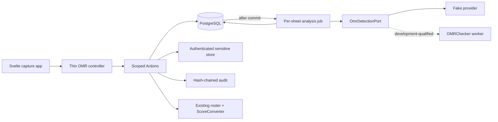
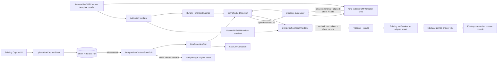

# Design: OMR Scoring Capture

**Change ID:** `omr-scoring-capture`  
**Decision date:** 2026-08-12  
**Implementation boundary:** Phase A fake-provider capture shipped; Phase B pinned OMRChecker development integration; production activation remains gated

## Context

The founder-approved experience is `omr-capture-preview.html`: a mobile-first capture app with camera, scans gallery, per-sheet review, examinee binding, and an item score editor whose first column is the cropped bubble row. One physical page contains all aptitude areas. The answer-sheet geometry and question-booklet/answer key are separately versioned. Test Administrator confirmation is mandatory.

The repository contains an earlier OMR skeleton, but it is disconnected and contradicts the current contract: batch-wide synchronous analysis closes intake; sheets require pre-binding; review accepts client area totals; idempotency is globally keyed and fingerprint-free; assets use an unversioned CBC format; provenance can be detached with `nullOnDelete`; and no routes, jobs, binding, pages, tests, or seeds exist. Historical migrations stay immutable. New migrations and replacement code create a clean cutover.

## Goals / Non-Goals

**Goals:**

- Ship one production-shaped online vertical slice using `FakeOmrDetection`.
- Preserve the approved mockup's visual shape and staff vocabulary.
- Keep the existing grading core authoritative and manual scoring available.
- Make concurrency, retries, idempotency, audit, encryption, cleanup, and recovery explicit.
- Leave a stable provider envelope and benchmark gate for OMRChecker.
- Leave exact Compose seed and operator instructions for the next developer.

**Non-Goals:**

- Production OMRChecker activation, floating upstream code, or silent fake fallback.
- Zero-click Batch capture or camera-quality automation.
- Offline/PWA image persistence and synchronization.
- Multi-page grouping, QR attribution, result printing, Nexi confirmation, or navigation reorganization.
- Committed-evidence purge before retention/legal-hold approval.

## 1. Architecture and request flow

- Controllers validate/projection-map only; Actions own state and invariants.
- The detector is pure from NEXIAM's perspective: bytes + immutable snapshot in, typed proposal out. It never queries or mutates application tables.
- Manual analysis calls the same claim/invoke/persist service synchronously, outside database locks; Auto dispatches it after commit.
- Score writes occur only in `CommitManualOmrCaptureSheet` and `ConfirmOmrCaptureBatch`, both through one internal `WriteReviewedOmrScores` module that reuses roster and `ScoreConverter`.
- UI polling is a partial Inertia reload of batch/sheet status props. Polling never performs mutations.

## 2. State, ownership, and write timing

### 2.1 Batch

States: `open` → `closing` → `confirmed`; `open` → `rejecting` → `rejected`.

- One `open`, `closing`, or `rejecting` batch per grading session, enforced by PostgreSQL partial unique index.
- `open` accepts Manual/Auto uploads while other sheets analyze.
- `closing` is set inside confirmation after the session and batch are locked; no new upload can pass.
- `rejecting` blocks uploads and mutations while durable cleanup intents run; only complete cleanup moves the batch to `rejected`, and a failure remains operator-visible/retryable.
- Any blocking sheet causes confirmation to roll back to `open` with a typed list of blockers.
- `confirmed` and `rejected` are immutable. Rejection is allowed only when no sheet has a score revision.

### 2.2 Sheet

States and legal transitions:

| From | Command/outcome | To |
|---|---|---|
| — | begin upload | `received` |
| `received` | asset finalized, Manual claim | `processing` |
| `received` | asset finalized, Auto dispatch | `queued` |
| `queued` | job claim | `processing` |
| `processing` | valid proposal | `needs_review` |
| `processing` | retryable failure | `queued` |
| `processing` | terminal/exhausted failure | `failed_terminal` |
| `failed_terminal` | authorized retry creates a new run | `queued` |
| `needs_review` | Save Draft | `needs_review` with incremented version and reviewer draft |
| `needs_review` | complete Auto review | `reviewed` |
| `needs_review` | complete Manual Save | `committed` |
| `reviewed` | batch confirmation | `committed` |
| any uncommitted non-processing state | remove request + successful cleanup | hard delete |

`received` may temporarily have `asset_state=pending_write`; it is not visible as a usable scan until asset finalization. `processing` cannot be removed; staff may wait or use an explicit cancel/reconcile operation added only if implementation proves it necessary.

### 2.3 Finalization

`FinalizeGradingSession` adds one guard: any `open`, `closing`, or `rejecting` OMR batch blocks finalization, including an empty batch or one containing only committed Manual sheets. Staff must explicitly confirm or finish rejection; finalization never auto-closes OMR state. OMR drafts never count as scores.

### 2.4 Write timing

- **Manual:** upload → synchronous analysis → forced review → Save validates and commits only that sheet immediately.
- **Auto:** upload → after-commit job → gallery review persists reviewer output → `Confirm session's scans` atomically commits every reviewed/uncommitted Auto sheet and closes the batch.
- A Manual sheet already committed within the same batch is skipped truthfully during Auto batch confirmation.
- OMR never overwrites a current manual score. A later manual correction of OMR uses expected version + reason and creates a score revision.

## 3. Forward-fix database design

Do not edit migrations `2026_08_11_170000`–`170002`. The first forward-fix migration SHALL abort with a clear reset/remediation message if unshipped skeleton OMR rows exist; the repository currently has no seeded or routed OMR rows to preserve. Because the cut removes the old non-null globally unique batch idempotency column and cannot reconstruct historical keys after new rows exist, this cutover migration is intentionally forward-only: `down()` throws an actionable irreversible-migration exception and operational rollback restores the pre-cut database backup. Clean install, upgrade-from-current-schema, failed preflight, and explicit rollback refusal are tested.

### 3.1 Catalog and immutable versions

| Table | Required columns and constraints |
|---|---|
| `omr_answer_sheet_templates` | `id`, unique `code`, `name`, `is_synthetic`, timestamps |
| `omr_answer_sheet_template_versions` | template FK restrict; `version`; `status draft/active/retired`; immutable OMRChecker-native bundle (`template.json`, `config.json`, required marker/reference assets), exact engine/patch identity and artifact hashes; page dimensions; derived review-manifest JSON/hash; activated actor/time; unique `(template_id,version)` |
| `omr_template_areas` | activation-derived projection only: template-version FK cascade; aptitude-area FK restrict; `display_order`; immutable `max_items`; normalized area region derived from the native bundle; unique template/area and template/order |
| `omr_template_questions` | activation-derived projection only: template-area FK cascade; stable native field label; `question_no`; normalized bubble-row region derived from expanded native bubbles; unique area/question and native label; activation enforces contiguity |
| `omr_template_question_options` | activation-derived projection only: question FK cascade; `code`; `display_order`; normalized option region derived from one native bubble; unique question/code and question/order |
| `omr_question_booklets` | `id`, unique `code`, `name`, timestamps |
| `omr_question_booklet_versions` | booklet FK restrict; `version`; `status draft/active/retired`; SHA-256 `answer_key_hash`; activated actor/time; unique `(booklet_id,version)` |
| `omr_question_booklet_questions` | booklet-version FK cascade; template-question FK restrict; aptitude-area FK restrict; `question_position`; `correct_option_code`; unique booklet/template-question and booklet/position |
| `omr_template_booklet_pairs` | template-version and booklet-version FKs restrict; status `active|retired`; approved actor/time; unique version pair; indexes by status and both versions |

`ActivateOmrConfiguration` first verifies the immutable native bundle and exact pinned engine/patch hashes, loads the bundle through the isolated activation tool, expands OMRChecker `FieldBlock`/`Bubble` objects, derives the normalized NEXIAM review manifest and relational projections, and rejects unknown labels, duplicates, gaps, out-of-bounds bubbles, overlap, or manifest drift. It then validates contiguity, complete option/key coverage, exact area `max_items`, conversion coverage, template/booklet compatibility, and synthetic/production policy before activating the approved pair in one transaction. Multiple active pairs may coexist. `CreateOmrCaptureBatch` therefore requires both selected version IDs and rejects omitted, inactive, retired, or incompatible pairs. PostgreSQL append-only triggers reject UPDATE/DELETE of active or retired version payloads and descendants; they permit only the controlled status metadata transitions `draft→active|retired` and `active→retired`. Model/Action guards provide typed errors, while triggers remain invariant authority for query-builder or direct-SQL writes.

### 3.2 Capture batches

Forward-fix `omr_capture_batches`:

- drop the old global `idempotency_key` column/index after zero-row preflight; command receipts replace it;
- add non-null template-version and booklet-version FKs with `restrictOnDelete`;
- use `status varchar(16)` check in `open|closing|rejecting|confirmed|rejected`;
- add `version bigint default 0 CHECK (version >= 0)`; opened/closing/rejecting/confirmed/rejected actor FKs with `nullOnDelete`; corresponding timestamps;
- check timestamp/actor coherence for terminal states;
- partial unique index on `grading_session_id WHERE status IN ('open','closing','rejecting')`;
- indexes `(grading_session_id,status,id)` and `(status,updated_at,id)`.

### 3.3 Capture sheets

Forward-fix `omr_capture_sheets`:

- make `admission_attempt_id` nullable with `restrictOnDelete`;
- add `capture_mode` check `manual|auto`;
- replace status check with the seven states in §2.2;
- add `version bigint default 0 CHECK (version >= 0)`, UUID `client_capture_id`, detected identity and nullable detected/sheet confidence, `proposal_json`, `review_draft_json`, `reviewed_json`, upload claim token/time/expiry, and nullable `current_processing_run_id`; Phase B real-engine confidence remains null until a separately qualified calibration exists;
- add `original_mime`, `original_bytes`, `asset_path`, plaintext provenance `asset_hmac`, `asset_hmac_key_id`, envelope `asset_format_version`, encryption `asset_key_id`, and `asset_state` check `pending_write|live|cleanup_pending|integrity_failed`;
- add captured/reviewed/committed actor and timestamp fields;
- keep unique `(batch_id,admission_attempt_id)`; PostgreSQL permits multiple null identities;
- add unique `(batch_id,client_capture_id)`;
- add checks for every confidence `BETWEEN 0 AND 1`, positive bytes, asset-state/path coherence, and status/timestamp coherence;
- indexes `(batch_id,status,created_at,id)`, detected applicant number, admission attempt, and asset state.

`proposal_json`, drafts, and final review are immutable snapshots for their stage; later edits replace only the draft before review completion and are also captured in audit. The server never persists a client-supplied area total as authority.

### 3.4 Issues and processing runs

`omr_capture_sheet_issues`:

- sheet FK cascade; nullable stable area code/question number; `issue_code`; severity `warning|required|terminal`; `state open|resolved`; redacted evidence JSON; resolution code/reason/actor/time; version;
- PostgreSQL partial expression unique index for each open issue identity: `(sheet_id,issue_code,COALESCE(area_code,''),COALESCE(question_no,0)) WHERE state='open'`;
- indexes for unresolved required issues and sheet projection.

`omr_processing_runs`:

- sheet FK cascade; monotonic `run_no`; status `pending|claimed|succeeded|retryable_failed|terminal_failed`; provider name/version/commit; request envelope version; input/template/booklet/config hashes; claim token/time/expiry; attempts; next retry; safe diagnostic code; timings; output JSON; created/updated times;
- unique `(sheet_id,run_no)` plus PostgreSQL partial unique index on `sheet_id WHERE status IN ('pending','claimed','retryable_failed')`; after this table exists, add the sheet's nullable `current_processing_run_id` FK with `restrictOnDelete` and enforce that it references the same sheet;
- indexes `(status,next_retry_at,id)` and `(sheet_id,status,id)`.

Provider raw output is stored as validated, redacted JSON. No image bytes, secrets, absolute paths, stack traces, or unrestricted OCR text are stored in issues, runs, audit, or logs.

### 3.5 Score projection and immutable revisions

Forward-fix `score_records`:

- drop/recreate `capture_sheet_id` FK as `restrictOnDelete`;
- check `source IN ('manual','omr')`;
- check nullable confidence range; real-engine Phase B writes null until a separately qualified calibration profile exists;
- check `(source='omr') = (capture_sheet_id IS NOT NULL)` and manual confidence/capture fields are null;
- add `version bigint default 0 CHECK (version >= 0)`.

Create `score_record_revisions` with nullable score-record FK `nullOnDelete`, non-null session/attempt/area FKs `restrictOnDelete`, a per-score immutable stream UUID plus revision number, operation `write|correct|clear`, encrypted prior/new raw and converted values, source, nullable capture-sheet FK `restrictOnDelete`, confidence, actor, mandatory reason for corrections/clears, command/correlation IDs, and timestamps. Unique `(stream_id,revision_no)`. An insert trigger verifies that session/attempt/area match the referenced score record when present. `ClearScores` appends a tombstone revision before deleting the current projection; the natural identity and history survive. The current `score_records` row is only the live projection.

### 3.6 Command receipts and asset cleanup

`omr_command_receipts` contains actor, command name, aggregate type/id, idempotency key, canonical SHA-256 payload fingerprint, status `started|succeeded|failed_safe`, execution token/lease expiry, redacted result JSON, correlation ID, and timestamps. Unique `(actor_id,command_name,aggregate_type,aggregate_id,idempotency_key)`. Create-batch uses the grading session as its aggregate; upload uses the batch plus stable `client_capture_id`. A live lease owns side effects, an expired `started` receipt is resumable, and only `succeeded|failed_safe` returns a terminal stored result.

`omr_asset_cleanup_intents` contains non-null batch FK `restrictOnDelete`, sheet ID as a non-FK evidence value, asset path/HMAC/key IDs, reason, requested actor, status `pending|processing|completed|failed`, attempts, next retry, safe error code, and timestamps. Cleanup success deletes the sheet in a follow-up transaction and retains the completed intent plus canonical audit. When a rejection intent completes, `FinalizeOmrBatchRejection` locks the batch, verifies zero remaining sheets and zero incomplete intents by `batch_id`, and transitions `rejecting→rejected`; reconciliation performs the same idempotent check after crashes.

## 4. Domain modules and Action boundaries

Keep namespaces already used by the skeleton. Replace implementations rather than adding parallel conventions.

| Symbol | Single responsibility |
|---|---|
| `ActivateOmrConfiguration` | Validate complete template/booklet/config/conversion invariants; atomically activate one approved compatible pair. |
| `CreateOmrCaptureBatch` | Authorize, lock session, enforce one active batch, validate explicitly selected active pair, pin both versions, apply receipt, audit. |
| `UploadOmrCaptureSheet` | Single public coordinator: claim/resume receipt and upload lease, create/reuse `received/pending_write` sheet, write or verify the deterministic authenticated asset outside locks, finalize Manual/Auto state, store the safe replay result, and dispatch Auto only after commit. |
| `RunOmrSheetAnalysis` | Claim run transaction; read/verify asset and call port outside locks; validate and persist proposal/issues in second transaction. |
| `SaveOmrCaptureSheetDraft` | Persist non-authoritative binding/item draft with expected version and audit. |
| `ReviewOmrCaptureSheet` | Validate binding, item edits, issue resolutions, reasons; derive marks; persist complete Auto review. |
| `CommitManualOmrCaptureSheet` | Same review validation plus atomic score write/revisions; set Manual sheet committed. |
| `RetryOmrCaptureSheet` | Authorize terminal/needs-review retry, create next run, set queued, dispatch after commit. |
| `RequestOmrCaptureSheetRemoval` | Verify uncommitted/non-processing/no revision, mark cleanup pending, create cleanup intent, dispatch after commit. |
| `ProcessOmrAssetCleanup` | Delete/check asset outside DB lock; finalize sheet hard-delete and audit or retain retryable failure; invoke rejection finalization check. |
| `FinalizeOmrBatchRejection` | Lock a rejecting batch, verify no sheets or incomplete batch cleanup intents remain, then transition idempotently to rejected. |
| `ConfirmOmrCaptureBatch` | Lock session→batch→ordered sheets→ordered scores; reject blockers/collisions; write all reviewed Auto sheets; confirm batch. |
| `RejectOmrCaptureBatch` | Require no score revisions; create batch-linked cleanup intents for every sheet; enter rejecting and delegate terminal transition. |
| `WriteReviewedOmrScores` | Internal module for roster recheck, server-derived raw score, conversion, collision policy, projection+revision writes. |
| `ClearScores` | Require expected versions and reason; append clear tombstones before deleting current projections and auditing. |
| `ReadOmrCaptureProjection` | Reauthorize list/gallery/review scope, project only permitted fields, and commit protected-view evidence before returning sensitive data. |
| `ReconcileOmrAssets` | Operator command: report/fix pending, missing, and orphaned assets without plaintext output. |
| `RekeyOmrAssets` | Operator command: authenticated read, new envelope write, atomic metadata swap, audit; preserve plaintext HMAC. |

Every public Action accepts a typed command DTO containing actor, target IDs, command/correlation IDs, idempotency key, fingerprint input, expected version, and payload. Every Action returns a finite outcome object; ordinary invariant failures do not escape as generic `RuntimeException`.

## 5. Concurrency, idempotency, and audit

### 5.1 Lock order

All commands use: grading session → batch → sheets ascending ID → score records ascending attempt/area → issues/runs. No path acquires a session lock after a sheet lock. Provider calls and filesystem writes/deletes occur without database row locks.

### 5.2 Canonical fingerprint

Normalize request payloads by command-specific allowlist, stable key ordering, normalized scalar types, and file SHA-256 rather than raw bytes; include actor, command, aggregate, expected version, and immutable pin hashes. Hash the canonical JSON with SHA-256. Same scoped key + fingerprint replays the stored safe outcome; same scoped key + different fingerprint returns `IdempotencyConflict`. Database uniqueness, not cache/job middleware, is correctness authority.

### 5.3 Expected versions

Batch, sheet, issue, and score projection versions increment on every mutation. Review, retry, remove, confirm, reject, and manual correction require the projected version. Stale commands return current safe version metadata and refresh guidance; they do not merge.

### 5.4 Audit

Mutating Actions write the business row and canonical `RecordAuditEvent` in the same transaction. Include actor, capability, scope, route/channel, target, command/idempotency/correlation IDs, expected/current version, reason, and redacted before/after. Provider requested/completed/failed, asset view, integrity failure, cleanup, rekey, score commit/correction, and authorization denial use distinct event names. Protected image view evidence is committed before bytes are released.

## 6. Queue and after-commit contract

`AnalyzeOmrCaptureSheetJob implements ShouldQueue, ShouldBeUnique`:

- queue: existing database queue; `$tries = 3`; `$timeout = 60`; backoff `[5,20,60]`; configured claim lease `80` seconds and queue `retry_after=90` both exceed provider timeout in that order;
- `uniqueId() = 'omr-sheet:{sheetId}:run:{runId}'`; uniqueness is optimization only;
- overlap middleware key matches sheet/run and expires with the 80-second claim lease;
- upload/retry creates a `pending` run, sets `sheet.current_processing_run_id`, and dispatches only with `DB::afterCommit`;
- `handle()` re-resolves actor/capability/scope, then atomically claims only the sheet's current `pending` or due `retryable_failed` run with a new token and expiry;
- the provider runs outside locks; persistence requires the same current-run ID, claim token, unexpired claim, sheet version, and authority;
- a typed retryable outcome or caught retryable dependency exception persists `retryable_failed` plus `next_retry_at`, clears the claim, calls `$this->release($delay)`, and returns without creating another run; the third failure becomes terminal;
- `failed()` stores a redacted terminal/manual outcome only if the run is still current and not already terminal;
- cancellation/retry never deletes the asset or writes a score.

Crash windows are visible: a current `pending` run without a dispatched job is redispatched idempotently; reconciliation moves an expired current `claimed` run to due `retryable_failed` and redispatches it. A staff Retry is permitted only from a terminal sheet, creates the next run number, and atomically replaces `current_processing_run_id`.

## 7. Detection provider contract

### 7.1 Request

`OmrDetectionRequest` v2 carries run/correlation IDs, decoded bytes/MIME/dimensions, input hash, page dimensions, stable area codes, exact item/option geometry, structured bubbled-identity geometry, template/booklet/config/compiler hashes, expected engine/commit, and provider deadline. Database IDs may appear only as opaque correlation metadata. Answer keys, correctness, scores, roster records, storage paths, and unrestricted identity hints SHALL NOT cross this seam.

### 7.2 Result

`OmrDetectionResult` is one of `Succeeded`, `Unsupported`, `InvalidInput`, `RetryableFailure`, or `TerminalFailure`. Success echoes contract/run/engine/hash identity and contains observed applicant-number bubbles, identity regions, exactly one state/selected option for every requested item, calibrated confidence, source-image normalized regions, normalized issues, allowlisted measurements, sheet confidence, and timings. It contains no answer key, correctness, or score. NEXIAM recomputes correctness and area totals from the pinned booklet after validation.

`OmrDetectionResultValidator` enforces the complete v2 correspondence and rejection rules in §§20.3–20.4 before any proposal is stored.

### 7.3 Fake and OMRChecker

`FakeOmrDetection` remains deterministic under v2 and is allowed only when `OMR_PROVIDER=fake` and the environment is non-production or an explicit demo gate is enabled.

The OMRChecker adapter runs in the optional Compose inference boundary with the pinned commit/image and authenticated request contract. A matching development qualification enables only the synthetic demo; institutional production requires every §15 and §23.3 gate. Adapter selection does not change Actions, states, UI layout, score rules, audit, or asset policy.

## 8. Sensitive asset format and lifecycle

Use a versioned binary/JSON envelope with `format_version=1`, encryption `key_id`, 12-byte random nonce, AES-256-GCM ciphertext/tag, and authenticated AAD containing format/key identifiers. Derive encryption material from a configured OMR keyring; do not derive directly from `APP_KEY`. Store a separate keyed SHA-256 plaintext provenance HMAC and `asset_hmac_key_id`.

`SensitiveAssetStore` operations return typed results or throw typed integrity/storage exceptions. The sensitive disk uses `throw => true`; every put/read/delete result is checked. Read requires expected path, HMAC, format version, encryption key ID, and provenance key ID; authentication occurs before plaintext release. Active and retired decryption keys remain readable. Key removal is blocked while referenced.

`UploadOmrCaptureSheet` is one HTTP command with three resumable phases. (1) Under transaction, claim the scoped receipt and upload lease, then create or reuse the unique `(batch_id,client_capture_id)` `pending_write` row and its deterministic opaque path derived from sheet UUID. (2) Outside locks, if no asset exists, encrypt/write it; if one exists after a crash, authenticated-read it and reuse only when MIME, byte count, and plaintext HMAC match the request. A live lease makes concurrent duplicates wait/replay; an expired lease may be reclaimed. Any conflicting existing asset becomes an integrity failure and cleanup case, never an overwrite. (3) Under transaction, recheck receipt token, sheet version, batch state, and asset metadata; finalize Manual processing or Auto pending run, commit the safe receipt result/audit, and dispatch Auto after commit. Replays of `started` resume these phases; replays of `succeeded|failed_safe` return the stored result. No plaintext is cached server-side or written to public storage. Image responses are private/no-store and MIME-validated. Crops are rendered in-browser from the protected image and normalized coordinates.

Removal/rejection uses durable cleanup intents. This cut has no committed-asset purge. Retention/legal hold remains `indefinite until policy approved`; this is a safety default, not a final institutional duration.

## 9. Authorization and protected scope

Add `CapabilityCatalog::GUIDANCE_SCORING_OMR`. Include it only in `testAdministratorCapabilities()`; exclude it from guidance clerk, support helper, delegated manual-scoring, and assistant capability sets.

Routes use the capability middleware as an outer gate. Each Action and `ReadOmrCaptureProjection` query calls `CapabilityAuthorizer` with institution, academic cycle, grading session, target sheet/batch, sensitivity, lifecycle, and duty/assignment facts. Jobs repeat the decision at execution. Controllers resolve `{sheet}` through `batch.grading_session_id = {gradingSession.id}`; no reliance on implicit nested relationship names. Foreign resources return safe not-found/denial without existence leakage. Capture, gallery, review, and image projections expose protected scan/identity/proposal/score data only after the query reauthorizes scope; protected-view evidence is committed before the response is returned. The capture landing may return only non-sensitive configuration choices before a batch exists.

## 10. HTTP and typed outcomes

All routes use `{gradingSession}`. Page reads are GET; mutations use POST/PUT/DELETE semantics with CSRF through Inertia/router forms.

| Route | Purpose |
|---|---|
| `GET /grading/sessions/{gradingSession}/omr` | Capture app and status projection. |
| `POST /grading/sessions/{gradingSession}/omr/batches` | Idempotently create/reuse the active pinned batch. |
| `POST /grading/sessions/{gradingSession}/omr/sheets` | Upload Manual/Auto sheet; returns redirect to review or accepted status. |
| `GET /grading/sessions/{gradingSession}/omr/sheets/{sheet}` | Session-scoped review projection. |
| `GET /grading/sessions/{gradingSession}/omr/sheets/{sheet}/image` | Audited private image stream. |
| `PUT /grading/sessions/{gradingSession}/omr/sheets/{sheet}/draft` | Save non-authoritative review draft. |
| `PUT /grading/sessions/{gradingSession}/omr/sheets/{sheet}/review` | Complete Auto review. |
| `POST /grading/sessions/{gradingSession}/omr/sheets/{sheet}/commit` | Complete and commit Manual sheet. |
| `POST /grading/sessions/{gradingSession}/omr/sheets/{sheet}/retry` | Create and dispatch next analysis run. |
| `DELETE /grading/sessions/{gradingSession}/omr/sheets/{sheet}` | Reasoned uncommitted removal through cleanup. |
| `POST /grading/sessions/{gradingSession}/omr/confirm` | Commit reviewed Auto sheets and close batch. |
| `POST /grading/sessions/{gradingSession}/omr/reject` | Reject only a score-free batch through cleanup. |

Use one Form Request per mutation. Upload validates decoded JPEG/PNG/WebP, configured 10 MiB default, explicit minimum/maximum dimensions, total pixels, and orientation; the limits live in `config/omr.php`. Review accepts only binding ID, expected version, per-item selected option/state, issue-resolution codes, and reasons. Server derives all marks/totals.

Typed outcomes map to: validation `422`; safe denial/not-found `403/404`; stale/idempotency/manual-score collision `409`; finalized/immutable `423`; provider unavailable `503`; missing/malformed/tampered evidence and other integrity failures safe `500`. `410 Gone` is reserved for a future explicit purged-evidence state and is not emitted by this cut. Every error includes a correlation ID and staff-safe next action, never stack/SQL/path/provider secrets.

## 11. Svelte interface

### 11.1 Page structure

- `GradingSession.svelte`: OMR capture entry beside manual scoring/finalize, visible only with page-projected OMR capability and open lifecycle. Before the first batch, it auto-uses one available active configuration pair or requires an explicit Test Administrator choice when several exist; it never lets the server guess.
- `Pages/Assessment/Omr/Capture.svelte`: near-fullscreen app shell and camera landing.
- `Pages/Assessment/Omr/Review.svelte`: deep-linkable sheet review so refresh/back works.
- Reusable local components: capture controls, scans grid/card, image overlay, Examinee bottom sheet, Scores bottom sheet, Unsaved Changes bottom sheet, and status/error banner. Reuse the existing staff UI kit primitives; do not add a second component system.

### 11.2 Capture

Centered phone column on desktop; full bleed on mobile. Header returns to the grading session and shows exam/session name plus scan count. Viewfinder shows corner guides and capture instructions. Control deck is gallery left, shutter center, Manual/Auto selector right. File upload is always available. Camera toggle persists only the boolean preference; it stores no image. Browser camera permission denied/unavailable produces a useful fallback state. Batch is not an operable selector.

Manual upload enters a truthful processing screen, then forced review. Auto upload shows queued status and restores the shutter immediately. Duplicate click is prevented while an upload command is in flight; client capture UUID and idempotency key survive a recoverable retry.

### 11.3 Gallery

Draft shows received/queued/processing/needs-review/reviewed/failed sheets; All also includes committed. Two-column cards show thumbnail, internal scan number, mode, and truthful status (`…`, `!`, draft marker, check, failed). Partial reload polls only while transient sheets exist and stops when the tab is inactive or all states are stable. Empty/error/offline states preserve capture navigation.

### 11.4 Review

Review contains protected full-sheet image, zoom controls, normalized overlay boxes, encryption note, examinee card, and Detected → Final scores. Scores editor renders the cropped bubble row first, then proposal/confidence/issue and reviewer selection/derived mark. Examinee modal shows advisory proposal, cropped identity fields, and roster search; editable demographic fields from the mockup are display-only unless another authorized applicant-data Action exists—OMR binding does not mutate applicant identity.

Required issues, unbound identity, stale version, or provider/integrity failure disable commit and show the exact manual fallback. Force-set, rebinding, removal, and correction require reasons. Remove is hidden/disabled outside eligible states.

Dirty back navigation is guarded for in-app and browser navigation. The Unsaved Changes bottom sheet offers Discard or Save Draft, uses accessible dialog semantics, traps focus, restores the opener, and announces validation/server errors. Draft success clears only the dirty state confirmed by the response.

## 12. Observability and operations

Structured logs and metrics use correlation/run/sheet/batch IDs only: upload outcome/latency, queue wait, provider latency/outcome, retries, terminal failures, review duration, issue counts, commit conflicts, asset integrity/cleanup/reconciliation, and false-green benchmark evidence. Never log image bytes, OCR identity content, answer selections, plaintext scores, keys, HMACs, or storage paths.

Operator commands:

- `omr:reconcile-assets --dry-run` by default; explicit apply flag repairs known safe cases and reports others.
- `omr:reconcile-runs --dry-run` finds undispatched/stale claims and safely redispatches current runs.
- `omr:rekey-assets --from=<id> --to=<id> --dry-run` with resumable, audited batches.

Queue, cleanup, and integrity failures identify an operational owner and next action in `HANDOFF.md`. Backups must include the database, sensitive disk, and active+retired keyring; restore proof must verify a seeded asset before production activation.

## 13. Seed and handoff contract

`GradingDemoSeeder` creates a visibly synthetic template/booklet and pins it to one active batch. It creates one deterministic encrypted sheet for an eligible applicant who has no current score rows for the fixture areas, plus at least one required warning and identity proposal. The seeded path supports bind/edit/reason/save/confirm without collisions. A second fixture exercises terminal/retry or manual fallback only if it remains clearly labeled.

`HANDOFF.md` records observed evidence only. It contains the current Phase A credentials, reset/seed commands, URLs, queue/runtime facts, and production blockers. As Phase B lands, update it with exact fixture/benchmark commands and hashes, inference image/contract identity, readiness, Manual/Auto real-provider transitions, recovery drills, and qualification scope; never pre-claim an unobserved result.

## 14. Existing skeleton disposition

- Keep historical migrations; add forward-fixes and prove both paths.
- Replace batch-wide `AnalyzeOmrCaptureBatch` with per-sheet service/job; remove the obsolete class and every caller.
- Split upload/review/remove/commit intents as in §4; do not keep compatibility aliases.
- Replace area-score DTOs with the provider envelope and validator.
- Replace `SensitiveAssetStore` format and API; no old asset compatibility is required because OMR was never routed or seeded.
- Replace `authorize(): true` requests with explicit request validation plus Action authority.
- Add the dedicated capability; never reuse manual scoring as sole authorization.
- Bind `OmrDetectionPort` explicitly in the service provider according to environment/config.
- Update manual `RecordScores` so manual writes clear OMR projection provenance only through a revisioned correction, never silent `updateOrCreate`. Replace `ClearScores` and its request/controller/UI callers with expected-version, reasoned tombstone semantics before projection deletion.

## 15. Production OMRChecker activation gates

The fake vertical slice is accepted. Phase B may build and demonstrate the pinned OMRChecker adapter against synthetic fixtures, but institutional production activation remains fail-closed until all gates below have durable evidence:

1. Actual client one-page answer sheet and approved answer key supplied.
2. Representative, labeled production-like corpus includes clean, rotated, blurred, shadowed, partial, erased, crossed-out, blank, multi-mark, wrong-template, and identity-conflict cases.
3. Canonical OMRChecker commit, source checksum, dependency lock, owned patch checksum, and container image digest pinned; MIT notice and dependency review recorded.
4. Headless execution proven in the Compose inference service with bounded CPU, memory, request size, concurrency, and wall time and no display/monitor/GUI dependency.
5. Item-level measurements, calibrated confidence, source-image coordinates, identity output, failure taxonomy, and deterministic behavior verified against the pinned source and patch.
6. False-green, uncertainty recall, item accuracy, identity precision and coverage, overlay error, latency, throughput, restart, and resource thresholds pass on the approved corpus.
7. Canonical geometry → OMRChecker config compilation, reference-sheet generation, artifact hashing, qualification ownership, and approval workflow are fixed.
8. Institutional retention/legal-hold, evidence access, and de-identification policies are approved.
9. Backup/restore, key rotation, reconciliation, worker restart, timeout, dependency outage, rolling-version mismatch, and rollback drills pass.
10. A `production` qualification record exists for the exact template version × booklet version × adapter contract × upstream commit × image digest × benchmark-manifest hash; an environment switch alone is insufficient.

## Risks / Trade-offs

- The exact schema is larger than the disconnected skeleton, but it prevents JSON-only template logic and unverifiable historical rescoring.
- Queueing both modes adds a short Manual polling step, but removes web-request timeout and disconnect ambiguity while preserving the normal straight-to-review experience.
- Hard deletion of uncommitted scans requires a cleanup intent instead of one transaction because PostgreSQL cannot roll back filesystem deletion.
- Indefinite retention is operationally expensive, but it is the only safe default until policy approval.
- Excluding Batch/offline removes two unproven concurrency/security systems from the authoritative scoring launch.

## 16. Phase B observed baseline and mandatory preflight

Phase B starts from working capture and provider-envelope code, not from a production-ready engine boundary. The following are observed in `system/` and SHALL be corrected before OMRChecker output can influence a review proposal:

1. `OmrDetectionRequest` does not carry an immutable native template-bundle identity, derived review-manifest hash, or declared bubbled-identity fields, so a result cannot yet be proven against the exact OMRChecker layout that produced it.
2. `OmrItemGeometry` carries `correctOptionCode`, and `OmrDetectedItem` returns it. `AnalyzeOmrCaptureBatch::project()` currently calls provider-owned `isCorrect()`. This gives the provider influence over correctness and violates the NEXIAM-owned answer-key invariant.
3. `OmrDetectionResultValidator` does not yet validate response-envelope version, engine identity/commit, native bundle and derived-manifest identity, duplicate identity fields, issue references, diagnostic allowlists, aligned-image integrity, or correspondence with expected stable fields.
4. `AnalyzeOmrCaptureSheetJob` has retries but no durable current-run claim/token/version recheck. A slow or stale provider result can persist after a competing retry/state change.
5. `OmrDemoSeeder` currently hand-calculates a second geometry, omits the area offset for question Y coordinates, and gives every option in a question the same Y coordinate. Those rows SHALL be replaced by projections derived from one visibly synthetic OMRChecker-native bundle; hand-authored duplicate coordinates must not survive.
6. The current identity record is one crop rectangle. OMRChecker is a bubble reader, not approved free-form OCR. The native synthetic bundle SHALL define bubbled applicant-number columns; all undeclared identity fields remain unsupported/manual.
7. Upstream `core.py` returns field strings and a sheet-level multi-mark flag but no calibrated confidence. Phase B SHALL preserve upstream classification, set real-engine confidence to `null`, return the canonical aligned sheet plus field-block shifts for review, and require human confirmation. Per-bubble telemetry and calibrated confidence are a later, separately qualified patch; CSV/output-folder parsing remains prohibited.

These are activation blockers, not reasons to discard the shipped fake-provider demo.

## 17. Architecture spine

**Paradigm:** proposal-only hexagonal adapter with a process-isolated inference sidecar.

| ID | Binds | Rule | Prevents |
|---|---|---|---|
| OMRC-AD-1 | Application boundary | `OmrDetectionPort` remains the only Laravel detection seam. Controllers, Actions, jobs, and score code never depend on OMRChecker classes or JSON. | Provider coupling across the grading module. |
| OMRC-AD-2 | Scoring authority | The answer key and correctness comparison never cross the provider boundary. The worker returns observed marks only; NEXIAM joins them to the pinned booklet and derives scores after validation. | False-green results caused by provider-supplied keys or totals. |
| OMRC-AD-3 | Geometry authority | The immutable OMRChecker-native template bundle is canonical for detection geometry. Activation expands it through the exact pinned engine and persists a hash-pinned NEXIAM review manifest plus relational projections. These derivatives are never edited independently or compiled back into OMRChecker input. | Dual coordinate authorities, lossy compilation, and drift in OMRChecker's native field-block semantics. |
| OMRC-AD-4 | Execution | Every Manual or Auto upload creates one durable processing run and dispatches after commit. Only the queue job invokes the port. Manual waits/polls for that run; Auto restores capture immediately. | HTTP disconnect loss, duplicate orchestration, two provider paths. |
| OMRC-AD-5 | Transport | PHP sends a signed, size-bounded multipart request containing canonical JSON plus image bytes to the internal inference service. No asset URL, database ID as ground truth, shared volume, or answer key is exposed. | Worker access to storage/DB and base64 memory expansion. |
| OMRC-AD-6 | Worker isolation | The HTTP supervisor stays responsive while one isolated inference child executes at a time per container. Timeout/crash kills and replaces the child; scale is horizontal. | OMRChecker global/temp-file collisions and a hung health endpoint. |
| OMRC-AD-7 | Selection | `fake` and `omrchecker` are explicit drivers. No fallback occurs. OMRChecker requires an enabled gate, exact contract/commit/image settings, healthy readiness, and a matching qualification record. | Accidental production enablement and version drift. |
| OMRC-AD-8 | Evidence | Raw provider output is never authoritative. Only schema-validated, allowlisted, redacted normalized output, exact hashes/timings, and the encrypted canonical aligned-sheet derivative are persisted. The immutable original photo remains forensic evidence; the aligned derivative is the operational review surface. | PII/path/stack leakage, unverifiable proposals, and fragile reverse mapping into the original camera image. |

## 18. End-to-end flow

Sequence:

1. Template activation verifies the immutable native bundle, expands it through the exact pinned OMRChecker engine, validates the stable labels and bubbles, and stores the hash-pinned review manifest and relational projections.
2. Upload validates and stores the encrypted original image, creates a `pending` run, and dispatches after commit.
3. The job reauthorizes the initiating actor/scope, claims the exact current run, verifies the sensitive asset, and constructs envelope v2 from the pinned bundle, derived manifest, and booklet snapshot.
4. `OmrCheckerDetection` sends the already approved native bundle identity and image, calls the worker once, verifies HTTP/contract/hash/engine identity, and maps the response into NEXIAM DTOs. It never compiles NEXIAM coordinates into OMRChecker input.
5. The validator checks full stable-field coverage, bundle/manifest identity, field-block shifts, and the aligned-image hash. Persistence then re-locks and requires the same current run ID, claim token, expected sheet version, authority, and live batch.
6. NEXIAM computes correctness and area totals from validated selected options plus its pinned booklet. The worker never sees this comparison.
7. Manual UI polls the same status URL and redirects to review when stable; Auto remains on capture. Staff review uses the encrypted canonical aligned-sheet derivative while the original remains immutable forensic evidence. Timeout/unavailability yields a truthful failed/retry/manual-fallback state, never fake output.

## 19. Native template bundle, derived manifest, and fixture pack

### 19.1 Single geometry authority

The immutable OMRChecker-native bundle is the only detection-geometry authority. It contains versioned `template.json`, `config.json`, required marker/reference assets, exact page dimensions, engine/patch identity, and file hashes. NEXIAM SHALL NOT independently author normalized bubble coordinates and then compile them back into OMRChecker.

Before an OMRChecker-capable template version can activate, the isolated activation tool loads the bundle using the exact pinned engine and expands every native `FieldBlock` and `Bubble`. Activation rejects the bundle unless:

- page dimensions are positive and every bundle asset/hash is present;
- stable question and identity labels follow the approved mapping and are unique;
- question positions are contiguous and every expected option occurs exactly once;
- every expanded bubble is finite, in bounds, non-overlapping, and belongs to exactly one declared field;
- bubbled applicant-number fields use fixed positions and symbols `0..9`;
- undeclared/free-form identity fields are explicitly unsupported;
- the derived output is deterministic for the same bundle, engine, and patch identity.

Irregular native layouts are not rounded or repaired by NEXIAM. Activation fails with typed `template_invalid` or `manifest_derivation_failed` evidence.

### 19.2 Derived NEXIAM review manifest

Activation derives, hashes, and persists a manifest containing:

- bundle, engine, patch, template, config, and manifest versions/hashes;
- stable field label, area code, question position, and option code;
- native pixel rectangle and normalized rectangle for every expanded bubble;
- normalized question/area/identity crops derived from those bubbles;
- page dimensions, label ordering, and reference/alignment requirements.

The manifest drives request coverage, validator correspondence, fixture rendering, and review crops. Relational area/question/option rows are immutable projections of it. Neither the manifest nor the projections are edited independently, and no reverse compiler exists. Runtime verifies the pinned bundle and manifest hashes before invoking the worker.

### 19.3 Fixture-pack contract

The first implementation slice is **native synthetic bundle + activation derivation + generator**. The current hand-calculated overlapping seed is deleted and replaced by projections from that visibly synthetic bundle.

The generator loads `SYN-OMR-ONE-PAGE` v1, its derived manifest, and `SYN-OMR-BOOKLET-A` v1 through `OmrPinnedSnapshot`; it SHALL NOT contain a second coordinate table. It emits:

- printable SVG as deterministic source, PDF and PNG derivatives, and a blank alignment reference;
- de-identified bubbled applicant-number fixtures;
- clean blank, all-correct, all-incorrect, mixed, single-mark, multi-mark, faint, erased/ghost, crossed-out, stray/out-of-region, wrong-template, and malformed cases;
- deterministic rotation, perspective/skew, crop, blur, shadow, low-light, JPEG-compression, resolution, and combined transforms with recorded parameters;
- a versioned manifest containing generator version, random seed, bundle/template/booklet/config/derived-manifest hashes, file SHA-256, dimensions/MIME, transform parameters, expected identity state, expected per-item selected option/state, expected required issues, and tags.

Uncertain fixtures record the actual upstream result and the required human-review expectation; they do not justify fabricated confidence or silent acceptance. The committed acceptance subset remains small and deterministic; a command can regenerate a larger benchmark corpus. Generated binary hashes are compared so drift is explicit.

Synthetic fixtures unlock development and CI. They do not replace the later approved production-like corpus.

## 20. Detection envelope v2 and transport

### 20.1 NEXIAM request

`nexiam.omr.detection.v2` replaces v1 cleanly across fake, real adapter, tests, and callers. It contains:

- run ID, correlation ID, relative deadline budget, input SHA-256, decoded MIME/bytes/dimensions;
- template, native-bundle, config, derived-manifest, booklet, and contract hashes;
- immutable native `template.json`/`config.json` payload or an exact preloaded bundle identity accepted by worker readiness;
- page dimensions and the ordered stable field labels/options from the derived manifest for coverage validation;
- declared bubbled applicant-number fields when present;
- expected engine name, adapter contract, pinned upstream commit, and patch identity.

It contains no correct option, answer key, score, converted score, applicant record, roster data, storage path, encryption key, or unrestricted identity hint. It does not carry a second hand-authored geometry table.

### 20.2 Worker request

`POST /v1/detections` uses multipart parts `manifest` (`application/json`) and `image` (original bytes). The manifest contains the approved native template/config or exact preloaded bundle identity plus expected stable labels, never an answer key. Required headers:

- `X-Nexiam-OMR-Contract`;
- `X-Nexiam-Run-Id`;
- `X-Nexiam-Timestamp`;
- `X-Nexiam-Signature = HMAC-SHA256(secret, method + path + timestamp + run_id + input_hash + manifest_hash)`.

The worker rejects stale timestamps, invalid signatures, duplicate/mismatched IDs, unsupported versions, wrong commit/bundle/config/manifest/patch hash, redirects, oversized manifest/image/response, invalid MIME/decode/dimensions, and a deadline too small to start. Secrets never appear in manifests, logs, diagnostics, or persisted runs.

Laravel sets bounded connect and total timeouts from the remaining job deadline, disables redirects, makes one HTTP attempt, and lets the durable job policy own retries.

### 20.3 Worker response

A successful response is bounded multipart: `result` (`application/json`) plus `aligned_image` bytes. The result echoes contract/run/input/bundle/config/manifest/patch hashes and exact engine name/version/commit. It includes:

- one observation for every expected stable item: selected option or null and upstream-derived `marked|blank|ambiguous|unreadable` state;
- real-engine `confidence: null` and `calibration_status: unqualified` throughout this cut;
- structured applicant-number observations from declared bubbled fields only, never an automatic binding;
- per-field-block shifts, aligned-image MIME/dimensions/SHA-256, normalized issue candidates, and stage timings.

The aligned image is the engine's canonical post-alignment review surface. NEXIAM encrypts it as derivative evidence and applies derived-manifest crops plus returned block shifts. The worker need not compose every transform back into original-camera coordinates. The immutable original photo remains separately available for forensic review.

Failure responses use only `unsupported|invalid_input|retryable_failure|terminal_failure` plus an allowlisted safe code. They contain no stack trace, local path, raw OCR text, image data, answer key, template contents, or arbitrary engine message.

### 20.4 Validation additions

The Laravel validator SHALL reject:

- missing success/failure payload coherence, unknown response version/outcome/code, or engine/commit/bundle/config/manifest/patch/hash mismatch;
- missing, extra, duplicate, or reordered stable items;
- an option not present in the derived manifest;
- provider-supplied answer-key, correctness, score, or non-null real-engine confidence fields;
- duplicate/unknown identity fields or values outside declared symbol/length rules;
- issue references outside expected area/question/identity fields;
- non-finite timing/shift values or shifts outside approved bounds;
- missing, malformed, oversized, hash-mismatched, or dimension-mismatched aligned-image evidence;
- response/diagnostic size above configured bounds.

## 21. Inference worker low-level design

### 21.1 Reproducible image

- Base: pinned Python 3.12 slim digest.
- OMRChecker: exact commit `de3f6982822895491be760325fd43e65e90fa293`, verified source archive SHA-256, MIT notice retained.
- Dependencies: fully pinned lock with hashes; use `opencv-python-headless`; set `MPLBACKEND=Agg`; no display packages or floating ranges.
- Initial owned patch set: only (1) remove import-time monitor/GUI dependence in provider mode and (2) fix or disable the stale/unbound `x, y` overlay-drawing branch. These patches SHALL NOT change native geometry expansion, preprocessing order, threshold selection, or bubble classification. Every patch has a focused test, checksum, rationale, and exact upstream references.
- Runtime: non-root, read-only root filesystem, bounded tmpfs, no source bind mount, no secrets baked into layers, no outbound network requirement.

### 21.2 Service shape

- `GET /health/live`: API supervisor is responsive.
- `GET /health/ready`: contract/commit/bundle profile loaded and a tiny deterministic self-test passed.
- `POST /v1/detections`: authenticated proposal-only inference.
- One isolated inference child handles one sheet and then exits because upstream uses mutable global/class/template state and file-oriented utilities. The supervisor remains responsive, enforces the deadline, terminates a hung/crashed child, and returns a retryable safe code. Horizontal replicas provide concurrency.
- Each request gets an opaque temporary directory; cleanup occurs in `finally` and at startup reconciliation. The child calls OMRChecker's narrow in-memory template/core path, not `entry.py`, CSV, `evaluation.json`, or `check_and_move`.
- Image decode occurs once with byte, dimension, pixel, and type bounds before expensive processing.

### 21.3 Classification and confidence

OMRChecker owns pixel preprocessing, alignment, thresholding, and native bubble classification. NEXIAM maps its observed field output into review states without changing the algorithm. This cut does not claim calibrated confidence:

- every real-engine item and identity proposal returns `confidence: null`;
- `calibration_status` is `unqualified`;
- human review and explicit applicant binding are mandatory regardless of apparent mark quality;
- blank, multi-mark, processing, alignment, or unsupported outcomes become truthful review issues, never guessed percentages.

Per-bubble intensity, threshold margin, best-versus-second separation, and alignment telemetry MAY be added later as a separately reviewed instrumentation patch. A confidence percentage may appear only after a representative labeled corpus fits and validates a versioned calibration mapping without changing upstream classification. `evaluation.json` may be used only for offline fixture/regression comparison; its score is never imported as a production grade.

## 22. Failure and recovery matrix

| Condition | Provider outcome / sheet effect | Retry | Staff/ops action |
|---|---|---|---|
| Worker DNS/connect failure, 429, 502/503, child crash, bounded timeout | `retryable_failure`; same run records attempt/next retry | Bounded job backoff | Wait; after exhaustion Retry or manual score |
| Invalid signature, wrong contract, wrong engine commit/image/config hash | terminal configuration/security failure; no proposal | No automatic retry | Disable provider, fix deployment, redeploy |
| Unsupported MIME/decode, wrong page count, impossible dimensions | `invalid_input`; asset retained | No | Recapture/upload supported one-page image |
| Wrong template, missing markers, excessive crop/skew, native bundle/manifest mismatch | required/terminal typed issue; no authoritative proposal | Only if dependency/transient | Recapture, select correct template, or manual score |
| Blank, faint, erased, crossed-out, multi-mark, unreadable | normalized uncertain state + required issue | No automatic retry | Reviewer resolves explicitly or manual score |
| Unknown/ambiguous/conflicting identity | remains unbound; required issue | No | Roster search and explicit bind |
| Malformed/oversized/extra-item/unknown-code/NaN response | terminal `provider_output_invalid`; raw response discarded/redacted | No | Operator investigates contract; manual fallback |
| Duplicate queue delivery | one database claim invokes/persists; duplicate exits | N/A | None |
| Stale result after retry/remove/review/close | persistence token/version recheck rejects result | N/A | Current state remains authoritative |
| Actor capability revoked before execution | terminal/manual recovery without provider call | No | Authorized staff retries or uses manual path |
| Browser disconnect during Manual wait | run continues; resume/poll status | N/A | Reopen gallery/review |
| Temp cleanup failure | request result may finish; readiness degrades and cleanup alarm records safe code | Bounded ops retry | Reconcile worker temp storage |
| App configured for OMRChecker while unqualified/unready | binding/readiness fails closed; no fake fallback | No | Use manual scoring or explicit non-production fake mode |

## 23. Qualification and proof gates

### 23.1 Development qualification

A durable qualification record binds:

- scope `development`;
- template and booklet versions;
- adapter/worker contract versions;
- native bundle version/hash and derived review-manifest version/hash;
- OMRChecker commit, source/patch/dependency hashes, and image digest;
- fixture manifest/report hashes;
- measured metrics and pass/fail;
- approver, timestamp, and expiry/invalidation reason.

The synthetic demo may select OMRChecker only when this exact record passes. Any native bundle, derived manifest, dependency lock, upstream commit, owned patch, worker image, contract, or fixture manifest change invalidates it. A later calibration profile is separately versioned and also invalidates qualifications that depend on it.

### 23.2 Synthetic acceptance metrics

- false-green rate: `0%` across the acceptance pack;
- definite-answer accuracy: `>=99%` on clean/controlled marked items;
- uncertain cases: report the actual upstream outcome and mandatory-review expectation for every faint/multi/erased/crossed/unreadable fixture; no confidence threshold is invented;
- identity proposal precision: `>=99.5%`, reported with clean-case suggestion coverage (`>=95%`) so abstaining on all identities cannot pass;
- no automatic identity binding;
- aligned-review crop error: `<=2%` of the smaller aligned-page dimension at the 95th percentile and no item crop mapped to another row;
- Manual proposal availability: warm p95 `<=5s` at declared pilot concurrency;
- deterministic output for repeated identical image/config/commit;
- bounded memory/CPU with no unbounded growth during the soak count recorded in the report;
- every timeout, crash, malformed response, unsupported sheet, and dependency outage reaches a recoverable manual path without a score write.

Metric definitions, sample counts, hardware, warmup, concurrency, and raw confusion counts are part of the report. A threshold cannot pass from a percentage with no denominator.

### 23.3 Production qualification

Synthetic qualification never promotes itself. Production additionally requires the gates in §15, scope `production`, the approved de-identified client corpus, named institutional approvers, retention/legal-hold decision, and successful operational drills. Provider readiness and batch creation verify the qualification record at runtime.

### 23.4 Junior implementation rule

Execute `tasks.md` in order. Start with the native synthetic bundle and activation-derived manifest; never repair the old hand-authored coordinates or add a reverse compiler. Do not start the adapter before bundle/envelope/run-claim prerequisites pass; do not switch the driver before worker contract and failure tests pass; do not emit real-engine confidence; do not mark development-qualified before the benchmark report is reproducible; do not represent development qualification as production clearance.
