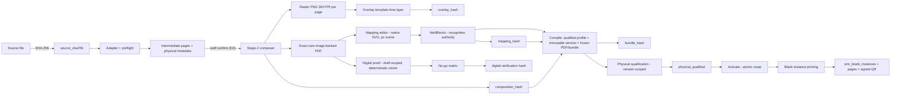
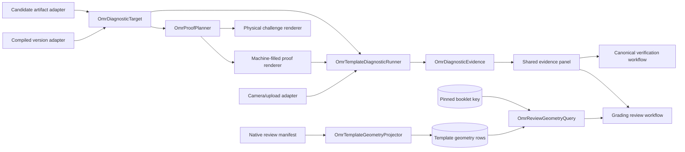

# Design — omr-canonical-template-authoring

## Context

Staff can today author OMR sheets only through the server-owned semantic blueprint solver (`system/app/Assessment/Omr/Layout/OmrTemplateLayoutSolver.php` → `SaveAuthoredTemplateDraft`), which cannot represent supplier forms (HTML, DOCX, PDF, scanned images) with print-exact fidelity. The predecessor change `omr-profile-test-readiness` delivered the marker-bearing bundle seam: `nexiam.omr.capture-policy.v1` (frozen in `system/config/omr/capture-policy.php`), the custom `nexiam.omr.fiducial.v1` fiducial (`fiducial.png`) as comparison evidence, marker-only `CropOnMarkers` normalization in `docker/inference/detect.py` with no Hough fallback, `/v1/layout-verification` (`docker/inference/verify.py`, `OmrLayoutVerificationResult`), and the read-only `Test capture` panel (`TestCapturePanel.svelte`).

This change builds a staged canonical-document authoring pipeline on those seams. Every source converges to an exact-size 300-PPI canonical page raster that staff map onto by hand; every NEW activated template carries the mandatory four-corner marker registration from a VERSIONED, QUALIFIED `omr_marker_profiles` record (the upstream OMRChecker sample marker and the current custom fiducial each start as candidates; qualification promotes exactly one to `qualified` on evidence); blank print instances are identified by a signed, versioned QR with no applicant binding. The existing `fieldBlocks` remain the recognition-geometry authority — the recognition algorithm and `fieldBlocks` contract stay pinned, while the compiler/bundle asset manifest and the worker request/response envelope MAY extend to carry canonical assets, QR decode, and item evidence.

**Sequencing invariant (founder-required):** physical qualification NEVER precedes compile. Digital proof is draft-scoped; compile atomically creates the immutable version; physical qualification runs against that exact compiled version/PDF; activation swaps.

**Constraints (binding):**
- No implementation code in this change; planning artifacts only.
- Work only under `openspec/changes/omr-canonical-template-authoring/`; never edit `system/` or the predecessor change.
- Recognition algorithm and `fieldBlocks` contract unchanged; bundle asset manifest and worker envelope may extend.
- All new routes use the existing `guidance.scoring.omr` capability; every new action is audited.
- Incomplete staged work never lives directly on the immutable template version: authoring drafts own their assets until atomic compile.
- Capture page references use the real `omr_capture_sheet_pages` table / `OmrCaptureSheetPage` model.

## Goals / Non-Goals

**Goals:**
- One staged pipeline for HTML, DOCX, PDF, image, and preset sources: draft stages `draft → source_confirmed → page_prepared → mapping_complete → digital_verified → compiled`, then version-scoped `physical_qualified → active`.
- Versioned marker profiles with candidate→qualified promotion on evidence; drafts select a profile; compile and activation require a qualified profile.
- Authoring drafts with owned assets and optimistic locking; atomic compile into an immutable template version + native bundle; physical qualification against the compiled version only.
- Canonical exact-size composition: 300-PPI PNG per page plus an exact-size image-backed PDF print authority, deterministic mm↔px conversion, proportional scale/offset/9-point alignment, white padding only, source-type-aware enlargement DPI gate; system-controlled 100% internal render scale with explicit external-printer instructions and measured physical verification.
- Staff hand-mapping over the canonical raster in a native Svelte SVG scene (no Konva/Fabric), overlay/tag layer with no applicant tags, explicit (never automatic) structural splitting.
- Signed, versioned blank-instance QR with keyring rotation, unique checksummed display codes, per-page tracking, terminal lifecycle, and typed capture issues; manual damaged-QR recovery as an explicit audited fallback that never overrides a bad signature.
- Draft-scoped digital proof (booklet-independent, identity only when a mapped identity grid exists) + no-go matrix; version-scoped physical qualification and activation gates; old active version stays live until replacement activation commits.
- Full security/ops (incl. DB CHECK constraints and provenance-preserving GC) and staged UX with per-stage wireframes and state/microcopy tables.

**Non-Goals:**
- No change to the recognition algorithm or the `fieldBlocks` contract; the compiler/bundle asset manifest and worker envelope may extend for canonical assets, QR decode, and item evidence.
- No applicant identity binding anywhere in canonical templates, overlays, QRs, or blank instances.
- No irregular option spacing, no freehand per-bubble geometry, no multi-size/multi-orientation page sets in v1.
- No enforcement of external printer settings (a printer dialog's Fit-to-page cannot be detected or refused by software); the system renders exact-size output, instructs/warns, and verifies measured output during physical qualification.
- No result-sheet printing, no applicant data, no new OMR provider.
- No permanent dual builder: the old builder is removed in a clean cut after the semantic parity checklist.

## Decisions

### D1. One stage machine; all sources converge to the same canonical page

Every adapter produces the same intermediate artifact — ordered page images at a bounded pixel budget plus detected physical metadata (paper size in mm, orientation, page count) and provenance — which staff confirm page-by-page, then a single Stage-2 composer turns confirmed pages into the exact-size 300-PPI canonical raster + print PDF. The preset adapter wraps the existing solver output: the existing rendered PDF's actual page dimensions are measured and `fieldBlocks` are rescaled by a NORMALIZED physical transform `x_new = round(x_old / old_page_width × new_page_width)` (and likewise y/w/h), preserving normalized regions. There is NO fixed `px242 × 300/242` ratio — the renderer's 242 PPI label is not exact physical DPI; only the actual page box in the rendered PDF is authoritative.

*Rationale:* one verification, mapping, and activation path regardless of source; normalized transforms are dimension-agnostic and testable. *Alternatives rejected:* per-source bespoke mapping; a fixed PPI-ratio transform; using intermediate pages directly as canonical.

### D2. Adapters are thin, preflight-hardened converters

- **HTML**: allowlist sanitizer (server-side allowlist + CSS property filtering, remote-off, deterministic output) rendered with the existing HTML→PDF path (DomPDF/Browsershot family already used for result sheets) exactly once. The sanitizer is a RESEARCHED, PINNED, maintained dependency (Foundation prerequisite before the HTML adapter is implemented — no package assumed); vetted license/security/version. Dynamic slots MUST be fixed `data-omr-overlay` markers. Unrecognized `{{…}}` or dynamic-looking tokens (e.g., `{{name}}`, `[Q1]`, `$var`) are REJECTED at preflight unless represented by an allowlisted `data-omr-overlay` slot; plain static text is fine.
- **DOCX**: LibreOffice headless → PDF exactly once (already the result-sheet pattern), inside the queue worker; hostile preflight first.
- **PDF**: MediaBox inspection for page size/orientation; encrypted/passworded rejection; page count cap.
- **Image**: EXIF orientation applied; no-profile and sRGB accepted; non-sRGB ICC profiles are converted ONLY by a researched deterministic pipeline (Foundation research/pin) or otherwise rejected with typed `image_icc_unsupported` (no promised unsupported conversion); transparency flattened onto white; DPI floor check.
- **Preset**: solver blueprint output transformed via the normalized physical transform (D1).

Authoring photos (supplier scans/photos with page edges visible) require **manual-confirmed quadrilateral rectification**: the frontend preview may SUGGEST corners and let staff drag them, but the SERVER is the authority — staff-confirmed four points plus the image go to the inference worker seam `POST /v1/source-rectification` (new bounded child `rectify.py` reusing the exact existing child-process/HMAC envelope pattern), which returns the rectified raster plus quality metrics (edge straightness residual, content aspect ratio, resolution after warp); staff confirm the rectified page before it is accepted. No auto-magic corner detection is trusted for authoring photos — confirmation is mandatory. Ordinary capture never exposes a manual quad (marker registration remains the capture path). Staff reject reasons for source pages (`wrong_page`, `duplicate_page`, `upside_down`, `illegible`) are user classifications recorded as-is, never automatic claims.

*Rationale:* hostile-file handling belongs at the boundary; photos without printed edges cannot be auto-rectified safely; staff judgment owns page rejection. *Alternatives rejected:* automatic corner detection as the only path; client-side rectification only; auto-claiming wrong pages from pixel heuristics.

### D3. Staff page confirmation is a hard gate between ingest and compose

After conversion, the UI shows every intermediate page; staff confirm each page or reject it with a typed reason (user classification). Composition refuses to start until every page is confirmed. `source_confirmed` is a terminal-until-change state: any re-ingest returns the draft to `draft` and voids confirmations.

*Rationale:* a wrong page silently propagated into the canonical raster corrupts every downstream gate. *Alternatives rejected:* trusting converter output blindly.

### D4. Stage-2 composition: exact-size 300-PPI raster + image-backed PDF, system-controlled 100% render

- PPI is exactly 300 for canonical rasters; `px = round(mm × 300 / 25.4)`, `mm = px × 25.4 / 300`.
- One size/orientation for all pages in v1; mixed offending pages are rejected with a typed list (`mixed_page_sizes`).
- Per-page independent per-side mm settings: **printer-safe margin** (unprintable band), **marker inset** (marker-center distance from the paper edge), **content margin** (staff-configured content safe zone). All stored in mm, converted deterministically.
- Placement: proportional scale `s` with white padding only. Downscaling is always allowed (`0 < s ≤ 1`). Proportional visual ENLARGEMENT (`s > 1`) is allowed ONLY when the effective source DPI after physical placement stays at or above the source-type-aware floor (e.g., ≥150 effective DPI for the ≥4.2 mm bubble contract); no detail is invented below the floor — such placements are rejected (`insufficient_resolution`). A 9-point alignment reference chooses which page corner/edge/center lands on which canvas corner/edge/center (default center); X/Y offset completes placement.
- Output: one 300-PPI PNG per page (mapping underlay) + one exact-size PDF whose page size in mm equals the paper size and whose image is placed at internal renderer scale 100% — the print authority.
- **External printer scope (honest boundary):** the system controls the PDF page box and its own render scale; it CANNOT detect or refuse a printer dialog's Fit-to-page/scale setting. Every print surface shows an explicit `Print at 100% / actual size — do not fit to page` instruction and warning; physical qualification verifies measured output (e.g., printed marker-center distance vs expected mm) before activation. Later printer profiles can warn or require institution policy qualification per printer.
- The composer records `composition_hash` over page assets + settings; `BundleRenderer::PPI` (242) is untouched for existing templates — canonical templates render via the new exact-size path only.

*Rationale:* deterministic math makes mm↔px provable in tests; the DPI gate keeps enlargement honest; image-backed PDF avoids font/subset drift. *Alternatives rejected:* vector PDF from HTML/DOCX directly; unconditional `s ≤ 1`; claiming enforcement of external printer settings.

### D5. Marker profiles: versioned domain, candidate→qualified promotion, per-template selection

- **New `omr_marker_profiles` table** (versioned, unique `code+version`): `family` (e.g., `omrchecker.sample`, `nexiam.custom`), asset path + SHA-256 (fiducial image), physical `size_mm` and `quiet_zone_mm` (nullable until qualified), matching options/config JSON (match thresholds, rescale range), status `candidate|qualified|retired`, `qualification_evidence_hash`, `created_by_user_id`, `qualified_by_user_id`/`qualified_at` (nullable), timestamps.
- The upstream OMRChecker sample marker starts as a CANDIDATE (never an assumed production marker); the current custom `nexiam.omr.fiducial.v1` profile is a COMPARISON candidate. Candidate qualification is TEMPLATE-INDEPENDENT: `GenerateOmrMarkerCalibrationArtifact` renders a dedicated SYSTEM marker-calibration artifact/sheet through the canonical renderer — four candidate markers plus a controlled background/corner false-positive corpus — bound to the marker asset hash + canonical renderer version + printer/device/paper evidence; it does NOT require a target template version. `QualifyOmrMarkerProfile` accepts the calibration evidence, promotes EXACTLY ONE profile to `qualified` (atomically marking any other `qualified` profile `retired` — single-qualified invariant), and records `qualification_evidence_hash`/`qualified_by`/`qualified_at`. Pixel sizes are derived from the qualified physical mm at 300 PPI; legacy pixel constants are never carried into canonical sizing.
- A draft selects `marker_profile_id` (qualified profiles are selectable); **compile requires a qualified profile** (`marker_profile_unqualified` otherwise). Staff adjust marker INSETS only (asymmetric insets within the engine quadrant split `w/2 × h/3`); they never edit the profile's physical size/quiet zone.
- **TEMPLATE physical qualification** (post-compile, `RunOmrPhysicalQualification`) is a SEPARATE gate: it binds the compiled template version + the ALREADY-QUALIFIED marker profile + canonical renderer version + printer/device/paper and records per-variant outcomes and measured output; it gates activation. Marker-profile qualification NEVER requires a compiled version and template qualification NEVER re-qualifies the profile.
- `pageDimensions` MUST equal the marker-center rectangle (frame anchoring invariant from the predecessor); all mapped geometry is derived in that frame; the physical paper is the frame plus the inset ring. Four repeated markers from the qualified profile are **mandatory on every NEW activation**. The system adds no registration border; an imported supplier border is NOT rejected — the corner-pattern false-positive probe MUST prove imported borders, decorative corners, and partial markers do not register. No three-of-four fallback, no Hough fallback.
- **Corner-pattern false-positive testing**: a fixture corpus of page corners WITHOUT markers (decorative borders, company logos at corners, dark corner shadows, partial markers clipped by the edge, imported supplier borders) MUST produce `marker_missing`/`marker_mismatch`, never a registration. New python test `test_corner_false_positive.py` plus fixtures in `generate_fixture.py`.

*Rationale:* a versioned, evidence-promoted marker domain makes the registration contract auditable and reversible; per-template selection lets new printers qualify a fresh profile without mutating live templates. *Alternatives rejected:* hardcoding the current custom profile sizes; AprilTags/encoded marker IDs; 3-of-4 fallback.

### D6. Overlay layer: three scopes, fixed boxes, no applicant tags

Overlays are fixed-position boxes (no reflow, no auto-layout). Three scopes:

1. **Template-time**: static text/logo/writing boxes baked into the canonical raster (e.g., institution header, `NAME (PRINT):` writing box, instructions). In HTML sources, dynamic slots are fixed `data-omr-overlay` markers; all other content is static.
2. **Print-job**: dynamic values rendered when a blank-print job runs — allowed tags `blank_instance_code`, `page_number`, `page_count`, `blank_instance_qr`.
3. **Blank-instance**: per-instance rendering of the signed QR + display-code fallback (subset of print-job tags, produced by the instance service).

Allowed tag set is closed: `institution`, `assessment`, `template`, `blank_instance_code`, `page_number`, `page_count`, `blank_instance_qr`. **NO applicant tags.** The canonical static raster excludes per-instance values by construction — a re-render of the same template version with a different instance yields identical raster bytes (hash-stable) and only the print-job overlay differs.

*Rationale:* fixed boxes keep the raster hash-stable and the mapping valid; the closed tag set prevents identity leakage by construction. *Alternatives rejected:* flowing/auto-layout overlays; applicant tags (explicitly forbidden).

### D7. Blank instances: set + page rows, signed QR with keyring, terminal lifecycle, audited manual fallback

Two additive tables, **no applicant FK anywhere**:

- `omr_blank_instances` (set row): immutable `omr_answer_sheet_template_version_id` (restrict), unique high-entropy `instance_code` (≥128-bit: 26-char Crockford base32 random), UNIQUE short checksummed `display_code` (human fallback; lookup aid only, NEVER a security authority), monotonic per-version `page_set_no` (never reused), `page_count`, `status` (`printed|captured|superseded|void`), `print_job_id`, `superseded_by_instance_id` (self-FK), `qr_manifest_hash` (SHA-256 of the ORDERED per-page signed payload hashes — every page payload differs, so the set-level hash is a manifest hash, not a single payload hash), `signing_key_id`, `signature_version`, `created_by_user_id`, timestamps.
- `omr_blank_instance_pages` (per-page rows): `instance_id` FK, `page_no`, `qr_payload_hash` (this page's signed payload hash), `signing_key_id`, `print_artifact_hash` (SHA-256 of the rendered page artifact), `status` (`printed|captured|void`), `captured_page_id` (nullable FK to `omr_capture_sheet_pages` / `OmrCaptureSheetPage`), unique `(instance_id, page_no)`.

**Signed QR with keyring:** payload is opaque AND signed/versioned — `nexiam:blank:v1:<instance_code>:p<page_no>:p<page_count>:k<signing_key_id>:<hmac>` where `hmac = HMAC-SHA256(key[signing_key_id], "v1|<instance_code>|p<page_no>|p<page_count>|k<signing_key_id>")`; `signature_version=1`. Storage keeps the per-page payload hash, the signing key id, and the signature version; the set stores `qr_manifest_hash`. Raw unsigned payloads are never trusted. Verification resolves the key from a configured keyring so KEY ROTATION still verifies historical prints; an unknown key id fails with `qr_key_unknown`, an invalid HMAC with `qr_signature_invalid`.

**Lifecycle:** `printed → captured | superseded | void`; all three non-printed states are TERMINAL — `void` is never allowed after `captured` or `superseded`. `printed` means the COMPLETE page set rendered (every page row `printed`); a failed/partial render never transitions the set to `printed`. A set STAYS `printed` while partially captured — page progress derives from page rows — and becomes `captured` only when ALL required pages are captured. Superseding a partially captured `printed` set is allowed ONLY via explicit whole-set replacement with audit; old page captures remain evidence. Whole-set replacement prints the next page set and supersedes the previous set (all its pages).

**Manual damaged-QR recovery — explicit audited fallback, two branches:**
- Payload PRESENT but signature/key invalid → HARD typed error (`qr_signature_invalid` / `qr_key_unknown`). Manual display-code entry MUST NOT override a present-but-invalid payload.
- Payload cannot be DECODED or is ABSENT → capability-gated staff may enter the unique checksummed `display_code`; the server resolves the set/page/template from the DB, requires explicit staff confirmation, records `instance_resolved_manually` (audited), and recognition remains BLOCKED until confirmed. This is an explicit audited fallback path, NOT signature verification — there is no payload to verify.

**Capture registration** lives in the grading/capture flow (not the setup builder) and validates set + page rows; marker registration remains the recognition authority — the QR is advisory identity only.

*Rationale:* opaque signed instance codes give auditability, tamper detection, key-rotation capability, and per-page partial-failure representation without making the sheet a PII carrier; the two-branch manual fallback is honest about what can and cannot be verified. *Alternatives rejected:* unsigned payloads; manual entry overriding a bad signature; a single static signing key; applicant identity in QR (forbidden).

### D8. Authoring drafts, owned assets, atomic compile

- `omr_template_authoring_drafts`: `template_id` (nullable FK to an existing `omr_answer_sheet_templates`), `code`, `name`, `source_kind`, `stage`, `marker_profile_id` (nullable FK to `omr_marker_profiles`), `authoring_json` (source/canonical/markers/overlay/mapping/verification blocks), `lock_version` (optimistic lock for autosave), `owner_user_id`, `compiled_version_id` (nullable, set by compile), timestamps. DB CHECK on `stage` values.
- `omr_template_assets`: REAL FKs, no polymorphism — nullable `authoring_draft_id` FK and nullable `template_version_id` FK with a DB CHECK that exactly one is non-null (indexed); `kind` (`source`, `intermediate_page`, `raster_page`, `print_pdf`, `evidence`, `digital_proof`, `marker_profile`), `page_no` (nullable), `disk`, `path`, `mime`, `bytes`, `sha256`, `metadata`, timestamps. Assets are immutable once written.
- **Asset lifecycle**: on compile, assets are TRANSFERRED/COPY-PINNED to version ownership (source, raster, PDF, and evidence rows get version-owned copies). GC removes ONLY unreferenced draft-owned and temp assets past TTL; provenance source assets (source file, converter output, evidence) are NEVER garbage-collected once version-owned.
- **Compile** (`CompileOmrCanonicalDraft`, DRAFT-scoped): requires stage `mapping_complete` PLUS a QUALIFIED marker profile PLUS `digital_verified` evidence; atomically validates, creates the immutable `omr_answer_sheet_template_versions` row with status `draft`, derives the `NativeBundle` from `fieldBlocks`, FREEZES the canonical PDF/bundle, copy-pins assets/evidence into version-owned rows, stores on the version ONLY a compact authoring manifest (hashes + summary, no full geometry), and sets the draft `compiled_version_id` + stage `compiled`. A failed compile leaves no partial version (`compile_failed`).
- Autosave optimistic locking uses the draft `lock_version` (`concurrency_conflict` on mismatch), never the immutable template version's `updated_at`.
- DB CHECK constraints across the new tables enforce: draft `stage` values, blank set/page `status` values, `page_no ≥ 1` and `page_no ≤ page_count`, `page_count ≥ 1`, exactly-one asset owner, unique `display_code`; TERMINAL lifecycle transitions (`void` after `captured`/`superseded`, etc.) are enforced in the actions AND covered by tests.

*Rationale:* incomplete work is inherently mutable and must not pollute the immutable version table; real FKs make ownership provable and indexable; provenance must outlive draft cleanup. *Alternatives rejected:* polymorphic owner columns; GC of version-owned provenance assets; staging JSON columns directly on `omr_answer_sheet_template_versions`.

### D9. Mapping editor: native Svelte SVG scene

`CanonicalMapEditor.svelte` renders the 300-PPI raster as an SVG `<image>` underlay; the scene `viewBox` and ALL stored coordinates are **canonical pixels** (not mm); pointer events convert through the inverse CTM to canonical px; the inspector derives mm via `px × 25.4 / 300`. **No Konva, no Fabric** — native SVG + Svelte pointer events only. Tablet/desktop (≥1024 px) required for editing; phone is view-only.

- **Overlay layer editing**: template-time boxes drag/resize (handles + numeric inspector), snap to a 4px grid.
- **OMR block/grid mapping**: staff draw block bounding boxes and grid parameters (columns, rows, options per row); per-row uniform structural adjustment (row pitch, option pitch, bubble diameter for the whole row) — no per-bubble edits.
- **Explicit structural split (never automatic)**: when a row is overfull or option spacing is irregular, the validator reports the block as blocking (`overfull_row`/`irregular_options`); staff must explicitly split the block into one-label regular blocks, preview the result, and only then does the validator recheck. No silent split-to-one-row fallback exists.
- **Individual bubbles are inspect-only**: click a bubble → read-only readout (page/block/row/option, pixel rect, normalized region); never draggable.
- Interaction contract: inverse-CTM px conversion; pointer drag with live ghost; 4px snap (blocks); keyboard arrows 1px, Shift+Arrow 10px; touch drag/resize with ≥44 px hit targets; undo/redo stack (bounded 200 steps); autosave (debounced 800 ms) with explicit saved/saving/conflict states; conflict detection against the draft `lock_version` with a stale-draft banner and merge-by-reload; accessibility: keyboard-operable, ARIA labels per block/row, focus ring, screen-reader readouts, `prefers-reduced-motion` respected.
- Output is the `mapping` JSON whose `field_blocks` are the OMRChecker `fieldBlocks` shape; the compiler/bundle asset manifest and worker envelope may extend around it, but the recognition contract stays pinned.

*Rationale:* canonical-pixel storage matches the raster 1:1 and keeps the math transparent/testable; mm is a derived display unit. *Alternatives rejected:* Konva/Fabric; mm-based scene coordinates; per-bubble freehand; automatic row splitting.

### D10. fieldBlocks authority, hash invalidation, read-only compiled versions

- `mapping.field_blocks` is the only geometry the worker consumes; grid/structural edits rewrite `field_blocks` deterministically server-side (client never posts raw bubble coordinates).
- Hash chain (see diagram): `source_sha256 → converter(version+settings) → page_assets → composition_hash → overlay_hash → mapping_hash → verification hashes → bundle hash`. Any source/composition/overlay change invalidates the stored mapping and all verification hashes (typed `stale_mapping` / `verification_invalidated`); staff must re-map and re-verify.
- Compiled versions are immutable and read-only; activation (`ActivateOmrCanonicalTemplate`, VERSION-scoped) requires the compiled version + qualified marker profile + `physical_qualified` evidence and atomically swaps the active version — the previous active stays live until commit.

### D11. Verification: draft-scoped digital proof, version-scoped physical qualification

- **Digital proof** (`GenerateOmrDigitalProofJob`, DRAFT-scoped): starts from the draft's final composed exact-size PDF, programmatically shades a DETERMINISTIC declared answer vector derived from mapped labels (e.g., cycle A/B/C/D per question — a paired booklet is NOT required for template proof), plus the signed instance QR + display code. A deterministic identity is shaded ONLY when a mapped identity grid exists (e.g., an applicant-number grid); otherwise NO fabricated identity field is added. Booklet compatibility (answer key ↔ fieldBlocks/options) is tested separately when a pairing exists.
- **No-go matrix** (`RunOmrNoGoMatrixJob`, draft-scoped with digital proof): runs clean + perspective/rotation/light/blur/glare/low-res/partial/missing-marker/wrong-marker/wrong-instance/superseded/duplicate/multipage-order variants; every variant must produce the declared outcome or a typed rejection — no false accepts.
- **Post-compile parity smoke**: after compile, the digital proof re-runs against the frozen PDF/bundle; only hash parity of repeated identical runs is asserted (no cross-path byte equality).
- **Physical qualification** (`RunOmrPhysicalQualification`, VERSION-scoped — runs against the COMPILED template version/PDF): staff print at 100% on the target printer (UI instructs actual-size) and capture via the extended Test-capture panel. TEMPLATE evidence binds the compiled template version + the ALREADY-QUALIFIED marker profile + canonical renderer version and records printer identity, device, paper, measured output (e.g., marker-center distance vs expected mm), and per-variant outcomes; gates `physical_qualified`. The selected marker profile was qualified independently through the system marker-calibration artifact (D5) — template qualification never re-qualifies the profile. Software cannot enforce an external printer's Fit setting — later new-printer profiles may warn or require institution policy qualification.
- Test-capture evidence extension: whole normalized page + `draw_template_layout` overlay AND per-item/row evidence driven by the DECLARED OPTION SET — A–D for MCQ4, A–E for MCQ5, 0–9 for int (A–D is the common example): circles/rectangles, crops, bubble means, threshold delta/status, field-block shifts, marker match scores, and source/mapping/bundle hashes; read-only with a `Return to mapping and select row` path that jumps the mapping editor to the row under investigation. Thresholds stay `Unqualified` until calibration.

### D12. Security/ops

- Hostile-file preflight per adapter (MIME + magic bytes, DOCX zip-bomb/member caps/macro rejection, PDF encrypted/xref/page-box checks, HTML sanitization via a RESEARCHED/PINNED server-side allowlist sanitizer with CSS filtering + remote-off + dynamic-token rejection, image EXIF/ICC/transparency/DPI checks where non-sRGB profiles are converted only by a researched deterministic pipeline or rejected `image_icc_unsupported`); bounded pixel budgets and physical custom-size bounds; caps/timeouts/queue/progress/cancel for heavy conversion; private SHA-256 storage chain (`OmrTemplateAssetStore`, draft/version FK-owned); temp/orphan GC that NEVER removes version-owned provenance assets; rate limits; `CapabilityAuthorizer` on every route; `RecordAuditEvent` on every action; staff-only diagnostics.
- **QR renderer (FOUNDATION prerequisite):** the PHP queue runtime has no QR package; a maintained server-side QR renderer MUST be researched and pinned FIRST, with the research task COMPLETED BEFORE the QR rendering implementation tasks. Acceptance: deterministic SVG/PNG output, fixed ECC level and quiet zone, vetted license/security/version, no network calls at render time. npm `qrcode` serves the Svelte client only and cannot cover the PHP queue.

### D13. Migration: preset adapter + semantic parity checklist, then clean cut

- The solver becomes the **preset adapter** (existing renderer PDF transformed by the normalized physical mapping, parity checks).
- Old builder stays live and is the parity baseline. Cutover parity is SEMANTIC: same pages/labels/options, physical centers/regions within a declared tolerance, normalized review regions within tolerance, deterministic recognition exactness, and a visual-diff threshold — all using normalized transforms from actual page dimensions. Byte-identical rasters across render paths are NOT required and NOT expected; hash equality applies only to repeated canonical runs with identical inputs.
- After the checklist passes, hide the old builder, then delete it in a clean cut — **no dual builder**.
- Historical markerless templates remain immutable and scan-only (`CropPage` path unchanged); canonical markers apply only to NEW activations.

## Domain / Schema

Existing tables (unchanged, referenced): `omr_answer_sheet_templates`, `omr_answer_sheet_template_versions` (status `draft|active|retired`), `omr_question_booklets`, `omr_question_booklet_versions`, `omr_template_areas`, `omr_template_questions`, `omr_template_question_options`, `omr_question_booklet_questions`, `omr_template_booklet_pairs`, `omr_capture_batches`, `omr_capture_sheets`, `omr_capture_sheet_pages` (`OmrCaptureSheetPage`), `print_jobs`, `operations` (idempotency keys), `audit_events`.

### Additive migration A: `omr_marker_profiles`

| column | type | notes |
|---|---|---|
| `id` | bigint PK | |
| `code` | string(64) | e.g. `omrchecker.sample` |
| `version` | int | unique with `code` |
| `family` | string(64) | `omrchecker.sample` / `nexiam.custom` |
| `asset_path` | string(512) | fiducial asset (private disk) |
| `asset_sha256` | string(64) | |
| `size_mm` | decimal nullable | physical; NULL until qualified |
| `quiet_zone_mm` | decimal nullable | physical; NULL until qualified |
| `matching_config` | JSON | match thresholds/rescale options |
| `status` | string(16) | check `candidate\|qualified\|retired` |
| `qualification_evidence_hash` | string(64) nullable | evidence asset reference |
| `created_by_user_id` | FK users restrict | |
| `qualified_by_user_id` | FK users nullable | |
| `qualified_at` | timestamp nullable | |
| timestamps | | |

Unique `(code, version)`. Qualification promotes EXACTLY ONE profile to `qualified` (others → `retired`).

### Additive migration B: `omr_template_authoring_drafts`

| column | type | notes |
|---|---|---|
| `id` | bigint PK | |
| `template_id` | FK `omr_answer_sheet_templates` nullable | pre-existing template or null for new |
| `code` | string(64) | natural key per template scope |
| `name` | string(190) | |
| `source_kind` | string(16) | `html\|docx\|pdf\|image\|preset` |
| `stage` | string(32) | check `draft\|source_confirmed\|page_prepared\|mapping_complete\|digital_verified\|compiled` |
| `marker_profile_id` | FK `omr_marker_profiles` nullable | selected by staff |
| `authoring_json` | JSON | source/canonical/markers/overlay/mapping/verification blocks |
| `lock_version` | int | optimistic lock for autosave |
| `owner_user_id` | FK users restrict | |
| `compiled_version_id` | FK `omr_answer_sheet_template_versions` nullable | set by atomic compile |
| timestamps | | |

### Additive migration C: `omr_template_assets`

| column | type | notes |
|---|---|---|
| `id` | bigint PK | |
| `authoring_draft_id` | FK `omr_template_authoring_drafts` nullable | indexed |
| `template_version_id` | FK `omr_answer_sheet_template_versions` nullable | indexed |
| `kind` | string(24) | `source\|intermediate_page\|raster_page\|print_pdf\|evidence\|digital_proof\|marker_profile` |
| `page_no` | int nullable | |
| `disk` | string(64) | private disk |
| `path` | string(512) | |
| `mime` | string(127) | |
| `bytes` | bigint | |
| `sha256` | string(64) | provenance |
| `metadata` | JSON nullable | |
| timestamps | | |

DB CHECK: exactly one of `authoring_draft_id` / `template_version_id` non-null. Immutable once written; compile copy-pins to version ownership; GC removes ONLY unreferenced draft/temp rows.

### Additive migration D: `omr_answer_sheet_template_versions` gains compact `authoring_manifest` JSON

Only hashes + summary (source hash, converter version/settings hash, composition hash, overlay hash, mapping hash, verification hashes, marker profile reference, pixel/page summary) — never full geometry.

### Additive migration E: `omr_blank_instances`

| column | type | notes |
|---|---|---|
| `id` | bigint PK | |
| `omr_answer_sheet_template_version_id` | FK restrict | immutable compiled version |
| `instance_code` | string(40) unique | ≥128-bit: 26-char Crockford base32 random |
| `display_code` | string(24) UNIQUE | short checksummed human fallback; lookup aid only |
| `page_set_no` | int | monotonic per template version; never reused |
| `page_count` | int | check `> 0` |
| `status` | string(16) | check `printed\|captured\|superseded\|void` |
| `print_job_id` | FK `print_jobs` nullable | |
| `superseded_by_instance_id` | self-FK nullable | |
| `qr_manifest_hash` | string(64) | SHA-256 of ordered per-page signed payload hashes |
| `signing_key_id` | string(32) | keyring reference |
| `signature_version` | int | `1` = HMAC-SHA256 scheme |
| `created_by_user_id` | FK users restrict | |
| timestamps | | |

Unique `(template_version_id, page_set_no)`; unique `display_code`; NO applicant FK.

### Additive migration F: `omr_blank_instance_pages`

| column | type | notes |
|---|---|---|
| `id` | bigint PK | |
| `instance_id` | FK `omr_blank_instances` cascade | |
| `page_no` | int | check `≥ 1` |
| `qr_payload_hash` | string(64) | THIS page's signed payload hash |
| `signing_key_id` | string(32) | |
| `print_artifact_hash` | string(64) | rendered page artifact SHA-256 |
| `status` | string(16) | check `printed\|captured\|void` |
| `captured_page_id` | FK `omr_capture_sheet_pages` nullable | real capture-page model `OmrCaptureSheetPage` |
| timestamps | | |

Unique `(instance_id, page_no)`; no applicant FK.

## Artifact / Hash chain



Invalidation rule: changing `SRC`, converter settings, composition settings, or overlays recomputes downstream hashes and clears `mapping`, `verification.digital`, `verification.physical` (typed `stale_mapping`/`verification_invalidated`). Compiled/activated versions never re-hash.

## Engine-parity correction spine (founder decision 2026-08-22)

The editor-stage continuity fix is not sufficient evidence of print or detection parity. The correction uses three authorities at different lifecycle points, never two authorities at the same point:

1. **Editable draft authority — `CanonicalSheetDefinition`**: server-validated paper, visual components, explicit section-header visibility/text, overlay slots, qualified marker-profile identity/insets, and OMR block intent. Geometry is normalized to canonical integer pixels at 300 PPI; millimetres remain presentation metadata.
2. **Materialized candidate authority — `CanonicalArtifactSet`**: one deterministic server operation consumes the definition and emits the exact unmarked page PNG, image-backed PDF, non-blank reference page, native `template.json`, `config.json`, marker asset, expanded review manifest, and hashes. No browser HTML or green overlay is an artifact authority.
3. **Runtime authority — immutable `NativeBundle`**: compile promotes the already-verified candidate bytes without regenerating geometry. From that point, OMRChecker native expansion is canonical and NEXIAM projections remain read-only derivatives.

```mermaid
flowchart LR
  DEF[CanonicalSheetDefinition] --> MAT[CanonicalArtifactMaterializer]
  MAT --> PNG[300-PPI page PNG]
  MAT --> PDF[exact-size PDF]
  MAT --> REF[non-blank reference page]
  MAT --> NT[native template/config + marker]
  NT --> EXP[pinned OMRChecker Template expansion]
  EXP --> MAN[derived review manifest]
  PNG --> CLEAN[clean digital proof]
  NT --> CLEAN
  CLEAN --> LV[/v1/layout-verification]
  LV --> AL[worker aligned raster]
  LV --> OL[draw_template_layout overlay]
  PNG --> HASH[artifact-set hash]
  PDF --> HASH
  REF --> HASH
  NT --> HASH
  MAN --> HASH
  HASH --> COMPILE[atomic immutable compile]
```

### Pinned OMRChecker use

- Preserve upstream `Template`/`FieldBlock.generate_bubble_grid`, preprocessor order, page/marker alignment, field-block shifting, bubble sampling, thresholding, and classification. NEXIAM MUST NOT recreate native bubble expansion in Svelte or PHP.
- Use `CropOnMarkers` with the exact bundled qualified marker asset and profile-owned `sheetToMarkerWidthRatio`. Its output marker-center rectangle is resized to native `pageDimensions`; all `origin`, `bubbleDimensions`, `bubblesGap`, and `labelsGap` coordinates live in that frame.
- Keep upstream generic `auto_align` disabled for canonical marker sheets; upstream documents it as deprecated/low-performance on generic sheets. Retain OMRChecker's bounded per-field shifts, return them, and fail the existing half-pitch unsafe-shift gate.
- Keep the owned patch that returns the clean, unannotated aligned page from `read_omr_response`; `draw_template_layout` remains a separate diagnostic image. The uploaded photo is forensic input, never the normalized proof image.
- Keep the one-child-per-sheet supervisor boundary, pinned commit `de3f6982822895491be760325fd43e65e90fa293`, patch identity `nexiam-headless-overlay-v1`, bounded HMAC envelope, null confidence, and mandatory staff review.

### Stage boundary

- **Sheet Designer** uses a responsive client renderer for editing, but exposes an explicit **Print Preview** backed by `CanonicalArtifactMaterializer`; that server-owned full-paper raster/PDF is the first printable product, not the browser DOM.
- **Entering Recognition Mapping** reuses the unchanged candidate artifact already previewed in Sheet Designer; if none exists or the definition changed, it saves, materializes, loads the pinned native template, derives expanded bubbles, and runs the clean candidate through `/v1/layout-verification`. Navigation-only saves never invalidate byte-identical artifacts.
- **Recognition Mapping** always keeps the full printable canonical sheet as its fixed base—including visual content, four markers, and the read-only QR reservation. `Print Sheet`, `Aligned Check`, and `Recognition Overlay` switch only the diagnostic surface. Every authoring source renders the same translucent bubble/ID guides. Unlocked guides edit native field-block coordinates only; print components remain unchanged. Lock state is editor metadata. Collision guards stop invalid geometry before autosave.
- **Digital verification** runs the declared synthetic/no-go variants through the same worker endpoint and candidate artifact hash; expected outcomes are assertions, not recorded actuals.
- **Compile** byte-promotes the passing candidate artifact set into the immutable version. Any byte/hash change forces re-verification.
- **Verification & Test Capture** exposes the candidate PDF with Actual Size print instructions, then accepts camera/photo/scan evidence only after immutable compile. It defaults to OMRChecker's returned aligned raster, with the engine overlay as the comparison tab.
- **Runtime pairing** resolves the signed blank-instance QR to the immutable template version; capture-batch/template-booklet pairing resolves the answer key. Scanner code loads internal native `template.json` automatically and never guesses geometry from appearance alone.
- **Native download** remains an authenticated diagnostics endpoint for engineering evidence, but ordinary staff authoring UI does not expose `template.json`, client mapping JSON, or copy/download controls.

### Reuse seams

- Extract bundle assembly from `OmrCanonicalNativeBundleCompiler` so draft materialization and atomic compile call the same implementation.
- Generalize `OmrDiagnosticRequestBuilder` over a pinned diagnostic-geometry value object; compiled versions and draft candidates then share one request/envelope path.
- Reuse `NativeManifestDeriver`, `OmrCheckerDetection::verifyLayout`, `OmrLayoutVerificationResult`, diagnostic asset streaming, and unsafe-shift gates.
- Replace `OmrNoGoMatrixRunner`'s contract-only loop; do not add a second detector, threshold algorithm, alignment implementation, or browser geometry compiler.

## Shared verification and scanner architecture spine

**Paradigm:** modular-monolith diagnostic kernel with immutable geometry snapshots, ports/adapters at the candidate/version seam, durable pipeline state machines, and read-only evidence projections.

### Adopted decisions

**AD-1 — One diagnostic kernel**
- **Binds:** canonical verification, template Test Capture, and grading scanner evidence.
- **Prevents:** three request builders, three evidence schemas, or browser-owned recognition math.
- **Rule:** `OmrTemplateDiagnosticRunner` consumes an `OmrDiagnosticTarget`, input image, and optional `OmrProofPlan`; it delegates only to `OmrDiagnosticRequestBuilder` + `OmrLayoutVerificationPort`/`OmrDetectionPort` and returns `OmrDiagnosticEvidence`.

**AD-2 — Two target adapters, one interface**
- **Binds:** draft candidate artifact and immutable compiled version.
- **Prevents:** candidate rehearsals silently acting as compiled qualification.
- **Rule:** `CandidateArtifactDiagnosticTarget` exposes current artifact/native/mapping hashes and is rehearsal-only; `CompiledVersionDiagnosticTarget` exposes pinned version/native/manifest/config hashes and is qualification-capable. Every result repeats target kind/id/hashes.

**AD-3 — One deterministic proof plan**
- **Binds:** digital synthetic proof, quick physical rehearsal, and full qualification challenge.
- **Prevents:** random retries, browser-selected answers, fabricated applicant identity, and digital/physical expected-vector drift.
- **Rule:** `OmrProofPlanner::plan(target, purpose, seed)` returns versioned `OmrProofPlan` with expected label→value vector, optional calibration digits only when an identity grid exists, per-page shading instructions, challenge code, seed, and plan hash. Seed = artifact/native hash + plan version + purpose. `OmrDigitalProofGenerator` renders a machine-filled plan; `OmrPhysicalChallengeRenderer` renders the exact blank/signed-QR sheet plus a separate human guide.

**AD-4 — Template geometry and answer keys have separate owners**
- **Binds:** canonical compile/activation and grading review.
- **Prevents:** scanner crops/options disappearing when booklet rows lack `template_question_id`, and prevents the shared diagnostic module from owning scores.
- **Rule:** extract `OmrTemplateGeometryProjector` from `ActivateOmrConfiguration`; it idempotently projects native review manifest → version-owned pages/areas/questions/options. Canonical compile and legacy activation call it. `OmrReviewGeometryQuery` reads template geometry and merges pinned booklet correct options by validated semantic area/question coverage. Booklet pairing owns correctness; template version owns regions/options.

**AD-5 — Evidence is read-only and normalized**
- **Binds:** builder evidence review, legacy Test Capture, and grading scanner review.
- **Prevents:** provider-specific JSON in pages and scoring mutations from diagnostic UI.
- **Rule:** `OmrDiagnosticEvidence` carries target/proof hashes, captured/aligned/overlay assets, gates, marker matches, shifts, declared-option item crops/rectangles/means/threshold status, expected/detected values, timings, and safe issues. It contains no applicant binding or score command.

**AD-6 — Durable runs report real progress**
- **Binds:** digital matrix and physical challenge/capture.
- **Prevents:** fake percentages, request timeouts, lost retries, and UI-only run state.
- **Rule:** `omr_template_verification_runs` owns `queued|preparing_proof|clean_recovery|variant_matrix|awaiting_print|awaiting_capture|analyzing_capture|needs_review|passed|failed`, phase detail, progress done/total, hashes, safe error, actor, timestamps, and optimistic version. The normalized run/evidence rows—not the generic operation ledger, browser state, or job payload—are the recovery and qualification authority. POST starts idempotently and returns `202`; status GET polls persisted progress. Jobs lock the run, verify expected run version/target hashes, update after each actual phase/variant, and dispatch follow-on work only after commit.

**AD-7 — Qualification is derived, never checked manually**
- **Binds:** challenge result and activation gate.
- **Prevents:** “matrix passed” checkbox or rehearsal evidence activating production.
- **Rule:** candidate quick/full runs are rehearsal-only. Physical qualification requires compiled target, full plan, exact expected-vector recovery, passing marker/dimension/shift gates, qualified profile, printer/device/paper/measurement evidence, and stored capture hashes. `RunOmrPhysicalQualification` derives pass from the run.

**AD-8 — Runtime identification is QR + pinned pair**
- **Binds:** blank-instance capture and grading scanner.
- **Prevents:** template guessing from appearance and staff selecting native JSON.
- **Rule:** signed blank-instance QR resolves immutable template version/page set; capture batch resolves active template–booklet pair; analysis requires both to match before building the request. Unreadable/absent QR uses audited manual recovery before recognition; present-invalid signature hard-fails. Internal native bundle loads automatically. Calibration challenge QR uses a distinct signed payload purpose and cannot enter applicant capture lifecycle.

**AD-9 — Shared frontend is diagnostic presentation, not workflow**
- **Binds:** setup Test Capture, canonical Stage 3, and grading review.
- **Prevents:** coupling canonical builder to grading sessions/applicants/scores, or duplicating 428/556-line diagnostic panels.
- **Rule:** extract one deep `OmrDiagnosticEvidencePanel.svelte` (tabs, gates, problems filter, item/ID evidence, return link) and one `OmrCaptureInput.svelte` (camera/upload/preflight). `OmrRegionCrop.svelte` moves under the shared diagnostic module. Canonical and scanner workflows remain separate callers.

**AD-10 — Data and asset deletion order is explicit**
- **Binds:** failed compile, failed run/capture, retry, and GC.
- **Prevents:** orphan private images, deleted evidence still referenced by run rows, or version evidence lost on cleanup.
- **Rule:** create immutable asset → persist referencing row in one action boundary; on failure delete only newly-created unreferenced draft/run assets; version-owned assets never delete; GC queries references from run/challenge/capture/version rows before storage deletion. Run/challenge rows are retained per evidence policy even when failed.

### Module map



### Persistence seed

| table | ownership | required fields |
|---|---|---|
| `omr_template_verification_runs` | draft XOR version target | purpose, status/phase, progress, target/artifact/native/manifest/config hashes, proof-plan hash, summary, safe error, actor, timestamps, version |
| `omr_physical_challenges` | verification run | challenge code, mode `quick|full`, plan version/seed/hash, expected vector, instruction manifest, signed QR/display code, sheet/guide asset ids |
| `omr_template_verification_captures` | verification run + attempt | attempt no, input/aligned/overlay asset ids+hashes, outcome/gates/evidence, printer/device/paper/measurements, created/finished timestamps |

Images remain immutable `omr_template_assets`; rows reference asset ids and never embed image bytes. Additive DB CHECKs enforce exactly one run target, phase/status enums, mode, positive attempt numbers, and compiled-only qualification.

### Complexity and deletion rules

- `Capture.svelte` remains grading orchestration but loses capture-input and evidence-rendering implementation; do not rewrite unrelated gallery/batch/review state.
- `StudioExportVerifyPanel.svelte` becomes verification-run orchestration and uses shared modules; delete duplicated camera/upload/proof-tab/item-evidence code.
- `Templates/TestCapturePanel.svelte` becomes a thin caller or is deleted after its show page uses the shared modules.
- `ActivateOmrConfiguration` delegates geometry persistence to `OmrTemplateGeometryProjector`; no second canonical projector.
- Controllers validate/request-project/delegate only. Actions own transitions. Query modules own page projections.
- No generic OMR “service registry,” no score callbacks in shared UI, no polymorphic image ownership, and no compatibility aliases after all callers migrate.

## Adapters

| adapter | preflight | conversion | page output | notes |
|---|---|---|---|---|
| `html` | sanitizer allowlist; scripts/events/remote/iframes rejected; dynamic-looking tokens rejected unless `data-omr-overlay` | existing HTML→PDF path once | 300-PPI page images + mm size | dynamic slots = fixed `data-omr-overlay`; plain static text fine |
| `docx` | zip magic, member cap, zip-bomb ratio, `content-types`/`document.xml` present, no VBA/macros | LibreOffice headless → PDF once (queue worker) | same | result-sheet DOCX pattern |
| `pdf` | xref parse, page count ≤ cap, no encryption/password, MediaBox size/orientation per page | page rasterization | same | mixed page sizes → typed reject list |
| `image` | MIME+magic, EXIF orientation, ICC→sRGB, alpha flatten white, DPI floor | n/a (single page; multipage TIFF rejected v1) | same | authoring photo → mandatory manual quad rectification + quality gates |
| `preset` | solver draft exists | existing rendered PDF's actual page box measured; normalized physical transform of `fieldBlocks` | exact mm size | parity checks; no fixed PPI-ratio transform |

All adapters return `OmrSourceIngestionResult` through `OmrSourceAdapterRegistry`. Conversion runs as `RenderOmrSourcePagesJob` (queued, progress/cancel/retry).

## Formulas and limits

- `px = round(mm × 300 / 25.4)`; `mm = px × 25.4 / 300`.
- Preset normalized transform from ACTUAL rendered-PDF page dimensions: `x_new = round(x_old / old_page_width × new_page_width)`, same for y/w/h; normalized regions preserved. No fixed PPI ratio (242 PPI label is not exact physical DPI).
- Alignment scale `s`; downscale always allowed (`0 < s ≤ 1`); enlargement (`s > 1`) only when effective source DPI after placement ≥ source-type-aware floor (≥150 for ≥4.2 mm bubbles); offset `o = ref_canvas − s·ref_page` for the chosen 9-point reference; white padding only.
- Effective DPI `eff = min(w_px / w_in, h_px / h_in)` (research: Addmen 100-DPI floor, NEXIAM phone-capture headroom; `docs/omr-bubble-size-research.md`).
- Minimum bubble diameter `4.2 mm`; minimum option edge gap `1.26 mm` (52 px @242 geometry); below floors → `bubble_too_small`/`pitch_too_tight`.
- Marker sizing: derived from the QUALIFIED profile's physical mm (FROZEN by qualification, D5) at 300 PPI; quadrant split `w/2 × h/3`; asymmetric insets only within split. No legacy px constants carried over.
- Limits (`config/omr/canonical.php`, config-owned and boundary-tested): upload ≤ 25 MB; pages per source ≤ 20; max pixels 20M/page and 100M/job (300-PPI long bond = 2551×3898 ≈ 9.95M px) plus physical custom-size bounds (`min_paper_mm`/`max_paper_mm`, e.g. 127×178 … 216×356); conversion timeout 300 s/page; 1 conversion per draft; queue concurrency 2; blank-print chunk = 100 instances; undo stack 200 steps; autosave debounce 800 ms; snap 4px; keyboard 1px / Shift+10px.
- Regular geometry v1: options per row ∈ {4 (MCQ4), 5 (MCQ5), 10 (int 0–9)}; uniform pitch per row; overfull/irregular rows are BLOCKING until staff explicitly split the block into one-label regular blocks (`explicit_split_required`), preview, then re-validate. No automatic split.

## Routes / Actions / Requests / Jobs / Services / Components

### Draft-scoped routes (`/setup/omr/templates/canonical/drafts`, capability `guidance.scoring.omr`)

| route | verb | purpose |
|---|---|---|
| `/drafts` | GET/POST | list drafts / create draft |
| `/drafts/{draft}` | GET | workflow shell (stage state, per-screen props) |
| `/drafts/{draft}` | DELETE | abandon draft (GC unreferenced draft assets only) |
| `/drafts/{draft}/source/ingest` | POST | adapter ingest (queued) |
| `/drafts/{draft}/source/ingest/{run}` | GET | progress/cancel |
| `/drafts/{draft}/source/rectify` | POST | worker `POST /v1/source-rectification` for staff-confirmed quad (server authority) |
| `/drafts/{draft}/source/pages/confirm` | POST | staff page confirmation/rejection |
| `/drafts/{draft}/compose` | POST | Stage-2 compose |
| `/drafts/{draft}/overlay` | PUT | save overlay layer |
| `/drafts/{draft}/mapping` | GET/PUT | read/save mapping (autosave endpoint, lock_version) |
| `/drafts/{draft}/marker-profile` | PUT | select marker profile (candidate list) |
| `/drafts/{draft}/verification-runs` | POST | idempotently start queued digital/quick candidate verification; returns 202 + status URL |
| `/drafts/{draft}/verification-runs/{run}` | GET | owner/capability-scoped persisted phase/progress/result/evidence |
| `/drafts/{draft}/verification-runs/{run}/retry` | POST | next attempt against the pinned proof plan |
| `/drafts/{draft}/verification-runs/{run}/challenges` | POST | create quick/full challenge, printable sheet, and shading guide |
| `/drafts/{draft}/verification-runs/{run}/captures` | POST | submit camera/upload capture and queue analysis |
| `/drafts/{draft}/compile` | POST | atomic compile → immutable version + frozen PDF/bundle + geometry projection (requires qualified profile + digital) |
| `/setup/omr/templates/canonical/diagnostics` | GET | staff-only diagnostics |

### Marker-profile routes

| route | verb | purpose |
|---|---|---|
| `/setup/omr/templates/canonical/marker-profiles` | GET/POST | list/create marker profile candidates |
| `/setup/omr/templates/canonical/marker-profiles/{profile}/calibration-artifact` | POST | generate SYSTEM marker-calibration sheet (four candidate markers + false-positive corpus; template-independent) |
| `/setup/omr/templates/canonical/marker-profiles/{profile}/qualify` | POST | record calibration evidence; promote ONE profile to `qualified` (others retire) |

### Version-scoped routes (post-compile)

| route | verb | purpose |
|---|---|---|
| `/setup/omr/templates/{templateVersion}/verification-runs` | POST | start compiled full challenge/qualification run |
| `/setup/omr/templates/{templateVersion}/verification-runs/{run}` | GET | persisted phase/result/evidence |
| `/setup/omr/templates/{templateVersion}/verification-runs/{run}/challenges` | POST | render full challenge pack |
| `/setup/omr/templates/{templateVersion}/verification-runs/{run}/captures` | POST | submit compiled challenge capture |
| `/setup/omr/templates/{templateVersion}/verify/physical` | POST | derive physical qualification from a passing compiled full-challenge run |
| `/setup/omr/templates/{templateVersion}/activate` | POST | activation (requires compiled + qualified profile + derived physical qualification) |
| `/setup/omr/templates/{templateVersion}/blank/print` | POST | print blank instances (chunked) |
| `/setup/omr/templates/{templateVersion}/blank/instances` | GET | instance history (sets + pages) |
| `/setup/omr/templates/{templateVersion}/blank/instances/{instance}/supersede` | POST | whole-set replacement (explicit; audited; allowed on partial capture) |
| `/setup/omr/templates/{templateVersion}/blank/instances/{instance}/void` | POST | void (only while `printed`) |

### Capture-flow routes (grading, not setup builder)

| route | verb | purpose |
|---|---|---|
| `/grading/…/omr/blank-instance/register` | POST | QR capture registration (typed issues; marker registration remains authority) |
| `/grading/…/omr/blank-instance/manual-resolve` | POST | manual damaged-QR recovery (two-branch contract; audited; recognition blocked until confirmed) |

### Actions (`system/app/Assessment/Actions/Omr/Canonical/`)

`CreateOmrAuthoringDraft`, `IngestOmrSourceDocument`, `RectifyOmrSourcePage`, `ConfirmOmrSourcePages`, `ComposeOmrCanonicalPages`, `SaveOmrCanonicalOverlay`, `SaveOmrCanonicalMapping`, `SelectOmrMarkerProfile`, `GenerateOmrMarkerCalibrationArtifact`, `QualifyOmrMarkerProfile`, `RunOmrDigitalVerification`, `CompileOmrCanonicalDraft`, `RunOmrPhysicalQualification`, `ActivateOmrCanonicalTemplate`, `PrintOmrBlankInstances`, `SupersedeOmrBlankInstanceSet`, `VoidOmrBlankInstanceSet`, `RegisterOmrBlankInstanceCapture`, `ResolveOmrBlankInstanceManually`, `ResolveOmrBlankInstanceIssue`.

### Requests (`system/app/Http/Requests/Omr/Canonical/`)

`CreateOmrAuthoringDraftRequest`, `IngestOmrSourceRequest`, `RectifyOmrSourcePageRequest`, `ConfirmOmrSourcePagesRequest`, `ComposeOmrCanonicalRequest`, `SaveOmrOverlayRequest`, `SaveOmrMappingRequest`, `SelectOmrMarkerProfileRequest`, `GenerateOmrMarkerCalibrationArtifactRequest`, `QualifyOmrMarkerProfileRequest`, `RunOmrDigitalVerificationRequest`, `CompileOmrCanonicalDraftRequest`, `RunOmrPhysicalQualificationRequest`, `PrintOmrBlankInstancesRequest`, `SupersedeOmrBlankInstanceRequest`, `RegisterOmrBlankInstanceCaptureRequest`, `ResolveOmrBlankInstanceManualRequest` (idempotency key on every mutating request).

### Jobs

`RenderOmrSourcePagesJob` (conversion), `RenderOmrMarkerCalibrationArtifactJob`, `RenderOmrBlankInstanceBatchJob`, `RunOmrTemplateVerificationJob` (proof + clean + per-variant persisted progress), `AnalyzeOmrTemplateVerificationCaptureJob` (camera/upload evidence), `GcOmrCanonicalTempAssetsJob`. `GenerateOmrDigitalProofJob` and `RunOmrNoGoMatrixJob` are folded into the durable verification job and deleted after callers migrate.

### Shared diagnostic modules

`OmrDiagnosticTarget` + candidate/version adapters; `OmrProofPlanner`, `OmrProofPlan`, `OmrPhysicalChallengeRenderer`; `OmrTemplateDiagnosticRunner`, `OmrDiagnosticEvidence`; `OmrTemplateGeometryProjector`; `OmrReviewGeometryQuery`. Existing `OmrDiagnosticRequestBuilder`, detection/layout ports, OMRChecker adapter, native expansion, and unsafe-shift gates remain the implementation seams.

### Worker (`docker/inference/`)

Extend the EXISTING `/v1/layout-verification` endpoint (`server.py`, child `verify.py` behind the server route — NOT a new HTTP endpoint) so its multipart/result payload additionally carries item evidence (per-item declared-option-set rects, crops, means, threshold delta/status, field-block shifts, marker matches) and source/mapping/bundle hashes; the existing HMAC envelope is retained. Add a new bounded child `rectify.py` served as `POST /v1/source-rectification` in `server.py` (same child-process/HMAC envelope pattern) accepting staff-confirmed four points + image and returning the rectified raster + quality metrics. Add an optional QR-decode passthrough for blank-instance verification; new `test_corner_false_positive.py`; new fixtures in `generate_fixture.py` (corner decorations, partial markers, imported borders, wrong-marker, wrong-instance, superseded/duplicate page sets). `detect.py` recognition untouched.

### Shared and workflow Svelte modules

- `resources/js/Components/Omr/Diagnostics/OmrDiagnosticEvidencePanel.svelte`: deep read-only evidence presentation.
- `resources/js/Components/Omr/Diagnostics/OmrCaptureInput.svelte`: camera/upload/preflight input.
- `resources/js/Components/Omr/Diagnostics/OmrRegionCrop.svelte`: lazy aligned-region crop and declared-option markers.
- Canonical `StudioExportVerifyPanel.svelte` and legacy `Templates/TestCapturePanel.svelte` become workflow callers.
- Grading `Capture.svelte` retains batch/applicant/review/score orchestration and calls shared evidence presentation; no wholesale scanner redesign in this cut.

## UX IA and wireframes

IA: `Setup › OMR Configuration › Templates › Canonical authoring`. Three staff-facing top stages: Sheet Designer/Source Preparation → Recognition Mapping → Verification & Test. Verification contains five persisted checkpoints: Digital engine check → Physical challenge → Capture → Evidence review → Qualification/activation. Domain stages and compile pivot remain server-owned; Blank print appears only after activation.

### Stage wireframes

**1 Start — source selection**
```
┌ Canonical authoring · new draft ───────────────────────────────┐
│ Choose source                                        [Create]  │
│ ┌──────────┐ ┌──────────┐ ┌──────────┐ ┌──────────┐ ┌───────┐ │
│ │ HTML     │ │ DOCX     │ │ PDF      │ │ Image    │ │Preset │ │
│ │ sanitized│ │ LibreOfc │ │ MediaBox │ │ photo ok │ │solver │ │
│ └──────────┘ └──────────┘ └──────────┘ └──────────┘ └───────┘ │
│ Existing drafts: AQ-2026-01 (mapping_complete) · open · delete │
└────────────────────────────────────────────────────────────────┘
```

**2 Convert/inspect — progress, metadata, photo quad**
```
│ Uploaded: source.pdf (18 MB, sha256 9f2c…)      [Convert] [X]  │
│ Progress: page 3/8 ████████░░ 62%  · [Cancel] [Retry]          │
│ Detected: long bond 216×330 mm · 8 pages · orientation ok      │
│ ┌ photo quad (image sources only) ───────────────────────────┐ │
│ │ drag four corners → quality gates: edge 0.8 ✓ ratio ✓ dpi ✓│ │
│ │ [Confirm rectified page]  [Reject: illegible]              │ │
│ └────────────────────────────────────────────────────────────┘ │
```

**3 Prepare — three-column controls/preview/layers**
```
│ Controls            │ Preview                  │ Layers         │
│ Paper 216×330 mm    │ ┌──────────────────────┐ │ ☑ printer-safe │
│ PPI 300 (locked)    │ │ raster 300 PPI       │ │ ☑ marker inset │
│ Printer margin mm   │ │ margins/alignment    │ │ ☑ content zone │
│  T6 R6 B6 L6        │ │ ghost frame + 9-pt   │ │ ☑ markers      │
│ Marker inset mm     │ │ alignment dots       │ │ ☐ grid         │
│  T22 R22 B22 L22    │ │                      │ │                │
│ Content margin mm…  │ │                      │ │ collisions: 0  │
│ Scale 1.00 (100%)   │ └──────────────────────┘ │ [Confirm page] │
│ Align: center [9-pt]│ ⚠ DPI after placement:  │                │
└─────────────────────┴──────────────────────────┴────────────────┘
```

**4 Overlay/tag editor**
```
│ Overlay scope: [template-time] [print-job] [blank-instance]    │
│ Box: Institution header · tags: [institution] [text] [logo]    │
│ Drag/resize on raster; snap 4px; NO applicant tags (blocked)   │
│ Dynamic slot (HTML): <div data-omr-overlay="blank_instance_qr">│
│ [Add box] [Tag picker (closed set)] [Delete]  Save ● saved     │
└────────────────────────────────────────────────────────────────┘
```

**5 Map** (see full wireframe below)
```
│ ┌───────────────────────── raster 300 PPI ─────────────────────┐ │
│ │  [marker]  Institution header overlay            [marker]    │ │
│ │  NAME (PRINT): ______  QR slot (blank-instance)              │ │
│ │  ┌── Block 1 ─────────────────────────────────────────────┐  │ │
│ │  │ Q1  ○ A ○ B ○ C ○ D   ← grid rows; row selected        │  │ │
│ │  └────────────────────────────────────────────────────────┘  │ │
│ │              [marker]                           [marker]     │ │
│ └───────────────────────────────────────────────────────────────┘ │
│ Inspector: block 1 · origin (402, 1350) px · rows 25 · options 4 │
│ pitch R 80 / O 54.6 px · bubble 50 px (4.2 mm)                   │
│ ⚠ overfull row Q12: explicit split required (never automatic)   │
│ [Add block] [Grid] [Per-row] [Split block] [Overlay] [Undo][Redo]│
│ Save: ● saved · ○ saving… · ⚠ conflict (stale draft, lock v12)   │
└──────────────────────────────────────────────────────────────────┘
```

**Verification & Test — five persisted checkpoints**
```
│ 1 Digital engine check                                         │
│   ✓ prepare plan  ✓ render  ● clean recovery  ○ variant 3/10   │
│   Current: rotation · persisted progress · [Retry]              │
│                                                                │
│ 2 Physical challenge                                           │
│   Mode: Quick rehearsal | Full qualification                   │
│   Challenge PC-7D41A2 · [Printable sheet] [Shading guide]      │
│                                                                │
│ 3 Capture printed challenge                                    │
│   [Device camera] [Upload photo/scan] · preflight → analyze     │
│                                                                │
│ 4 Evidence review                                              │
│   [Captured] [Aligned] [Recognition] · gates · 147/150 exact   │
│   [Problems only] Q37 expected C / detected B / crop+means      │
│   [Return to Recognition Mapping]                               │
│                                                                │
│ 5 Compile / Qualification / Activate                           │
│   Candidate quick run: Rehearsal only                          │
│   Full compiled run: exact recovery + printer/device/paper      │
│   [Compile] → [Record derived qualification] → [Activate]       │
└────────────────────────────────────────────────────────────────┘
```

The progress list reflects durable run phases and completed variants, never timer animation. The shading guide is separate from the exact sheet. Candidate evidence cannot qualify. The shared evidence panel is read-only; canonical workflow owns compile/qualification and grading workflow owns review/scores.

**9 Blank print**
```
│ Quantity: [500] · copies/chunk: 100 · [Print] [Cancel]          │
│ Chunk 3/5 ████████░░ 60% · per-item statuses · [Download ZIP]   │
│ History: set #12 NI-… printed · captured(3/4 pages) · supersede │
│ Manual QR recovery:                                            │
│  undecodable/absent QR → enter display code [Resolve]          │
│  ⚠ instance_resolved_manually — audited; recognition blocked   │
│  until confirm. Present-but-invalid signature → hard reject,   │
│  no override.                                                  │
└────────────────────────────────────────────────────────────────┘
```

### Per-stage state / microcopy table

| Stage | primary CTA | blocked copy | error/retry | progress/cancel | success | conflict/unsaved | focus return |
|---|---|---|---|---|---|---|---|
| Start | Create draft | no source kind selected: "Choose a source type" | ingest list failed → Retry | — | draft created → next | — | back to adapter cards |
| Convert | Confirm pages / Confirm quad | "Confirm every page before continuing" | typed ingest error + corrective sentence → Retry/Replace | % + Cancel/Retry | pages confirmed | re-ingest voids confirmations (warn) | return to failed page |
| Prepare | Confirm page composition | "Resolve collisions / DPI warning first" | composition error → Re-open controls | ghost frame + saving | page_prepared | unsaved margins guard | return to offending control |
| Overlay | Save overlay | "Select a tag from the allowed set" | tag_forbidden: "Applicant tags are not allowed" | saving… | overlay saved | autosave conflict banner | return to box |
| Map | Save mapping | overfull/irregular: "Split this block explicitly" | validation errors named → Fix | autosave dot | mapping_complete | lock_version conflict → reload | return to selected row |
| Digital engine check | Start / Retry | "Current mapping and marker profile required" | named variant/worker/stale-target issue → evidence/retry | persisted phase + actual variant done/total | exact clean + declared matrix outcomes | stale target fails run | failed variant/item |
| Physical challenge/capture | Print guide / Analyze capture | candidate quick = rehearsal; qualification requires compiled full | preflight/QR/marker/vector/gate issue → retry or mapping | persisted awaiting/analyzing phase and attempts | evidence `needs_review|passed` | new challenge explicitly changes plan hash | failed item/ID or mapping row |
| Compile/Qualification/Activate | Compile → derived qualification → Activate | qualified profile + digital; qualification requires compiled full exact run | no partial compile; physical evidence issue → capture | actual job/capture state | immutable version / physical_qualified / active | version/hash mismatch fails closed | failing gate |
| Blank print | Print instances | "No active compiled version" (disabled until active); manual QR: undecodable/absent → audited confirmation; present-but-invalid signature → hard reject, no override | partial failure list → Retry chunk | chunk progress | sets printed | duplicate retry blocked (idempotency) | return to failed instance |

Phone view-only throughout the editor stages (≥1024 px required; explicit open-on-tablet message).

## State / Error catalog

Draft stages: `draft → source_confirmed → page_prepared → mapping_complete → digital_verified → compiled`. Compiled version status: `draft` (immutable) → `active` (activation swap) → `retired`. Marker profile status: `candidate → qualified | retired` (single-qualified invariant).

Typed errors (all carry HTTP status, corrective copy, and a retry/recover path): `unsupported_source`, `hostile_docx`, `zip_bomb`, `macro_rejected`, `encrypted_pdf`, `invalid_pdf_xref`, `page_count_over_cap`, `pixel_budget_exceeded` (per-page/job), `paper_out_of_bounds`, `unsanitizable_html`, `dynamic_token_rejected`, `remote_asset_forbidden`, `image_icc_unsupported`, `transparency_unflattenable`, `insufficient_resolution` (incl. enlargement DPI gate), `quad_confirmation_required`, `quad_quality_failed`, `page_not_confirmed`, `mixed_page_sizes`, `composition_failed`, `marker_missing`, `marker_mismatch`, `marker_quadrant_violation`, `corner_false_positive`, `marker_profile_unqualified` (compile/activation gate), `marker_profile_not_selected`, `tag_forbidden` (applicant tag), `overlay_invalid`, `mapping_invalid`, `bubble_too_small`, `pitch_too_tight`, `overfull_row`, `irregular_options`, `explicit_split_required`, `page_parity_mismatch`, `stale_mapping`, `verification_invalidated`, `digital_verification_failed`, `no_go_variant_failed`, `compile_gate_missing`, `compile_failed`, `physical_evidence_missing`, `activation_gate_missing`, `draft_not_found`, `concurrency_conflict` (draft `lock_version`), `asset_owner_violation`, `duplicate_instance`, `page_already_captured`, `page_missing_from_set`, `qr_signature_invalid`, `qr_key_unknown`, `tamper_detected`, `template_mismatch`, `superseded_instance`, `page_set_reused`, `instance_resolved_manually` (recorded outcome, not an error), `idempotency_conflict`.

Verification/scanner additions: `verification_run_stale`, `proof_plan_invalid`, `challenge_mode_invalid`, `candidate_not_qualification_capable`, `challenge_qr_mismatch`, `expected_vector_mismatch`, `geometry_projection_missing`, `geometry_projection_stale`, `pair_geometry_coverage_mismatch`, `pair_option_set_mismatch`, `capture_attempt_active`, `qualification_run_invalid`.

## Authz / Audit / Idempotency / Concurrency

- **Authz**: every route behind `CapabilityAuthorizer` with `guidance.scoring.omr`; drafts owner-scoped for edit (authorized staff may view); manual QR recovery and marker-profile qualification additionally require the capability and are audited; diagnostics staff-only; downloads re-authorize and stream `private, no-store`.
- **Audit**: `RecordAuditEvent` on draft create, ingest, confirm, compose, overlay save, mapping save, marker-profile selection/qualification, digital verification, compile, physical qualification, activation, blank print, supersede/void, capture registration, and MANUAL resolution — actor, draft/version/profile id, event type, hashes.
- **Idempotency**: mutating actions require an idempotency key (`newIdempotencyKey()`, `operations` table); blank-print batch retries are idempotent per chunk and per page (pinned inputs: version + page_set_no + chunk range + page_no).
- **Concurrency**: autosave optimistic lock on the DRAFT `lock_version` (`concurrency_conflict` → stale-draft banner, merge-by-reload); one conversion per draft; blank-print chunk jobs independent with per-page statuses; marker-profile qualification is serialized (one `qualified` profile); compile and activation are serialized — compile validates + creates the immutable version atomically (no partial version), activation locks/switches the active version atomically with the previous active remaining live until commit. Terminal lifecycle transitions are enforced in the actions and covered by tests.

## Migration / Rollback

1. Phase 1 (parity): add the canonical capability behind flag `omr.canonical.enabled`; solver = preset adapter; old builder remains default. SEMANTIC parity checklist using normalized transforms from actual page dimensions: same pages/labels/options, physical centers/regions within declared tolerance, normalized review regions within tolerance, deterministic recognition exactness, visual diff threshold. Hash equality only for repeated canonical runs with identical inputs.
2. Phase 2 (cutover): hide old builder after checklist; canonical workflow is the only entry; delete old builder code cleanly (no dual builder, no re-export shims).
3. Historical markerless templates: immutable, scan-only (`CropPage`) forever; canonical markers apply to NEW activations only.
4. Rollback (honest, two phases): during the feature-flag/parity phase, rollback = flip `omr.canonical.enabled` off / restore the previous route (old builder remains available). AFTER the clean-cut deletion, rollback = deploy the previous application release while KEEPING all additive canonical tables and data (drafts, assets, instances) — the code returns, the data survives (forward-compatible deployment rollback). Migration `down()`/table drops are for clean test/dev teardown ONLY, with an explicit data-loss warning (they destroy drafts/assets/instances and do NOT restore deleted code); they are never an operational production rollback path.

## Tests

- **Unit**: `OmrPageDimensionMathTest` (mm↔px rounding, normalized preset transform from actual page dims, 9-point alignment, scale bounds incl. DPI-gated enlargement, padding-only, effective DPI, pixel budgets, paper bounds), `OmrMarkerProfileTest` (candidates, template-independent calibration-artifact qualification, single-qualified promotion, insets-only editing, compile gate `marker_profile_unqualified`), `OmrMarkerCalibrationTest` (calibration sheet renders four candidate markers + false-positive corpus via the canonical renderer, bound to marker asset hash + renderer version, NO template version required), `OmrQrPayloadTest` (sign/verify HMAC via keyring, forged payload rejection, key-rotation verification, unknown key → `qr_key_unknown`, `qr_manifest_hash` composition from ordered page payload hashes), `OmrOverlaySpecTest` (closed tag set, applicant-tag rejection, no-reflow, `data-omr-overlay` slots, dynamic-token rejection), `OmrMappingValidatorTest` (regular geometry, collisions, min sizes, page parity, `overfull_row`/`irregular_options` blocking, explicit split recheck), `OmrBlankInstanceServiceTest` (≥128-bit codes, unique checksummed display codes, lifecycle incl. terminal rules and partial-capture semantics, page rows, page_set_no monotonicity, constraint enforcement).
- **Adapter**: `OmrSourceAdapterTest` — HTML sanitization + slot markers + dynamic-token rejection, DOCX (zip bomb/macro rejected), PDF (encrypted rejected, MediaBox parsed), image (EXIF/ICC/alpha/DPI), preset normalized-transform parity.
- **Feature**: `OmrCanonicalAuthoringTest` (draft stage transitions incl. `digital_verified → compiled`, gates block incl. qualified-profile gate, hash invalidation, atomic compile with no partial version, `compile_gate_missing`, read-only compiled versions, previous-active-live, lock_version conflict), `OmrTemplateAssetOwnershipTest` (exactly-one-owner via real FKs, immutable writes, copy-pin on compile, provenance never GC'd, GC of unreferenced draft/temp only), `OmrBlankInstanceLifecycleTest` (print→captured/superseded/void incl. terminal rules, partial-capture stays `printed` until all pages captured, explicit audited supersede of partial capture, per-page rows, typed issues, idempotent retry, DB constraint violations), `OmrBlankPrintChunkTest` (chunking, manifest/ZIP with page order, failed instance never `printed`, successful instances downloadable), `OmrManualRecoveryTest` (present-but-invalid payload is a hard error manual entry cannot override; undecodable/absent payload resolves via display code with `instance_resolved_manually`, capability+audit, recognition blocked until confirmed), `OmrDigitalProofTest` (draft-scoped booklet-independent vector; identity only when identity grid mapped — no fabricated identity; booklet compatibility when paired; post-compile hash parity smoke), `OmrNoGoMatrixTest` (every variant outcome), `OmrPhysicalQualificationTest` (version-scoped after compile, evidence binding to version+renderer+marker profile, printer/device/paper recorded, `physical_evidence_missing`), `OmrCanonicalAuthzTest` (denied without capability, audited actions, staff-only diagnostics).
- **Python worker**: `test_corner_false_positive.py` (decorations/partial markers/imported borders → no registration), item-evidence payload contract within the existing `/v1/layout-verification` response, and `test_source_rectification.py` (staff-confirmed quad → rectified raster + quality metrics; HMAC envelope).
- **Browser**: stage flow incl. compile-gate and physical-after-compile sequencing, SVG editor (px scene, 4px snap, keyboard/touch/undo/autosave/conflict/accessibility), per-stage states and microcopy, explicit-split UX, blank print chunk UI + per-page states, manual recovery UI, Test-capture per-item evidence + return-to-row, actual-size print warning surfaces.
- Seeds/handoff: `OmrCanonicalDemoSeeder` seeds five authoring drafts at useful stages (one per adapter kind) and MAY compile the digitally verified examples, but MUST NOT fabricate physical qualification or activate supplier templates; marker profiles are seeded as candidates only; credentials and recreate steps recorded in `HANDOFF.md`.
- **Shared verification/scanner**: `OmrProofPlanTest`, `OmrTemplateGeometryProjectorTest`, `OmrTemplateVerificationRunTest`, `OmrPhysicalChallengeTest`; contract tests for candidate/version targets and normalized evidence; canonical compile→pair→grading props prove exact nonzero item/option geometry and correct-option merge; camera/upload equivalence; candidate cannot qualify; full compiled challenge derives qualification.
- **Complexity regression**: imports/static checks prove one projector, one evidence panel, one capture input, no duplicate native expansion/detector, no geometry fallback, and no shared-module imports of grading/applicant/score actions.

## Risks / Trade-offs

- **[Risk] LibreOffice/HTML raster drift across environments** → pin converter images/versions; converter version + settings hashed into provenance; semantic parity checklist compares tolerances.
- **[Risk] Authoring photos without print edges cannot auto-rectify** → mandatory manual quad confirmation with quality gates; typed failure otherwise.
- **[Risk] Corner-pattern false positives register wrong geometry (incl. imported borders)** → dedicated fixture corpus + `test_corner_false_positive.py` gate before any activation; supplier borders are never auto-rejected, only proven non-registering; only the system-generated registration border is absent by design.
- **[Risk] Physical printer margins and dialog Fit settings vary** → independent per-side margins, actual-size instruction/warning, measured-output verification in physical qualification; later printer profiles may warn/require policy qualification. Software never claims to enforce external settings.
- **[Risk] Unqualified marker profiles selected for activation** → versioned marker-profile domain with candidate→qualified promotion on evidence; compile and activation hard-block on `marker_profile_unqualified`.
- **[Risk] Enlargement invents detail** → source-type-aware effective-DPI gate rejects any placement whose effective DPI after scaling falls below the floor.
- **[Risk] QR forgery/swap or key compromise** → signed/versioned payload with keyring, stored payload hashes + key id + set-level manifest hash; typed tamper/mismatch/unknown-key issues; manual recovery is an explicit audited fallback that never overrides a present-but-invalid payload; QR advisory only — marker registration remains the recognition authority.
- **[Risk] Old-builder parity drift** → semantic parity checklist (normalized transforms) is a stop gate before hiding/deleting; clean cut, no dual builder; hash equality only for identical canonical runs.
- **[Trade-off] Image-backed PDF over vector** → provable exact-size print authority at the cost of larger files; acceptable for sheet printing.
- **[Trade-off] One size/orientation per template in v1** → simpler validator/editor; mixed sizes rejected with a typed list until v2.
- **[Trade-off] Draft staging doubles persistence (drafts + versions)** → necessary to keep the immutable version table clean; compile is the single atomic hand-off and the physical-qualification anchor.
- **[Risk] Shared diagnostic UI grows grading authority** → normalized evidence is read-only; workflow commands stay in canonical/grading callers and import checks enforce the direction.
- **[Risk] Canonical per-item scanner crops use missing legacy links** → template-owned projector/query is a stop gate before scanner adoption; no full-page fallback regions.
- **[Risk] Human shading variance obscures geometry defects** → digital machine-filled plan isolates engine geometry; quick rehearsal isolates usability; only a full compiled challenge with exact recovery may qualify.
- **[Trade-off] Dedicated verification-run tables over generic operations payload** → more schema, but truthful progress, retries, evidence provenance, and qualification gates remain local and queryable.
